# Smithling

**A pocket-sized SmithDB. Trace your agents locally.**

SmithDB is the storage engine behind LangSmith, built for the cloud. Smithling is a little clone of it that lives on
your laptop: same design, one folder, and your agent's data never leaves the machine.

| I want to… | Start here |
|---|---|
| see what my agent is doing | [Use it today](#use-it-today) |
| learn how a trace database works | [Learn from it](#learn-from-it) |
| see what each milestone answers, and what's next | [What it does, milestone by milestone](#what-it-does-milestone-by-milestone) |

## Credit: SmithDB

Smithling is named after **SmithDB** and exists because of it. The LangChain team described SmithDB, the storage
engine they built for LangSmith, in [Introducing SmithDB](https://www.langchain.com/blog/introducing-smithdb). That
post laid out the problem (seven kinds of questions people ask about agent traces, listed
[below](#the-seven-questions)) and a design for answering them fast. Smithling is my attempt to
learn that design by rebuilding it, small enough to run on a laptop: hence the name, a *little* Smith.

**From the post**: the seven workloads; the architecture (Rust and Apache DataFusion, a log-structured write path
with memtables, immutable columnar segments and compaction, object storage plus a small metadata catalog, ingestion,
query and compaction as separate services); late materialization of large payloads; an inverted text index built for
object storage; progressive answers; time-tiered compaction.

**Smithling's own**: all of the code (no SmithDB code is used, and none is public as far as I know), the local-first
packaging as one program and one folder, the APIs, query syntax and UI, and the places where it differs from SmithDB,
each written down with a reason in the [design notes](specs/000-smithling-master-plan/design-notes.md) and
[decision log](specs/000-smithling-master-plan/decisions.md).

Thank you to the LangChain team for writing the design up in the open. Smithling is an independent project, not
affiliated with or endorsed by LangChain; LangSmith is LangChain's trademark, and Smithling speaks its SDK's upload
protocol so existing agents work unchanged.

---

## Use it today

### What you get

- **No code changes.** Point an agent built on the LangSmith SDK (LangChain, LangGraph, `@traceable`) at Smithling
  with one environment variable.
- **Watch it live.** Each step shows up in the browser as it happens. Open a run to see its tree, a timing
  waterfall, and every step's inputs and outputs.
- **Find things.** Build filters by clicking, search the text of inputs, outputs and errors, and ask about whole
  traces ("tasks that looked fine but had a failed step").
- **Add it up.** Error rate, p95 latency and cost per tool, over time, or batch against batch.
- **Stays local.** One folder, no account, no cloud, no outbound connections.

### A five-minute tour

You need Rust 1.99+ and Node 24.

```bash
git clone https://github.com/liukai/smithling && cd smithling
(cd ui && npm ci && npm run build)          # the browser UI, once
cargo build --release
./target/release/smithling serve            # http://localhost:7070
```

In a second terminal, load an example:

```bash
./target/release/smithling demo --url http://localhost:7070
```

That sends an overnight evaluation of a research agent (two batches, before and after a bug fix) into your server,
then checks ten numbers it planted. You should see `all 10 checks passed`.

Now open **http://localhost:7070/scenarios** and click any question. Things to try:

| Question | What you'll see |
|---|---|
| Find the text | 31 runs mentioning "429 Too Many Requests", each with the match highlighted |
| Think in trees | tasks that finished ok although a step inside them failed (23 of them) |
| Add it up | `fetch_url` fails 14% of the time in batch a, with p95 latency of 31 s |
| Did the fix work? | batch b after the fix, side by side: 2% errors and 9 s |

Click any run to open its trace.

### Trace your own agent

```bash
export LANGSMITH_TRACING=true
export LANGSMITH_ENDPOINT=http://localhost:7070
export LANGSMITH_API_KEY=local          # any value; Smithling doesn't check it
export LANGSMITH_PROJECT=my-agent
python your_agent.py
```

No agent handy? `python examples/research_agent.py` runs one with no API keys and no network
(`pip install -r examples/requirements.txt` first).

**More**: every view, command and flag, cloud mode and current limits are in [USAGE.md](USAGE.md).

---

## Learn from it

I built Smithling to learn how a modern trace database works, by rebuilding SmithDB's published design step by step.
The docs are written so you can learn along: they explain the problem first, then each technique, with diagrams and
real numbers.

| Read | You'll learn |
|---|---|
| [STARTER_GUIDE.md](STARTER_GUIDE.md) | the problem with agent traces, the architecture, and how each milestone built on the last |
| [SECRET_OF_COLUMNAR_DB.md](SECRET_OF_COLUMNAR_DB.md) | why columnar storage is fast, with examples you can run |
| [ROCKSDB_COMPARISON.md](ROCKSDB_COMPARISON.md) | the storage engine part by part, if you know RocksDB |
| milestone guides: [M1](specs/001-m1-see-agent-trace-live/starter-guide.md), [M2](specs/002-m2-durable-storage-query-builder/starter-guide.md), [M3](specs/003-m3-search-aggregates-speed/starter-guide.md) | the code, one request traced through it, with links to the lines |
| the [decision log](specs/000-smithling-master-plan/decisions.md) | why things are the way they are, and what changed |

Two ways to see the code evolve:

```bash
git checkout m1      # the first version: everything in memory, a seventh of today's code
git checkout main    # back to today
cargo run --release -p smithling-tools --example columnar_tour   # rows vs columns, on your laptop
```

---

## What it does, milestone by milestone

The [SmithDB post](https://www.langchain.com/blog/introducing-smithdb) names seven questions a trace store has to
answer fast. Smithling is built in milestones, and each one lets you answer more of them. This section follows one
story through all of them, with screenshots of the demo data.

### The seven questions

| # | Question | Example in the demo data | Answered in |
|---|---|---|---|
| 1 | **Show me this one** | open the slowest failed task of batch a, then any step's full input | ✅ [M1](#m1-see-an-agent-trace-live-) |
| 2 | **Narrow it down** | failed steps in batch a that took longer than 2 s | ✅ [M2](#m2-keep-everything-find-anything-) |
| 3 | **Find the text** | runs mentioning "429 Too Many Requests" (31, all `fetch_url`) | ✅ [M3](#m3-search-add-it-up-compare-) |
| 4 | **Look inside the JSON** | runs on `metadata.prompt_version = v7` whose output had `status_code = 429` | ✅ [M2](#m2-keep-everything-find-anything-) |
| 5 | **Think in trees** | tasks that finished ok although a step inside them failed (23 of them) | ✅ [M2](#m2-keep-everything-find-anything-) |
| 6 | **Rebuild the conversation** | all turns of one chat, in order | ⏳ backlog ([D-038](specs/000-smithling-master-plan/decisions.md#d-038)) |
| 7 | **Add it up** | per step name: `fetch_url` fails 14% of the time, p95 31 s; batch a cost $4.12 | ✅ [M3](#m3-search-add-it-up-compare-) |

### Milestones at a glance

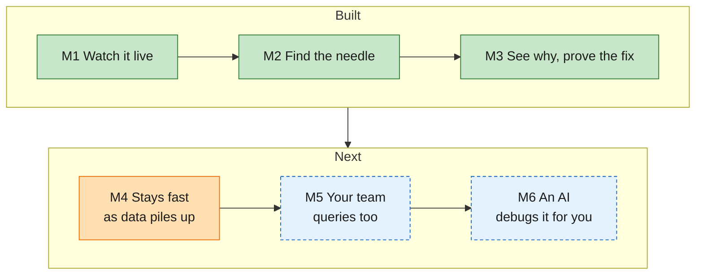

*Green: built. Orange: in progress. Dashed blue: planned.*

| Milestone | What you get | Questions | Status |
|---|---|---|---|
| **M1** See an agent trace live | Point your agent at Smithling with one setting and watch every step appear as it happens: the tree, the timing, each step's full input and output. Nothing Smithling confirmed is lost in a crash. | 1 | ✅ built |
| **M2** Keep everything, find anything | Months of runs stay on disk. Narrow them down by clicking: any field, any key inside the JSON, conditions on a whole trace. Every view is a link you can share. | 2, 4, 5 | ✅ built |
| **M3** Search, add it up, compare | Search every word your agent read or wrote. Error rate, latency percentiles, tokens and cost by any field, as tables and charts. Put two batches side by side. | 3, 7 | ✅ built |
| **M4** Compaction | Small files are merged in the background, so reads stay fast and answers stay identical as data piles up, through crashes and long queries. | all, at scale | 🟠 in progress |
| **M5** Read workers | Start read-only copies on the same storage for heavy queries; the writer keeps taking traces as before. | all, for a team | spec and plan drafted |
| **M6** Agents debugging agents | Import your Claude Code sessions with no setup; let an AI agent investigate traces through tools and cite the runs. | 1–7, asked by an agent | planned |

### The setup

You've built a **research agent**. Last night it ran **batch a**: 200 research tasks, each searching the web, fetching
pages with a `fetch_url` tool and asking an LLM to summarize. This morning the batch looks bad and you don't know why.
You'll fix a bug, and **batch b** runs with the fix. The numbers below are the ones `smithling demo` plants and checks.

```bash
./target/release/smithling serve                               # terminal 1
./target/release/smithling demo --url http://localhost:7070    # terminal 2: loads the data, checks 10 numbers
```

Then open **http://localhost:7070/scenarios**: one card per question, one click each. Orange boxes in the screenshots
mark what to look at.

### M1: See an agent trace live ✅

> *As an agent developer, I change one setting, and every step my agent takes shows up in my browser within a second.*

You start a job. A run appears marked **running**, and its steps fill in as a tree with a timing bar each: search,
fetch, fetch, LLM. Forty minutes later it flips to **ok**. You click one `fetch_url` step and read the full 40 KB page
it got back. Then you pull the power cord mid-run: after the restart, nothing Smithling confirmed is missing.

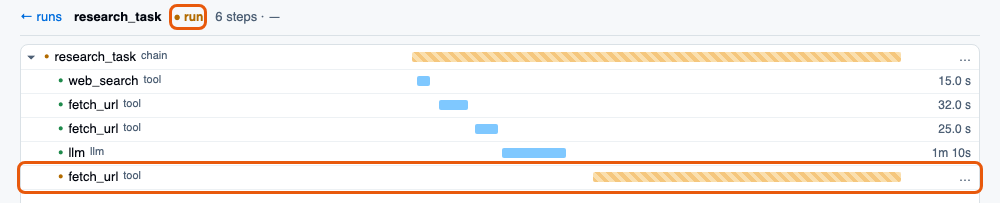

*Still running: the task and its last `fetch_url` show `run`, and their bars keep growing until they finish.*

#### Question 1: Show me this one

Open the slowest failed task of batch a, then any step's full input. Smithling shows the trace tree, a timing
waterfall, and each step's inputs and outputs.

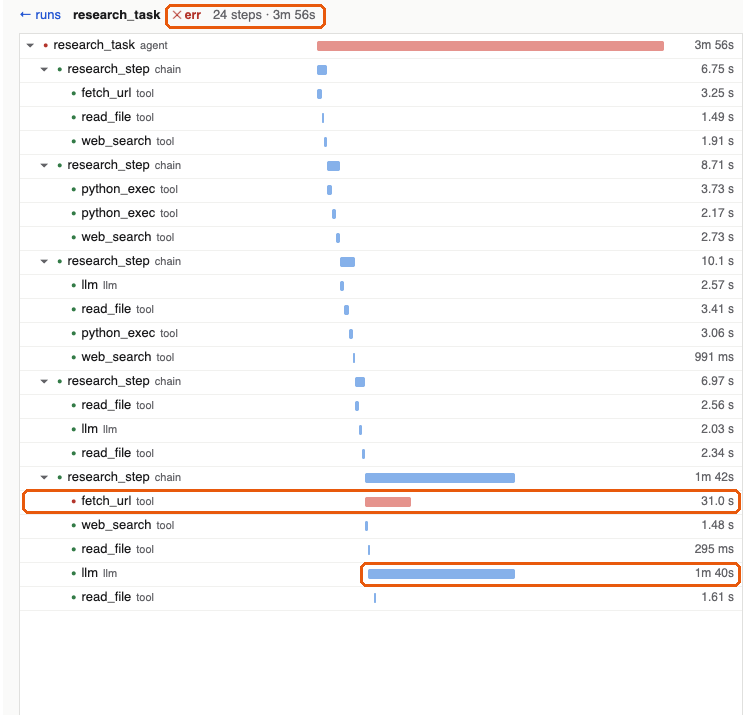

*A failed task, 24 steps in 3m 56s. The red `fetch_url` in the last step is where it broke; the long `llm` bar
beside it is where the time went.*

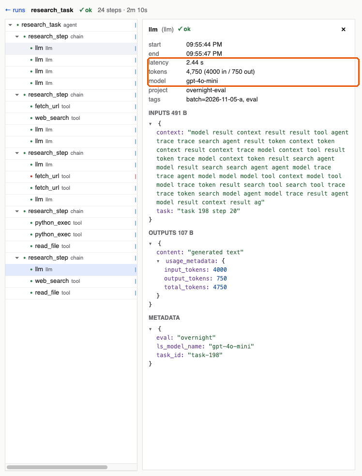

*Click any step to read it whole: 2.44 s, 4,750 tokens on `gpt-4o-mini`, its inputs, outputs and metadata.*

### M2: Keep everything, find anything ✅

> *As an agent developer, I can narrow millions of runs down to the handful I care about, by clicking.*

Click *last night's batch*, then *errored*: **14 runs**. Then a sneakier question: *which tasks said "success" but had
a failing tool inside?* **23**, the quiet failures you'd never have noticed. A side panel shows
`prompt_version: v7 (912), v6 (928)`; one click filters on `v7`. You send a teammate the link and it opens the same
view.

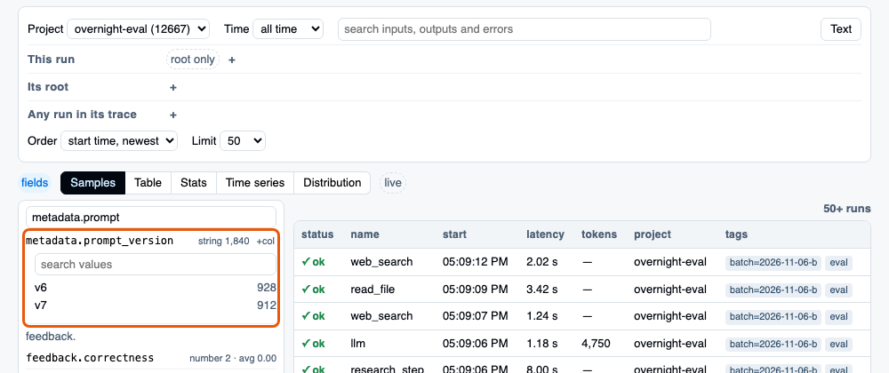

*Every field in your data, with its most common values and counts. Click one to filter on it.*

#### Question 2: Narrow it down

Failed steps in batch a that took longer than 2 s. Filter on any field, by clicking or as text.

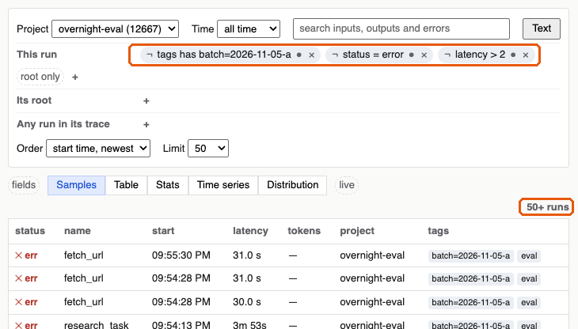

*Three clicks, three conditions: the `fetch_url` steps that hit a 429 or a 30 s timeout, and the failed tasks above
them (56 runs; the list stops at the page limit of 50).*

#### Question 4: Look inside the JSON

Runs on `metadata.prompt_version = v7` whose output had `status_code = 429` (19 in batch a). Filter on fields inside
the metadata, input and output JSON. The step opened under question 5 is one of them.

#### Question 5: Think in trees

Tasks that finished ok although a step inside them failed (23 of them). Put conditions on a trace's root or on any run
in it.

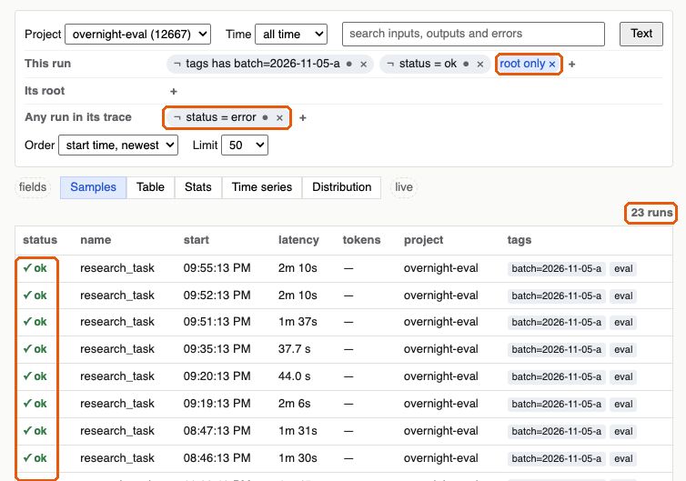

*Two rows of conditions: the root says `status = ok`, and some run in its trace says `status = error`. 23 tasks, every
one marked ✓ ok. Open one:*

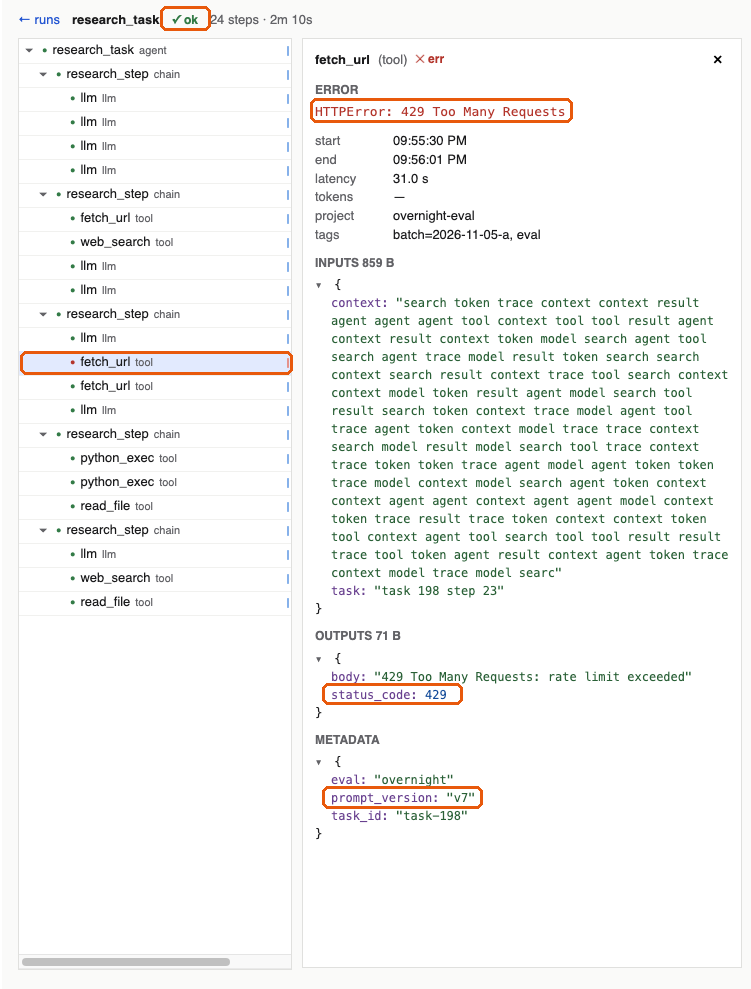

*The task says ✓ ok, but one `fetch_url` inside it failed with a 429. Its `outputs.status_code` and
`metadata.prompt_version` are the fields question 4 filters on.*

### M3: Search, add it up, compare ✅

> *As an agent developer, I can search everything my agent read and wrote, and put numbers on what went wrong.*

Search for **"429 Too Many Requests"**: **31 runs**, all `fetch_url`. The website was rate-limiting you. Group by tool:
`fetch_url` fails **14%** of the time and its slowest 5% take **31 s**; the batch cost **$4.12**. You add a retry and
run batch b. Side by side: **14% → 2%** errors, **31 s → 9 s**. Proof on one screen, not a hunch.

#### Question 3: Find the text

Runs mentioning "429 Too Many Requests". Smithling searches inputs, outputs and errors, and highlights each match.

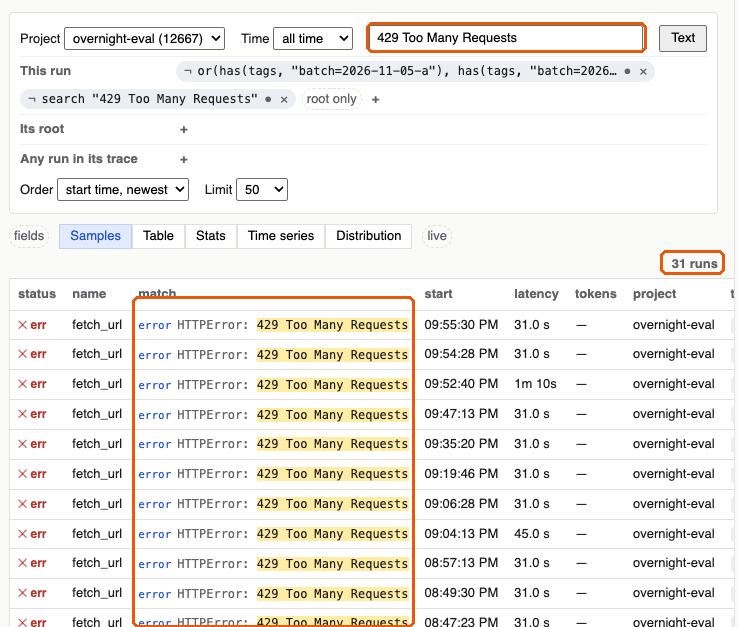

*31 hits, every one a `fetch_url` failing with `HTTPError: 429`. The agent is being rate limited.*

#### Question 7: Add it up

Per step name: how often it fails, how slow it is, what it costs. Smithling shows stats, time series and distributions.

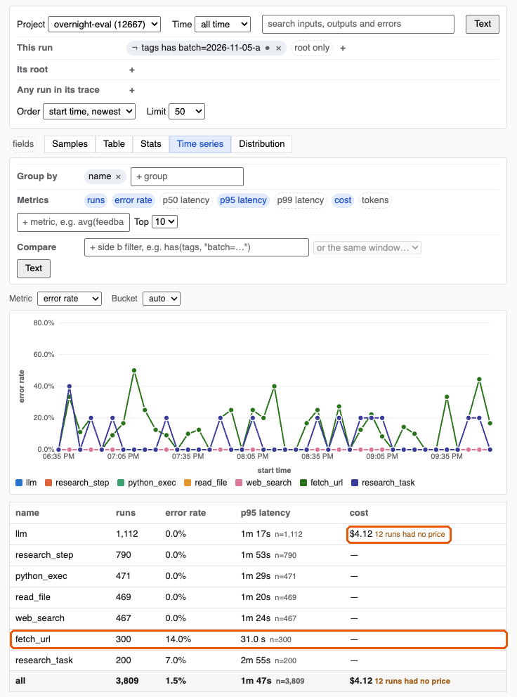

*`fetch_url` fails 14% of the time with a p95 of 31 s; the model calls cost $4.12 for the batch.*

#### Bonus: did the fix work?

Compare batch a with batch b, after the fix, side by side.

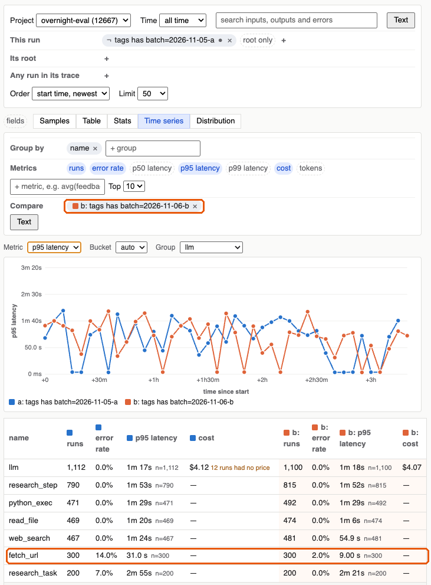

*`fetch_url` errors drop from 14% to 2% and its p95 from 31 s to 9 s; failed tasks go from 7% to none.*

### M4: Compaction 🟠 in progress

> *As an agent developer, I get the same fast answers at a million runs as at a thousand, and never have to think
> about why.*

Months of nightly batches leave thousands of small files. You notice nothing: in the background, Smithling merges
them into about **a tenth as many**, and every answer stays exactly the same. A job whose last step arrived hours
late still shows the right result. Kill Smithling in the middle of a merge and nothing is lost; a long query left
running finishes normally, even though the files under it were replaced.

**Try it**: start `smithling serve --memtable 256KB` and run `smithling demo --url http://localhost:7070 --compact`.
The 10 checks pass, compaction runs, they pass again with **all the same answers**, and the demo reports
**83 data files → 8** (9% of before). In the browser, a new storage line shows it:

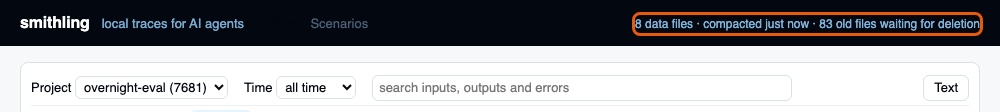

Step by step: [the M4 demo](specs/004-m4-compaction/plan.md#the-m4-demo-what-youll-see).

### M5: Read workers (spec and plan drafted)

> *As an operator, I can add read-only copies for heavy queries, and the one taking writes never notices.*

The whole team uses it now. You start **two readers** from the same program, on the same storage. Dashboards and big
comparisons go to them; live tracing stays on the writer, still about a second behind. You restart a reader at lunch
and the writer doesn't notice. Someone starts a second writer by mistake, and it refuses to start.

### M6: Agents debugging agents (planned)

> *As an agent developer, I can ask an AI "why did last night's batch fail?" and get an answer with links to the
> evidence.*

You import your own Claude Code sessions with no setup and ask *"which session ran the failing `cargo test`, and what
did the agent do just before?"* Then you ask an AI assistant about batch a. It works through the traces with tools
sized for it, answers *rate limiting on `fetch_url`*, and cites the **31 runs**. You click through to check its work.

### Not yet, and why

Question 6, **rebuild the conversation** (all turns of one chat, in order), needs conversation threads, which are in
the backlog. Also deferred: export, feedback from the UI and "what stands out" (moved out of M4,
[D-038](specs/000-smithling-master-plan/decisions.md#d-038)); a full 2M-run benchmark and the idle-memory target
(re-evaluated before M5's plan); delete and retention. Status and plans:
[roadmap](specs/000-smithling-master-plan/roadmap.md) · what changed: [CHANGELOG.md](CHANGELOG.md).

---

## Contributing

```bash
cargo test --workspace && (cd ui && npm test)
```

Read [AGENTS.md](AGENTS.md) before a change (checks to run, and how the changelog and decision log are kept). Build
and test details are in [USAGE.md](USAGE.md#building-and-developing).

## License and security

[MIT](LICENSE). Smithling is a local, single-user tool with no login: read [SECURITY.md](SECURITY.md) before exposing
it beyond `127.0.0.1`.

---

## Personal notes: why I'm doing this experiment

Why rebuild something that already exists? Because building a thing is the best way I know to understand it.
Smithling isn't meant to compete with SmithDB; it's how I'm learning it.

I came to this as a user first. I build agents with LangChain and really enjoy it, and LangSmith is where I watch them
run. Then I read the SmithDB post and kept recognizing words: write-ahead log, memtables, immutable files,
compaction, pinned versions. I've worked on storage engines like RocksDB, so that skeleton felt familiar.

But SmithDB is columnar, and that's a different world. I've always been amazed by how fast columnar systems are: with
tools like Facebook's Scuba, you ask a question over a huge pile of events and the answer comes back almost before
you've finished typing. A key-value engine and a columnar one share the same skeleton, yet each bends every piece of
it toward a different job. I knew they were very different; rebuilding SmithDB was a way to find out exactly where
they meet and where they part.

The part I find most interesting is the collision: a database on one side, an agent on the other. Agents produce
deep, tree-shaped traces whose pieces arrive minutes apart, and people read them with questions a key-value store was
never built for. I want to see how the two shape each other: what an agent's data demands from storage, and what
storage makes cheap or hard to ask about an agent. Once the store works, the agent can turn around and use it (M6).

I started with something small: one program, one folder, on my laptop. Each milestone fixed one thing that was
broken:

- ✅ **M1, see an agent trace live**: you can't fix what you can't see. Point an unchanged agent at Smithling, watch
  every step appear, and lose nothing on a crash.
- ✅ **M2, durable storage and a query builder**: memory forgets; disk remembers. Keep millions of runs on disk and find
  any of them by clicking.
- ✅ **M3, search, aggregates and speed**: find the needle, then count the haystack. Search the text, add it up, compare
  batches.
- 🟠 **M4, compaction**: every flush leaves a crumb. Merge small files into big ones and store each run whole. In
  progress.
- 🔜 **M5, a disaggregated trace database**: reads and writes stop fighting over one box. Step 1: read workers over
  shared storage, beside the writer. Spec and plan drafted.
- 💭 **M6, agents debugging agents**: let an agent answer "why did batch a fail?" and cite the runs. Not started.

Then, with a slightly inflated ego, I started asking: what if this had to scale? What would have to change? That
question became M5. It's specced, not built, and it has already made me think harder about the problem than anything
else in this project: storage and compute on separate machines, each scaling on its own.

My favorite rule in system design has always been **think big, but start incrementally**. Smithling started light,
and building it raised the interesting questions on its own, one step at a time: why the memtable shouldn't be
sorted, why files should be grouped by trace instead of by time, why bloom filters can't find words. I think that's
the best way to learn anything.

If you know RocksDB, [ROCKSDB_COMPARISON.md](ROCKSDB_COMPARISON.md) is the long version of this note.
