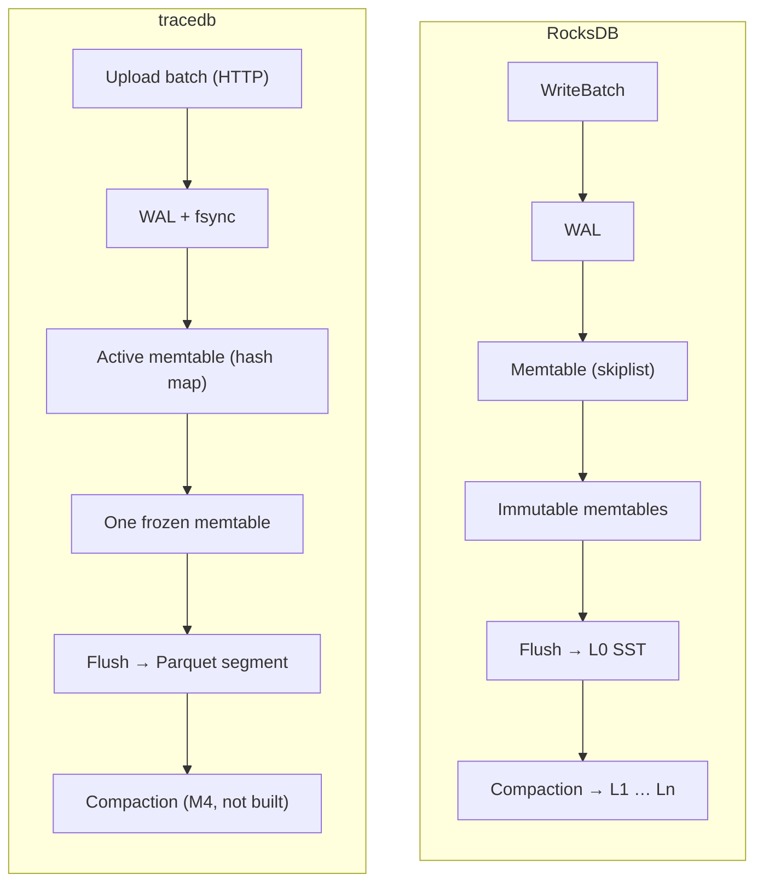
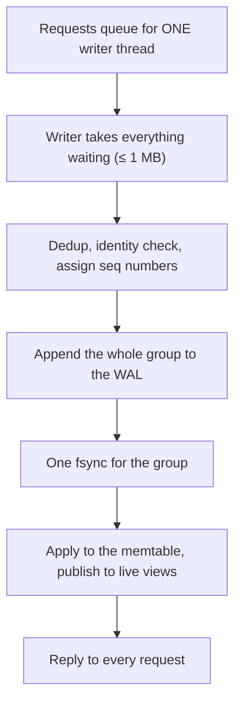
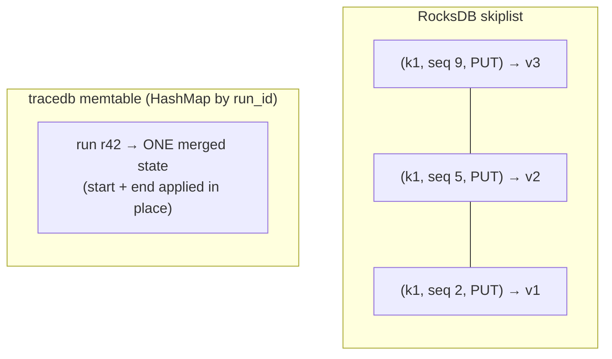
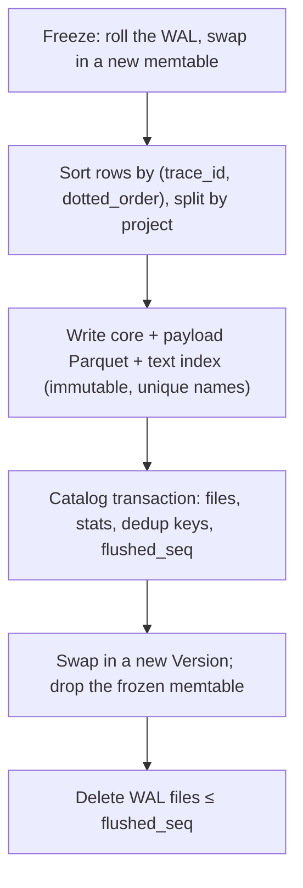
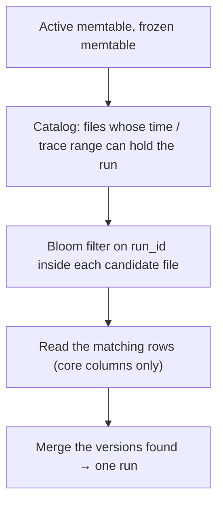

# tracedb for RocksDB people

You know RocksDB's internals: memtables, immutable memtables, SSTs, the MANIFEST, SuperVersions, compaction, write
stalls. tracedb is built on the same LSM ideas, but stores **columnar Parquet files** for an **analytics** workload
instead of row-oriented SSTs for a **key-value** workload. This guide walks the familiar path, part by part, and
marks where tracedb does the same thing, a different thing, or nothing yet.

If columnar storage itself is new to you, read [SECRET_OF_COLUMNAR_DB.md](SECRET_OF_COLUMNAR_DB.md) first (15
minutes, with a runnable example). For the product and its milestones, see [STARTER_GUIDE.md](STARTER_GUIDE.md).

Legend used in the tables: **same** = same idea, **different** = same role, different design, **missing** = not
built (yet).

---

## 1. The one-minute version

| | RocksDB | tracedb |
|---|---|---|
| Data model | opaque byte keys → byte values | typed rows: one *run* (agent step) with ~40 columns |
| Workload | point gets, range scans, high write rate | high write rate, then filter / group / aggregate over millions of rows |
| Log | WAL, `sync` optional per write | WAL, **always fsynced** before "OK" (group commit) |
| Memtable | skiplist, sorted, every version kept | hash map, **unsorted**, one *merged* state per run |
| Immutable memtables | a list (`max_write_buffer_number`) | **at most one** frozen memtable |
| File format | SST: sorted key/value blocks | **Parquet**: columnar, sorted by `(trace_id, dotted_order)` |
| File list | MANIFEST (log of VersionEdits) | **SQL catalog** (SQLite / Postgres), one transaction per flush |
| Reader snapshot | SuperVersion + sequence-number snapshot | pinned `Version` + copies of memtable rows |
| Combining versions | newest seqno wins, or a merge operator | built-in **field-by-field merge** at read time |
| Compaction | leveled / universal / FIFO | **missing** (planned for M4: time-tiered) |
| Query engine | iterators | **Apache DataFusion** scans + tracedb's own merge and filter |

The short version: tracedb is an LSM whose SSTs are Parquet files, sorted by trace for locality, pruned by time
through a SQL manifest, merged per run field by field, and read by an analytics engine instead of an iterator.
Every file today is effectively L0.

---

## 2. The shape, side by side

Same skeleton. The interesting differences are inside each box.

---

## 3. Write path: WAL and group commit

| | RocksDB | tracedb | |
|---|---|---|---|
| Who writes | write thread: a leader writes the group's WAL records (`JoinBatchGroup`) | one dedicated writer thread owns the WAL and memtable ([writer.rs](crates/ingest/src/writer.rs)) | same idea |
| Durability | `WriteOptions::sync` defaults to false | every acknowledged write is fsynced; there is no "fast, unsynced" mode | **different** |
| Group commit | followers piggyback on the leader's write/sync | requests that queue during one fsync share the next; no fixed wait | same |
| Sequence numbers | per write, part of the internal key | per event (`event_seq`), defines merge order | same |
| Dedup | none (the app's job) | retries dropped by `(run_id, op, body hash)` for 10 min | **different** (tracedb-specific) |
| WAL files | one per memtable switch, deleted when every CF is flushed past it | rolled at every freeze, deleted whole once that memtable is registered | same |

Why always fsync: the client is an SDK that will retry anyway, so tracedb trades a few ms per group for a simple
promise ("OK" means on disk), and gets the throughput back through group commit (74k events/s measured in M1).

---

## 4. The memtable: merged, not versioned

This is the biggest internal difference.

| | RocksDB | tracedb |
|---|---|---|
| Structure | concurrent skiplist (sorted by internal key) | `HashMap<RunId, RunState>` plus small indexes by trace and root ([store.rs](crates/ingest/src/store.rs)) |
| An update to an existing key | inserts a new entry with a higher seqno | **merges into the existing entry** in place (the merge rule, [merge.rs](crates/model/src/merge.rs)) |
| Sorted when? | at insert | **at flush** (rows sorted by `(trace_id, dotted_order)`) |
| Size accounting | arena bytes (`write_buffer_size`) | heap bytes of the runs (`--memtable`, default 64 MB) |
| Flush triggers | buffer full; WAL size; manual | full, **or oldest event ≥ `--flush-age` (2 min)**, or unflushed WAL ≥ half its cap |

Why merge in place: a run's start and end arrive minutes apart, and readers want the *current* state of each run.
Keeping one merged state per run in memory means every read of fresh data is already merged, and the memtable holds
one row per run, not one per event.

Why an **age** trigger: on a quiet server a size-only rule could leave data unflushed for days; the age bounds how
stale the WAL-only data gets.

---

## 5. Immutable memtable and flush

| | RocksDB | tracedb | |
|---|---|---|---|
| Count | up to `max_write_buffer_number - 1` immutables | **one** frozen memtable; a second freeze waits | **different** |
| When full and flush can't keep up | write stall / slowdown | writer answers `429` + `Retry-After` (the SDK retries) | same idea (R-8) |
| Flush output | one L0 SST | one segment **per project**: `core.parquet`, `payload.parquet`, plus a text index (`.fts.dict.parquet`, `.fts.post`) | **different** |
| Making it visible | VersionEdit appended to the MANIFEST | **one SQL transaction**: register files, field stats, dedup keys, `flushed_seq` | **different** |

Crash at any step leaves data in the WAL, in registered files, or both. Files written but not registered are
orphans, deleted on start (RocksDB's "delete obsolete files not in the MANIFEST", same idea). Code:
[flush.rs](crates/ingest/src/flush.rs).

---

## 6. The files: SST vs Parquet

| | SST | Parquet segment |
|---|---|---|
| Layout | rows: a key and its whole value together | **columns**: all `status` values together, all `latency_ms` together, … |
| Built for | `Get(key)`, `Seek` + `Next` in key order | "read 3 of 40 columns for 2M rows, skip what can't match" |
| Index | index block → data block by key | footer min/max per row group and page, page index, column blooms |
| Compression | per block (LZ4/ZSTD), prefix-compressed keys | per page (ZSTD) after **dictionary + run-length encoding** per column |
| Big values | inline, or BlobDB blob files | separate `payload.parquet` (inputs, outputs, events), linked by row number: the BlobDB idea, per segment |

Why columnar: the questions are "errors in the last 12 h, p95 latency by tool". A row store reads every value of every
matching row, including megabyte prompts. A column store reads only the columns the query names, compresses
repetitive columns (`status`, `name`) to almost nothing, and can skip row groups from their statistics alone. The
[columnar primer](SECRET_OF_COLUMNAR_DB.md) shows this with real numbers.

---

## 7. Keys: one key vs three roles

RocksDB's key does everything: sort order, lookup key and the unit of versioning. tracedb splits those roles:

| Role | RocksDB | tracedb |
|---|---|---|
| Sort order inside a file | user key | `(trace_id, dotted_order)`: a whole trace sits together, in tree order |
| Unit of versioning / merge | user key | `run_id` |
| File pruning | smallest/largest key per file | catalog min/max of `start_key` (the run's start time), `trace_id`, plus project |

So file pruning isn't "is my key in this file's range?" but "does this file overlap my time window, project or trace
range?". Trace ids are UUIDv7 (time-prefixed), so time and trace ranges line up.

---

## 8. Snapshots: SuperVersion vs pin

| | RocksDB | tracedb | |
|---|---|---|---|
| File set held by a reader | Version, ref-counted | `Arc<Version>` ([memtable.rs](crates/ingest/src/memtable.rs)) | same (R-7) |
| Memtables held | mem + imm in the SuperVersion | frozen memtable `Arc` + **copies** of active-memtable rows | **different** |
| Point-in-time | seqno snapshot, any number of them | no seqno snapshots; consistency comes from taking files + memtables under one lock (D-015) | **different** |
| Obsolete files | deleted when no Version references them | same rule; nothing deletes files until compaction exists | same |

The copy is the price of the in-place merge: the active memtable's entries change, so a query copies what it needs
instead of reading a versioned structure.

---

## 9. Reads: iterator vs scan, merge operator vs merge rule

A **point lookup** looks familiar:

A **filtered list** is where tracedb departs from iterators:

| Step | RocksDB analogue | tracedb |
|---|---|---|
| choose files | key-range check per file | catalog ranges: project, `start_key` window, trace range |
| inside a file | index block + filter block | DataFusion: footer stats skip row groups, page index skips pages, blooms for id lookups, decode filter columns first |
| combine sources | `MergingIterator` in key order | hash-group rows by `run_id`; **only runs that may be split** (`needs_merge`, ~10%) are merged |
| filter | app code on each kv | **after** the merge, by tracedb's evaluator (DataFusion only pre-filters a superset) |
| stop early | stop iterating | newest-first `start_key` windows (~20k rows, then ×4), stop at a full page |

**Merge operator vs merge rule.** RocksDB's merge operator stores operands and folds them at read and compaction
time. tracedb's rule is built in and field-wise: sort a run's versions by sequence, then for each field the newest
version that *set* it wins (a `present` bitmask records which fields each version set); identity fields keep the first
value; status and latency are recomputed. Conceptually it's a full-merge operator for one fixed schema.

**Why filter after merging**: a run's start (in a file) says `running`; its end (in the memtable) says `error`.
Filtering the file row alone for `status = error` would drop it. So rows that may have other versions always pass
the pre-filter, and the exact filter runs on merged runs.

---

## 10. Compaction: the missing piece

| | RocksDB | tracedb today | tracedb plan (M4) |
|---|---|---|---|
| Strategy | leveled (L1+ non-overlapping), universal, FIFO | none: every file is effectively **L0** (overlapping ranges) | **time-tiered**: T0 flushes → T1 ~15-min files → T2 daily ~256 MB files |
| Version folding | yes (keeps what snapshots need) | no: a split run stays split | write one merged row per run, clear `needs_merge` |
| Deletes | tombstones, range deletes | none (backlog B1: delete vectors + TTL) | apply delete vectors and TTL while rewriting |
| Swap | VersionEdit in the MANIFEST | — | one catalog transaction: new files `active`, old `tombstoned`; delete when no `Version` pins them |

Consequences of "all L0" today: file count only grows, every in-scope file's footer is read, and split runs pay the
merge on every read (and hold memory, which is why idle memory is above target until M4). The plan sorts by *time*
rather than key because queries are time-scoped and old data stops changing; that's closer to Cassandra's
time-window compaction than to leveled compaction. RocksDB-style FIFO/TTL compaction was considered and not adopted:
late updates mean an old run can have a version in a new file, so dropping files purely by age would be wrong.

---

## 11. Smaller parts

| Part | RocksDB | tracedb | |
|---|---|---|---|
| Block cache | LRU / HyperClock for data, index, filter blocks | 32 MB memory cache for footers, page indexes, text-index pages, payload ranges ([cache.rs](crates/storage/src/cache.rs)) | same idea |
| Column families | separate memtables + SSTs, shared WAL | projects: **shared** memtable and WAL, separate files per project | **different** |
| Recovery | replay WAL from the MANIFEST's log number | replay WAL records with seq > the catalog's `flushed_seq` | same |
| DB lock | `LOCK` file | `<data>/LOCK`, held for the process's life | same |
| Bloom filters | per SST (or per block) | Parquet blooms on `run_id`, `trace_id` per file (R-9) | same idea |
| Object storage | via env / remote compaction | data files on a folder or S3 (`object_store`), catalog in Postgres, WAL stays local | **different** |
| Text search | — | per-file inverted index (dictionary + postings), no positions | tracedb-specific |

---

## 12. What tracedb borrowed from RocksDB, on purpose

From the roadmap's backlog of LSM ideas ([roadmap](specs/000-tracedb-master-plan/roadmap.md)), all built in M2:

| # | RocksDB idea | tracedb |
|---|---|---|
| R-7 | pinned versions for readers | `Arc<Version>`; files deleted only when unpinned |
| R-8 | write slowdown | `429` + `Retry-After` when the frozen memtable is still flushing and the new one is full, or the unflushed WAL is over its cap |
| R-9 | key bloom filters | Parquet blooms on `run_id`, `trace_id` |
| R-10 | two memtables | active + frozen, so ingest never pauses for a flush |

Not adopted: compaction I/O rate limiting, BlobDB garbage collection, checkpoints, the merge-operator API, FIFO/TTL
compaction.

---

## 13. Reading the code with RocksDB in mind

| RocksDB concept | Start here |
|---|---|
| `DBImpl::WriteImpl`, write thread | [crates/ingest/src/writer.rs](crates/ingest/src/writer.rs) |
| `log::Writer` | [crates/ingest/src/wal.rs](crates/ingest/src/wal.rs) |
| `MemTable` | [crates/ingest/src/store.rs](crates/ingest/src/store.rs), [memtable.rs](crates/ingest/src/memtable.rs) |
| `FlushJob` | [crates/ingest/src/flush.rs](crates/ingest/src/flush.rs) |
| `BlockBasedTableBuilder` | [crates/storage/src/segment.rs](crates/storage/src/segment.rs) |
| `VersionSet` / MANIFEST | [crates/storage/src/metastore.rs](crates/storage/src/metastore.rs) + `Version` in memtable.rs |
| `DBImpl::Recover` | [crates/ingest/src/recover.rs](crates/ingest/src/recover.rs) |
| `MergingIterator`, merge operator | [crates/query/src/scan.rs](crates/query/src/scan.rs), [crates/model/src/merge.rs](crates/model/src/merge.rs) |
| `BlockCache` | [crates/storage/src/cache.rs](crates/storage/src/cache.rs) |
