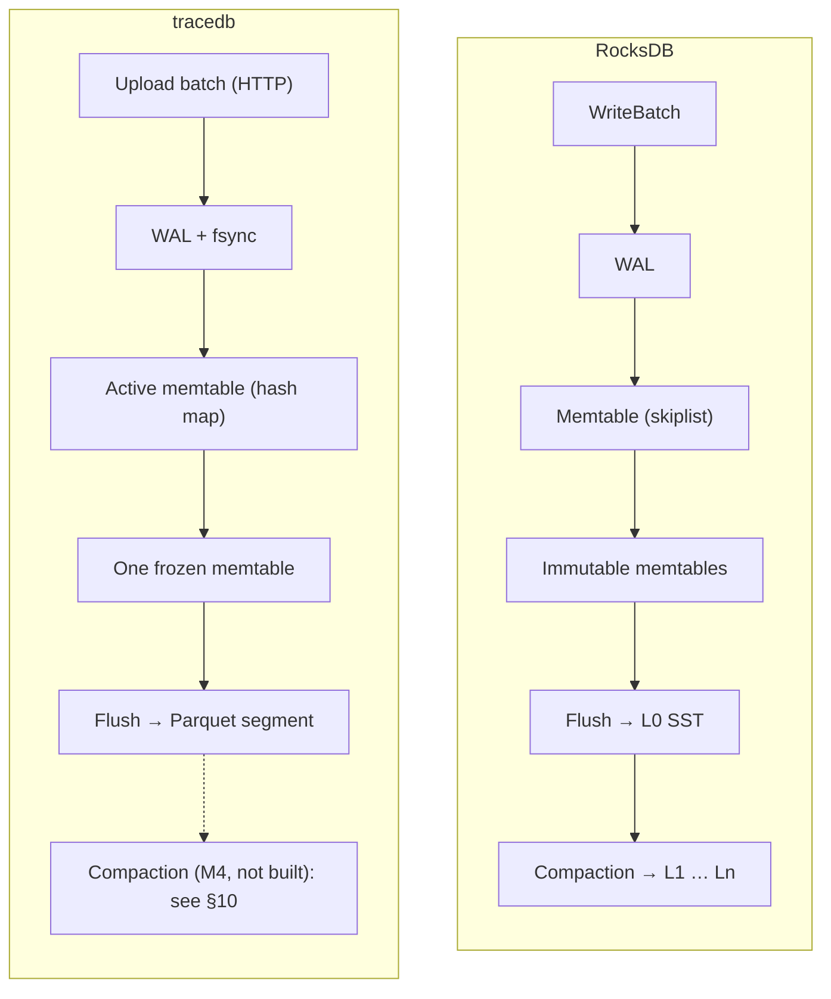
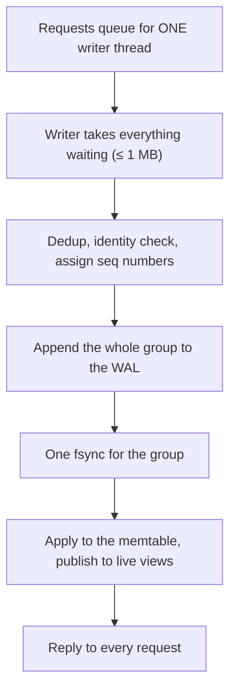
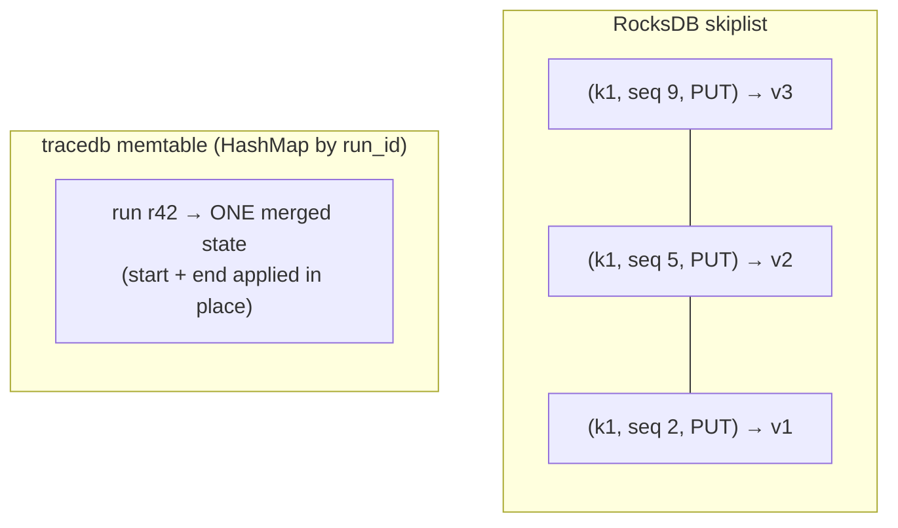
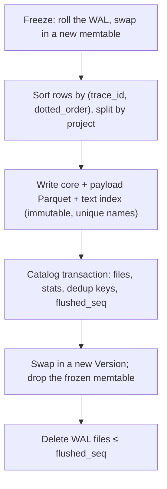
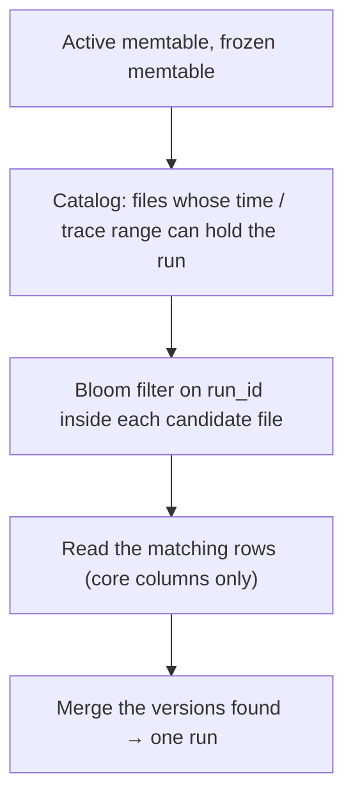
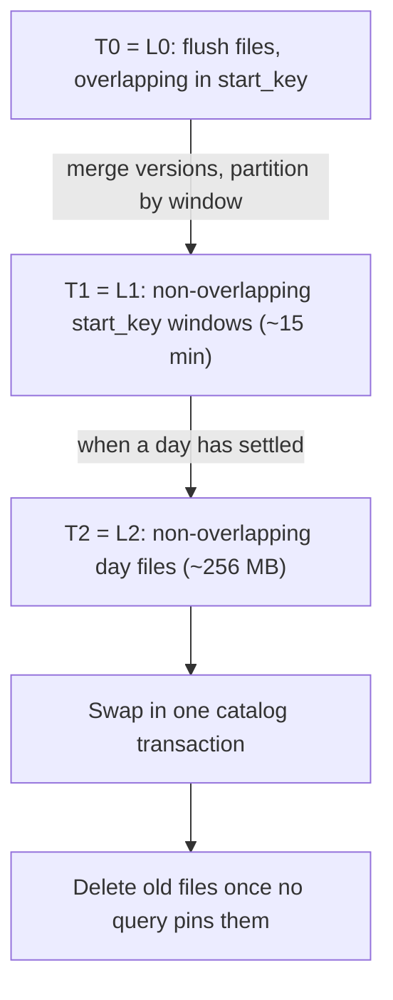
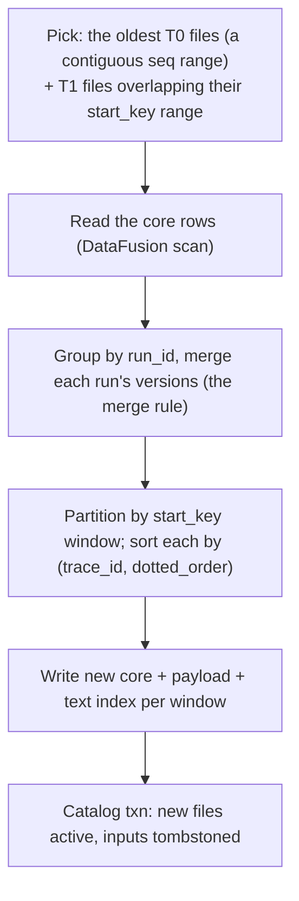

# tracedb for RocksDB people

You know RocksDB's internals: memtables, immutable memtables, SSTs, the MANIFEST, SuperVersions, compaction, write
stalls. tracedb is built on the same LSM ideas, but stores **columnar Parquet files** for an **analytics** workload
instead of row-oriented SSTs for a **key-value** workload. This guide walks the familiar path, part by part, and
marks where tracedb does the same thing, a different thing, or nothing yet.

If columnar storage itself is new to you, read [SECRET_OF_COLUMNAR_DB.md](SECRET_OF_COLUMNAR_DB.md) first (15
minutes, with a runnable example). For the product and its milestones, see [STARTER_GUIDE.md](STARTER_GUIDE.md).

Legend used in the tables: **same** = same idea, **different** = same role, different design, **missing** = not
built (yet).

---

## 1. The one-minute version

| | RocksDB | tracedb |
|---|---|---|
| Data model | opaque byte keys → byte values | typed rows: one *run* (agent step) with ~40 columns |
| Workload | point gets, range scans, high write rate | high write rate, then filter / group / aggregate over millions of rows |
| Log | WAL, `sync` optional per write | WAL, **always fsynced** before "OK" (group commit) |
| Memtable | skiplist, sorted, every version kept | hash map, **unsorted**, one *merged* state per run |
| Immutable memtables | a list (`max_write_buffer_number`) | **at most one** frozen memtable |
| File format | SST: sorted key/value blocks | **Parquet**: columnar, sorted by `(trace_id, dotted_order)` |
| File list | MANIFEST (log of VersionEdits) | **SQL catalog** (SQLite / Postgres), one transaction per flush |
| Reader snapshot | SuperVersion + sequence-number snapshot | pinned `Version` + copies of memtable rows |
| Combining versions | newest seqno wins, or a merge operator | built-in **field-by-field merge** at read time |
| Compaction | leveled / universal / FIFO | **not built**; proposed for M4: leveled by start time (§10) |
| Query engine | iterators | **Apache DataFusion** scans + tracedb's own merge and filter |

The short version: tracedb is an LSM whose SSTs are Parquet files, sorted by trace for locality, pruned by time
through a SQL manifest, merged per run field by field, and read by an analytics engine instead of an iterator.
Every file today is effectively L0.

---

## 2. The shape, side by side

Same skeleton. The interesting differences are inside each box.

---

## 3. Write path: WAL and group commit

| | RocksDB | tracedb | |
|---|---|---|---|
| Who writes | write thread: a leader writes the group's WAL records (`JoinBatchGroup`) | one dedicated writer thread owns the WAL and memtable ([writer.rs](crates/ingest/src/writer.rs)) | same idea |
| Durability | `WriteOptions::sync` defaults to false | every acknowledged write is fsynced; there is no "fast, unsynced" mode | **different** |
| Group commit | followers piggyback on the leader's write/sync | requests that queue during one fsync share the next; no fixed wait | same |
| Sequence numbers | per write, part of the internal key | per event (`event_seq`), defines merge order | same |
| Dedup | none (the app's job) | retries dropped by `(run_id, op, body hash)` for 10 min | **different** (tracedb-specific) |
| WAL files | one per memtable switch, deleted when every CF is flushed past it | rolled at every freeze, deleted whole once that memtable is registered | same |

Why always fsync: the client is an SDK that will retry anyway, so tracedb trades a few ms per group for a simple
promise ("OK" means on disk), and gets the throughput back through group commit (74k events/s measured in M1).

---

## 4. The memtable: merged, not versioned

This is the biggest internal difference.

| | RocksDB | tracedb |
|---|---|---|
| Structure | concurrent skiplist (sorted by internal key) | `HashMap<RunId, RunState>` plus small indexes by trace and root ([store.rs](crates/ingest/src/store.rs)) |
| An update to an existing key | inserts a new entry with a higher seqno | **merges into the existing entry** in place (the merge rule, [merge.rs](crates/model/src/merge.rs)) |
| Sorted when? | at insert | **at flush** (rows sorted by `(trace_id, dotted_order)`) |
| Size accounting | arena bytes (`write_buffer_size`) | heap bytes of the runs (`--memtable`, default 64 MB) |
| Flush triggers | buffer full; WAL size; manual | full, **or oldest event ≥ `--flush-age` (2 min)**, or unflushed WAL ≥ half its cap |

Why merge in place: a run's start and end arrive minutes apart, and readers want the *current* state of each run.
Keeping one merged state per run in memory means every read of fresh data is already merged, and the memtable holds
one row per run, not one per event.

Why an **age** trigger: on a quiet server a size-only rule could leave data unflushed for days; the age bounds how
stale the WAL-only data gets.

---

## 5. Immutable memtable and flush

| | RocksDB | tracedb | |
|---|---|---|---|
| Count | up to `max_write_buffer_number - 1` immutables | **one** frozen memtable; a second freeze waits | **different** |
| When full and flush can't keep up | write stall / slowdown | writer answers `429` + `Retry-After` (the SDK retries) | same idea (R-8) |
| Flush output | one L0 SST | one segment **per project**: `core.parquet`, `payload.parquet`, plus a text index (`.fts.dict.parquet`, `.fts.post`) | **different** |
| Making it visible | VersionEdit appended to the MANIFEST | **one SQL transaction**: register files, field stats, dedup keys, `flushed_seq` | **different** |

Crash at any step leaves data in the WAL, in registered files, or both. Files written but not registered are
orphans, deleted on start (RocksDB's "delete obsolete files not in the MANIFEST", same idea). Code:
[flush.rs](crates/ingest/src/flush.rs).

---

## 6. The files: SST vs Parquet

| | SST | Parquet segment |
|---|---|---|
| Layout | rows: a key and its whole value together | **columns**: all `status` values together, all `latency_ms` together, … |
| Built for | `Get(key)`, `Seek` + `Next` in key order | "read 3 of 40 columns for 2M rows, skip what can't match" |
| Index | index block → data block by key | footer min/max per row group and page, page index, column blooms |
| Compression | per block (LZ4/ZSTD), prefix-compressed keys | per page (ZSTD) after **dictionary + run-length encoding** per column |
| Big values | inline, or BlobDB blob files | separate `payload.parquet` (inputs, outputs, events), linked by row number: the BlobDB idea, per segment |

Why columnar: the questions are "errors in the last 12 h, p95 latency by tool". A row store reads every value of every
matching row, including megabyte prompts. A column store reads only the columns the query names, compresses
repetitive columns (`status`, `name`) to almost nothing, and can skip row groups from their statistics alone. The
[columnar primer](SECRET_OF_COLUMNAR_DB.md) shows this with real numbers.

---

## 7. Keys: one key vs three roles

RocksDB's key does everything: sort order, lookup key and the unit of versioning. tracedb splits those roles:

| Role | RocksDB | tracedb |
|---|---|---|
| Sort order inside a file | user key | `(trace_id, dotted_order)`: a whole trace sits together, in tree order |
| Unit of versioning / merge | user key | `run_id` |
| File pruning | smallest/largest key per file | catalog min/max of `start_key` (the run's start time), `trace_id`, plus project |

So file pruning isn't "is my key in this file's range?" but "does this file overlap my time window, project or trace
range?". Trace ids are UUIDv7 (time-prefixed), so time and trace ranges line up.

---

## 8. Snapshots: SuperVersion vs pin

| | RocksDB | tracedb | |
|---|---|---|---|
| File set held by a reader | Version, ref-counted | `Arc<Version>` ([memtable.rs](crates/ingest/src/memtable.rs)) | same (R-7) |
| Memtables held | mem + imm in the SuperVersion | frozen memtable `Arc` + **copies** of active-memtable rows | **different** |
| Point-in-time | seqno snapshot, any number of them | no seqno snapshots; consistency comes from taking files + memtables under one lock (D-015) | **different** |
| Obsolete files | deleted when no Version references them | same rule; nothing deletes files until compaction exists | same |

The copy is the price of the in-place merge: the active memtable's entries change, so a query copies what it needs
instead of reading a versioned structure.

---

## 9. Reads: iterator vs scan, merge operator vs merge rule

A **point lookup** looks familiar:

A **filtered list** is where tracedb departs from iterators:

| Step | RocksDB analogue | tracedb |
|---|---|---|
| choose files | key-range check per file | catalog ranges: project, `start_key` window, trace range |
| inside a file | index block + filter block | DataFusion: footer stats skip row groups, page index skips pages, blooms for id lookups, decode filter columns first |
| combine sources | `MergingIterator` in key order | hash-group rows by `run_id`; **only runs that may be split** (`needs_merge`, ~10%) are merged |
| filter | app code on each kv | **after** the merge, by tracedb's evaluator (DataFusion only pre-filters a superset) |
| stop early | stop iterating | newest-first `start_key` windows (~20k rows, then ×4), stop at a full page |

**Merge operator vs merge rule.** RocksDB's merge operator stores operands and folds them at read and compaction
time. tracedb's rule is built in and field-wise: sort a run's versions by sequence, then for each field the newest
version that *set* it wins (a `present` bitmask records which fields each version set); identity fields keep the first
value; status and latency are recomputed. Conceptually it's a full-merge operator for one fixed schema.

**Why filter after merging**: a run's start (in a file) says `running`; its end (in the memtable) says `error`.
Filtering the file row alone for `status = error` would drop it. So rows that may have other versions always pass
the pre-filter, and the exact filter runs on merged runs.

---

## 10. Compaction: not built yet, and how we would build it

### Today: everything is L0

tracedb has no compaction. Every flush adds files that overlap in time with earlier ones, exactly like RocksDB's
L0, and nothing ever merges them. The costs are the ones a RocksDB person would predict:

| Symptom | RocksDB analogue | Effect in tracedb |
|---|---|---|
| file count only grows | L0 file count growing with compaction disabled | every in-scope file's footer is read; more catalog entries to prune |
| a run whose start and end were flushed apart stays split | versions of a key spread over many L0 files | every read of it fetches and merges both versions |
| memory held for split runs | — | the multi-version set and kept merged rows grow; the main reason idle memory is above target (D-028) |
| deletes and retention can't free space | tombstones that never get compacted away | backlog B1 is blocked on compaction |

### The idea: leveled compaction, where the "key" is time

The master design sketches **time-tiered** compaction (T0 flushes → T1 ~15-minute files → T2 daily ~256 MB files).
Seen from RocksDB, the cleanest reading of that sketch is **leveled compaction on `start_key`**, the run's own start
time:

Why `start_key` is the right key: **every version of a run carries the same `start_key`** (it comes from the run's
`dotted_order`, which a late update also sends). So if a compaction job takes *every* file that overlaps a
`start_key` window, it is guaranteed to see *every* stored version of every run in that window. RocksDB gets the same
guarantee from user keys: all versions of a key fall in the same key range.

### One compaction job, step by step

| Step | RocksDB analogue | tracedb detail |
|---|---|---|
| pick inputs | L0 → L1: all L0 files + overlapping L1 files | the oldest T0 files as a **contiguous sequence range** (see rule 1 below) + T1 files overlapping their `start_key` span |
| merge | `CompactionIterator` dropping shadowed versions | `merge_versions` per run; output is **one row per run** with `first_seq..last_seq` covering its inputs |
| output | SSTs cut at `target_file_size_base` | one file per (project, window), cut by row count; payload rows rewritten in the same order; text index and field stats rebuilt |
| install | VersionEdit to the MANIFEST | one catalog transaction (same shape as a flush); new `Version` swapped in |
| cleanup | obsolete files deleted when no Version refs them | files marked `tombstoned`, deleted when no pinned `Version` holds them (R-7, already built and tested) |

### The rules it has to follow

1. **Contiguous by sequence, oldest first.** The merge rule requires a run's versions to cover disjoint sequence
   ranges (`merge_versions` asserts it). If a job merged flushes 1 and 3 but skipped flush 2, the merged row's range
   would straddle flush 2's version of the same run. RocksDB has the same constraint for L0: files overlap, so L0
   compaction takes the oldest files in order.
2. **Never include the memtables.** Compaction only rewrites files. A late update that arrives during a job lands
   in the memtable with a higher sequence number and merges on top of the compacted row at read time.
3. **Clear `needs_merge` only when it's true.** A compacted row is single-version only if no other version exists:
   not in the memtables, not in a T0 file outside the job. Runs that still have a version elsewhere stay in the
   multi-version set; the rest can leave it, which is where the memory comes back.
4. **Crash-safe like flush.** Write files, then one catalog transaction; a crash before it leaves orphans (deleted
   on start) and the old files still active.

### Late updates to old windows: the write-amplification trade

A late end for a run from yesterday arrives today. It lands in a T0 file; the next job that covers yesterday's
window must rewrite yesterday's T1 (or T2) file to fold it in. That's RocksDB's write amplification, with a
twist: the "hot" keys here are *recent* windows, so the policy should be

- **recent windows**: compact lazily (they still change; avoid rewriting them every few minutes);
- **settled windows** (no new versions for, say, a few hours): fold into T2 once and leave them;
- **a rare late update to a settled day**: leave it in T0 until enough accumulate, or rewrite only the affected
  file. Reads stay correct either way, because the run is in the multi-version set.

### What would trigger a job

| Trigger | RocksDB analogue | Why |
|---|---|---|
| T0 file count over a limit | `level0_file_num_compaction_trigger` | bounds read amplification |
| share of `needs_merge` rows over a limit | — | bounds merge work and memory |
| a window has settled | — | promote T1 → T2 once |
| periodic check while idle | periodic compaction, TTL | retention and deletes must free space even on a quiet server |
| T0 count far over the limit | `level0_slowdown_writes_trigger` | feed into the existing `429` write slowdown |

### What it buys

Fewer, bigger, non-overlapping files (footer reads and pruning get cheaper as data grows); split runs become single
rows (no merge on read, memory back, which closes the idle-memory waiver); and a place to apply deletes and
retention. Open questions for the M4 spec: window sizes against real flush sizes (a flush already holds minutes of
data), the exact "settled" rule, CPU/I/O budget next to ingest, and how compaction runs in cloud mode (RocksDB has
remote compaction; SmithDB runs compaction as its own service).

---

## 11. The other missing pieces, and how we would build them

### Deletes and retention (backlog B1)

| | RocksDB | tracedb idea |
|---|---|---|
| delete one thing | point tombstone, shadows older versions until compaction drops both | **delete vector**: per file, a bitmap of deleted row numbers in the catalog; applied as a row filter at scan time |
| delete by condition | `DeleteRange` (key ranges only) | `DELETE /runs?filter=…`: run the filter once, record the matching rows per file; works for any condition, not just key ranges |
| time to live | compaction filter, FIFO / periodic compaction with TTL | per-project `ttl_days`; queries hide expired runs at once; whole T1/T2 windows past the cutoff are **dropped as files** (cheap, because compacted windows don't overlap) |
| space comes back | when compaction rewrites the tombstoned range | when compaction rewrites a file without its deleted rows |

Delete vectors (the Iceberg / Delta Lake approach) suit columnar files better than tombstones: a columnar file can't
cheaply shadow one key, and deletes here come by filter ("this trace contained an API key"), not by key.

The tricky case is a **late update after a delete**: RocksDB happily resurrects a key that is `Put` again after a
`Delete`, and so would tracedb's merge, producing a partial run. One option is to keep deleted run ids for the dedup
window and drop late events for them; the M4/B1 spec has to decide.

### Snapshots by sequence number

RocksDB snapshots pin a seqno so old versions survive compaction. tracedb doesn't need them for queries (the pin
gives each query a consistent view). Where they'd help is **long exports or paging** across compaction: the simplest
design is to pin the `Version` (the file set) for the export's lifetime, rather than seqno snapshots, since compaction
deletes files only when no `Version` holds them.

### More than one immutable memtable

RocksDB allows several (`max_write_buffer_number`). tracedb allows one and answers `429` when the next one fills
during a flush. Allowing N would absorb longer bursts at the cost of N × 64 MB of memory and longer restarts; with
an SDK that retries, pushing back has been the better trade so far.

### Checkpoints and backups

RocksDB's `Checkpoint` hard-links the live SSTs and copies the MANIFEST. tracedb's files are immutable with unique
names too, so a checkpoint would be: in one catalog read, list the active files and `flushed_seq`; hard-link (or, on
S3, reference) those files; copy the catalog rows and the WAL tail after `flushed_seq`. Not planned; listed as "not
adopted" in the roadmap.

### Compaction I/O limits

RocksDB has a rate limiter. tracedb would start simpler: one compaction job at a time, on its own thread, paused
while ingest is under write slowdown, and preferring idle periods. A real limiter waits until measurements show
compaction hurting ingest or query latency.

---

## 12. Smaller parts

| Part | RocksDB | tracedb | |
|---|---|---|---|
| Block cache | LRU / HyperClock for data, index, filter blocks | 32 MB memory cache for footers, page indexes, text-index pages, payload ranges ([cache.rs](crates/storage/src/cache.rs)) | same idea |
| Column families | separate memtables + SSTs, shared WAL | projects: **shared** memtable and WAL, separate files per project | **different** |
| Recovery | replay WAL from the MANIFEST's log number | replay WAL records with seq > the catalog's `flushed_seq` | same |
| DB lock | `LOCK` file | `<data>/LOCK`, held for the process's life | same |
| Bloom filters | per SST (or per block) | Parquet blooms on `run_id`, `trace_id` per file (R-9) | same idea |
| Object storage | via env / remote compaction | data files on a folder or S3 (`object_store`), catalog in Postgres, WAL stays local | **different** |
| Text search | — | per-file inverted index (dictionary + postings), no positions | tracedb-specific |

---

## 13. What tracedb borrowed from RocksDB, on purpose

From the roadmap's backlog of LSM ideas ([roadmap](specs/000-tracedb-master-plan/roadmap.md)), all built in M2:

| # | RocksDB idea | tracedb |
|---|---|---|
| R-7 | pinned versions for readers | `Arc<Version>`; files deleted only when unpinned |
| R-8 | write slowdown | `429` + `Retry-After` when the frozen memtable is still flushing and the new one is full, or the unflushed WAL is over its cap |
| R-9 | key bloom filters | Parquet blooms on `run_id`, `trace_id` |
| R-10 | two memtables | active + frozen, so ingest never pauses for a flush |

Not adopted: compaction I/O rate limiting, BlobDB garbage collection, checkpoints, the merge-operator API, FIFO/TTL
compaction.

---

## 14. Reading the code with RocksDB in mind

| RocksDB concept | Start here |
|---|---|
| `DBImpl::WriteImpl`, write thread | [crates/ingest/src/writer.rs](crates/ingest/src/writer.rs) |
| `log::Writer` | [crates/ingest/src/wal.rs](crates/ingest/src/wal.rs) |
| `MemTable` | [crates/ingest/src/store.rs](crates/ingest/src/store.rs), [memtable.rs](crates/ingest/src/memtable.rs) |
| `FlushJob` | [crates/ingest/src/flush.rs](crates/ingest/src/flush.rs) |
| `BlockBasedTableBuilder` | [crates/storage/src/segment.rs](crates/storage/src/segment.rs) |
| `VersionSet` / MANIFEST | [crates/storage/src/metastore.rs](crates/storage/src/metastore.rs) + `Version` in memtable.rs |
| `DBImpl::Recover` | [crates/ingest/src/recover.rs](crates/ingest/src/recover.rs) |
| `MergingIterator`, merge operator | [crates/query/src/scan.rs](crates/query/src/scan.rs), [crates/model/src/merge.rs](crates/model/src/merge.rs) |
| `BlockCache` | [crates/storage/src/cache.rs](crates/storage/src/cache.rs) |
