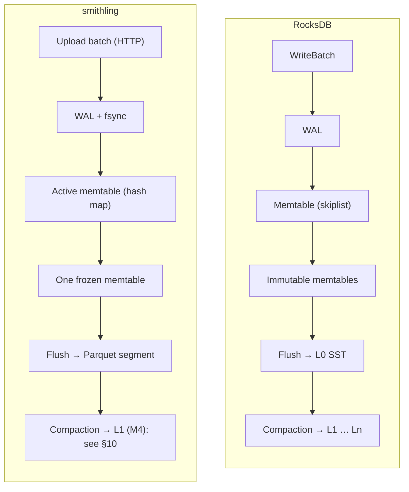
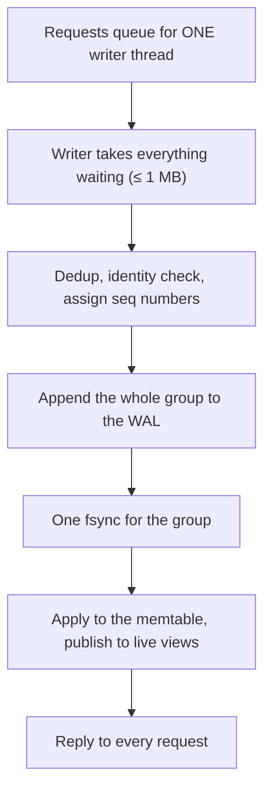
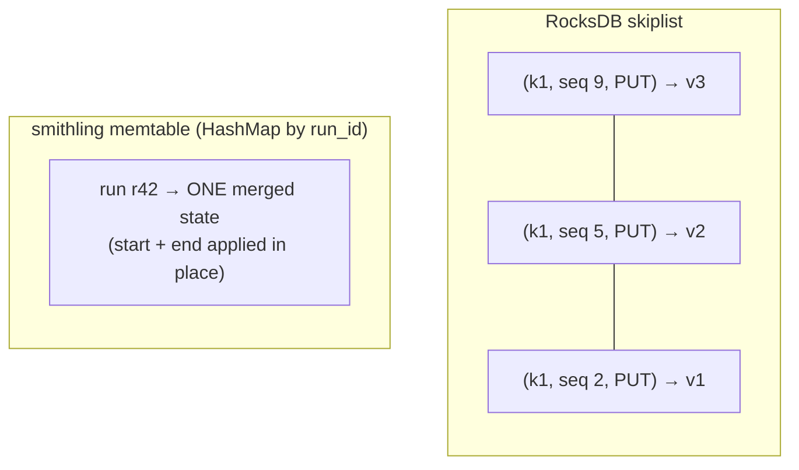
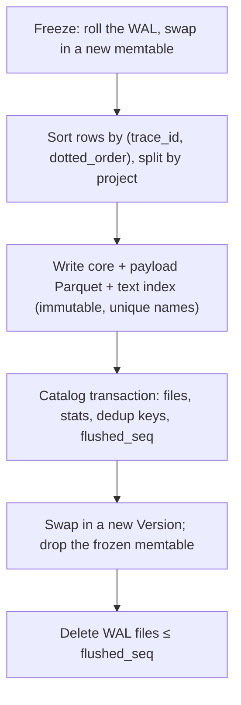
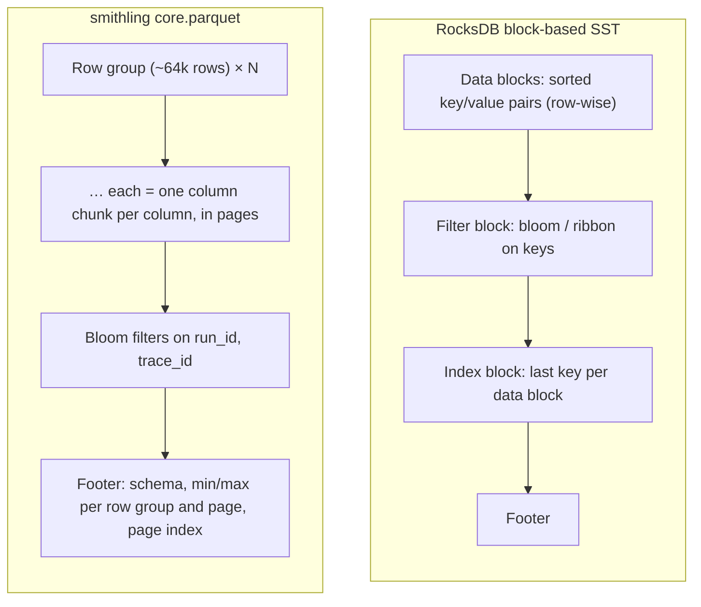
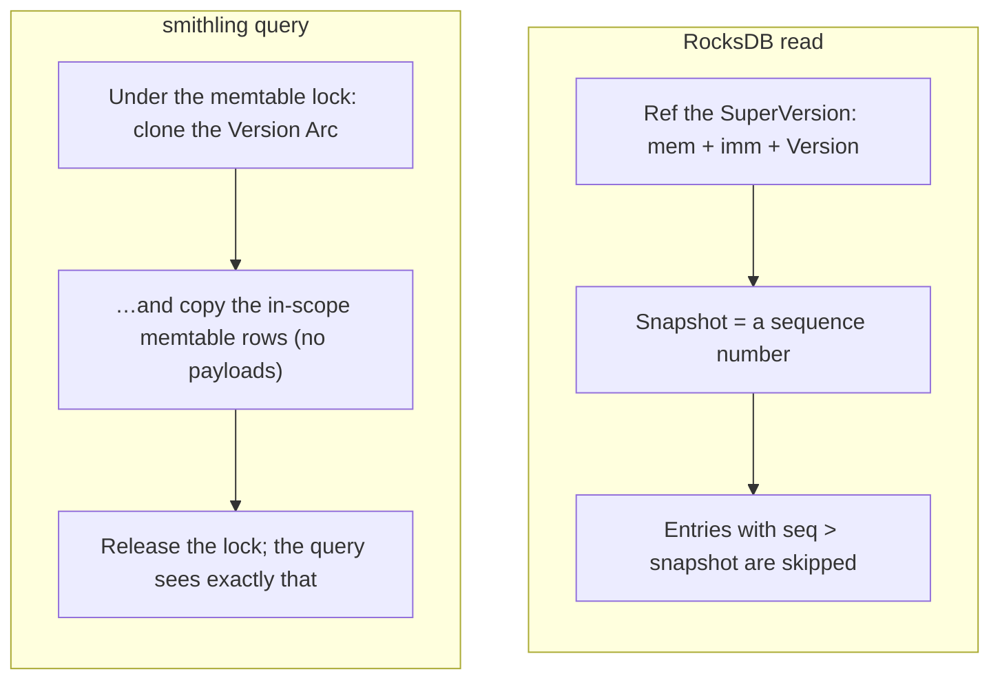
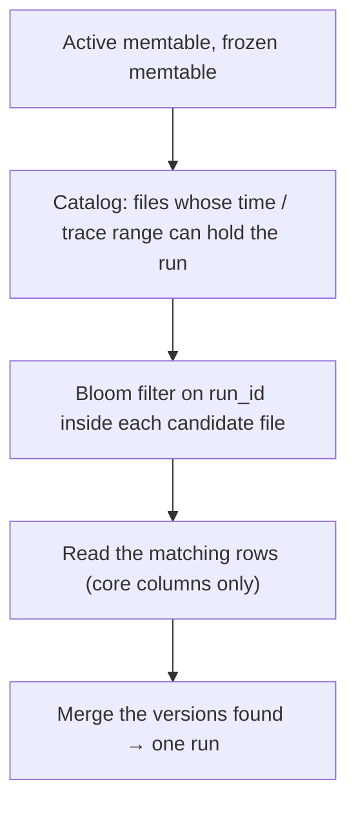
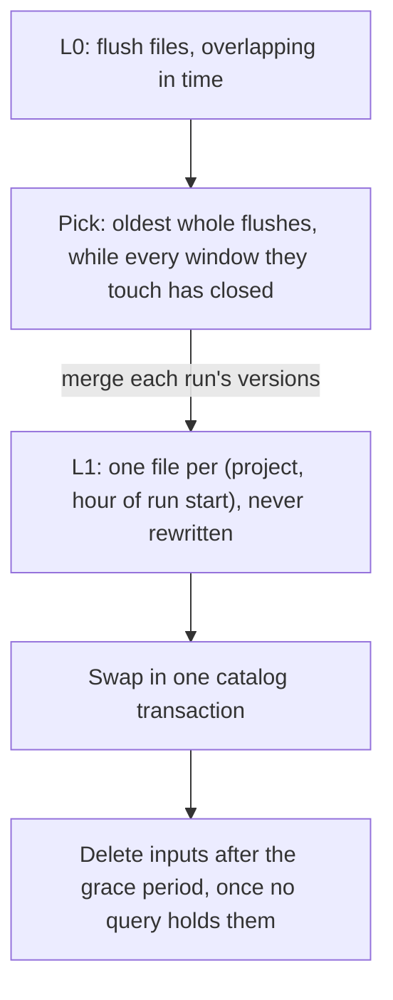
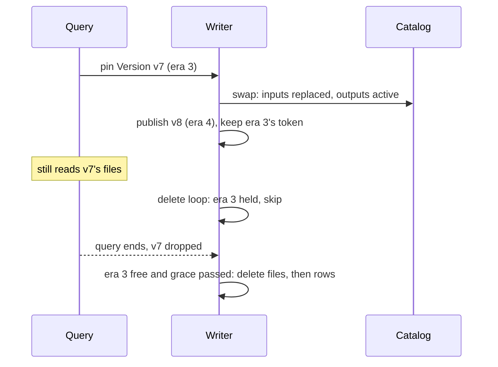

# smithling for RocksDB people

You know RocksDB's internals: memtables, immutable memtables, SSTs, the MANIFEST, SuperVersions, compaction, write
stalls. smithling is built on the same LSM ideas, but stores **columnar Parquet files** for an **analytics** workload
instead of row-oriented SSTs for a **key-value** workload. This guide walks the familiar path, part by part, and
marks where smithling does the same thing, a different thing, or nothing yet.

If columnar storage itself is new to you, read [SECRET_OF_COLUMNAR_DB.md](SECRET_OF_COLUMNAR_DB.md) first (15
minutes, with a runnable example). For the product and its milestones, see [STARTER_GUIDE.md](STARTER_GUIDE.md).

Legend used in the tables: **same** = same idea, **different** = same role, different design, **missing** = not
built (yet).

---

## 1. The one-minute version

| | RocksDB | smithling |
|---|---|---|
| Data model | opaque byte keys → byte values | typed rows: one *run* (agent step) with ~40 columns |
| Workload | point gets, range scans, high write rate | high write rate, then filter / group / aggregate over millions of rows |
| Log | WAL, `sync` optional per write | WAL, **always fsynced** before "OK" (group commit) |
| Memtable | skiplist, sorted, every version kept | hash map, **unsorted**, one *merged* state per run |
| Immutable memtables | a list (`max_write_buffer_number`) | **at most one** frozen memtable |
| File format | SST: sorted key/value blocks | **Parquet**: columnar, sorted by `(trace_id, dotted_order)` |
| File list | MANIFEST (log of VersionEdits) | **SQL catalog** (SQLite / Postgres), one transaction per flush |
| Reader snapshot | SuperVersion + sequence-number snapshot | pinned `Version` + copies of memtable rows |
| Combining versions | newest seqno wins, or a merge operator | built-in **field-by-field merge** at read time |
| Compaction | leveled / universal / FIFO | **one level** (M4): settled flush files (L0) merged into hour-window L1 files, never rewritten (§10) |
| Query engine | iterators | **Apache DataFusion** scans + smithling's own merge and filter |

The short version: smithling is an LSM whose SSTs are Parquet files, sorted by trace for locality, pruned by time
through a SQL manifest, merged per run field by field, and read by an analytics engine instead of an iterator.
Flush files are L0; compaction merges a prefix of them into L1 files, one per project per hour.

---

## 2. The shape, side by side

Same skeleton. The interesting differences are inside each box.

---

## 3. Write path: WAL and group commit

| | RocksDB | smithling | |
|---|---|---|---|
| Who writes | write thread: a leader writes the group's WAL records (`JoinBatchGroup`) | one dedicated writer thread owns the WAL and memtable ([writer.rs](crates/ingest/src/writer.rs)) | same idea |
| Durability | `WriteOptions::sync` defaults to false | every acknowledged write is fsynced; there is no "fast, unsynced" mode | **different** |
| Group commit | followers piggyback on the leader's write/sync | requests that queue during one fsync share the next; no fixed wait | same |
| Sequence numbers | per write, part of the internal key | per event (`event_seq`), defines merge order | same |
| Dedup | none (the app's job) | retries dropped by `(run_id, op, body hash)` for 10 min | **different** (smithling-specific) |
| WAL files | one per memtable switch, deleted when every CF is flushed past it | rolled at every freeze, deleted whole once that memtable is registered | same |

Why always fsync: the client is an SDK that will retry anyway, so smithling trades a few ms per group for a simple
promise ("OK" means on disk), and gets the throughput back through group commit (74k events/s measured in M1).

---

## 4. The memtable: merged, not versioned

This is the biggest internal difference.

| | RocksDB | smithling |
|---|---|---|
| Structure | concurrent skiplist (sorted by internal key) | `HashMap<RunId, RunState>` plus small indexes by trace and root ([store.rs](crates/ingest/src/store.rs)) |
| An update to an existing key | inserts a new entry with a higher seqno | **merges into the existing entry** in place (the merge rule, [merge.rs](crates/model/src/merge.rs)) |
| Sorted when? | at insert | **at flush** (rows sorted by `(trace_id, dotted_order)`) |
| Size accounting | arena bytes (`write_buffer_size`) | heap bytes of the runs (`--memtable`, default 64 MB) |
| Flush triggers | buffer full; WAL size; manual | full, **or oldest event ≥ `--flush-age` (2 min)**, or unflushed WAL ≥ half its cap |

Why merge in place: a run's start and end arrive minutes apart, and readers want the *current* state of each run.
Keeping one merged state per run in memory means every read of fresh data is already merged, and the memtable holds
one row per run, not one per event.

Why an **age** trigger: on a quiet server a size-only rule could leave data unflushed for days; the age bounds how
stale the WAL-only data gets.

---

## 5. Immutable memtable and flush

| | RocksDB | smithling | |
|---|---|---|---|
| Count | up to `max_write_buffer_number - 1` immutables | **one** frozen memtable; a second freeze waits | **different** |
| When full and flush can't keep up | write stall / slowdown | writer answers `429` + `Retry-After` (the SDK retries) | same idea (R-8) |
| Flush output | one L0 SST | one segment **per project**: `core.parquet`, `payload.parquet`, plus a text index (`.fts.dict.parquet`, `.fts.post`) | **different** |
| Making it visible | VersionEdit appended to the MANIFEST | **one SQL transaction**: register files, field stats, dedup keys, `flushed_seq` | **different** |

Crash at any step leaves data in the WAL, in registered files, or both. Files written but not registered are
orphans, deleted on start (RocksDB's "delete obsolete files not in the MANIFEST", same idea). Code:
[flush.rs](crates/ingest/src/flush.rs).

---

## 6. The files: SST vs Parquet

| | SST | Parquet segment |
|---|---|---|
| Layout | rows: a key and its whole value together | **columns**: all `status` values together, all `latency_ms` together, … |
| Built for | `Get(key)`, `Seek` + `Next` in key order | "read 3 of 40 columns for 2M rows, skip what can't match" |
| Index | index block → data block by key | footer min/max per row group and page, page index, column blooms |
| Compression | per block (LZ4/ZSTD), prefix-compressed keys | per page (ZSTD) after **dictionary + run-length encoding** per column |
| Big values | inline, or BlobDB blob files | separate `payload.parquet` (inputs, outputs, events), linked by row number: the BlobDB idea, per segment |

Why columnar: the questions are "errors in the last 12 h, p95 latency by tool". A row store reads every value of every
matching row, including megabyte prompts. A column store reads only the columns the query names, compresses
repetitive columns (`status`, `name`) to almost nothing, and can skip row groups from their statistics alone. The
[columnar primer](SECRET_OF_COLUMNAR_DB.md) shows this with real numbers.

---

## 7. Keys: one key vs three roles

RocksDB's key does everything: sort order, lookup key and the unit of versioning. smithling splits those roles:

| Role | RocksDB | smithling |
|---|---|---|
| Sort order inside a file | user key | `(trace_id, dotted_order)`: a whole trace sits together, in tree order |
| Unit of versioning / merge | user key | `run_id` |
| File pruning | smallest/largest key per file | catalog min/max of `start_key` (the run's start time), `trace_id`, plus project |

So file pruning isn't "is my key in this file's range?" but "does this file overlap my time window, project or trace
range?". Trace ids are UUIDv7 (time-prefixed), so time and trace ranges line up.

---

## 8. Snapshots: SuperVersion vs pin

| | RocksDB | smithling | |
|---|---|---|---|
| File set held by a reader | Version, ref-counted | `Arc<Version>` ([memtable.rs](crates/ingest/src/memtable.rs)) | same (R-7) |
| Memtables held | mem + imm in the SuperVersion | frozen memtable `Arc` + **copies** of active-memtable rows | **different** |
| Point-in-time | seqno snapshot, any number of them | no seqno snapshots; consistency comes from taking files + memtables under one lock (D-015) | **different** |
| Obsolete files | deleted when no Version references them | deleted when no Version of that *era* is held **and** a grace period has passed (§10) | **different** |

The copy is the price of the in-place merge: the active memtable's entries change, so a query copies what it needs
instead of reading a versioned structure. How `Version` changes when compaction removes files is in
[§10, Versions across a swap](#versions-across-a-swap).

---

## 9. Reads: iterator vs scan, merge operator vs merge rule

A **point lookup** looks familiar:

A **filtered list** is where smithling departs from iterators:

| Step | RocksDB analogue | smithling |
|---|---|---|
| choose files | key-range check per file | catalog ranges: project, `start_key` window, trace range |
| inside a file | index block + filter block | DataFusion: footer stats skip row groups, page index skips pages, blooms for id lookups, decode filter columns first |
| combine sources | `MergingIterator` in key order | hash-group rows by `run_id`; **only runs that may be split** (`needs_merge`, ~10%) are merged |
| filter | app code on each kv | **after** the merge, by smithling's evaluator (DataFusion only pre-filters a superset) |
| stop early | stop iterating | newest-first `start_key` windows (~20k rows, then ×4), stop at a full page |

**Merge operator vs merge rule.** RocksDB's merge operator stores operands and folds them at read and compaction
time. smithling's rule is built in and field-wise: sort a run's versions by sequence, then for each field the newest
version that *set* it wins (a `present` bitmask records which fields each version set); identity fields keep the first
value; status and latency are recomputed. Conceptually it's a full-merge operator for one fixed schema.

**Why filter after merging**: a run's start (in a file) says `running`; its end (in the memtable) says `error`.
Filtering the file row alone for `status = error` would drop it. So rows that may have other versions always pass
the pre-filter, and the exact filter runs on merged runs.

---

## 10. Compaction (M4): one level, and what it does to versions

Status: the job, the swap and the version changes are built (M4 units 1–3). Still open: the background timer
(T017), the delete loop (T018) and the compaction crash points (T019). The plan is
[specs/004-m4-compaction/plan.md](specs/004-m4-compaction/plan.md).

### Why it was needed: everything was L0

Before M4 every flush added files that overlap in time with earlier ones, like RocksDB's L0 with compaction turned
off. The costs were the ones a RocksDB person would predict:

| Symptom | RocksDB analogue | Effect in smithling |
|---|---|---|
| file count only grows | L0 file count growing with compaction disabled | every in-scope file's footer is read; single-run reads pass 50 ms at ~680 files |
| a run whose start and end were flushed apart stays split | versions of a key spread over many L0 files | every read of it fetches and merges both versions |
| memory held for split runs | — | the multi-version set and kept merged rows grow; the main reason idle memory is above target (D-028) |
| deletes and retention can't free space | tombstones that never get compacted away | backlog B1 is blocked on compaction |

### The design: L0 → L1, a prefix of the log

| | RocksDB | smithling | |
|---|---|---|---|
| Levels | L0 … Ln, each level non-overlapping by key | L0 and L1 only; L1 files split by **time window** (1 h of run start time), not by key range | **different** |
| Picking L0 inputs | oldest L0 files + overlapping L1 files | the oldest whole flushes in log order, **across all projects**, up to the first that still touches an open window (end + 15 min settle) | same idea (oldest first) |
| Merging | `CompactionIterator` drops shadowed versions | `merge_versions` per run, in seq order; one row per run | same idea |
| Output | SSTs cut at `target_file_size_base` | `cmp-*` files per (project, window), split at 256 MB, sorted by `(trace_id, dotted_order)` | same idea |
| Install | VersionEdit to the MANIFEST | one guarded catalog transaction (below) | same idea |
| Late writes to old data | land in L0, compacted down again | land in L0, then in a **small extra L1 file** for the old window; merged at query time (option a; K6 to fold them) | **different** |
| Where it runs | background threads; remote compaction | one job at a time on a timer in the writer; its own service later (M5 B3) | **different** |

Why a **prefix of the log**: the merge rule needs a run's versions to cover non-overlapping sequence ranges
(`merge_versions` asserts it). Picking files per project could merge versions on both sides of one it skipped, and
an older update would then override a newer one (problem C8). Taking a prefix means everything left out is newer
than everything merged. RocksDB's L0 has the same constraint for the same reason: L0 files overlap, so they're
compacted oldest first.

**Never the memtables.** Compaction reads files only (A4: the catalog and files, not the writer's memory), so it can
move to its own process later. A late update that arrives during a job lands in the memtable with a higher seq and
merges on top of the compacted row at read time.

**`needs_merge` marks.** An output row is marked as multi-version if the run is already in an L1 file of the same
window, or its first version in this job is an update (its start is somewhere older). Unmarked rows skip the merge
at read time.

### The file's life: MANIFEST vs catalog states

RocksDB's MANIFEST knows only live files; anything else on disk is obsolete. smithling's catalog keeps a state per
file, so a crash at any point leaves a state the catalog describes:

| State | Meaning | After a crash |
|---|---|---|
| `pending` | compaction output, registered **before** any byte is uploaded | start-up deletes the files, then the row |
| `active` | in the live file set; queries read it | — |
| `replaced` | a compaction input, `replaced_at` saved | the delete loop finishes it |
| deleted | files removed, then the row | — |

The swap is one transaction: every input `active → replaced`, every output `pending → active`. It's refused if any
input isn't `active` any more, and retried with the same outputs if the reply was lost. This is RocksDB's
`LogAndApply` for a compaction edit, with the "inputs still live?" check done by the database instead of under the
DB mutex. Registering outputs before uploading is what lets start-up tell its own unswapped files from a stranger's
(a wrong `--metastore` can't delete data).

### Versions across a swap

This is the part closest to RocksDB. Before M4 a `Version` only gained files; compaction is the first thing that
removes them.

| | RocksDB | smithling | |
|---|---|---|---|
| The file set | `Version`: files per level | `Version`: `segments`, `field_stats`, `flushed_seq`, an `id` and an `era` ([memtable.rs](crates/ingest/src/memtable.rs)) | same |
| The current one | `VersionSet::current()` | `mem.version`, an `Arc<Version>` under the memtable lock | same |
| A flush | `LogAndApply(edit)`: current + new L0 file | `with_flush`: current + new files, new `flushed_seq` | same |
| A compaction | `LogAndApply(edit)`: current − inputs + outputs | `with_compaction`: current − inputs + outputs, **on the current Version**, so files flushed during the job are kept | same |
| A reader's pin | ref on a Version (through the SuperVersion) | the query clones the `Arc<Version>` at start and reads only those files | same (R-7) |
| Knowing old files are unread | each Version's ref count | **one era token per swap**: every Version between two swaps shares an `Arc<()>`; count 1 means none is held | **different** |
| Deleting | as soon as no Version refs the file | era free **and** `replaced_at` + grace (24 h) passed; files first, then the row | **different** |

Why **eras** instead of a ref count per Version: flushes make a new Version every few minutes, and the question the
delete loop asks is only "does anyone still hold a file set from before this swap?". One token per swap answers it
with a single count. Eras are freed in order: a later era can't be free while an earlier one is held.

Why a **grace period** on top: pins only see queries in this process. The grace period, stored in the catalog,
covers readers in other processes (M5's read workers), which RocksDB doesn't have to think about.

### "Multi-version" here is not MVCC

The plan's "multi-version set" can sound like RocksDB's multi-versioning. It isn't:

| | RocksDB | smithling |
|---|---|---|
| What "versions" are | every write of a key, kept for seqno snapshots | a run's start and its updates, stored in **different files** |
| Why they're kept | readers at older snapshots may need them | they haven't been merged into one row yet |
| Nearest RocksDB idea | — | unmerged **merge operands**, folded at read time until compaction folds them |
| The in-memory set | — | the run ids with versions in several files, plus their kept merged rows (`VersionRows`, D-023, D-029) |

After a swap the set shrinks, job by job in swap order, once that swap's era is free: merged runs leave unless a
memtable or a `needs_merge` row in an active file still has them. Kept merged rows are reset when the Version lost
files, and rebuilt on the next request. That's where the memory of late-updated runs comes back (C2).

### What triggers a job

| Trigger | RocksDB analogue | smithling (M4) |
|---|---|---|
| periodic check | periodic compaction | every 60 s (T017, open) |
| enough settled input | `level0_file_num_compaction_trigger` | any whole flush whose windows have all closed |
| ingest under pressure | compaction yields to writes | skipped while writes are slowed down (R-8) |
| bounded work | `max_compaction_bytes` | at most 1M rows per job; the next job continues the prefix |
| tests and demos | `CompactRange` | `force` takes every flush regardless of windows |

Defaults (window 1 h, settle 15 min, target 256 MB, grace 24 h) are starting values to tune later (K10). Multi-tier
compaction (T0 → T1 → T2 in the design notes) and splitting L1 by trace-id range, which would be more like RocksDB
levels, are backlog K6 and a rejected M4 option.

---

## 11. The other missing pieces, and how we would build them

### Deletes and retention (backlog B1)

| | RocksDB | smithling idea |
|---|---|---|
| delete one thing | point tombstone, shadows older versions until compaction drops both | **delete vector**: per file, a bitmap of deleted row numbers in the catalog; applied as a row filter at scan time |
| delete by condition | `DeleteRange` (key ranges only) | `DELETE /runs?filter=…`: run the filter once, record the matching rows per file; works for any condition, not just key ranges |
| time to live | compaction filter, FIFO / periodic compaction with TTL | per-project `ttl_days`; queries hide expired runs at once; whole L1 window files past the cutoff are **dropped as files** (cheap, because they're cut by time window) |
| space comes back | when compaction rewrites the tombstoned range | when compaction rewrites a file without its deleted rows |

Delete vectors (the Iceberg / Delta Lake approach) suit columnar files better than tombstones: a columnar file can't
cheaply shadow one key, and deletes here come by filter ("this trace contained an API key"), not by key.

The tricky case is a **late update after a delete**: RocksDB happily resurrects a key that is `Put` again after a
`Delete`, and so would smithling's merge, producing a partial run. One option is to keep deleted run ids for the dedup
window and drop late events for them; the B1 spec has to decide (M4 left deletes out, K8).

### Snapshots by sequence number

RocksDB snapshots pin a seqno so old versions survive compaction. smithling doesn't need them for queries (the pin
gives each query a consistent view). Where they'd help is **long exports or paging** across compaction: the simplest
design is to pin the `Version` (the file set) for the export's lifetime, rather than seqno snapshots, since compaction
deletes files only when no `Version` of their era is held. Across processes the grace period has to outlast the
export, or M5's leases take over.

### More than one immutable memtable

RocksDB allows several (`max_write_buffer_number`). smithling allows one and answers `429` when the next one fills
during a flush. Allowing N would absorb longer bursts at the cost of N × 64 MB of memory and longer restarts; with
an SDK that retries, pushing back has been the better trade so far.

### Checkpoints and backups

RocksDB's `Checkpoint` hard-links the live SSTs and copies the MANIFEST. smithling's files are immutable with unique
names too, so a checkpoint would be: in one catalog read, list the active files and `flushed_seq`; hard-link (or, on
S3, reference) those files; copy the catalog rows and the WAL tail after `flushed_seq`. Not planned; listed as "not
adopted" in the roadmap.

### Compaction I/O limits

RocksDB has a rate limiter. M4 starts simpler: one compaction job at a time, on a timer thread in the writer,
skipped while ingest is under write slowdown, with a row cap per job (A8). A real limiter waits until measurements
show compaction hurting ingest or query latency (SC-07, K11).

---

## 12. Smaller parts

| Part | RocksDB | smithling | |
|---|---|---|---|
| Block cache | LRU / HyperClock for data, index, filter blocks | 32 MB memory cache for footers, page indexes, text-index pages, payload ranges ([cache.rs](crates/storage/src/cache.rs)) | same idea |
| Column families | separate memtables + SSTs, shared WAL | projects: **shared** memtable and WAL, separate files per project | **different** |
| Recovery | replay WAL from the MANIFEST's log number | replay WAL records with seq > the catalog's `flushed_seq` | same |
| DB lock | `LOCK` file | `<data>/LOCK`, held for the process's life; plus `<storage>/LOCK` for a local store (T017), a catalog lease in M5 | same |
| Bloom filters | per SST (or per block) | Parquet blooms on `run_id`, `trace_id` per file (R-9) | same idea |
| Object storage | via env / remote compaction | data files on a folder or S3 (`object_store`), catalog in Postgres, WAL stays local | **different** |
| Text search | — | per-file inverted index (dictionary + postings), no positions | smithling-specific |

---

## 13. What smithling borrowed from RocksDB, on purpose

From the roadmap's backlog of LSM ideas ([roadmap](specs/000-smithling-master-plan/roadmap.md)), all built in M2:

| # | RocksDB idea | smithling |
|---|---|---|
| R-7 | pinned versions for readers | `Arc<Version>`; since M4, compaction deletes files only when their era is unpinned |
| R-8 | write slowdown | `429` + `Retry-After` when the frozen memtable is still flushing and the new one is full, or the unflushed WAL is over its cap |
| R-9 | key bloom filters | Parquet blooms on `run_id`, `trace_id` |
| R-10 | two memtables | active + frozen, so ingest never pauses for a flush |

Not adopted: compaction I/O rate limiting, BlobDB garbage collection, checkpoints, the merge-operator API, FIFO/TTL
compaction.

---

## 14. Reading the code with RocksDB in mind

| RocksDB concept | Start here |
|---|---|
| `DBImpl::WriteImpl`, write thread | [crates/ingest/src/writer.rs](crates/ingest/src/writer.rs) |
| `log::Writer` | [crates/ingest/src/wal.rs](crates/ingest/src/wal.rs) |
| `MemTable` | [crates/ingest/src/store.rs](crates/ingest/src/store.rs), [memtable.rs](crates/ingest/src/memtable.rs) |
| `FlushJob` | [crates/ingest/src/flush.rs](crates/ingest/src/flush.rs) |
| `CompactionJob`, `CompactionPicker` | [crates/ingest/src/compact.rs](crates/ingest/src/compact.rs) |
| `BlockBasedTableBuilder` | [crates/storage/src/segment.rs](crates/storage/src/segment.rs) |
| `VersionSet` / MANIFEST | [crates/storage/src/metastore.rs](crates/storage/src/metastore.rs) (file states, the swap) + `Version` in memtable.rs (`with_flush`, `with_compaction`, `era`) |
| `DBImpl::Recover` | [crates/ingest/src/recover.rs](crates/ingest/src/recover.rs) |
| `MergingIterator`, merge operator | [crates/query/src/scan.rs](crates/query/src/scan.rs), [crates/model/src/merge.rs](crates/model/src/merge.rs) |
| `BlockCache` | [crates/storage/src/cache.rs](crates/storage/src/cache.rs) |
