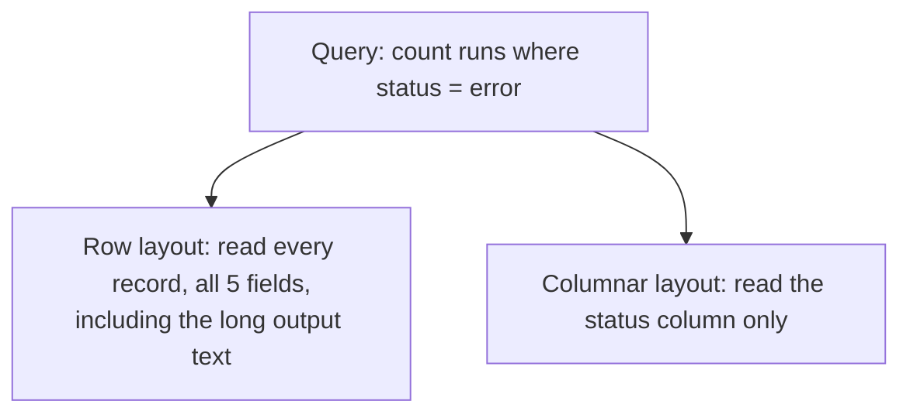
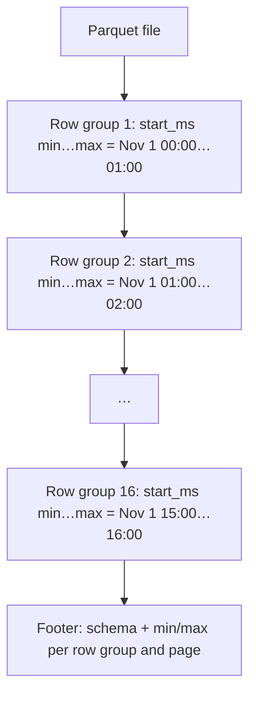
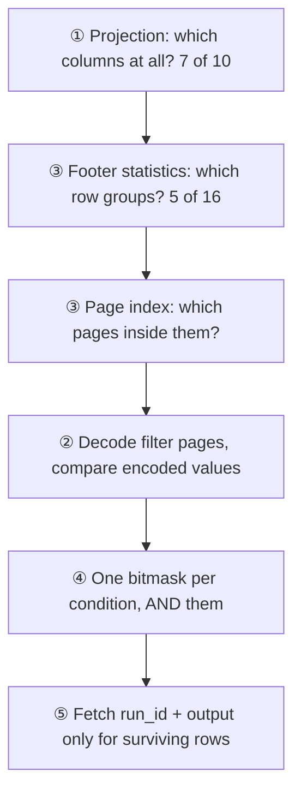
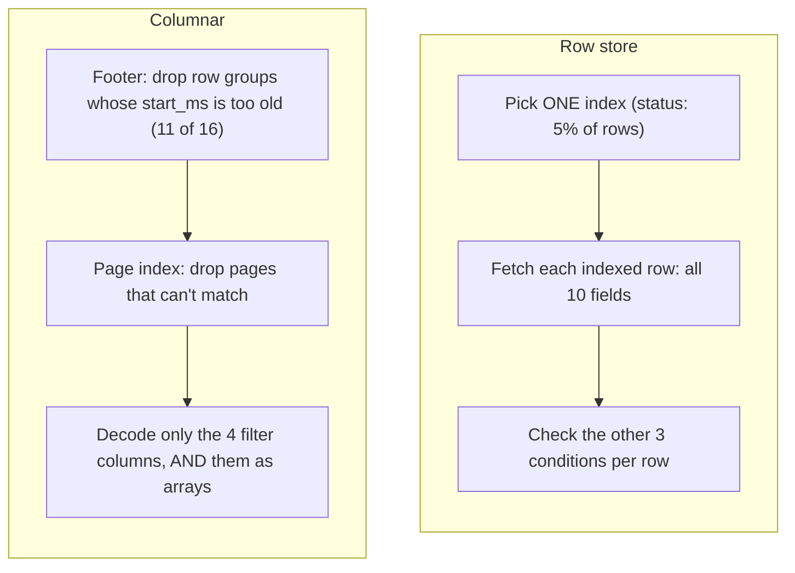
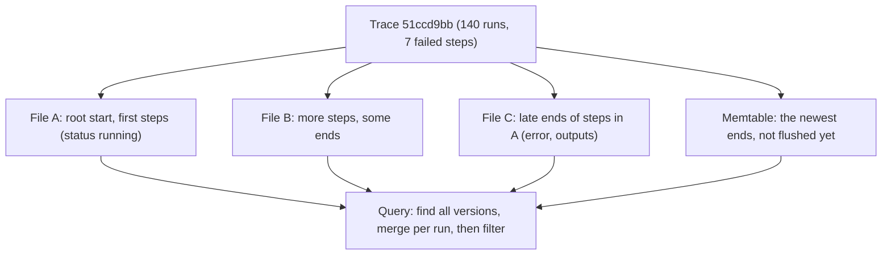
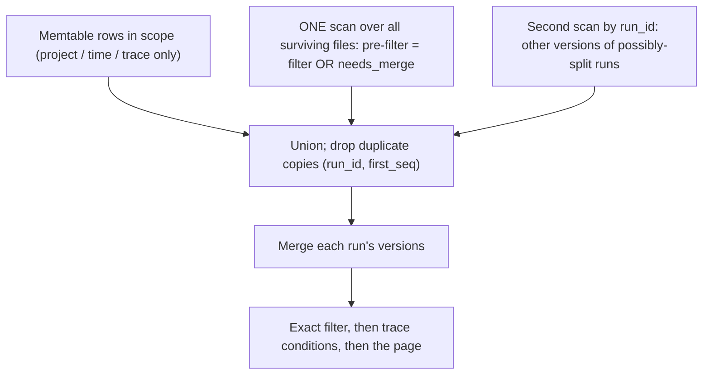
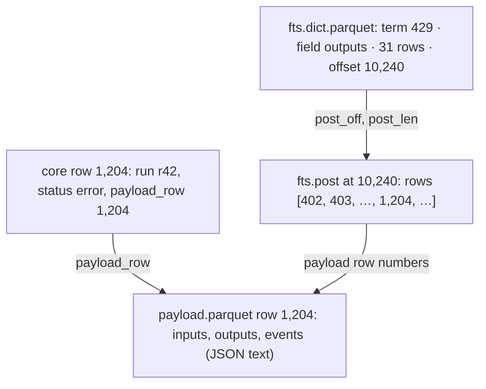
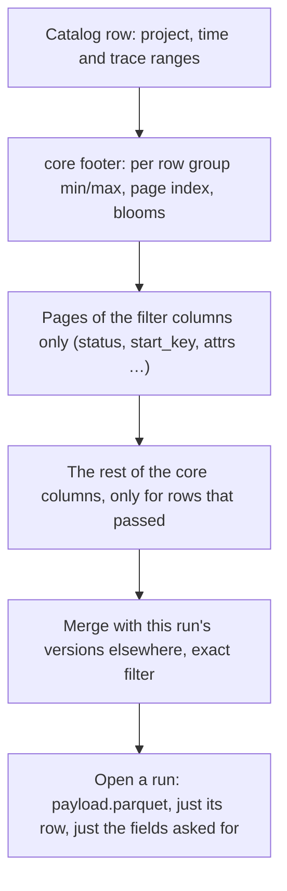

# The secret of the columnar database

A 15-minute primer on columnar storage, the idea under smithling's data files (and under Parquet, DuckDB, ClickHouse,
Snowflake, BigQuery and SmithDB). It ends with a program you can run on your laptop that shows every idea with real
numbers.

Background you don't need: databases internals. If you know RocksDB, also read
[ROCKSDB_COMPARISON.md](ROCKSDB_COMPARISON.md) afterwards; for the product, [STARTER_GUIDE.md](STARTER_GUIDE.md).

---

## 1. The secret, in one sentence

**Store each column's values together instead of each row's values together**, so a query reads only the columns it
asks about, values of one type squeeze down to almost nothing, and every file can tell you what it *doesn't*
contain before you read it.

That's it. Everything else is a consequence.

---

## 2. Rows vs columns: the same table, two layouts

Take four agent runs:

| run_id | name | status | latency_ms | output |
|---|---|---|---|---|
| 1 | fetch_url | ok | 812 | "fetched 2,041 bytes…" |
| 2 | plan | ok | 2,104 | "step 1: search…" |
| 3 | fetch_url | error | 31,000 | "HTTPError: 429…" |
| 4 | llm | ok | 4,020 | "The answer is…" |

A **row layout** writes them record by record:

```text
[1, fetch_url, ok, 812, "fetched 2,041 bytes…"]
[2, plan, ok, 2104, "step 1: search…"]
[3, fetch_url, error, …] …
```

A **columnar layout** writes them column by column:

```text
run_id:     [1, 2, 3, 4]
name:       [fetch_url, plan, fetch_url, llm]
status:     [ok, ok, error, ok]
latency_ms: [812, 2104, 31000, 4020]
output:     ["fetched 2,041 bytes…", "step 1: search…", "HTTPError: 429…", "The answer is…"]
```



---

## 3. When each layout wins

| Workload | Typical question | Better layout | Why |
|---|---|---|---|
| **Transactions** (OLTP) | "fetch order 42, change its address" | **rows** | one record, all its fields, read and written together |
| **Key-value** | `Get(key)`, `Put(key, value)` | **rows** (RocksDB, …) | the value is one blob anyway |
| **Analytics** (OLAP) | "error rate by tool over the last 12 h" | **columns** | many rows, few columns, mostly reads |
| **Logs / traces / events** | "errors tagged `batch=a`, p95 latency" | **columns** | append-heavy, then scanned and aggregated |

Rule of thumb: if your queries touch **many rows but few columns**, go columnar. If they touch **one row and all
its columns**, stay with rows.

smithling's questions ("show me the errors", "p95 latency per tool", "which runs mention `429`") are analytics over
millions of runs where each run has ~40 fields and a megabyte of prompt text. That's why its data files are Parquet.

---

## 4. The five core ideas

### Idea 1: read only the columns you need (projection)

A filter on `status` reads the `status` column. A group-by on `name` with `avg(latency_ms)` reads two columns. The
long `output` text, usually most of the bytes, is never touched unless the query names it.

### Idea 2: one type, one column, tiny on disk (encoding + compression)

A column holds values of one type that often repeat or change slowly, which is ideal for compression:

| Encoding | Works on | Example |
|---|---|---|
| **Dictionary** | few distinct values | `status`: store `{0: ok, 1: error}` once, then one small integer per row |
| **Run-length (RLE)** | repeats in a row | `ok, ok, ok, ok, error` → `(0 × 4), (1 × 1)` |
| **Bit-packing** | small integers | dictionary codes `0/1` need 1 bit each, not 8 bytes |
| **Delta** | sorted / slowly changing numbers | timestamps `t, t+50, t+100` → `t, +50, +50` |
| general codec (ZSTD) | whatever is left | applied per page after the encodings |

A row layout can't do most of this, because neighbouring bytes are different fields of different types.

### Idea 3: skip what can't match (statistics / zone maps)

Columnar files are split into **row groups** (smithling: ~64k rows each), and each column of each row group is split
into **pages**. The file footer records **min and max per row group and per page**:



A query for "after 15:30" reads the footer, sees that only row group 16 can match, and never opens the other 15.
**This only works if the data is sorted (or naturally ordered) by the column you filter on.** Random order gives
every row group the full min…max range, and nothing can be skipped. Bloom filters do the same job for "is this exact
id here?".

### Idea 4: process arrays, not rows (vectorized execution)

In memory, a columnar engine keeps each column as a contiguous array (Apache **Arrow** is the standard format). A
filter becomes "compare 64k integers to a constant" in a tight loop the CPU can run with SIMD, instead of "for each
row object, look up a field, compare". That's where much of the speed comes from even when data is already in
memory.

### Idea 5: fetch expensive columns last (late materialization)

Evaluate the filter on cheap columns first (`status`, `start_ms`), get the list of matching row numbers, then read
the expensive columns (`output`, `inputs`) **only for those rows**. smithling takes this furthest: payloads live in a
separate file and are read only for the rows on screen.

### The price

| Cost | Why | How smithling pays it |
|---|---|---|
| Writes must be batched | a file is written column by column, then sealed | recent writes live in memory (a *memtable*) and are flushed as whole files |
| Updates are hard | you can't edit one value inside a compressed column | an update is a new *version*; reads **merge** versions (and, later, compaction rewrites them) |
| One whole row is slower | its fields live in many places | lookups touch few rows; payloads are fetched on demand |

---

## 5. One query through one file, on paper

Before the real numbers, here is one query traced through one Parquet file by hand, so each of the five ideas shows
up where it does its work. The numbers are illustrative; section 6 measures the real ones.

### The file and the query

`runs.parquet`: 1,000,000 runs in time order, 10 columns, 16 row groups of ~64k rows, each column chunk cut into
pages of a few thousand rows. The first half of the runs is batch `a`, the second half batch `b`.

> **Show the run id and output of every failed run in the newest 25% of the time range, from batch b, slower than
> 30 s, on prompt v7.**

```sql
SELECT run_id, output FROM runs
WHERE start_ms >= T75 AND status = 'error' AND batch = 'b' AND latency_ms > 30000 AND prompt_version = 'v7'
```

Five conditions (SmithDB's "narrow it down" plus "look inside the JSON"), and a big column (`output`) in the answer.



### ① Projection: never touch what the query doesn't name

The query names `start_ms`, `status`, `batch`, `latency_ms`, `prompt_version` (filters) and `run_id`, `output`
(answer). `name`, `tokens` and `status_code` are **never read**. And the two answer columns aren't read yet either;
they wait for step ⑤.

### ③ Footer statistics: skip row groups without opening them

The reader fetches the footer (a few KB) and looks at each row group's min/max for the filter columns:

| Row group | `start_ms` min … max | `batch` min … max | Can it match? |
|---|---|---|---|
| 1–8 | oldest half | `a` … `a` | **no**: `batch = 'b'` is impossible |
| 9–11 | middle | `b` … `b` | **no**: max `start_ms` < T75 |
| 12 | … T75 falls inside … | `b` … `b` | maybe |
| 13–16 | newest | `b` … `b` | maybe |

Two conditions, judged from statistics alone, drop **11 of 16 row groups**. No data page of them is read. (This only
works because the data is in time order: each row group covers a narrow slice of time and a single batch.)

### ③ Page index: skip pages inside a row group

Row group 12 straddles the cutoff. Its page index has a min/max per page of `start_ms`, so the pages entirely before
T75 are skipped too. What's left: the newest ~25% of rows, ~250k of 1M.

### ② Decode the filter pages, comparing encoded values

Each surviving page of the five filter columns is decoded, but often **not into strings**:

| Column | Stored as | The condition becomes |
|---|---|---|
| `status` | dictionary `{0: ok, 1: error}` + RLE runs of codes | `code == 1`; a run of 900 `ok`s is rejected in one step |
| `batch` | one RLE run of `b` covering the whole page | **true for the whole page**, decided once |
| `prompt_version` | dictionary `{0: v6, 1: v7}`, bit-packed codes | `code == 1` on 1-bit values |
| `latency_ms` | dictionary codes or plain integers (whichever is smaller) | integer compare over an array |
| `start_ms` | dictionary codes or plain integers | integer compare (only on the cutoff page) |

The strings `"error"`, `"b"`, `"v7"` are each looked up **once per dictionary**, not once per row.

### ④ One bitmask per condition, then AND

Each condition produces a bitmask over the rows of the page, computed over a whole array at a time. For 16 rows:

```text
row               0123456789abcdef
start_ms ≥ T75    1111111111111111      (page fully after the cutoff)
status = error    0000100000010000
batch = b         1111111111111111      (one RLE run: whole page)
latency > 30 s    0000100000010000
prompt = v7       0100110001000010
AND               0000100000000000  → row 4
```

**Order matters.** The engine evaluates the cheapest, most selective condition first (here `status`: 5% pass) and
decodes the next column only where the mask still has 1s. So most of `latency_ms` and `prompt_version` is never
decoded at all (DataFusion's `pushdown_filters` + `reorder_filters`, both on in smithling).

### ⑤ Late materialization: fetch the big column last

Only now are `run_id` and `output` read, and only the pages that contain a surviving row. ~2,000 matching rows out
of a million means the 11 MB `output` column is touched in a handful of pages, not in full. In smithling this step
goes one further: `output` lives in a separate payload file, read only when you open a run.

### What was touched

| Step | Read |
|---|---|
| ① | 7 of 10 columns considered; 3 never touched |
| ③ | the footer; 5 of 16 row groups kept; pages before the cutoff dropped |
| ② ④ | `status` for the kept pages, then the other filter columns only where `status` matched |
| ⑤ | the pages of `run_id` and `output` holding the ~2,000 answers |

A row store without indexes reads all 1,000,000 records, every field. With an index on `status` it fetches the
50,000 error rows whole (all ten fields, including `output`) and checks the other four conditions on each. Section 6
measures both.

### The seven questions, idea by idea

| SmithDB question | Leans on | Note |
|---|---|---|
| 1. Show me this one (trace / run) | ③ min/max on `trace_id` + bloom filters, ⑤ payload by row | files sorted by trace, so a trace is a few contiguous rows |
| 2. Narrow it down | ③ statistics, ② encoded compares, ④ AND of masks | the walk above |
| 3. Find the text | ① projection of the text column; statistics can't help | smithling adds a per-file **inverted index** (M3) to pick candidate rows first |
| 4. Look inside the JSON | ① one `attrs` column, superset text match, exact check after | promoted values live in one JSON column (see backlog I-1: typed columns) |
| 5. Think in trees | ③ ④ for the failing steps, then a second pass by `trace_id` for their roots | two scans joined on `trace_id` |
| 6. Rebuild the conversation | ③ on `thread_id`, sort by time | threads are planned for M4 |
| 7. Add it up | ① two or three columns, ④ aggregates over arrays | no row of `output` is ever read |

---

## 6. Live coding: see it on your laptop

[`crates/tools/examples/columnar_tour.rs`](crates/tools/examples/columnar_tour.rs) generates 1,000,000 synthetic agent
runs (10 columns, ~5% errors, about 20 runs per second in time order) and stores them three ways:

| Layout | What it is |
|---|---|
| **rows, no index** | JSON lines, read start to finish |
| **rows + 2 indexes** | the same file plus a sparse **time index** (one entry per 1,024 rows, like a clustered B-tree) and a **secondary index on `status`** (one entry per error row), both saved to disk |
| **columns** | Parquet with smithling's own settings, queried with **Apache DataFusion** (the engine smithling uses) |

```bash
cargo run --release -p smithling-tools --example columnar_tour            # 1,000,000 runs
cargo run --release -p smithling-tools --example columnar_tour -- 200000  # smaller
```

Every answer below is computed all three ways and the three agree. For the columnar side, "what was read" comes from
DataFusion's own `EXPLAIN ANALYZE` scan counters. Output from a MacBook, release build.

### Step 1: the transposition

The heart of the program is turning a `Vec<Run>` (rows) into one array per column:

```rust
let batch = RecordBatch::try_new(schema, vec![
    ints(|r| r.run_id),
    ints(|r| r.start_ms),
    strs(|r| &r.name),
    strs(|r| &r.status),
    // … one array per column
])?;
```

and writing it with the same settings as smithling's data files: ~64k-row row groups, page-level statistics, ZSTD.

### Step 2: storage, and what indexes cost

```text
                                        on disk   write time
  rows (JSON lines)                    266.2 MB       319 ms
  rows + 2 indexes                     266.6 MB       360 ms   (+15.6 KB time index, +397.2 KB status index)
  columns (Parquet)                     21.7 MB       371 ms   (8% of the rows file)
  16 row groups of up to 65536 rows
  column             on disk      per row   encodings
  run_id              2.9 MB       2.93 B   PLAIN,RLE,RLE_DICTIONARY
  start_ms            3.3 MB       3.26 B   PLAIN,RLE,RLE_DICTIONARY
  name              380.7 KB       0.38 B   PLAIN,RLE,RLE_DICTIONARY
  status             69.2 KB       0.07 B   PLAIN,RLE,RLE_DICTIONARY
  status_code        79.4 KB       0.08 B   PLAIN,RLE,RLE_DICTIONARY
  latency_ms          1.9 MB       1.89 B   PLAIN,RLE,RLE_DICTIONARY
  tokens              1.9 MB       1.86 B   PLAIN,RLE,RLE_DICTIONARY
  batch               2.4 KB       0.00 B   PLAIN,RLE,RLE_DICTIONARY
  prompt_version    130.9 KB       0.13 B   PLAIN,RLE,RLE_DICTIONARY
  output             11.0 MB      11.01 B   PLAIN,RLE,RLE_DICTIONARY
```

What to notice (idea 2):

- **`status` costs 0.07 bytes per row.** Two distinct values → dictionary codes → 1 bit each → long runs of `ok`
  collapse under RLE. In JSON the same field costs ~14 bytes per row (`"status":"ok",`).
- **`batch` costs almost nothing** (2.4 KB for a million rows): it's `a` for the first half and `b` for the second,
  so RLE stores two runs.
- **Integers shrink from 8 bytes to ~2–3** because sequential and small values compress well.
- **`output` is half the file**: free text is the one thing that stays big. Keep that in mind for the experiments below.
- **The two indexes are small here (+0.4 MB, +13% write time)** because they're minimal: a *sparse* time index and a
  status index that only lists the 5% of rows that failed. See "Is it fair?" below for what real indexes cost.

### Step 3: "how many runs failed?" (ideas 1, 2)

```text
                           answer        time   what was read
  rows, no index            49656      303 ms   read 266.2 MB
  rows + status index       49656        0 ms   read 397.2 KB
  columns (Parquet)         49656       10 ms   read 69.20 K · row groups 16 total → 16 matched
```

An index **built for exactly this question** wins: counting its entries answers it without touching the table. The
columnar file gets within milliseconds **without any index chosen ahead of time**, by reading the 69 KB `status`
column. Statistics can't skip anything here (every row group has both `ok` and `error`).

### Step 4: "how many runs started in the newest 1% of the time range?" (idea 3)

```text
  rows, no index            10000      299 ms   read 266.2 MB
  rows + time index         10000        3 ms   read 2.9 MB
  columns (Parquet)         10000        2 ms   read 54.38 K · row groups 16 total → 1 matched
```

With a time index the row store also skips 99% of the table, so **this part of the original comparison was unfair**.
The difference that remains: the row store reads the newest 1% of *rows* (all ten fields, 2.9 MB); the columnar file
skips 15 of 16 row groups from the footer and reads only `start_ms` from the one left (54 KB). Both depend on the data
being in time order; smithling relies on exactly this for its time-scoped lists.

### Step 5: "average latency per tool" (ideas 1, 4)

```text
  rows, any index               8      322 ms   read 266.2 MB
  columns (Parquet)             8        3 ms   read 2.27 M
```

A full aggregate needs every row, so no index helps a row store; the columnar side reads two columns.

### Step 6: several conditions at once (SmithDB's "narrow it down")

Errors in the newest 25% of the time range, from batch b, slower than 30 s: four conditions, like SmithDB's "errors
in the last 12 h, tagged `batch=a`, slower than 2 s".

```text
  rows, no index             4294      305 ms   read 266.2 MB
  rows + time index          4294       75 ms   read 66.7 MB
  rows + status index        4294       48 ms   read 11.5 MB
  columns (Parquet)          4294        3 ms   read 1.39 M · row groups 16 total → 5 matched
                                                  · rows by page index 279.1 K total → 258.6 K matched
```



A row database typically uses **one index per table access** and checks the remaining conditions on every row that
index returns (some can intersect several indexes, at extra cost). The columnar scan applies **all four conditions
together**: row-group and page statistics on `start_ms` cut the data to a quarter, then the four small columns are
decoded and combined as arrays. Reads: 1.4 MB vs 11.5 MB with the best single index.

### Step 7: a column nobody indexed (SmithDB's "look inside the JSON")

`prompt_version = v7` and `status_code = 429`, like SmithDB's `metadata.prompt_version = "v7"`:

```text
  rows, no index            18608      303 ms   read 266.2 MB
  rows + indexes                                neither column has an index: same full scan
  columns (Parquet)         18608        3 ms   read 210.3 K
```

This is the case that matters most for traces: **the fields people filter on aren't known in advance** (metadata
keys, tool outputs). A row store needs an index per column it might ever be asked about; a columnar file has
per-page statistics on every column for free and, at worst, reads just the columns the filter names.

One caveat: the tour stores `prompt_version` and `status_code` as their own typed columns. smithling keeps such
values inside one JSON text column; section 8 measures what that costs.

### Is it fair? Not entirely, and here's what an index costs

The first version of this tour compared Parquet with a row file that had **no index at all**, read start to finish.
That was fair for full aggregates (step 5) and unfair for selective filters (step 4), where any real row database
would use an index. This version adds two indexes so the comparison is honest, and they come with a cost:

| Cost | In this tour | In a real row database (typical, not measured here) |
|---|---|---|
| **Storage** | +0.4 MB (+0.15%): a sparse time index and an error-only status index | a full B-tree secondary index stores a key and a row pointer **per row**: roughly 10–20 bytes per row per indexed column, i.e. tens of MB per column at a million rows |
| **Write time** | +41 ms (+13%) to build both while writing | every insert and update also updates every index (random writes into B-tree pages) |
| **Choosing** | two indexes, picked for two of these questions | you must guess which columns will be filtered; every new question (a new metadata key) needs a new index |
| **Multi-condition** | one index per access, rest checked per row (step 6) | index intersection exists but costs extra I/O |

Two other caveats, in the row store's favor: the row side parses JSON (a binary row format would be faster to
decode, though it still reads whole rows), and it isn't compressed. So treat the **millisecond** gaps as upper
bounds, and the **bytes read** as the real layout effect.

What columnar storage gets "for free" sits inside its 21.7 MB: per-row-group and per-page min/max for **every**
column, dictionaries, and the ability to read any subset of columns.

### Experiments to try

Edit `generate()` in the example and re-run:

1. **Break the sort order.** Replace `t0 + i as i64 * 50` with `t0 + rng.below(n as u64) as i64 * 50`. Step 4's
   pruning collapses (every row group covers the whole time range, so none can be skipped) and `bytes_scanned`
   grows to the whole `start_ms` column (the count changes too, since the cutoff now comes from a random run). The
   sparse time index breaks the same way: it only works on time-ordered rows.
2. **Make `status` noisy.** Use 50% errors: the column stops collapsing under RLE, and the status index grows 10×.
3. **Search the text.** Add a query `filter(col("output").like(lit("%429%")))`: statistics can't help with
   substrings, so it reads the whole `output` column. That's why smithling added a per-file text index in M3.

---

## 7. smithling, live: one trace spread over files and memory

The tour above is a single sealed file. smithling is harder: data keeps arriving, a run's **start and end arrive
minutes apart**, and a single trace ends up spread over **many Parquet files and the in-memory table** at once. Here
is a real server answering queries in exactly that state.

### The setup

```bash
smithling serve --data /tmp/split --port 7099 --memtable 1MB      # tiny memtable: flush constantly
smithling seed --traces 300 --no-delay --url http://127.0.0.1:7099 # every start first, then the late ends
curl -s 127.0.0.1:7099/healthz                                   # runs in memory, segments on disk
```

```text
sent 300 traces (46862 steps): 46862 starts, 4607 late updates
{'runs': 107, 'segments': 484, 'memtable_bytes': 347440, 'frozen': False, ...}
```

So **46,862 runs** are stored as **51,362 rows** in **484 files**, plus **107 runs in memory**. The extra ~4,500 rows
are late ends filed apart from their starts. One trace looks like this:



### The queries

Filters from the README and the SmithDB post, sent to `POST /api/query` with `"count": true` (read everything, report
the exact total) unless noted. Stats are the server's own:

| # | Question | Filter | matched | files scanned | rows read (of 51,362) | rows merged | ms |
|---|---|---|---|---|---|---|---|
| 1 | what failed? | `eq(status, "error")` | 2,238 | 484 | 2,235 | 4,714 | 62 |
| 2 | narrow it down (4 conditions) | `and(eq(status,"error"), eq(run_type,"tool"), gt(latency,1), has(tags,"batch=seed-1"))`, last 12 h | 275 | 484 | 539 | 4,714 | 49 |
| 2b | same, first page only | (no `count`) | 100 (stopped early) | **200** | 188 | 1,890 | **19** |
| 3 | look inside the JSON | `and(eq(metadata.prompt_version,"v7"), eq(status,"error"))` | 1,101 | 484 | 991 | 4,714 | 55 |
| 4 | think in trees: root ok, any step failed | root, `eq(status,"ok")`, tree filter `eq(status,"error")` | 284 | 484 | 15,923 | 13,928 | 1,001 |
| 4b | same, first page only | (no `count`) | 108 (stopped early) | 356 | 6,266 | 5,524 | 168 |
| 5 | a filter that can't be pushed down | `or(eq(status,"error"), eq(outputs.nope.deep.deeper.deepest,"x"))` | 2,238 | 484 | **51,362** | 4,714 | 254 |

(`latency` is in seconds in the filter language, as in LangSmith.)

### How to read it

- **"rows read" is the pushdown working.** For query 2, DataFusion applies all four conditions while scanning the
  Parquet files and hands back 539 rows out of 51,362. It's a superset: rows of runs that may have another version
  always pass, because a file row alone can't be trusted (it may say `running` while the run's end, elsewhere, says
  `error`).
- **"rows merged" is the split runs being reassembled.** About 4,700 runs have pieces in more than one place. They
  are combined field by field (newest value of each field wins) *before* the exact filter runs, so the answer is the
  same as if every run were in one place.
- **Trees cost more.** Query 4 must find the failing *steps* and then check their *roots*: candidates are checked
  2,000 at a time with a second scan by `trace_id`, and `files_version_lookup` = 484 shows it looking for other
  versions in every file. It's the slowest query here (1 s with `count`, 168 ms for a first page).
- **Asking for one page stops early.** Without `count`, lists read the newest slice of time first and stop once the
  page is full: query 2b opened 200 of 484 files.
- **When pushdown isn't possible, it reads more, never wrongly.** In query 5 one branch of the `or` names a path that
  isn't stored as an attribute, so nothing can be pushed into the scan: all 51,362 rows come back from the files,
  the merge and exact filter run on all of them, and the answer is the same 2,238. (A condition on a non-stored path
  by itself never matches and the response says so with a `not_indexed` warning.)

The code for this path is [scan.rs](crates/query/src/scan.rs) (find every version, merge) and
[pushdown.rs](crates/query/src/pushdown.rs) (what may be pushed into the Parquet scan and why it must be a superset).
These numbers come from a deliberately tiny memtable; real flushes are 64 MB, so there are far fewer files.

---

## 8. Inside smithling: from one file to many, plus memory

Section 5 walked one query through one file. smithling has many files and an in-memory table at the same time, and
runs that arrive in pieces. Here is how the same ideas stretch to that, in five short answers.

### What a segment is

A **segment** is what one flush writes for one project: four immutable files (`core.parquet` with the small fields,
`payload.parquet` with inputs/outputs/events, and a text index in `fts.dict.parquet` + `fts.post`) and **one catalog
row** with the segment's project, time range, trace-id range and row counts. A segment exists only once its catalog
row commits; queries skip whole segments by those ranges. Appendix A draws one.

### Union, then merge, then filter



Filtering each source separately and unioning the results would be wrong: a run's start (in a file) says
`running`, its end (in memory) has the error, and neither piece alone matches `status = error`. So the only filter
applied before the merge is a **superset**: rows of runs that live in one place are pre-filtered normally (about 90%
of them), rows that may have another version always pass. The real filter runs once, on merged runs.

Scaling the single-file walk to many files adds one level of skipping on top (the catalog's per-file ranges drop
whole segments without I/O) and the merge at the bottom; inside each surviving file, section 5's walk is unchanged,
and DataFusion handles files and row groups in parallel.

### The memtable is organized differently, on purpose

| | Files | Memtable |
|---|---|---|
| Layout | columns (Parquet) | rows: `HashMap<run_id, RunState>`, one **merged** state per run |
| Indexes | min/max per row group and page, blooms on `run_id` / `trace_id`, text index | hash maps by run id and by trace id, a sorted set of roots per project, cached attributes per run |
| How a query reads it | DataFusion scan with pruning and pushdown | direct lookup for one run or trace; otherwise a walk over the in-scope runs, copied without payloads and sorted by start time |
| Why | big, cold, append-only: skip as much as possible | small (≤ 64 MB), hot, updated in place: nothing worth skipping |

### Where Arrow is (and isn't)

Arrow, the in-memory columnar format, is used **only on the file path**:

| Step | What happens |
|---|---|
| flush | memtable rows → Arrow arrays → Parquet (`encode_core` in [segment.rs](crates/storage/src/segment.rs)) |
| scan | Parquet pages → Arrow batches, with pruning and pre-filtering on the columns (DataFusion) |
| after the scan | Arrow batches → rows (`decode_core`), so file rows and memtable rows meet as the same Rust type |
| aggregates, clean side | totals computed straight from the Arrow columns for single-version runs, no rows built |
| memtable | no Arrow at all |

The trade-off: the columnar speed is in the **scan** (skipping, few columns, pre-filtering); merging and the exact
filter work on **rows**, one run at a time. That keeps one evaluator for memory and files alike, and stays cheap
because the pre-filter leaves few rows (991 of 51,362 in the live query 3).

### What a merge is: per run, field by field

A merge combines **one run's** versions; a trace is never merged, its merged runs are collected afterwards (for the
trace view and for tree conditions). One run, `fetch_url`, in three pieces:

| Field | v1: start (file A) | v2: update (file B) | v3: end (memtable) | **Merged** |
|---|---|---|---|---|
| name, start_time, inputs | set | — | — | v1's |
| tags | `[batch=a]` | `[batch=a, retrying]` | — | v2's (**replaced**, never appended) |
| events | — | `[retry 1]` | `[retry 1, retry 2]` | v3's |
| end_time, error, outputs | — | — | set | v3's |
| trace_id, parent, dotted_order | set | same | same | v1's (identity: first wins; a different value → `identity_conflict` warning) |
| status, latency | — | — | — | **recomputed**: `error`, 31 s |

Phases: collect every version → drop duplicate copies → order by sequence number (writer order, not client clocks) →
fold oldest to newest, where a field a version didn't send never overwrites one that's set (`null` counts as not
sent) → recompute status and latency → only then filter. No single piece matches `status = error and latency > 30`:
v1 says `running`, v3 has no start time. Code: [merge.rs](crates/model/src/merge.rs).

### Looking inside JSON: promotion, not the text index

When a run is written, every small scalar leaf of `metadata`, `inputs` and `outputs` is copied out as a path →
value pair ("promoted"):

```text
outputs  = {"status_code": 429, "body": "<40 KB of HTML>"}
metadata = {"prompt_version": "v7"}
attrs    = {"metadata.prompt_version": "v7", "outputs.status_code": 429}    ← body is too long to promote
```

| Rule | Limit |
|---|---|
| strings | ≤ 256 bytes; longer ones are recorded as "not indexed" |
| depth | `metadata` 4 levels, `inputs` / `outputs` 3 |
| leaves | 64 each for `inputs` and `outputs`; arrays are not promoted |

The pairs go into **one JSON text column**, `attrs`, in the core file. A query filters in two steps: `eq` on a string
is pushed into the scan as a text match on `attrs` (`"metadata.prompt_version":"v7"`, a superset), and smithling's
evaluator then checks the typed value exactly. A path that was never promoted doesn't match, and the response says
so (`not_indexed`). The full-text index is separate: it indexes words of inputs, outputs and errors for `search(…)`.

What one JSON column costs, measured
([`columnar_json.rs`](crates/tools/examples/columnar_json.rs), 1M rows, same filter):

```text
On disk:
  prompt_version      130.9 KB
  status_code          79.7 KB
  attrs              5750.6 KB

prompt_version = v7 and status_code = 429:
  typed columns                    18639 matches     14 ms  read 210.6 K
  inside JSON text (substring)     18639 matches     16 ms  read 5.75 M
```

Still fast (it's still one column, and scanning text in memory is cheap), but **27× more bytes**, poorer
compression, and no statistics to skip with. At millions of runs or on S3 the bytes are what matter. Typed columns
for the most-used paths ("shredding") are in the backlog (I-1), as are two promotion gaps: `metadata` has no leaf
budget, and every key past a budget still adds a "not indexed" entry (I-6).

---

## 9. How smithling uses all this

| Idea | In smithling |
|---|---|
| Columns | data files are Parquet: a **core** file (ids, name, status, times, tags, promoted attributes) and a separate **payload** file (inputs, outputs, events) |
| Read only what you need | lists and filters read only core; payloads only when a run is opened |
| Compression | dictionary/RLE + ZSTD per page; disk is ~19% of the raw JSON uploads at 2M runs |
| Skip with statistics | files sorted by `(trace_id, dotted_order)`; the catalog keeps per-file time and trace ranges; footers, page index and bloom filters on `run_id` / `trace_id` skip the rest |
| Vectorized | DataFusion scans Parquet into Arrow arrays |
| Late materialization | payload rows fetched by row number, only for rows shown or search candidates |
| The price: batched writes | writes go to a WAL and an in-memory memtable, flushed as whole files |
| The price: updates | a late update is a new version; queries merge a run's versions before filtering |
| Free text | statistics can't help, so each file also gets a small inverted index (M3) |

Where to read the code: [segment.rs](crates/storage/src/segment.rs) (writing and reading the files),
[scan.rs](crates/query/src/scan.rs) and [pushdown.rs](crates/query/src/pushdown.rs) (pruning, scanning, merging),
[fts.rs](crates/storage/src/fts.rs) (the text index).

---

## Appendix A: a smithling segment, illustrated

What one flush leaves on disk, conceptually (not byte for byte). A **segment** is one flush's data for one project:
four immutable files and one catalog row.

### On disk

```text
<data>/data/
└── research-agent-1a2b3c4d/          one folder per project (name + hash)
    └── 2026-11-08/                   one folder per day
        ├── seg-01JD….core.parquet          small fields, one row per run version
        ├── seg-01JD….payload.parquet       inputs / outputs / events, same rows, same order
        ├── seg-01JD….fts.dict.parquet      text index: the words
        └── seg-01JD….fts.post              text index: which rows contain each word
<data>/meta.sqlite                    the catalog: one row per segment (+ field stats, dedup keys)
```

### The catalog row: read before any file is opened

| id | project | min/max start_key | min/max trace_id | rows | needs_merge rows | paths |
|---|---|---|---|---|---|---|
| `01JD…` | research-agent | 09:00:00 … 09:02:00 | `0193…` … `0193…` | 48,211 | 2,140 | core, payload, fts |

A query compares its project, time window and trace ids against these ranges and drops the segment without any I/O
if it can't match.

### Inside `core.parquet`

```text
core.parquet
├── row group 1  (~64k rows; rows sorted by trace_id, then dotted_order: each trace is contiguous, in tree order)
│   ├── run_id        [16-byte ids]                      ← bloom filter: "is run X in this row group?"
│   ├── trace_id      [t1 t1 t1 … t2 t2 …]               ← bloom filter; min/max per page
│   ├── dotted_order  [t1.root, t1.root.a, t1.root.a.x …]
│   ├── start_key     [µs timestamps]                    ← min/max per page: time pruning
│   ├── name          dictionary {fetch_url, plan, llm…} + codes
│   ├── status        dictionary {ok, error, running} + codes, long runs
│   ├── latency_ms, start_time, end_time, tokens, model …
│   ├── tags          lists of strings
│   ├── attrs         JSON of promoted leaves: {"metadata.prompt_version":"v7","outputs.status_code":429}
│   ├── present, first_seq, last_seq, needs_merge         ← what the merge needs
│   ├── inputs_bytes, outputs_bytes, events_bytes         ← sizes, without reading payloads
│   └── payload_row   [0, 1, 2, …]                        ← this row's row number in payload.parquet
├── row group 2 …
└── footer: schema · per row group and per page: min, max, null count · page index · bloom filter offsets
```

Each column of each row group is a **column chunk**, cut into **pages** of a few thousand values; statistics are kept
per page so the reader can skip inside a row group too.

### `payload.parquet`, `fts.dict.parquet`, `fts.post`



- **payload.parquet** has just `run_id`, `inputs`, `outputs`, `events`, in the core file's row order, so row *n* in
  one is row *n* in the other. It has its own bloom filter on `run_id`.
- **fts.dict.parquet** is sorted by `(term, field)`; each page's min/max term works as a "term zone", so finding a
  word reads the footer and one small page.
- **fts.post** holds the row-number lists, delta-encoded and bit-packed in blocks of 128, in 64 KB chunks.

### How a query walks a segment



Each step only happens for what survived the one before: a typical list never opens `payload.parquet` at all.
