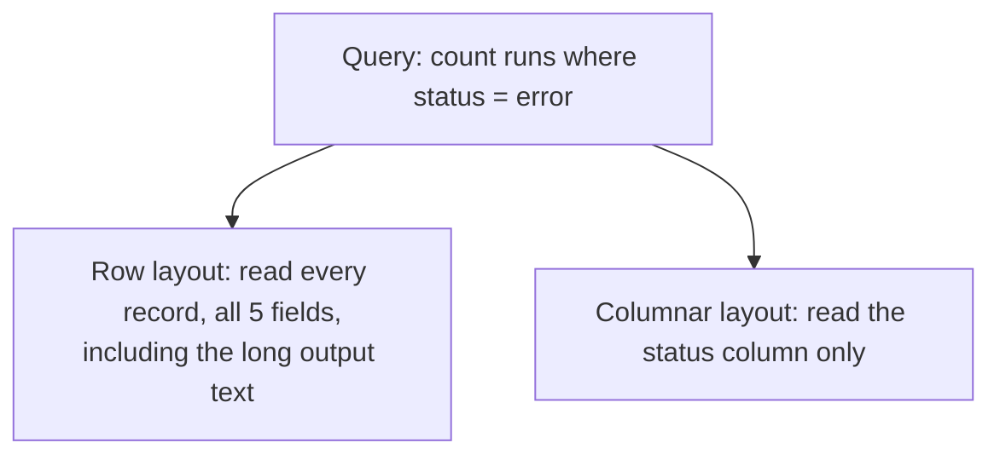
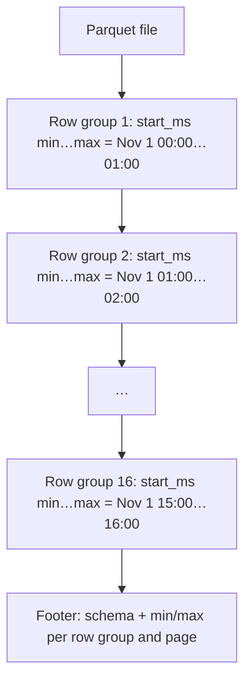

# The secret of the columnar database

A 15-minute primer on columnar storage, the idea under tracedb's data files (and under Parquet, DuckDB, ClickHouse,
Snowflake, BigQuery and SmithDB). It ends with a program you can run on your laptop that shows every idea with real
numbers.

Background you don't need: databases internals. If you know RocksDB, also read
[ROCKSDB_COMPARISON.md](ROCKSDB_COMPARISON.md) afterwards; for the product, [STARTER_GUIDE.md](STARTER_GUIDE.md).

---

## 1. The secret, in one sentence

**Store each column's values together instead of each row's values together**, so a query reads only the columns it
asks about, values of one type squeeze down to almost nothing, and every file can tell you what it *doesn't*
contain before you read it.

That's it. Everything else is a consequence.

---

## 2. Rows vs columns: the same table, two layouts

Take four agent runs:

| run_id | name | status | latency_ms | output |
|---|---|---|---|---|
| 1 | fetch_url | ok | 812 | "fetched 2,041 bytes…" |
| 2 | plan | ok | 2,104 | "step 1: search…" |
| 3 | fetch_url | error | 31,000 | "HTTPError: 429…" |
| 4 | llm | ok | 4,020 | "The answer is…" |

A **row layout** writes them record by record:

```text
[1, fetch_url, ok, 812, "fetched 2,041 bytes…"] [2, plan, ok, 2104, "step 1: search…"] [3, fetch_url, error, …] …
```

A **columnar layout** writes them column by column:

```text
run_id:     [1, 2, 3, 4]
name:       [fetch_url, plan, fetch_url, llm]
status:     [ok, ok, error, ok]
latency_ms: [812, 2104, 31000, 4020]
output:     ["fetched 2,041 bytes…", "step 1: search…", "HTTPError: 429…", "The answer is…"]
```



---

## 3. When each layout wins

| Workload | Typical question | Better layout | Why |
|---|---|---|---|
| **Transactions** (OLTP) | "fetch order 42, change its address" | **rows** | one record, all its fields, read and written together |
| **Key-value** | `Get(key)`, `Put(key, value)` | **rows** (RocksDB, …) | the value is one blob anyway |
| **Analytics** (OLAP) | "error rate by tool over the last 12 h" | **columns** | many rows, few columns, mostly reads |
| **Logs / traces / events** | "errors tagged `batch=a`, p95 latency" | **columns** | append-heavy, then scanned and aggregated |

Rule of thumb: if your queries touch **many rows but few columns**, go columnar. If they touch **one row and all
its columns**, stay with rows.

tracedb's questions ("show me the errors", "p95 latency per tool", "which runs mention `429`") are analytics over
millions of runs where each run has ~40 fields and a megabyte of prompt text. That's why its data files are Parquet.

---

## 4. The five core ideas

### Idea 1: read only the columns you need (projection)

A filter on `status` reads the `status` column. A group-by on `name` with `avg(latency_ms)` reads two columns. The
long `output` text, usually most of the bytes, is never touched unless the query names it.

### Idea 2: one type, one column, tiny on disk (encoding + compression)

A column holds values of one type that often repeat or change slowly, which is ideal for compression:

| Encoding | Works on | Example |
|---|---|---|
| **Dictionary** | few distinct values | `status`: store `{0: ok, 1: error}` once, then one small integer per row |
| **Run-length (RLE)** | repeats in a row | `ok, ok, ok, ok, error` → `(0 × 4), (1 × 1)` |
| **Bit-packing** | small integers | dictionary codes `0/1` need 1 bit each, not 8 bytes |
| **Delta** | sorted / slowly changing numbers | timestamps `t, t+50, t+100` → `t, +50, +50` |
| general codec (ZSTD) | whatever is left | applied per page after the encodings |

A row layout can't do most of this, because neighbouring bytes are different fields of different types.

### Idea 3: skip what can't match (statistics / zone maps)

Columnar files are split into **row groups** (tracedb: ~64k rows each), and each column of each row group is split
into **pages**. The file footer records **min and max per row group and per page**:



A query for "after 15:30" reads the footer, sees that only row group 16 can match, and never opens the other 15.
**This only works if the data is sorted (or naturally ordered) by the column you filter on.** Random order gives
every row group the full min…max range, and nothing can be skipped. Bloom filters do the same job for "is this exact
id here?".

### Idea 4: process arrays, not rows (vectorized execution)

In memory, a columnar engine keeps each column as a contiguous array (Apache **Arrow** is the standard format). A
filter becomes "compare 64k integers to a constant" in a tight loop the CPU can run with SIMD, instead of "for each
row object, look up a field, compare". That's where much of the speed comes from even when data is already in
memory.

### Idea 5: fetch expensive columns last (late materialization)

Evaluate the filter on cheap columns first (`status`, `start_ms`), get the list of matching row numbers, then read
the expensive columns (`output`, `inputs`) **only for those rows**. tracedb takes this furthest: payloads live in a
separate file and are read only for the rows on screen.

### The price

| Cost | Why | How tracedb pays it |
|---|---|---|
| Writes must be batched | a file is written column by column, then sealed | recent writes live in memory (a *memtable*) and are flushed as whole files |
| Updates are hard | you can't edit one value inside a compressed column | an update is a new *version*; reads **merge** versions (and, later, compaction rewrites them) |
| One whole row is slower | its fields live in many places | lookups touch few rows; payloads are fetched on demand |

---

## 5. Live coding: see it on your laptop

[`crates/tools/examples/columnar_tour.rs`](crates/tools/examples/columnar_tour.rs) generates 1,000,000 synthetic agent
runs (7 columns, ~5% errors, about 20 runs per second in time order), writes them once as **JSON lines** (a row
layout) and once as **Parquet** (columnar, with tracedb's own settings), then answers three questions both ways.

```bash
cargo run --release -p tracedb-tools --example columnar_tour            # 1,000,000 runs
cargo run --release -p tracedb-tools --example columnar_tour -- 200000  # smaller
```

The row side really parses every line; the columnar side uses **Apache DataFusion** (the engine tracedb uses) and
reports what the Parquet scan actually read (`EXPLAIN ANALYZE` metrics). Output from a MacBook, release build:

### Step 1: the transposition

The heart of the program is turning a `Vec<Run>` (rows) into one array per column:

```rust
let batch = RecordBatch::try_new(schema, vec![
    Arc::new(Int64Array::from_iter_values(runs.iter().map(|r| r.run_id))),
    Arc::new(StringArray::from_iter_values(runs.iter().map(|r| r.name.as_str()))),
    Arc::new(StringArray::from_iter_values(runs.iter().map(|r| r.status.as_str()))),
    // … one array per column
])?;
```

and writing it with the same settings as tracedb's data files: ~64k-row row groups, page-level statistics, ZSTD.

### Step 2: storage

```text
  rows    (JSON lines): 215.1 MB
  columns (Parquet):    21.4 MB  (10% of the rows file)
  16 row groups of up to 65536 rows
  column          on disk      per row   encodings
  run_id           2.9 MB       2.93 B   PLAIN,RLE,RLE_DICTIONARY
  start_ms         3.3 MB       3.26 B   PLAIN,RLE,RLE_DICTIONARY
  name             0.4 MB       0.38 B   PLAIN,RLE,RLE_DICTIONARY
  status           0.1 MB       0.07 B   PLAIN,RLE,RLE_DICTIONARY
  latency_ms       1.9 MB       1.89 B   PLAIN,RLE,RLE_DICTIONARY
  tokens           1.9 MB       1.86 B   PLAIN,RLE,RLE_DICTIONARY
  output          11.0 MB      10.97 B   PLAIN,RLE,RLE_DICTIONARY
```

What to notice (idea 2):

- **`status` costs 0.07 bytes per row.** Two distinct values → dictionary codes → 1 bit each → long runs of `ok`
  collapse under RLE. In JSON the same field costs ~14 bytes per row (`"status":"ok",`).
- **`name` (8 tools) costs 0.38 bytes per row** for the same reason.
- **Integers shrink from 8 bytes to ~2–3** because sequential and small values compress well.
- **`output` is half the file**: free text is the one thing that stays big. Keep that in mind for step 3.

### Step 3: "how many runs failed?" (ideas 1, 2, 4)

```text
  rows:       49811 errors in    233 ms, reading 215.1 MB
  columns:    49811 errors in     10 ms, bytes_scanned=68.98 K  row_groups_pruned_statistics=16 total → 16 matched
```

Same answer. The columnar scan read **69 KB** (the `status` column) instead of 215 MB: 3,000× fewer bytes.
Statistics can't skip anything here (every row group contains both `ok` and `error`), so all 16 row groups match;
the win is entirely from reading one tiny column.

### Step 4: "how many runs started in the newest 1% of the time range?" (idea 3)

```text
  rows:       10000 runs   in    243 ms, reading 215.1 MB
  columns:    10000 runs   in      2 ms, bytes_scanned=54.38 K  row_groups_pruned_statistics=16 total → 1 matched
```

**15 of 16 row groups were skipped from the footer alone**: their `start_ms` max is before the cutoff. That works
because runs arrive in time order, so each row group covers a narrow time slice. tracedb relies on exactly this:
its lists are time-scoped, and files are pruned by time before they're opened.

### Step 5: "average latency per tool" (ideas 1, 4)

```text
  rows:    8 groups in    254 ms, reading 215.1 MB
  columns: 8 groups in      3 ms, bytes_scanned=2.27 M
```

Two columns (`name`, `latency_ms`), 2.3 MB, aggregated as arrays.

### Is the comparison fair?

The **byte counts** are the layout effect and are fair: any row store has to read whole records (a binary row
format would be smaller than JSON, but would still read every field of every row). The **times** also include JSON
parsing, which a binary row store would avoid, so treat the millisecond gap as an upper bound on the layout effect,
and the byte gap as the real one.

### Experiments to try

Edit `generate()` in the example and re-run:

1. **Break the sort order.** Replace `t0 + i as i64 * 50` with `t0 + rng.below(n as u64) as i64 * 50`. Step 4's
   pruning collapses (every row group covers the whole time range, so none can be skipped) and `bytes_scanned`
   grows to the whole `start_ms` column (the count changes too, since the cutoff now comes from a random run).
2. **Make `status` noisy.** Use 50% errors: the column stops collapsing under RLE and grows.
3. **Search the text.** Add a query `filter(col("output").like(lit("%429%")))`: statistics can't help with
   substrings, so it reads the whole `output` column. That's why tracedb added a per-file text index in M3.

---

## 6. How tracedb uses all this

| Idea | In tracedb |
|---|---|
| Columns | data files are Parquet: a **core** file (ids, name, status, times, tags, promoted attributes) and a separate **payload** file (inputs, outputs, events) |
| Read only what you need | lists and filters read only core; payloads only when a run is opened |
| Compression | dictionary/RLE + ZSTD per page; disk is ~19% of the raw JSON uploads at 2M runs |
| Skip with statistics | files sorted by `(trace_id, dotted_order)`; the catalog keeps per-file time and trace ranges; footers, page index and bloom filters on `run_id` / `trace_id` skip the rest |
| Vectorized | DataFusion scans Parquet into Arrow arrays |
| Late materialization | payload rows fetched by row number, only for rows shown or search candidates |
| The price: batched writes | writes go to a WAL and an in-memory memtable, flushed as whole files |
| The price: updates | a late update is a new version; queries merge a run's versions before filtering |
| Free text | statistics can't help, so each file also gets a small inverted index (M3) |

Where to read the code: [segment.rs](crates/storage/src/segment.rs) (writing and reading the files),
[scan.rs](crates/query/src/scan.rs) and [pushdown.rs](crates/query/src/pushdown.rs) (pruning, scanning, merging),
[fts.rs](crates/storage/src/fts.rs) (the text index).
