# smithling starter guide

New here? This guide explains smithling from zero: the problem it solves, how the work was broken down, and how each
milestone turned a blank repo into a usable trace store, one step at a time. No storage background needed.

- **10 minutes**: read sections 1–3.
- **An hour**: read it all, then try section 9 on your laptop.
- **Ready for code**: each milestone has a detailed, line-linked guide; links are in section 10.

[README.md](README.md) has a five-minute tour and [USAGE.md](USAGE.md) every command and flag; this guide is the story
behind them.

---

## 1. The problem: debugging an AI agent

An AI agent doesn't answer in one step. It calls a model, the model asks for a tool, the tool's output goes back to
the model, a sub-agent starts, and so on. Each step is a **run**. Runs nest, and the whole tree for one task is a
**trace**:

```text
research_task  (agent, 41 min, ok)                  ← looks fine
├── plan            (llm,  2.1 s, 1,200 tokens)
├── web_search      (tool, 0.8 s)
├── fetch_url       (tool, 31.0 s, ERROR 429)       ← the real problem
├── fetch_url       (tool, 1.2 s)
├── summarize       (sub-agent, 3 min)
│   ├── llm         (llm,  4.0 s, 6,800 tokens)
│   └── python_exec (tool, 0.3 s)
└── final_answer    (llm,  3.2 s)
```

Each run records what went in (prompt, tool arguments), what came out, how long it took, tokens, cost, and whether
it failed. Real traces have 20–300 runs, and an overnight eval produces hundreds of traces.

### Why the usual tools struggle

Agent traces have four properties that, together, break ordinary logs and tracing tools:

| Property | What goes wrong |
|---|---|
| **Deep and wide**: hundreds of nested runs | a flat log shows *what* happened, not *who called whom* |
| **Arrives in pieces**: a run's end can come 40 minutes (or 3 days) after its start | write-once stores leave it "running" forever, or keep two disconnected records |
| **Heavy payloads, tiny filters**: megabyte prompts, byte-sized `status` | "show me the errors" ends up reading every payload: minutes, not milliseconds |
| **Odd questions**: "traces where *any* step failed", "search the outputs" | tools built for microservices don't know about prompts, tokens or late updates |

People fall back to `print` and grep, or send everything to a hosted service. Hosted tracing (LangSmith) handles all
of this well, but prompts, and sometimes customer data or secrets, leave the laptop.

**smithling's goal**: answer the same questions LangSmith answers, in **one local program**, with all data in **one
folder**, and with **no change to the agent** beyond one environment variable.

### The bar: seven questions a trace store must answer fast

From LangChain's [SmithDB post](https://www.langchain.com/blog/introducing-smithdb), the storage engine behind
LangSmith:

| # | Question | Example |
|---|---|---|
| 1 | Show me this one | open trace X, open run Y's full input |
| 2 | Narrow it down | errors in the last 12 h, tagged `batch=a`, slower than 2 s |
| 3 | Find the text | outputs containing `"429 Too Many Requests"` |
| 4 | Look inside the JSON | `metadata.prompt_version = "v7"` |
| 5 | Think in trees | roots that succeeded but where *any* step underneath failed |
| 6 | Rebuild the conversation | all six turns of one chat, in order |
| 7 | Add it up | error rate, p95 latency, cost per tool |

---

## 2. The approach: SmithDB, rebuilt in the open, in stages

smithling is a rebuild of SmithDB's *design* from public sources (the SmithDB post, and the open-source LangSmith SDK
for the wire format). Not its code. The ground rules ([constitution](.specify/memory/constitution.md)):

1. **SmithDB is the reference.** Every component maps to a SmithDB counterpart. Every difference is written down
   with a reason (local-first, not mature yet, or deliberately staged), and the rule is to keep it swappable so the
   SmithDB-style version can replace it later (today the text index is a trait; other parts are concrete types).
2. **Local and private.** No outbound connections, localhost only, everything under `--data`, UI embedded.
3. **Unchanged agents.** Speak the LangSmith SDK's upload protocol, so existing agents work by changing the
   endpoint.
4. **Measured, not asserted.** Every speed claim has a benchmark row; misses are reported, not loosened.
5. **UI first.** Every milestone ships its browser view.

### How the problem was broken down

Each milestone takes one slice of the problem, ends with something you can use, and sets up the next one:

**Colors in every chart below**: green = new in that step · orange = changed or improved · grey = unchanged from
before · dashed blue = planned, not built yet.

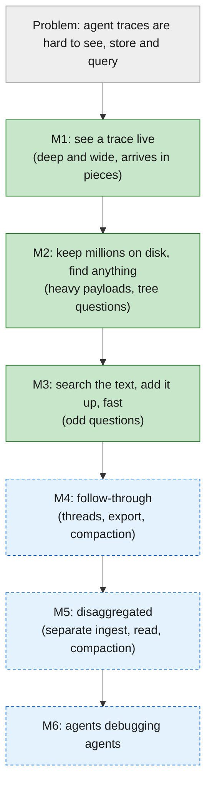

| Milestone | User can… | Status |
|---|---|---|
| **M1** See agent trace live | watch an unchanged agent's trace appear in the browser, and lose nothing on a crash | built, passed locally |
| **M2** Durable storage + query builder | keep 2M runs on disk and build any filter by clicking | built, passed locally |
| **M3** Search, aggregates, speed | search payload text, group and chart, compare batches | built, passed locally; performance work deferred |
| **M4** Follow-through | threads, export, feedback writes, "what stands out", compaction | planned |
| **M5** Disaggregated trace database | run ingest, read workers and compaction as separate services over shared storage | spec drafted |
| **M6** Zero instrumentation + agents | import Claude Code sessions; agent tools over MCP | planned |

Live status always lives in the [roadmap](specs/000-smithling-master-plan/roadmap.md).

---

## 3. The big picture

### The path of one run

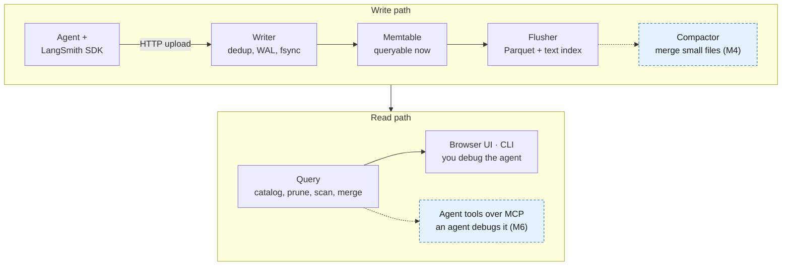

Dashed boxes are not built yet. Today the flusher's files (listed in the catalog: SQLite / Postgres) go straight to
the read path, unmerged; compaction ([M4](#m4-follow-through-found-it--fixed-it-and-prevented-it)) closes that gap.
Agent tools ([M6](#m6-zero-instrumentation--agents-agents-debugging-agents)) let an AI agent read the same traces you
read in the UI.

Everything runs in **one process**. The storage layout is designed so the data files can sit on S3 and the catalog
on Postgres (cloud mode) with the same binary.

### Words you'll see everywhere

| Word | Meaning |
|---|---|
| **run** | one step of an agent (LLM call, tool call, sub-agent) |
| **trace** | the tree of runs for one task |
| **event** | one upload about a run: a start (`post`) or an update (`patch`) |
| **WAL** | write-ahead log: every event is appended and fsynced here *before* smithling says "OK" |
| **memtable** | the in-memory table of recent runs; queries read it directly |
| **flush** | writing a full memtable out as immutable files |
| **segment** | one flush's files for one project: a *core* Parquet file (small fields), a *payload* Parquet file (inputs/outputs), and (M3) a text index |
| **catalog** (metastore) | a small SQL database listing every segment and its time / trace-id ranges |
| **version** | one stored piece of a run; a run whose start and end were stored at different times has two |
| **merge** | combining a run's versions into the one run you see: the newest value of each field wins |
| **pin** | a query's frozen snapshot of the file list + memtables, so files can't change under it |

### Where the code lives

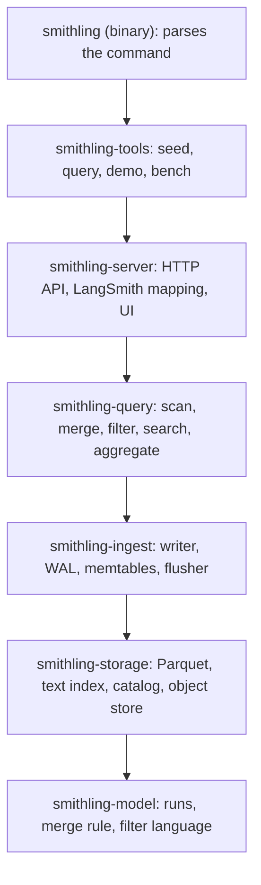

(Arrows show "uses". Each crate also uses the ones further down directly.) The browser UI is a React app in
[`ui/`](ui/), embedded in the binary at build time.

---

## 4. Step 1 (M1): see an agent trace live

**Problem**: "I can't see what my agent is doing right now." **Goals**: the whole path works end to end; each step
shows in the browser within 1 s; nothing smithling confirmed is ever lost, even after `kill -9`.

### What M1 built

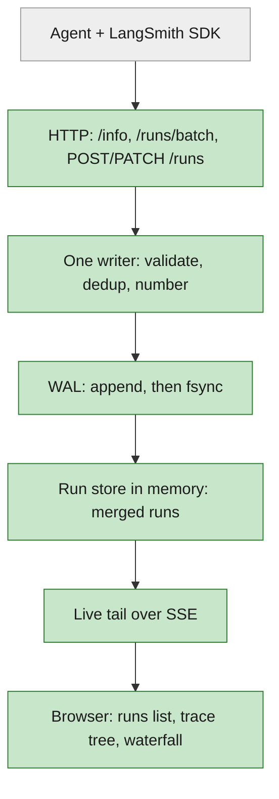

### Idea 1: one writer, and "OK" only after fsync

All uploads queue up for a **single writer thread**, which gives one order and no lock fights. For each batch of
waiting requests it:

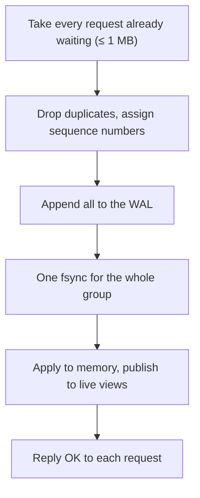

- **Group commit**: requests that arrive during one fsync share the next one. There's no fixed wait: a quiet server
  commits one request at a time, a busy one commits many together.
- **Crash-safe by construction**: a client hears "OK" only after its data is on disk. On restart, replaying the WAL
  rebuilds memory; a half-written record at the end fails its checksum and is dropped (it was never confirmed).
- **Backpressure**: when smithling can't keep up it answers `429` with `Retry-After`; the SDK retries.

Code: [`crates/ingest/src/writer.rs`](crates/ingest/src/writer.rs).

### Idea 2: a run arrives in pieces, so merge them

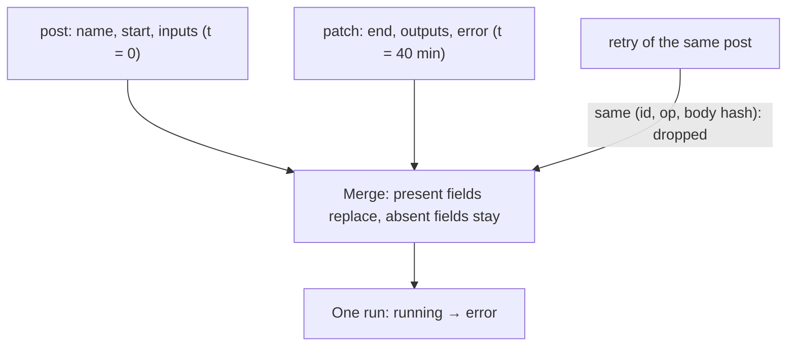

The merge rule ([`crates/model/src/merge.rs`](crates/model/src/merge.rs)) is the heart of the data model: apply a
run's pieces in arrival order; each field the newer piece sends replaces the old value; fields it doesn't send keep
their values; status and latency are recomputed. Identity fields (`trace_id`, parent, project) never change.

### Results, and what M1 cost

| Check | Target | Measured |
|---|---|---|
| Throughput | ≥ 5,000 events/s | 74,247 events/s for 60 s |
| Crash harness | 10/10 `kill -9` rounds | 10/10, zero confirmed events lost |
| Restart at 500k runs | ≤ 30 s | 0.83 s |
| Real agent | unchanged LangGraph agent | 9-step trace, `running` → `ok` |

**The cost, which sets up M2**: everything lives in RAM (about 500k runs), the WAL grows forever, and you can only
filter by project and status.

Deep dive: [M1 starter guide](specs/001-m1-see-agent-trace-live/starter-guide.md).

---

## 5. Step 2 (M2): keep millions on disk, find anything

**Problem**: "it doesn't fit in memory, and I can't find the run I need." **Goals**: hold 2M runs on disk, losing or
duplicating nothing even if a flush crashes; build any filter by clicking (fields, JSON paths, conditions on the
whole trace); run the same binary on S3 + Postgres.

### What M2 added

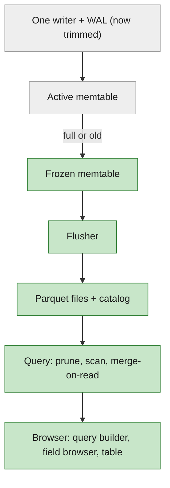

This is the classic **LSM** (log-structured merge) shape that RocksDB and SmithDB use: log every write, buffer it in
memory, write big sorted immutable files, merge on read. The files here are **Parquet** (columnar), not RocksDB's
SST files, because the workload is analytics: filter, group, add up.

### Idea 1: freeze, flush, then commit

When the active memtable is full or old enough, it is **frozen** and a fresh one takes over instantly, so uploads
never wait for the disk. Then, in the background:

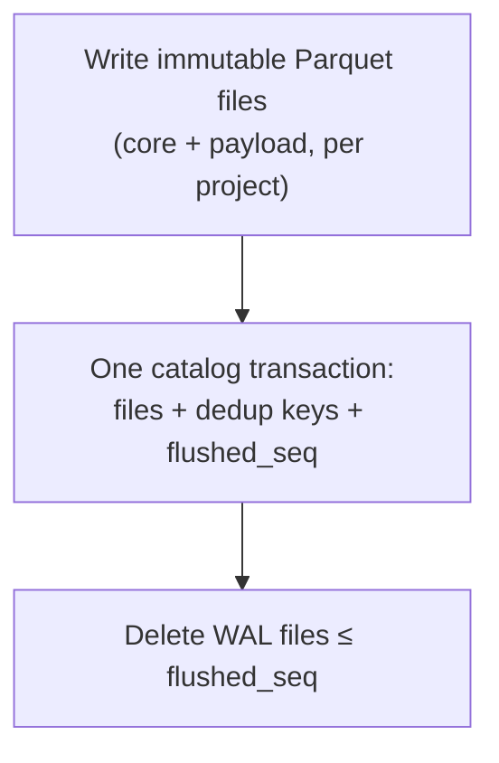

- **Crash anywhere, lose nothing**: data is always in the WAL, in registered files, or both. Files written but never
  registered are deleted on start.
- **Why "full *or* old"**: size handles busy servers; age stops a quiet server from keeping data only in the WAL for
  days. (Defaults: M2 shipped 128 MB / 10 min; M3 lowered them to 64 MB / 2 min to cut idle memory.)
- **Each WAL file belongs to one memtable**: the WAL starts a new file at every freeze, so a flushed memtable's log
  is deleted whole.

### Idea 2: two files per segment: small fields and big payloads

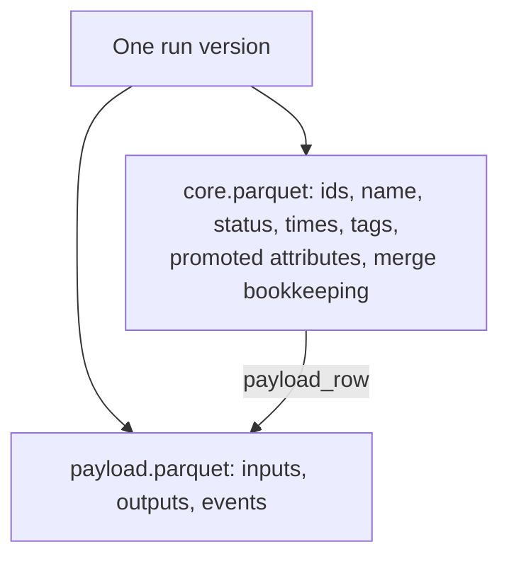

Lists and filters read only the core file. Small scalar values inside payloads (`outputs.status_code = 429`) are
copied into core as **promoted attributes**, so they can be filtered without touching payloads. The payload file is
read only when you open a run, and only the rows and fields you asked for.

### Idea 3: read fast, merge only what's split

A run's start can sit in a file while its end is still in memory (the 3-day run case). Filtering before merging would
be wrong ("status = error" would see `running`); merging everything would be slow. So:

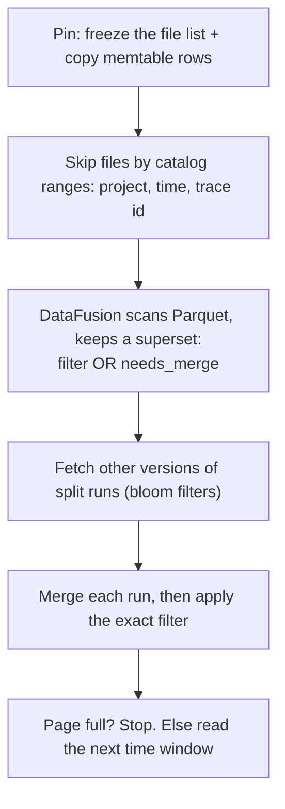

- **Two levels of skipping**: smithling drops whole files using the catalog's ranges (no I/O); inside each file,
  DataFusion uses Parquet's footer statistics, page index and bloom filters to skip row groups and pages.
- **The sieve and the judge**: DataFusion may keep extra rows but never drops a match; smithling's own evaluator makes
  the final call on the merged run. So results can't depend on where data happens to live.
- **Only ~10% of runs need merging** (the late finishers, marked `needs_merge`); the rest are read as-is.
- **Stop early**: lists read the newest slice of time first and stop as soon as a page is full.

Code: [`crates/query/src/scan.rs`](crates/query/src/scan.rs), [`crates/query/src/pushdown.rs`](crates/query/src/pushdown.rs).

### Results: misses reported, then fixed

At 2M runs (5.13 GB of raw JSON, 37 files):

| Metric | Target | First bench | After the fix |
|---|---|---|---|
| Broad filter (metadata + name), p50 | ≤ 500 ms | 2.6 s ❌ | 29 ms |
| "Quiet failures" (tree condition), p50 | ≤ 500 ms | 6.5 s ❌ | 53 ms |
| Disk vs raw JSON | ≤ 100% | 119% ❌ | 19% |
| Open a trace, p50 | ≤ 200 ms | 6.1 ms | 6.1 ms |

The fixes were design changes, logged as decisions: windowed scans that stop early
([D-021](specs/000-smithling-master-plan/decisions.md#d-021)), and saving 33-byte dedup keys in the catalog instead of
keeping old WAL files (D-022).

**What M2 left for later**: text search, aggregates and charts, comparison (M3); compaction (M4).

Deep dive: [M2 starter guide](specs/002-m2-durable-storage-query-builder/starter-guide.md).

---

## 6. Step 3 (M3): search the text, add it up, compare

**Problem**: "is this a pattern, how bad is it, and did the fix work?" **Goals**: search inputs, outputs and errors,
then group, chart and compare; make the speed claims measurable; accept the SDK's default upload format (multipart)
and feedback.

### What M3 added

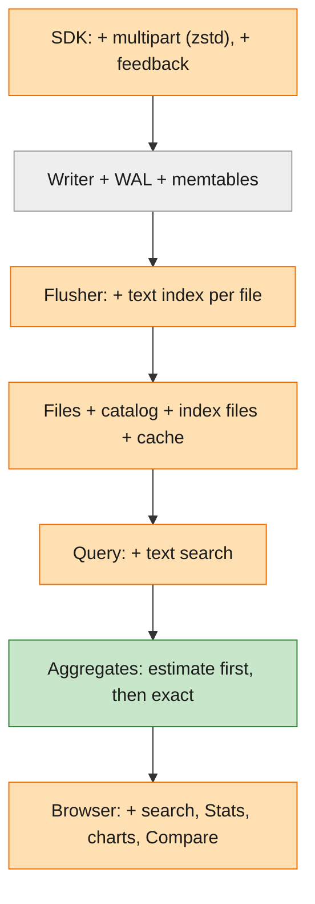

### Idea 1: a text index that can't lie

Each flush now writes two more files per segment: a **dictionary** (every word, which field it's in, where its list
is) and **postings** (for each word, the rows that contain it). That's an *inverted index*, like the index at the
back of a book.

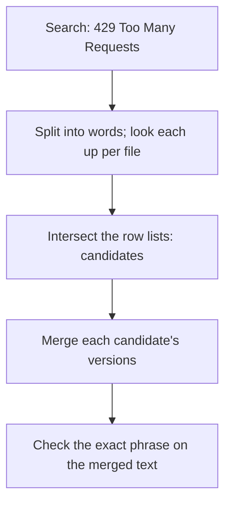

The index stores no word positions, so it only narrows the candidates; the exact check runs on the merged run. That
also handles late updates: if an update replaced the output that matched, the old index entry is rejected.
The index costs little disk (measured +0.2% to +6.9% of the raw JSON size, depending on how prose-like the data
is; D-026) and saves scanning every payload.

### Idea 2: aggregates without merging everything

- **Clean side**: runs with one version stream from a column-pruned scan straight into accumulators (count, error
  rate, exact p50/p95/p99, tokens, cost).
- **Dirty side**: split runs take the merge path first.
- Each run is counted on exactly one side, so the totals are exact.
- **Progressive**: a slow grouped query first sends an estimate from an even sample, then the exact answer, over SSE.

### Idea 3: read less, again

A bounded memory **cache** (32 MB) keeps Parquet footers, page indexes, index pages and payload ranges; run lookups
read only the files that hold the run; payloads are read only for rows on screen (late materialization). A damaged
data file is skipped and named instead of breaking every query.

### Results

`smithling demo --seed 7` passes all 10 checks: `"429 Too Many Requests"` finds 31 runs, all `fetch_url`;
`fetch_url` has 14.0% errors and p95 31 s in batch a vs 2.0% and 9 s in batch b; batch a costs $4.12. The current
LangSmith SDK works on its default settings (multipart + zstd); feedback is stored, filtered and averaged; disk stays
under 50% of raw JSON including the index.

**Deferred by decision** (end-to-end first, performance later): the full 2M-run bench on a quiet machine (D3-1) and
idle memory ≤ 200 MB (D3-2, waived until M4 compaction). **Not verified on this machine**: the cloud CI job, the UI
in a real browser, the no-outbound check under strace (D3-3 to D3-5).

Deep dive: [M3 starter guide](specs/003-m3-search-aggregates-speed/starter-guide.md).

---

## 7. How a read works (and what compaction changes)

Every question you ask, whether it's a runs list, a trace, one run, a search or a chart, goes through the same five
steps. Sections 4–6 introduced them one milestone at a time; this section puts them together, with the details
that matter once compaction (M4) starts replacing files under running queries.

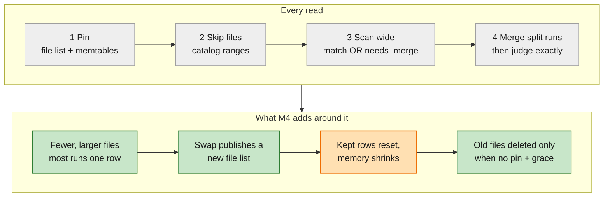

*Grey: built in M1–M3. Green: new in M4. Orange: changed by M4.*

### The five steps

| Step | What happens | Why |
|---|---|---|
| **1. Pin** | Under the memtable lock, the query takes the current file list (an `Arc<Version>`) and copies the memtable rows in scope, without payloads | A consistent snapshot; the writer never waits for a query |
| **2. Skip files** | The catalog's ranges (project, start time, trace id, sequence numbers) drop whole files without reading them | Most files never get opened |
| **3. Scan wide** | DataFusion reads the rest with Parquet statistics, page indexes and bloom filters, keeping every row that *might* match plus every row marked `needs_merge` | The "sieve": it may keep extras, never drops a match |
| **4. Merge, then judge** | Runs split across places are merged (newest value per field wins), and only then is the exact filter applied | Correct no matter where a run's pieces live |
| **5. Fill the page** | Lists read the newest time slice first and stop once a page is full; payloads are read only for rows on screen | Fast first answers |

Code: [`crates/query/src/scan.rs`](crates/query/src/scan.rs) (pin, scan, merge),
[`crates/query/src/fields.rs`](crates/query/src/fields.rs) (field counts and kept rows).

### The details

- **A snapshot, not a lock.** A flush that lands mid-query doesn't change that query's answer; the next query sees it.
  Live views re-run the same query over the traces that changed, at most every 100 ms.
- **One run can be in two places.** The 40-minute research run's start was flushed to a file long before its end
  arrived. The end sits in the memtable; the read finds both pieces and merges them. Filtering first would be wrong:
  the file's copy still says `running`.
- **How a read knows a run is split.** The writer keeps a *multi-version set*: runs whose update arrived after their
  start was frozen or flushed. A run joins it under the same lock readers pin with, so no query can see a new piece
  before the run is marked. When the memtable is flushed, those runs' rows get `needs_merge`. About 10% of runs are
  split; the rest are read as they are.
- **Counts add up per file, minus the split runs.** Field counts ("`prompt_version: v7 (912)`") come from per-file
  stats, which would count a split run once per piece. So for split runs the query subtracts their per-file rows and
  adds one merged row. Those merged rows (*kept rows*) are cached across requests, because before M4 files were only
  ever added. That cache is most of the idle memory that M3 waived (D-028).
- **One run's payload is read from one file.** A single-run read finds the file by its sequence and trace-id ranges,
  then reads the inputs and outputs for just that row.
- **Search never trusts the index alone.** The text index narrows to candidates; the exact phrase is checked on the
  merged text. If a late update replaced the output that matched, the stale index entry is rejected.
- **A damaged file is skipped and named**, not allowed to break every query.

### What compaction changes for reads (M4)

Compaction merges small files into one file per project per hour, with one row per run. Every query must give the
same answer before and after (SC-02). Here is what that takes:

- **Files can disappear now.** Before M4, files were never deleted, so a pinned file list was always readable.
  Now each swap publishes a new file list, and replaced files are deleted later. A query keeps reading the list it
  pinned. A replaced file is deleted only when no query still holds a file list from before its swap (an *era
  token*, a reference count shared by every file list between two swaps) **and** its grace period (24 h) has passed.
- **Answers switch files at one moment.** The swap is one catalog commit that also swaps the files' field stats. A
  query sees either all the old files or all the new ones, never a mix, so nothing is counted twice or lost.
- **Fewer files, fewer merges.** A compacted run is one row in one file, so most of step 4 disappears for old data.
- **Memory shrinks, once it's safe.** Merged runs leave the multi-version set, and the kept rows reset, but only
  after every file list from before the swap is released. The first field-count or aggregate request after that
  rebuilds the kept rows, which are now small.
- **Late updates still work.** An update to an already-compacted run lands in a new small file marked `needs_merge`
  and is merged at query time, as before. Compacted files are never rewritten (backlog K6 revisits this if these
  small files pile up).
- **Single-run reads cover a wider range.** A compacted file spans a wide range of sequence numbers, so the
  single-run lookup may open more candidate files. Answers are the same; whether it's slower is measured with the
  full bench (backlog K11).
- **Readers in other processes (M5).** A reference count only sees queries in this process. Read workers on other
  machines are covered by the grace period instead, with each reader query capped well under it.

How a job runs, the catalog states and the crash cases are in the
[M4 plan](specs/004-m4-compaction/plan.md#how-compaction-works).

---

## 8. What's next

Nothing below is specced yet; it's the plan and the current thinking.

### M4: follow-through ("found it" → "fixed it and prevented it")

| Capability | Example |
|---|---|
| **Threads**: a multi-turn conversation spread over several traces, shown as one chat | a task with 6 turns |
| **Export** any set of runs to JSONL, to reuse as an eval dataset | the 37 bad root runs |
| **Find what stands out**: select an odd part of a chart, see which fields set it apart | error spike → `fetch_url`, `prompt_version = v7` |
| **Feedback writes**: add a score and comment, filter and average by it | — |
| **Compaction**: merge small files, write each run's merged form, retire old files | late runs stay correct before and after |

**Compaction** is the missing LSM piece. Today every flush adds files and none are ever merged, so file count only
grows and split runs stay split (which is also why idle memory is above target). The sketch is *time-tiered*:

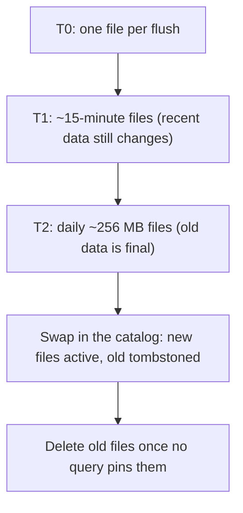

Open questions for the M4 spec: what triggers each step (file count, share of split runs, a schedule), when data is
"final enough", how a late update to an already-compacted day is handled, and re-sizing the tiers to M2's real
numbers (a flush already holds minutes of data, not seconds).

### M6: zero instrumentation + agents ("agents debugging agents")

- **Claude Code importer**: import local session history and use every triage feature on it, with no instrumentation.
- **Agent tools + `smithling mcp`**: outline, error path, payload slices, failure clusters, diffs and annotations,
  sized for an AI agent's context, so an agent can answer "why did batch a fail?" and cite the runs.

### Backlog (agreed, not scheduled)

| Item | Note |
|---|---|
| **Delete + retention** (B1) | hide immediately with delete vectors and a per-project TTL; reclaim space through compaction, so it pairs naturally with M4 |
| **Deferred M3 performance** (D3-1, D3-2) | the 2M-run quiet bench and idle memory; re-evaluated before M4 starts |
| **Vortex** files | SmithDB's file format, as an alternative to Parquet (no format interface exists yet) |
| **OpenTelemetry ingest, raw SQL** | the likely first follow-ups after v0 |
| **Cloud split** | separate ingest / query / compaction services, SSD cache, sticky routing (SmithDB's cloud shape) |

---

## 9. Try it

```bash
(cd ui && npm ci && npm run build)          # the UI, once
cargo build --release
./target/release/smithling serve               # http://localhost:7070, data in ./.smithling
```

In another terminal:

```bash
./target/release/smithling seed --traces 100 --no-delay        # realistic research-agent traces
./target/release/smithling query --search '429 Too Many Requests'
./target/release/smithling demo --seed 7                        # the whole triage story, as pass/fail checks
```

Or point a real agent at it: `LANGSMITH_TRACING=true LANGSMITH_ENDPOINT=http://localhost:7070 LANGSMITH_API_KEY=local`.

Things worth watching while you play:

- `curl -s localhost:7070/healthz` shows the segment count, memtable size and limit, whether a frozen memtable is
  flushing, and unflushed WAL bytes. Seed more data and watch flushes happen.
- `kill -9` the server mid-seed, restart it: every run that was confirmed is still there.
- Every list response carries `stats`: files scanned, rows read, rows merged. Compare a narrow time range with
  "all time".

---

## 10. Where to go next

| You want to… | Read |
|---|---|
| use smithling | [README.md](README.md) (a five-minute tour), [USAGE.md](USAGE.md) (every view, command and flag) |
| understand why it matters, in more depth | [primer](specs/000-smithling-master-plan/primer.md) |
| see status, decisions, what's next | [roadmap](specs/000-smithling-master-plan/roadmap.md), [decision log](specs/000-smithling-master-plan/decisions.md) |
| read the code, milestone by milestone | starter guides for [M1](specs/001-m1-see-agent-trace-live/starter-guide.md), [M2](specs/002-m2-durable-storage-query-builder/starter-guide.md), [M3](specs/003-m3-search-aggregates-speed/starter-guide.md) (in that order: each builds on the last) |
| see how smithling maps to SmithDB | [design notes §2](specs/000-smithling-master-plan/design-notes.md) |
| learn why columnar storage is fast, with a runnable example | [SECRET_OF_COLUMNAR_DB.md](SECRET_OF_COLUMNAR_DB.md) |
| compare the storage engine with RocksDB | [ROCKSDB_COMPARISON.md](ROCKSDB_COMPARISON.md) |
| change something | the milestone's `spec.md` → `design.md` → `tasks.md`, and the tests named in its starter guide |
