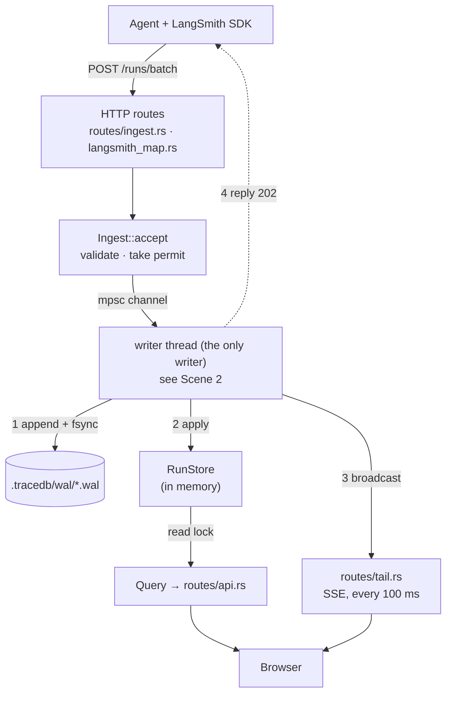
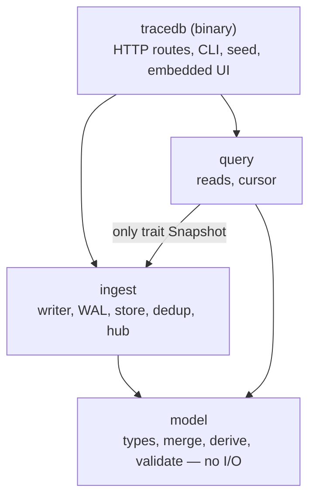
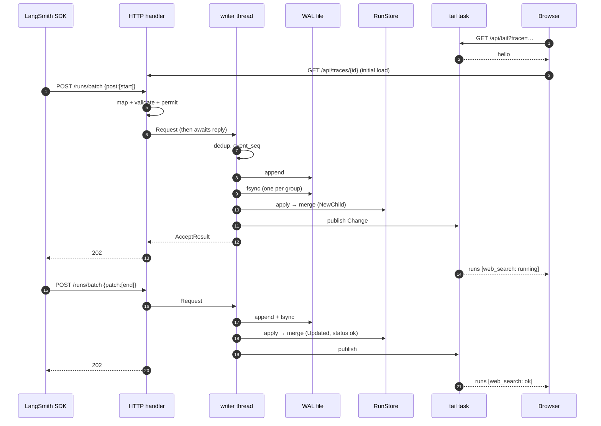
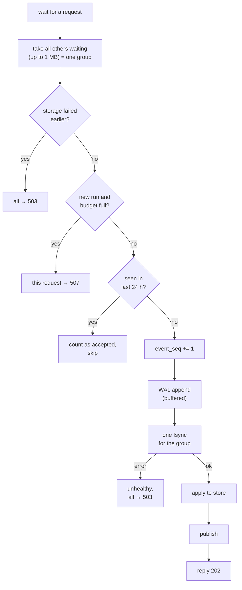
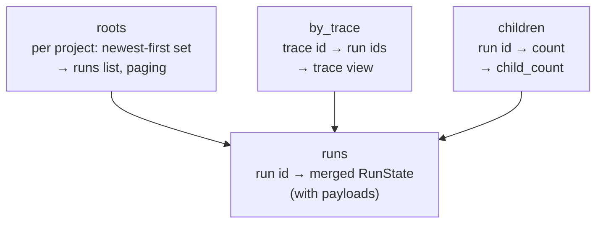
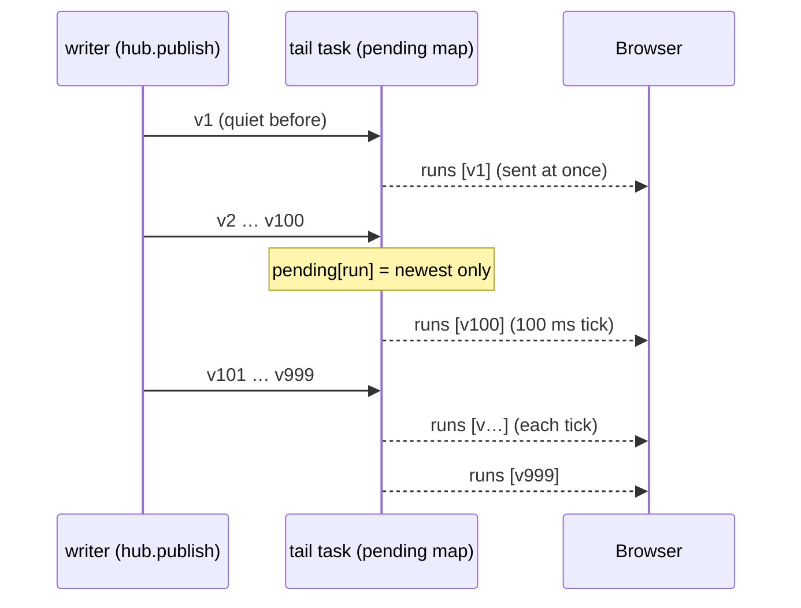
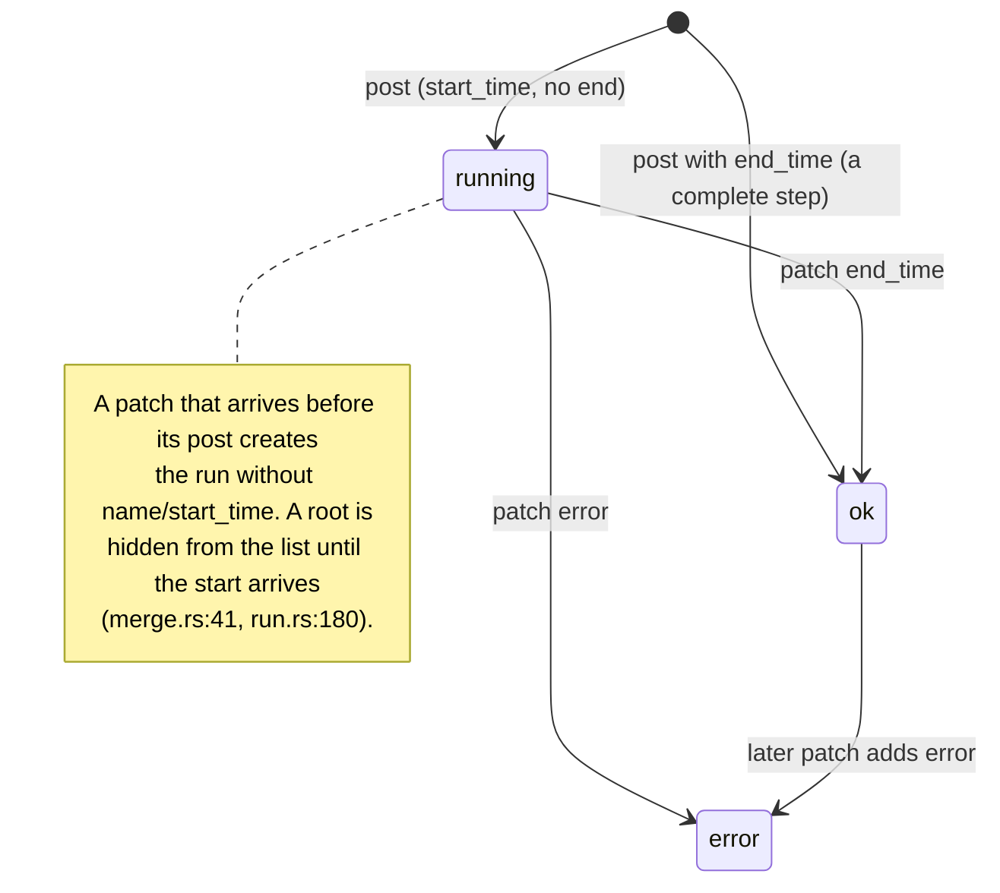
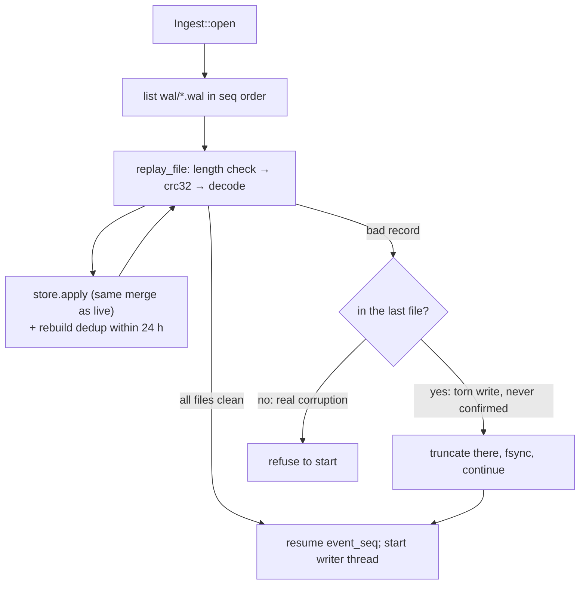

# M1 code starter guide

How to read the M1 code: the big picture, the critical parts, and one agent step traced through the code with
line numbers. Line numbers are as of commit `3a3f290`; if they drift, search for the function name.

For *why* it is built this way, see [design.md](design.md). This guide is about *where* it lives.

## 1. The system in one picture



Four ideas carry the whole system:

1. **One writer thread.** Only one thread writes the WAL, assigns sequence numbers, or changes the store, so
   there is no write-side locking puzzle.
2. **Disk before "yes".** A client gets 202 only after fsync.
3. **A run is a fold over its events.** `merge()` is a pure function, and the same function runs on live ingest
   and on WAL replay. That's why a restart rebuilds exactly the same state.
4. **Reads never block the writer.** Readers take a read lock on a snapshot, and the tail gets changes over a
   broadcast channel. A slow browser gets `resync` instead of slowing ingest down.

### Crates and who depends on whom



`query` sees ingest only through `trait Snapshot`
([ingest/src/lib.rs:120](../../crates/ingest/src/lib.rs#L120)). That trait is the boundary where M2 puts
segments and DataFusion.

## 2. Suggested reading order (about 2 hours)

| # | File | Why read it | Time |
|---|---|---|---|
| 1 | [model/src/run.rs](../../crates/model/src/run.rs), [event.rs](../../crates/model/src/event.rs) | Vocabulary: `RunFields` (wire, all optional), `RunEvent` (fields + seq), `RunState` (merged run) | 10 min |
| 2 | [model/src/merge.rs](../../crates/model/src/merge.rs) | **Critical.** The merge rule | 15 min |
| 3 | [model/src/derive.rs](../../crates/model/src/derive.rs) | status, latency, tokens | 5 min |
| 4 | [ingest/src/writer.rs](../../crates/ingest/src/writer.rs) | **Critical.** Group commit; order of operations | 20 min |
| 5 | [ingest/src/wal.rs](../../crates/ingest/src/wal.rs) | **Critical.** On-disk format, torn tail vs corruption | 20 min |
| 6 | [ingest/src/lib.rs](../../crates/ingest/src/lib.rs) (`open`, `accept`) | Startup replay, backpressure | 10 min |
| 7 | [ingest/src/store.rs](../../crates/ingest/src/store.rs) | Indexes, keyset paging | 15 min |
| 8 | [tracedb/src/routes/tail.rs](../../crates/server/src/routes/tail.rs) | **Critical.** Live fan-out and coalescing | 15 min |
| 9 | [langsmith_map.rs](../../crates/server/src/langsmith_map.rs), [routes/ingest.rs](../../crates/server/src/routes/ingest.rs) | Wire-format translation (skim) | 10 min |
| 10 | [ui/src/live.ts](../../ui/src/live.ts), [RunsList.tsx](../../ui/src/RunsList.tsx) | How the browser stays in sync | 10 min |

Skip on the first pass: `validate.rs` (limits), `seed.rs`, `routes/ui.rs`, `cursor.rs` (34 lines, obvious),
`build.rs`.

## 3. Walkthrough: one agent step, start to finish

The agent calls a `web_search` tool. The SDK sends its start, later its end, and you watch it in the browser.



### Scene 1: the SDK sends the start

The SDK sends `{"post": [{id, trace_id, dotted_order, parent_run_id, name:"web_search", start_time, inputs,
session_name:"research"}]}`.

| Step | Code |
|---|---|
| The route is registered | [tracedb/src/lib.rs:42](../../crates/server/src/lib.rs#L39) → `runs_batch` |
| post and patch items are tagged with an `Op` | [routes/ingest.rs:46-53](../../crates/server/src/routes/ingest.rs#L46) |
| Each item is translated; a bad item is rejected alone, not the whole batch | [routes/ingest.rs:103-116](../../crates/server/src/routes/ingest.rs#L103) → `incoming()` [langsmith_map.rs:33](../../crates/server/src/langsmith_map.rs#L33) |
| A hash of the raw body is taken for dedup | [langsmith_map.rs:39](../../crates/server/src/langsmith_map.rs#L39) |
| LangSmith names map to ours (`session_name` → project, `extra.metadata` → metadata) | [langsmith_map.rs:101-114](../../crates/server/src/langsmith_map.rs#L101) |
| Unknown fields are kept, not lost (stored under `extra.other`) | [langsmith_map.rs:128-137](../../crates/server/src/langsmith_map.rs#L128) |
| Validated, then queued with a backpressure permit; a full queue returns 429 | [ingest/src/lib.rs:243-273](../../crates/ingest/src/lib.rs#L243) |
| Sent to the writer; the HTTP task **awaits** the reply | [ingest/src/lib.rs:281-288](../../crates/ingest/src/lib.rs#L281) |

`wait.await` at [lib.rs:288](../../crates/ingest/src/lib.rs#L288) is the durability promise. The HTTP response
can't go out until the writer replies, and the writer replies only after fsync.

### Scene 2: the writer commits it (the heart of the system)



| Step | Code |
|---|---|
| Takes one request, drains all others waiting, up to 1 MB | [writer.rs:37-52](../../crates/ingest/src/writer.rs#L37) |
| Storage already failed: refuse everything (503) | [writer.rs:61-66](../../crates/ingest/src/writer.rs#L61) |
| Budget: a batch with any new run is refused whole if full (507) | [writer.rs:77-89](../../crates/ingest/src/writer.rs#L77) |
| Dedup: exact repeat (same run, op, body) is counted as accepted, skipped | [writer.rs:97-103](../../crates/ingest/src/writer.rs#L97) |
| Assigns the global `event_seq` | [writer.rs:104-112](../../crates/ingest/src/writer.rs#L104) |
| WAL append (buffered, not yet durable) | [writer.rs:113-117](../../crates/ingest/src/writer.rs#L113) → [wal.rs:129](../../crates/ingest/src/wal.rs#L129) |
| **One fsync for the whole group** | [writer.rs:128-132](../../crates/ingest/src/writer.rs#L128) → [wal.rs:142-146](../../crates/ingest/src/wal.rs#L142) |
| fsync failure: unhealthy and stays that way | [writer.rs:133-140](../../crates/ingest/src/writer.rs#L133) |
| Applies to the store under the write lock | [writer.rs:142-161](../../crates/ingest/src/writer.rs#L142) → [store.rs:65](../../crates/ingest/src/store.rs#L65) |
| Publishes changes to the tail | [writer.rs:167-169](../../crates/ingest/src/writer.rs#L167) |
| Replies, which unblocks the handler → 202 | [writer.rs:170-172](../../crates/ingest/src/writer.rs#L170) |

The order matters: **WAL → fsync → apply → publish → reply**. A kill before line 128 means nothing was
confirmed. A kill after it means replay restores the event.

#### The WAL record

```
file header     "TDBW" (4 B), then u32 version = 1
then records, one after another:

  ┌ u32 len           ┐  header, 8 B
  └ u32 crc32         ┘
  ┌ u64 seq           ┐
  │ u64 received_us   │
  │ u8  op            │  "rest" = len bytes,
  │ u8  source        │  covered by crc32
  │ u64 body_hash     │
  └ JSON fields …     ┘
```

Files are named `<first_seq:020>.wal` and roll at about 64 MB. The format is documented at
[wal.rs:11-19](../../crates/ingest/src/wal.rs#L11); encoding is in `encode()` at
[wal.rs:183-197](../../crates/ingest/src/wal.rs#L183).

### Scene 3: the store merges it

| Step | Code |
|---|---|
| Take the old state out, merge, put it back (a failed merge restores the old state) | [store.rs:65-80](../../crates/ingest/src/store.rs#L65) |
| First event: new state; parent taken from `dotted_order` if missing | [merge.rs:51-103](../../crates/model/src/merge.rs#L51) (line 58) |
| Classified as `NewChild` / `NewRoot` / `Updated` | [merge.rs:26-36](../../crates/model/src/merge.rs#L26) |
| Indexes: by trace, child count, per-project roots `BTreeSet` | [store.rs:82-101](../../crates/ingest/src/store.rs#L82) |
| A light `RunHeader` (no payloads) built for fan-out | [store.rs:104-106](../../crates/ingest/src/store.rs#L104) |

What the store holds ([store.rs:51-58](../../crates/ingest/src/store.rs#L51)):



### Scene 4: the browser sees it live

| Step | Code |
|---|---|
| The tab opens `/api/tail?trace=…` | [ui/src/live.ts:13-26](../../ui/src/live.ts#L13) |
| Server **subscribes before sending `hello`**, so no change falls in the gap | [tail.rs:57-72](../../crates/server/src/routes/tail.rs#L57) |
| `hello` → the browser loads the trace | [live.ts:18-21](../../ui/src/live.ts#L18), [TraceView.tsx:30](../../ui/src/TraceView.tsx#L30) |
| Change matches filter → keyed by run_id, only the newest version kept | [tail.rs:79-83](../../crates/server/src/routes/tail.rs#L79) |
| First change after a quiet spell goes at once; the rest every 100 ms | [tail.rs:87-90](../../crates/server/src/routes/tail.rs#L87), [tail.rs:99-104](../../crates/server/src/routes/tail.rs#L99) |
| Tab too far behind (lag or > 5000 pending) → `resync`, the tab reloads | [tail.rs:84-86](../../crates/server/src/routes/tail.rs#L84), [tail.rs:93-96](../../crates/server/src/routes/tail.rs#L93) |
| Browser upserts by `last_seq`, so an older version never overwrites a newer one | [live.ts:29-39](../../ui/src/live.ts#L29) |

How a burst is collapsed. One run is updated 1,000 times within a second; the tab gets about 10 messages, and
the last one is always the newest version:



### Scene 5: the tool finishes (PATCH with end_time + outputs)

The path is the same as Scenes 1–3, but `merge` takes the `Some(st)` branch:

| Step | Code |
|---|---|
| Identity check: trace, dotted order, parent, address, project can't change | [merge.rs:105-127](../../crates/model/src/merge.rs#L105) |
| Field by field: present wins, absent never overwrites | [merge.rs:129-181](../../crates/model/src/merge.rs#L129) |
| `events` is **replaced** (the SDK re-sends the full list) | [merge.rs:175-178](../../crates/model/src/merge.rs#L175) |
| Recompute status, latency, thread, model, tokens | [derive.rs:8-56](../../crates/model/src/derive.rs#L8) |

How a run's status moves (derived on every merge at [derive.rs:11-17](../../crates/model/src/derive.rs#L11)):



### Scene 6: `kill -9`, then restart



| Step | Code |
|---|---|
| Replays every WAL file through the **same** `store.apply` | [ingest/src/lib.rs:188-203](../../crates/ingest/src/lib.rs#L188) |
| Rebuilds dedup keys inside 24 h, so an SDK retry after the crash isn't stored twice | [lib.rs:195-199](../../crates/ingest/src/lib.rs#L195) |
| Per record: length, then crc32 | [wal.rs:227-259](../../crates/ingest/src/wal.rs#L227) |
| Bad record in the **last** file: torn write, cut it off | [wal.rs:90-96](../../crates/ingest/src/wal.rs#L90) |
| Bad record in an **earlier** file: corruption, refuse to start | [wal.rs:98-104](../../crates/ingest/src/wal.rs#L98) |
| Resume numbering from the last seq | [lib.rs:223-226](../../crates/ingest/src/lib.rs#L223) |

### Scene 7: you open the runs list and scroll

| Step | Code |
|---|---|
| `GET /api/roots?project=…&cursor=…` | [routes/api.rs:32-50](../../crates/server/src/routes/api.rs#L32) |
| Cursor checked against a hash of the filter, so it can't be reused with a different filter | [query/src/lib.rs:47-59](../../crates/query/src/lib.rs#L47), [cursor.rs:27-34](../../crates/query/src/cursor.rs#L27) |
| Keyset scan over `BTreeSet<(Reverse(start), run_id)>`: range after the cursor, take `limit+1` to know if there's more | [store.rs:164-204](../../crates/ingest/src/store.rs#L164) |
| Trace view: the trace's runs sorted by `dotted_order`, which is tree order | [store.rs:147-161](../../crates/ingest/src/store.rs#L147) |

## 4. HTTP status codes and where they come from

| Code | Meaning | Raised at |
|---|---|---|
| 202 | durable and applied (some items may be listed in `rejected`) | [routes/ingest.rs:117-121](../../crates/server/src/routes/ingest.rs#L117) |
| 429 + Retry-After: 1 | writer queue full | [ingest/src/lib.rs:267-273](../../crates/ingest/src/lib.rs#L267) |
| 507 | memory budget full and the batch adds a new run | [writer.rs:82-89](../../crates/ingest/src/writer.rs#L82) |
| 503 + Retry-After: 5 | WAL write or fsync failed | [writer.rs:133-140](../../crates/ingest/src/writer.rs#L133) |
| 413 / 415 / 501 | body over 50 MB / multipart / feedback | [tracedb/src/lib.rs:55](../../crates/server/src/lib.rs#L52), [routes/ingest.rs:66-80](../../crates/server/src/routes/ingest.rs#L66) |

The mapping from errors to codes is in [routes/errors.rs:23](../../crates/server/src/routes/errors.rs#L23).

## 5. Things to try while reading

```bash
cargo run -p tracedb-model --example merge_demo     # the merge rule, step by step
cargo test -p tracedb-model --test merge            # merge rules as tests
cargo test -p tracedb-ingest --test wal_replay      # torn tail vs corruption
cargo test -p tracedb --test e2e_tail               # live tail + burst coalescing
cargo test --release -p tracedb --test crash -- --ignored   # kill -9 harness (slow)
```

The tests are the spec in executable form: [model/tests/merge.rs](../../crates/model/tests/merge.rs),
[ingest/tests/wal_replay.rs](../../crates/ingest/tests/wal_replay.rs),
[tracedb/tests/e2e_tail.rs](../../crates/server/tests/e2e_tail.rs).

## 6. Known rough edges (found while writing this guide, not fixed)

- **A rejected item that is retried reads as accepted.** Events rejected at merge (e.g. `identity_conflict`)
  are still written to the WAL and get a dedup key ([writer.rs:121](../../crates/ingest/src/writer.rs#L121)). An
  identical retry is then counted as accepted ([writer.rs:98-101](../../crates/ingest/src/writer.rs#L98)). The
  data stays correct, and replay rejects the event again the same way, but the response misleads the client.
- **`accepted` counts items, not new events.** A duplicate inside one group is counted twice. That's harmless,
  but worth knowing when you read test numbers.
