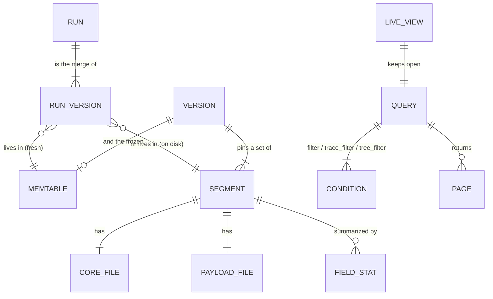
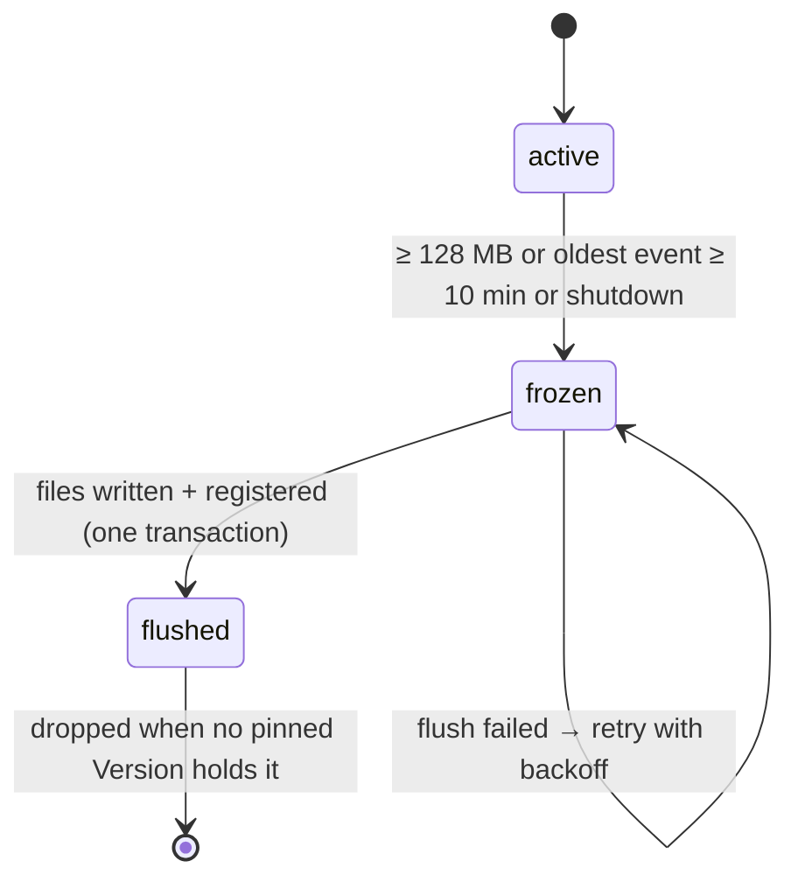
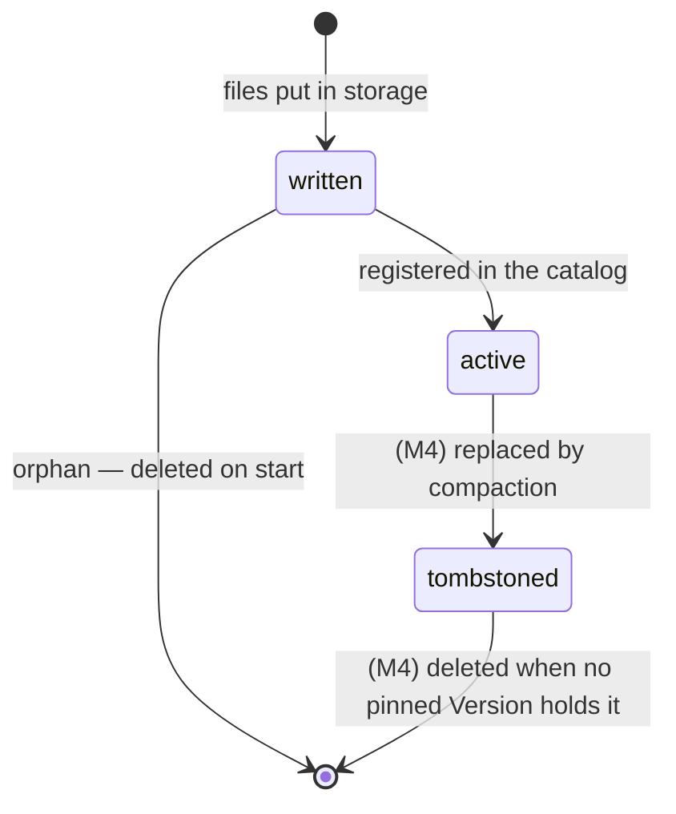

# Data Model: M2 — Durable storage + query builder

M1's entities (RunEvent, Run, derived fields, merge rule, validation) are unchanged:
[M1 data model](../001-m1-see-agent-trace-live/data-model.md). This file adds what M2 stores on disk, what a query is,
and how the pieces relate.

## 1. Entities and how they relate



- A **run** is what users see: one merged state. It is the merge of one or more **run versions**.
- A **run version** is a merged state at some moment: a memtable entry, or one row in a segment's core file.
- A **segment** is the pair of files one flush writes for one project, registered in the metastore.
- A **version** (of the catalog) is the set of segments plus the frozen memtable a query pins.

## 2. Run version (one core-file row)

| Column | Type | Notes |
|---|---|---|
| `run_id` | fixed binary 16 | bloom filter |
| `trace_id` | fixed binary 16 | bloom filter; sort key 1 |
| `parent_run_id` | fixed binary 16, null | null for roots |
| `dotted_order` | string | sort key 2 |
| `start_key` | timestamp µs | from the run's own `dotted_order` segment; **never null**; time pruning |
| `depth` | u16 | |
| `is_root` | bool | |
| `project` | string, null | null when this version didn't know its project (late update without `session_name`) |
| `address` | string, null | SDK 0.14 agent address |
| `name`, `run_type` | string, null | |
| `start_time`, `end_time` | timestamp µs, null | |
| `status` | enum `running`/`ok`/`error` | derived for this version; recomputed after a merge |
| `latency_ms` | u64, null | derived |
| `error` | string, null | first 1 KB; full text in payload `extra` |
| `tags` | list<string>, null | |
| `thread_id`, `model` | string, null | derived |
| `input_tokens`, `output_tokens`, `total_tokens` | u64, null | derived |
| `attrs_str` | map<string, string> | promoted scalar strings (§4) |
| `attrs_num` | map<string, f64> | promoted numbers |
| `attrs_bool` | map<string, bool> | promoted booleans |
| `present` | u32 bitmask | which fields this version set (needed where empty ≠ absent: `tags`, `metadata`) |
| `first_seq`, `last_seq` | u64 | merge order |
| `event_count` | u32 | |
| `needs_merge` | bool | this version was started by an update, or an older version exists (design §4.3) |
| `payload_row` | u32 | row in the paired payload file |

**Sort**: `(trace_id, dotted_order)` → a trace's rows are adjacent and in tree order; with UUIDv7 ids, files are also
roughly in time order. **Row groups**: ~64k rows. **Page index**: on. **Compression**: zstd.

## 3. Payload file row

| Column | Type | Notes |
|---|---|---|
| `run_id` | fixed binary 16 | check against the core row |
| `inputs`, `outputs` | JSON text, null | ≤ 20 MB each (M1 limit) |
| `events` | JSON text, null | latest full list |
| `metadata`, `extra` | JSON text, null | the full objects (promoted leaves are copies) |
| `dropped` | JSON text, null | sizes of fields received but not stored |

Read only by `run(id, include=…)`, the step panel, and filters on paths that weren't promoted.

## 4. Promoted paths

| Source | Depth | Limits | Example path → map |
|---|---|---|---|
| `metadata` | ≤ 4 | strings ≤ 256 B | `metadata.prompt_version` → `attrs_str` |
| `inputs` | ≤ 3 | ≤ 64 leaves per field, strings ≤ 256 B | `inputs.query` (if short) → `attrs_str` |
| `outputs` | ≤ 3 | same | `outputs.status_code` → `attrs_num` |
| arrays | — | not promoted; `has(tags, …)` uses the `tags` column | |

A path seen with two types (number in one run, string in another) is promoted into both maps; the field catalog lists
both types with their counts.

## 5. Metastore tables (same SQL on SQLite and Postgres)

```sql
CREATE TABLE state (
  id              INTEGER PRIMARY KEY CHECK (id = 1),
  schema_version  INTEGER NOT NULL,          -- 1 in M2
  flushed_seq     BIGINT  NOT NULL           -- every event with seq ≤ this is in a registered segment
);

CREATE TABLE segments (
  id              TEXT PRIMARY KEY,          -- ULID
  project         TEXT NOT NULL,             -- '' for versions with unknown project
  core_path       TEXT NOT NULL,
  payload_path    TEXT NOT NULL,
  min_start_key   BIGINT NOT NULL,  max_start_key BIGINT NOT NULL,
  min_trace_id    BLOB   NOT NULL,  max_trace_id  BLOB   NOT NULL,   -- BYTEA on Postgres
  min_seq         BIGINT NOT NULL,  max_seq       BIGINT NOT NULL,
  row_count       BIGINT NOT NULL,
  needs_merge_rows BIGINT NOT NULL,
  core_bytes      BIGINT NOT NULL,  payload_bytes BIGINT NOT NULL,
  tier            INTEGER NOT NULL DEFAULT 0,   -- M4 compaction tiers
  state           TEXT    NOT NULL DEFAULT 'active',   -- 'active' | 'tombstoned' (M4)
  created_at      BIGINT  NOT NULL
);
CREATE INDEX segments_scope ON segments (project, max_start_key);

CREATE TABLE field_stats (
  segment_id      TEXT NOT NULL REFERENCES segments(id),
  path            TEXT NOT NULL,             -- e.g. 'metadata.prompt_version', 'status', 'tags'
  type            TEXT NOT NULL,             -- 'string' | 'number' | 'bool' | 'list'
  count           BIGINT NOT NULL,           -- rows that have it
  top_values      TEXT NOT NULL,             -- JSON [[value, count], …] up to 50
  other_count     BIGINT NOT NULL,
  PRIMARY KEY (segment_id, path, type)
);

CREATE TABLE dedup_keys (                    -- D-022; added in place to older M2 catalogs (schema_version stays 1)
  flushed_seq     BIGINT PRIMARY KEY,        -- the flush that saved them
  newest_at       BIGINT NOT NULL,           -- newest received_at (µs) among the keys
  keys            BLOB   NOT NULL            -- BYTEA on Postgres; packed 33 B keys, see below
);
```

A flush is one transaction: insert its `segments`, `field_stats` and `dedup_keys` rows, update `state.flushed_seq`,
and delete `dedup_keys` rows older than the dedup window (except the newest). A packed key is `run_id` (16 B) + `op`
(1 B, WAL byte values) + `body_hash` (u64 LE) + `received_at` µs (i64 LE): the keys of every event the flush took
from the WAL, so start rebuilds the dedup window with no flushed WAL files kept.

## 6. Object layout

```
<storage root>/
  <project>/<yyyy-mm-dd>/seg-<ulid>.core.parquet
  <project>/<yyyy-mm-dd>/seg-<ulid>.payload.parquet
  _unknown/<yyyy-mm-dd>/seg-<ulid>.…              versions without a known project
<data>/wal/<first_seq:020>.wal                      local disk in every mode (M1 format); only unflushed files
<data>/meta.sqlite                                  local mode only
```

The day is the flush day (UTC). Names are unique and never reused, so nothing is overwritten.

## 7. In-memory structures

| Structure | Owner | Contents | Size at 2M runs |
|---|---|---|---|
| Active memtable | writer | M1 run store (states, by_trace, roots), limit 128 MB | ≤ 128 MB + indexes |
| Frozen memtable | flusher, readers | `Arc` of the previous active, immutable | ≤ 128 MB, at most one |
| `Version` | query (pinned) | segment list + frozen `Arc` | small |
| Multi-version set | ingest (writes), query (reads) | `HashSet<RunId>` | ~3 MB (10% late) |
| Dedup set | writer | `(run_id, op, body_hash)` for the last 10 min | ~2M keys at 5k events/s |
| `Cache` | storage | Parquet footers, bloom filters, hot row groups (LRU) | default 256 MB |

## 8. Lifecycle states

**Memtable**



**Segment** (M2 uses only the first two states; M4 adds the rest)



## 9. Query

```text
Query {
  project:      Option<String>,              # none = all projects
  time:         TimeRange,                   # {from, to} absolute or {last: "12h"}; on start_key
  filter:       Option<Expr>,                # conditions on the run itself
  trace_filter: Option<Expr>,                # conditions on the root of its trace
  tree_filter:  Option<Expr>,                # conditions on any run in its trace
  is_root:      Option<bool>,
  order:        { by: start_time | latency, dir: desc | asc },   # default start_time desc
  limit:        1..=200,                     # default 50
  cursor:       Option<Cursor>,
  view:         { kind: samples | table, columns: [Path] },      # display only; doesn't change results
  live:         bool,                        # display only
}

Expr = And([Expr]) | Or([Expr]) | Not(Expr)
     | Cmp { op: eq|neq|gt|gte|lt|lte, path: Path, value: Value }   # value may be null
     | Has { path: Path, value: Value }                             # list contains
     | In  { path: Path, values: [Value] }                          # tracedb addition
Path = built-in field (status, name, run_type, latency, start_time, tags, total_tokens, …)
     | metadata.<dotted> | inputs.<dotted> | outputs.<dotted>
```

**Cursor**: base64 of `{order_value, run_id, query_hash}`. `query_hash` covers everything except `cursor`, `view` and
`live`, so changing columns keeps your place but changing the filter starts over (as M1).

**Page**: `{runs: [RunHeader + requested columns], next_cursor?, warnings: [Warning], stats: {files_scanned, files_pruned, rows_merged, ms}}`.

**Warning** kinds: `mixed_types{path, counts}`, `not_indexed{path}` (payload scan), `identity_conflict{run_id}`,
`catalog_incomplete{project}`.

## 10. Field catalog entry

```text
Field { path, types: [{type, count}], top_values: [{value, count}], other_count, complete: bool }
```

Built from `field_stats` rows of segments in scope, summed, plus memtable stats computed on demand. Runs in the
multi-version set count once: their file rows are subtracted and their merged state is added (D-023).

## 11. Live view messages

```text
TailMsg = Hello  { server_seq }
        | Runs   [RunHeader]        # runs that match now, newest version each
        | Left   [run_id]           # sent before, no longer match after an update
        | Resync {}                 # fell behind; reload
```

## 12. Worked example: one run across a file and the memtable

The `fetch_url` step (run `7c1e…a4`, trace `0b9f…11`). Its start was flushed at 02:20; its late update arrives at
02:31 while the start is already on disk.

```
segment seg-01JC…  (core row)
  run_id 7c1e…a4  name fetch_url  run_type tool  start 02:14:07  end —  status running
  start_key 02:14:07  project eval-agent  needs_merge false  last_seq 1042
  attrs_str {metadata.prompt_version: "v7"}

active memtable (02:31, created by a patch → partial)
  run_id 7c1e…a4  name —  start —  end 02:14:38  error "HTTPError: 429 Too Many Requests"
  outputs {status_code: 429}  start_key 02:14:07 (from dotted_order)  project —  needs_merge true  last_seq 1987
  → writer adds 7c1e…a4 to the multi-version set

query  root ok AND any run in trace errored  (quiet failures)
  file row for 7c1e…a4: its id is in the multi-version set → goes to the merge, not filtered in the scan
  merge by last_seq: name fetch_url (file) · start 02:14:07 (file) · end 02:14:38 (mem) · error (mem) ·
                     project eval-agent (file) · attrs_num {outputs.status_code: 429} (mem)
  derive: status error, latency 31 076 ms
  tree_filter "any run errored" now matches trace 0b9f…11 → its root (ok) is one of the 23
```

Before the late update arrived, the same query did not return that root, which is correct: no step had errored yet.
