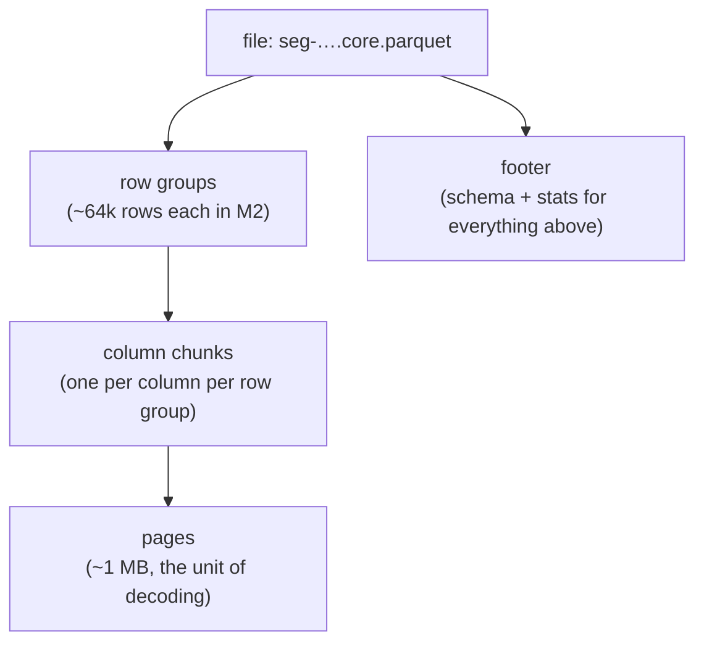
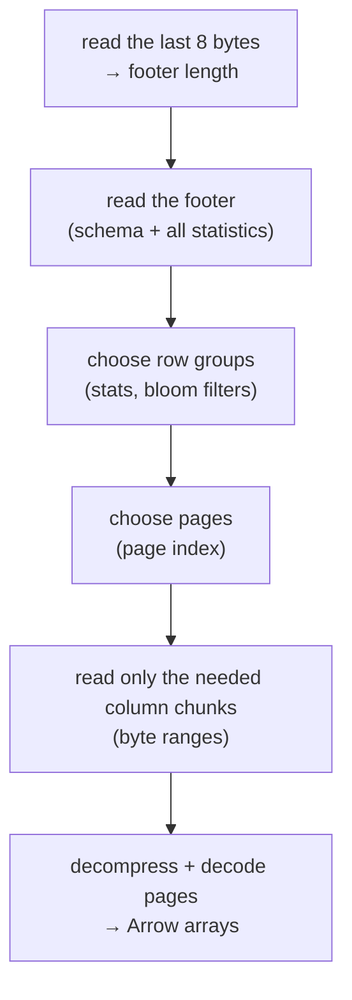
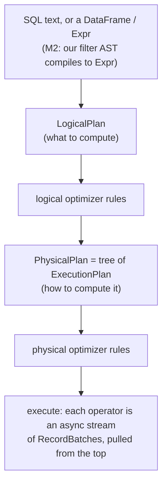
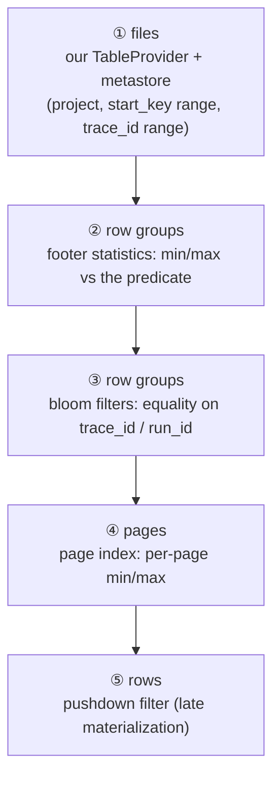

# How Parquet and DataFusion work together (and how M2 uses them)

A look inside the two libraries M2 builds on, deep enough that neither is a black box. Versions: DataFusion **55.2**,
arrow / parquet **59.3** (research M2-R1). Section 7 shows real output from a small program run against those
versions, so you can see each mechanism happen.

Read with: [design.md](design.md) §4.3 (the M2 query path) and [data-model.md](data-model.md) §2 (our core file).

## 0. The one-paragraph version

**Parquet** is a file format that stores a table **column by column**, in chunks, with a small index (min/max values,
counts, optional bloom filters) for every chunk. **Arrow** is the same idea in memory: a batch of rows held as one
array per column. **DataFusion** is a query engine: it turns a query into a tree of operators that pass Arrow batches
up from the files. The speed comes from **not reading**: the index lets DataFusion skip whole chunks, and the column
layout lets it read only the columns a query touches. The rest of this document is the detail of those two ideas.

## 1. Parquet: what is inside one file



Layout on disk, top to bottom:

| Part | What it is |
|---|---|
| `PAR1` | 4-byte magic number |
| row group 0 | column chunk `run_id`, column chunk `trace_id`, … one per column, each made of pages |
| row group 1, 2, … | same |
| bloom filters | optional, one per column chunk (M2: `trace_id`, `run_id`) |
| column index + offset index | the **page index**: per-page min/max and byte offsets |
| footer | schema, and for every row group and column chunk: row count, byte offsets, **statistics** |
| footer length + `PAR1` | last 8 bytes, so a reader can find the footer |

**Row group.** A horizontal slice of rows (M2 sets ~64k). It is the main unit of skipping.

**Column chunk.** All values of one column within one row group, stored together. Reading `status` for a row group
reads only this chunk, not the other 30 columns.

**Page.** A column chunk is split into pages (~1 MB by default). A page is the unit that gets decompressed and decoded.
With the page index, a reader can skip individual pages inside a row group.

**Statistics.** For every column chunk (and with the page index, every page) the footer stores `min`, `max`,
`null_count`, and sometimes a distinct count. This is the "index" that lets a reader skip without reading data.

**Encodings, then compression.** Inside a page, values are first *encoded*, then *compressed*:
- **Dictionary** encoding: repeated strings (`status`: `ok`, `error`, `running`) become small integers plus one
  dictionary page per chunk. Most low-cardinality columns shrink by 10–100×.
- **RLE / bit-packing**: runs of the same small integer are stored as (value, count).
- **Delta** encodings for sorted numbers and timestamps.
- Then **zstd** (M2's choice) compresses the page.

**Nulls and nesting.** Each value carries a *definition level* (is it null, or which level of nesting is null) and a
*repetition level* (where a new list starts). That is how `tags: list<string>` and `attrs_str: map<string,string>`
fit in a flat column layout: a map is stored as two leaf columns, `key` and `value`, plus these levels.

**Bloom filters.** Per column chunk, a compact bit array that answers "is value X **possibly** here?" with no false
negatives and a small false-positive rate (~1–5%). Min/max can't help for UUIDs scattered across the range; a bloom
filter can. Note: they are per **row group**, not per file, so checking a file means checking each row group's filter.

**Immutable.** A Parquet file is written once, top to bottom, and the footer comes last. You can't update a row in
place, which is why M2 writes new files and merges versions on read (design §4.3).

## 2. Reading a Parquet file, step by step



Every step before F only reads metadata. On object storage each read is one HTTP range request, which is why the
format suits S3 (constitution V) and why M2 caches footers and bloom filters (`Cache`, design §5).

## 3. Arrow: the in-memory side

DataFusion never works on Parquet bytes directly. Pages are decoded into **Arrow** arrays:

| Arrow piece | What it is |
|---|---|
| `Array` | one column's values in one contiguous buffer, plus a **validity bitmap** (1 bit per row: null or not) |
| `StringArray` | an offsets buffer + one bytes buffer (no per-string allocation) |
| `DictionaryArray` | integer keys + a values array (how dictionary pages can stay compact in memory) |
| `RecordBatch` | a set of equal-length arrays + a schema = a chunk of the table, typically **8,192 rows** |

Operators work on whole arrays at a time (*vectorized*): `status = 'error'` becomes one tight loop over a buffer that
produces a `BooleanArray`, then a `filter` kernel copies the selected rows. No per-row virtual calls.

## 4. DataFusion: from a query to running operators



**Logical plan.** Relational steps: `TableScan`, `Filter`, `Projection`, `Aggregate`, `Join`, `Sort`, `Limit`.

**Logical optimizer** (rules applied until nothing changes), the ones that matter for us:
- **Projection pushdown**: the scan is told which columns are needed, so unused column chunks are never read.
- **Filter pushdown**: filters move down into the scan (`TableScan … filters=[…]`), where the Parquet reader can use
  them for pruning.
- **Simplification**: constant folding (`now() - 12h` → a literal), and turning `NOT(a = b)` into `a != b`.
- **Limit pushdown**, and turning `ORDER BY … LIMIT n` into a top-k sort (keeps only n rows in memory).

**Physical plan.** Concrete operators, each an `ExecutionPlan`:

| Operator | Does |
|---|---|
| `DataSourceExec` (Parquet) | reads files and row groups → batches; applies pruning (§5) |
| `FilterExec` | evaluates a predicate, keeps matching rows |
| `ProjectionExec` | computes / selects columns |
| `AggregateExec` (Partial → Final) | group-by in two phases: each partition pre-aggregates, then results are combined |
| `HashJoinExec` | builds a hash table from one side, probes with the other; `LeftSemi` keeps left rows that have a match |
| `SortExec` / `SortPreservingMergeExec` | sort each partition / merge sorted partitions |
| `RepartitionExec`, `CoalescePartitionsExec` | spread work across cores / gather it back |
| `GlobalLimitExec` | stop after n rows |

**Partitions = parallelism.** A plan runs as N parallel streams (`target_partitions`, default = CPU cores). Files and
row groups are split across partitions; `RepartitionExec` hashes rows by group key so each core aggregates its own
share.

**Pull-based streaming.** The top operator asks its child for the next batch, which asks its child, down to the file
reader. Memory stays bounded by a few batches per operator, except for the ones that must hold state (hash tables,
sorts), which can spill to disk.

## 5. Where pruning happens: the four levels

This is the part that makes Parquet + DataFusion fast. From coarsest to finest:



1. **Files (ours, not DataFusion's).** Before DataFusion sees anything, M2's `TableProvider` picks files from the
   pinned `Version` using the metastore's per-segment bounds (design §4.3). Files that can't match are never opened.
   (DataFusion can also skip a file from its own footer statistics, `files_ranges_pruned_statistics` in §7.4, but
   that needs the footer read first; the metastore avoids even that.)
2. **Row-group statistics.** DataFusion builds a `PruningPredicate` from the pushed-down filter: it rewrites
   `start_key >= T` into "this row group's `max(start_key)` ≥ T". Row groups where that's false are skipped without
   reading. Works for `=`, `<`, `>`, `IN`, `IS NULL`, and `AND`/`OR` of those, on plain columns.
3. **Bloom filters.** For equality (`trace_id = X`, `run_id IN (…)`), DataFusion checks each row group's bloom filter
   and skips it on a definite "not here" (`bloom_filter_on_read`, on by default).
4. **Page index.** Inside the surviving row groups, per-page min/max skip pages (`enable_page_index`, on by default).
   Works best on sorted or clustered columns. Our core files are sorted by `(trace_id, dotted_order)`, and UUIDv7
   trace ids are time-ordered, so `start_key` is clustered too.
5. **Row filter, also called late materialization** (`pushdown_filters`, **off by default**; M2 turns it on). The
   reader first decodes only the columns the filter needs (`status`), evaluates the filter, and then decodes the
   other columns (`name`, `tags`, …) **only for rows that passed**. For a selective filter, most of the bytes are never
   decoded.

**What doesn't prune, so you aren't surprised:**
- Filters on **map entries** (`attrs_num['outputs.status_code'] = 429`) get no row-group or page pruning: Parquet keeps
  stats for the map's key and value leaf columns as a whole, not per key, so a min/max over all values says nothing
  about one key. They do get step ⑤, and step ① still applies (project + time). This is the known cost of M2's
  promoted-attribute design (research M2-R6); M3's speed work can promote hot paths into real columns if needed.
- Filters on **derived expressions** of a column (`lower(name) = 'x'`) can't use stats.
- An `OR` across an unprunable branch makes the whole predicate unprunable.

## 6. How M2 plugs into DataFusion

M2 adds three pieces. Everything else is DataFusion as shipped.

### 6.1 A `TableProvider` over files and memtables

```text
impl TableProvider for RunsTable {          # crates/query/src/provider.rs (planned)
  schema()  → the core-file schema (data-model §2)
  supports_filters_pushdown(filters) → Inexact
      # "I'll use these to prune, but DataFusion must still apply them", so FilterExec stays above us.
  scan(projection, filters, limit) → ExecutionPlan:
      files  = version.segments pruned by project + start_key (+ trace_id bounds)      # level ①
      parquet = DataSourceExec(files, projection, predicate = safe part of filters)    # levels ②–⑤
      fresh   = MemorySource(ingest.fresh_scan(scope))                                 # memtables as Arrow
      return UnionExec(parquet, fresh)
}
```

**Inexact** matters (contrast §7.3, where the built-in Parquet table runs without a `FilterExec`): pruning is allowed to keep extra rows (a row group whose min/max straddle the value), never to
drop matching ones, so a `FilterExec` above the scan makes the final decision.

The "safe part" of the filter is design §4.3's rule: `Q.filter OR needs_merge OR run_id ∈ multi-version set`, so
rows that may have other versions always reach the merge.

### 6.2 A `merge_versions` aggregate (UDAF)

A user-defined aggregate is a struct with an **accumulator** per group:

```text
Accumulator for merge_versions (one per run_id group):
  update_batch(columns)   # fold rows of this partition into the running merged version (by last_seq)
  state()                 # partial result, sent between the Partial and Final phases
  merge_batch(states)     # combine partial results from other partitions
  evaluate()              # the final merged version → derive status, latency
```

DataFusion runs it in its normal two-phase `AggregateExec` (Partial per partition, Final after a hash repartition on
`run_id`), so merging is parallel and can spill like any group-by.

### 6.3 The filter AST compiles to `Expr`

```text
eq(status, "error")                 → col("status").eq(lit("error"))
gt(latency, 30)                     → col("latency_ms").gt(lit(30_000))
has(tags, "batch=…")                → array_has(col("tags"), lit("batch=…"))
eq(outputs.status_code, 429)        → map_extract(col("attrs_num"), "outputs.status_code")[1] = 429.0
tree_filter: eq(status, "error")    → LeftSemi HashJoin on trace_id with (merged runs WHERE status = 'error')
```

## 7. Seen for real: one file, one query

A small program (DataFusion 55.2, parquet 59.3) writes **4 row groups × 1,000 rows**, one hour of `start_key` per row
group, with errors only in the last hour, then runs:

```sql
SELECT name, count(*) AS n FROM runs
WHERE start_key >= TIMESTAMP '1970-01-01T03:00:00' AND status = 'error'
GROUP BY name ORDER BY n DESC
```

Run on 2026-11-06 with `pushdown_filters = true`; the program is a 60-line scratch crate, not part of tracedb.

### 7.1 The footer statistics the writer produced

```text
row group 0: 1000 rows  start_key min 0            max  3,596,400,000   (hour 0)
row group 1: 1000 rows  start_key min 3,600,000,000 max  7,196,400,000   (hour 1)
row group 2: 1000 rows  start_key min 7,200,000,000 max 10,796,400,000   (hour 2)
row group 3: 1000 rows  start_key min 10,800,000,000 max 14,396,400,000  (hour 3)
```
(Timestamps are stored as INT64 microseconds; that's what the stats hold.)

### 7.2 The logical plan (after the optimizer)

```text
Sort: n DESC NULLS FIRST
  Projection: runs.name, count(Int64(1)) AS n
    Aggregate: groupBy=[[runs.name]], aggr=[[count(Int64(1))]]
      Projection: runs.name
        Filter: runs.start_key >= TimestampMicrosecond(10800000000) AND runs.status = Utf8View("error")
          TableScan: runs
            projection=[start_key, name, status]                 ← projection pushdown: 3 of 4 columns
            partial_filters=[start_key >= …, status = "error"]   ← filter pushdown into the scan
```

`now()`-style literals are already folded to a constant, and strings are read as `Utf8View` (Arrow's newer string
layout, which avoids copying short strings).

### 7.3 The physical plan

```text
SortPreservingMergeExec: [n DESC]
  ProjectionExec
    SortExec: [n DESC], preserve_partitioning
      AggregateExec: mode=FinalPartitioned, gby=[name]           ← phase 2 of the group-by
        RepartitionExec: Hash([name], 18)                         ← same name → same core
          AggregateExec: mode=Partial, gby=[name]                 ← phase 1, per partition
            RepartitionExec: RoundRobinBatch(18)                  ← spread batches over 18 cores
              DataSourceExec: runs.parquet
                projection=[name]
                predicate=start_key >= 10800000000 AND status = error
                pruning_predicate=
                    start_key_max >= 10800000000                  ← rewritten for row-group stats
                    AND status_min <= error AND error <= status_max
                required_guarantees=[status in (error)]           ← used with bloom filters
```

There is **no `FilterExec`**: with `pushdown_filters` on, the built-in Parquet table treats the pushed-down filter as
exact and evaluates it inside the reader. M2's own `TableProvider` answers `Inexact`, so a `FilterExec` stays above it
(§6.1).

### 7.4 What actually happened (`EXPLAIN ANALYZE`, scan metrics)

| Metric | Value | Meaning |
|---|---|---|
| `row_groups_pruned_statistics` | 4 total → **1 matched** | level ②: hours 0–2 skipped by `max(start_key)` |
| `row_groups_pruned_bloom_filter` | 1 → 1 | level ③: `error` is in hour 3, so no skip |
| `page_index_rows_pruned` | 1.00 K → 1.00 K | level ④: one page per row group here, nothing to skip |
| `pushdown_rows_matched` / `pruned` | **20 / 980** | level ⑤: `status` decoded for 1,000 rows; `name` decoded only for the 20 that passed |
| `bytes_scanned` | **9.78 K of 87.73 K** | 11% of the file read (`scan_efficiency_ratio`) |
| `metadata_load_time` | 47 µs | the footer read |
| result | plan 7 · fetch_url 7 · llm 6 | 20 errors |

### 7.5 When min/max can't help but a bloom filter can

```sql
SELECT count(*) FROM runs WHERE name = 'nope'
```

| Metric | Value | Meaning |
|---|---|---|
| `pruning_predicate` | `name_min <= nope AND nope <= name_max` | `'nope'` sorts between `'fetch_url'` and `'plan'` … |
| `row_groups_pruned_statistics` | 4 → **4 matched** | … so stats can't skip any row group |
| `row_groups_pruned_bloom_filter` | 4 → **0 matched** | the bloom filters say "definitely not here" for all four |
| `bytes_scanned` | **188** bytes | only metadata and filters read; no data pages |

This is exactly the M2 trace and run lookup case (R-9): UUIDs are spread across the min/max range, and the bloom
filter is what skips the row group.


## 8. The M2 quiet-failures query, as DataFusion sees it

The plan we expect for "root ok, any run in the trace errored" (simplified; a real `EXPLAIN` will be added to the code
starter guide in PR 12):

```text
SortPreservingMergeExec [start_time DESC, run_id]        ← newest first, then cursor + limit
  GlobalLimitExec 51
    HashJoinExec LeftSemi on trace_id                    ← tree_filter: keep roots whose trace has an error
      FilterExec is_root AND status = 'ok' AND has(tags, 'batch=…')
        merged runs (below)
      FilterExec status = 'error'                         ← any run in the trace
        merged runs (below)

merged runs =
  UnionExec
    FilterExec NOT needs_merge AND run_id NOT IN mvset     ← single-version fast path, already final
      UnionExec
        DataSourceExec  files: 4 of 65  predicate: start_key ≥ now-12h, (…)   ← levels ①–⑤
        MemorySource    fresh_scan(active + frozen)
    ProjectionExec derive(status, latency)
      AggregateExec Final  group by run_id: merge_versions(…)
        RepartitionExec hash(run_id)
          AggregateExec Partial  group by run_id: merge_versions(…)
            FilterExec needs_merge OR run_id IN mvset       ← the ~10% that may have other versions
              (same UnionExec of files + memtables)
```

The merged-runs subtree is used twice (the run side and the "any run" side). DataFusion doesn't share it
automatically; M2 can compute it once per query (materialize to a batch set) if the bench shows it matters.

## 9. Settings M2 uses

| Setting | Default | M2 | Why |
|---|---|---|---|
| `datafusion.execution.parquet.pushdown_filters` | false | **true** | late materialization (level ⑤) |
| `datafusion.execution.parquet.reorder_filters` | false | **true** | evaluate the cheapest / most selective filter first |
| `datafusion.execution.parquet.enable_page_index` | true | true | level ④ |
| `datafusion.execution.parquet.bloom_filter_on_read` | true | true | level ③ |
| `datafusion.execution.parquet.pruning` | true | true | level ② |
| `datafusion.execution.batch_size` | 8192 | 8192 | rows per Arrow batch |
| `datafusion.execution.target_partitions` | CPU cores | cores | parallelism |
| writer `max_row_group_size` | 1,048,576 rows | **65,536** | smaller row groups prune more finely |
| writer statistics | page level | page level | builds the page index |
| writer bloom filters | off | **on for `trace_id`, `run_id`** | level ③ for lookups (R-9) |
| writer compression | uncompressed | **zstd** | disk ≤ raw JSON (SC-04) |

## 10. Glossary

| Term | Meaning |
|---|---|
| row group | horizontal slice of a Parquet file; main unit of skipping |
| column chunk | one column's values inside one row group |
| page | piece of a column chunk; unit of decoding |
| statistics | min / max / null count per chunk (and per page with the page index) |
| page index | column index (per-page stats) + offset index (per-page byte positions) |
| bloom filter | "possibly here / definitely not" bit array per column chunk |
| projection pushdown | read only the columns the query needs |
| predicate (filter) pushdown | hand the filter to the scan so it can prune |
| late materialization | decode filter columns first, other columns only for matching rows |
| `RecordBatch` | Arrow's chunk of rows: one array per column, ~8k rows |
| `ExecutionPlan` | one physical operator; produces a stream of batches |
| partition | one parallel stream of a plan |
| UDAF | user-defined aggregate function (our `merge_versions`) |
| `TableProvider` | how a data source plugs into DataFusion (our files ∪ memtables) |
