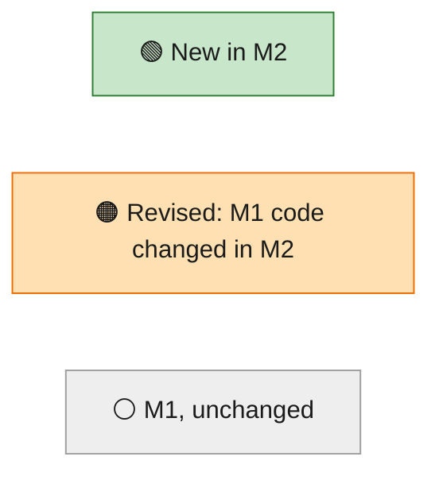
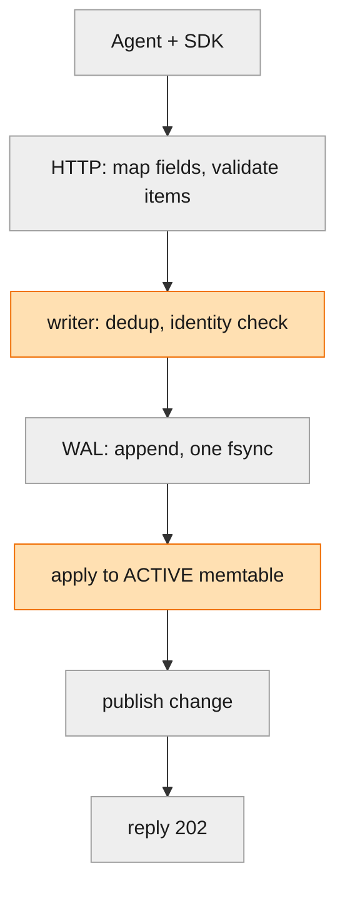
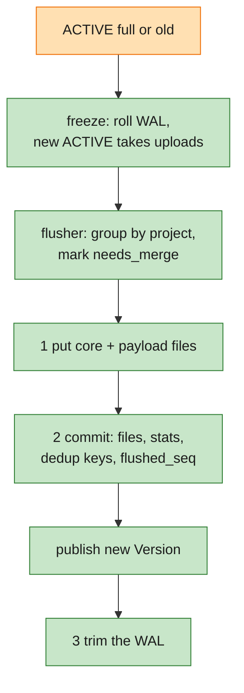
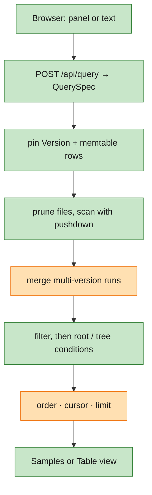
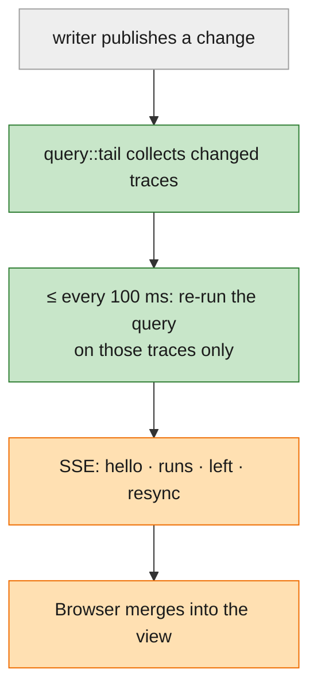
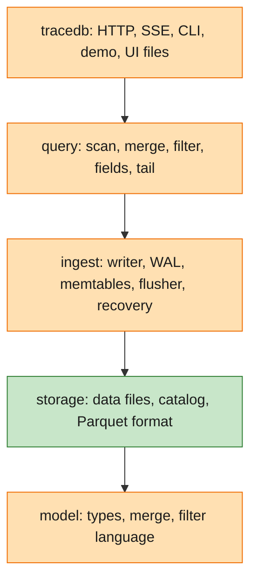
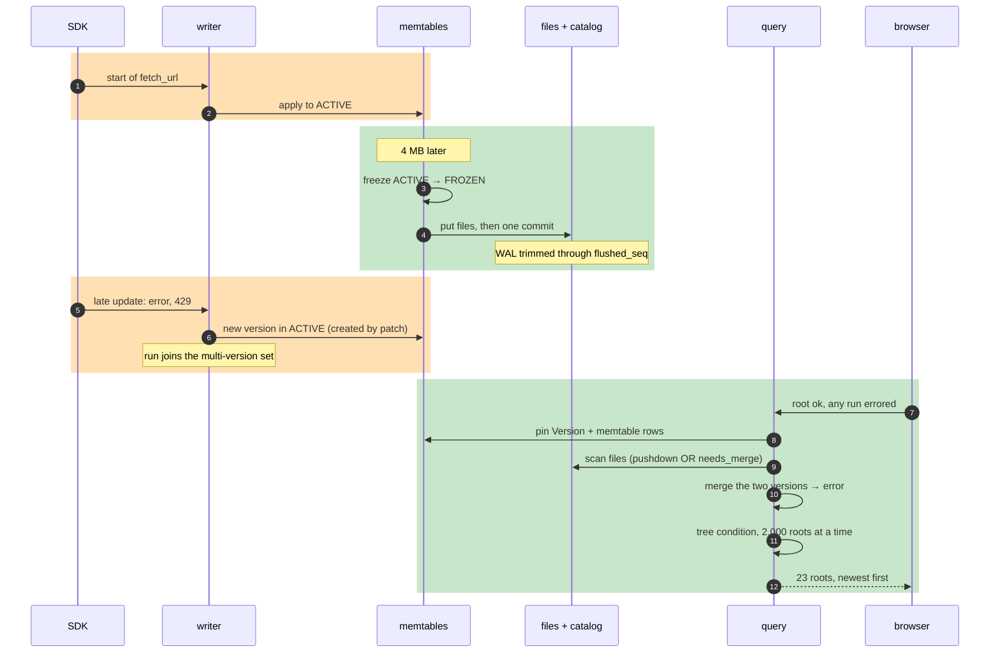
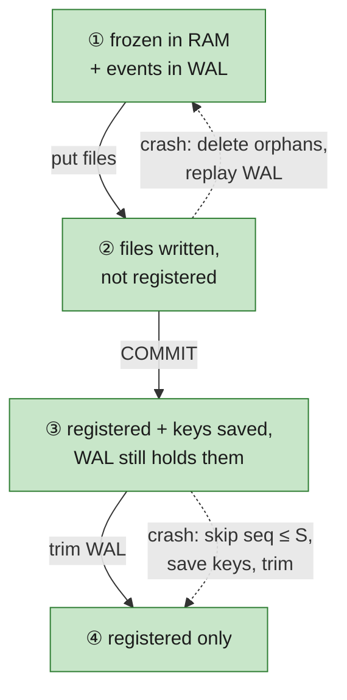
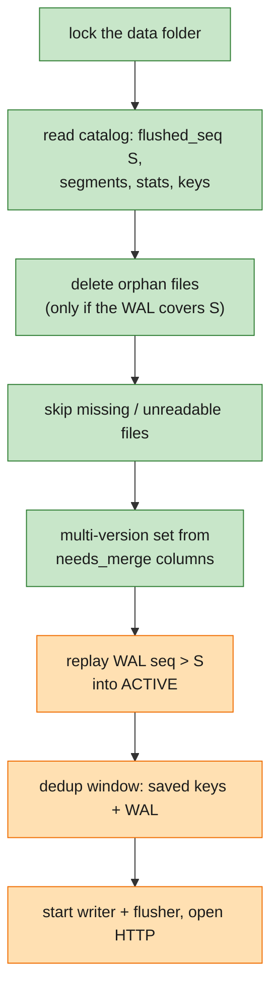
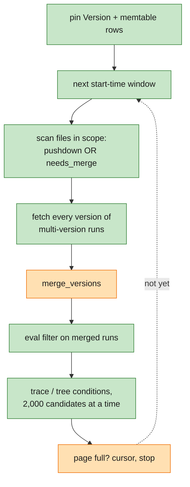

# M2 code starter guide

How to read the M2 code: what each goal needs and where it lives, the critical parts, and one run traced from
upload to the query that finds it, with line-level links. It describes the code as built on branch
`002-m2-durable-storage-query-builder` as of 2026-11-06 (commit `2990136` plus the in-progress dedup-key and
early-stop changes). If a line number has drifted, search for the function name.

For *why* it is built this way, see [design.md](design.md); for the PR order, [plan.md](plan.md). Where the code
differs from the design, the [decision log](../000-tracedb-master-plan/decisions.md) says why (D-015 to D-022 are the
M2 ones). This guide is about *where* things live.

**Colour key** (diagrams use the fill colour; tables and headings use the marker):

| Marker | Fill | Meaning |
|---|---|---|
| 🟢 **New** | green | first built in M2 |
| 🟠 **Revised** | orange | built in M1, changed in M2 |
| ⚪ **M1** | grey | built in M1, used as is |



Four ideas carry M2 (on top of M1's four):

1. **Every confirmed event is always somewhere durable.** It's in the WAL, in a registered file, or both. A flush
   writes files, then commits the catalog, then trims the WAL, in that order.
2. **A reader pins one `Version`.** Active memtable, frozen memtable and file list are taken under one lock, so a
   query never sees a half-done freeze or flush.
3. **One merge rule, one evaluator.** File rows and memtable rows become `RunState`s, runs with several versions are
   merged with the M1 rule, and one `eval` decides the filter. DataFusion only prunes and pre-filters
   ([D-017](../000-tracedb-master-plan/decisions.md#d-017)).
4. **A live view is the same query, re-run.** It runs only over the traces that changed, at most every 100 ms.

## 1. Goals → functionality → where it lives

| | Goal (spec end state) | What delivers it | Where |
|---|---|---|---|
| 🟢 | Keep data on disk; no memory ceiling | two memtables, flusher, Parquet core + payload files, catalog, WAL trim | [flush.rs](../../crates/ingest/src/flush.rs), [segment.rs](../../crates/storage/src/segment.rs), [metastore.rs](../../crates/storage/src/metastore.rs), [object.rs](../../crates/storage/src/object.rs) |
| 🟠 | Never lose or duplicate a confirmed event, even mid-flush | write → register → trim; orphan cleanup; replay past `flushed_seq`; dedup keys saved per flush | [flush.rs](../../crates/ingest/src/flush.rs), [recover.rs](../../crates/ingest/src/recover.rs), [wal.rs](../../crates/ingest/src/wal.rs), [dedup.rs](../../crates/ingest/src/dedup.rs) |
| 🟠 | One merged run wherever its pieces are | `needs_merge` + multi-version set; `merge_versions` | [writer.rs](../../crates/ingest/src/writer.rs), [model/merge.rs](../../crates/model/src/merge.rs), [query/scan.rs](../../crates/query/src/scan.rs) |
| 🟢 | Filter by any field, JSON path and tree condition | filter AST, parser, evaluator; pushdown; trace/tree conditions | [model/filter/](../../crates/model/src/filter/mod.rs), [query/lib.rs](../../crates/query/src/lib.rs), [pushdown.rs](../../crates/query/src/pushdown.rs) |
| 🟢 | Click to build, text to edit, both the same query | chips ⇄ AST ⇄ text; parser and printer mirrored in TypeScript | [ui/src/query/](../../ui/src/query/chips.ts), [model/filter/print.rs](../../crates/model/src/filter/print.rs) |
| 🟢 | Fields and values with counts | flush-time field stats + memtable stats per request | [segment.rs](../../crates/storage/src/segment.rs) (`StatsBuilder`), [query/fields.rs](../../crates/query/src/fields.rs) |
| 🟢 | Samples and Table views; URL is the query | `columns`, URL ⇄ `QueryState` | [views/](../../ui/src/views/Samples.tsx), [query/url.ts](../../ui/src/query/url.ts) |
| 🟠 | Any query live | re-query changed traces every 100 ms | [query/tail.rs](../../crates/query/src/tail.rs), [routes/tail.rs](../../crates/server/src/routes/tail.rs) |
| 🟠 | Bursts slow down, never fail | `429` when the next memtable fills during a flush, or unflushed WAL ≥ 1 GB | [writer.rs](../../crates/ingest/src/writer.rs) |
| 🟠 | Fast restart | catalog read, small WAL replay, multi-version set from one column | [recover.rs](../../crates/ingest/src/recover.rs) |
| 🟢 | Same results on cloud storage | `Store` (local or S3), `Metastore` (SQLite or Postgres) | [object.rs](../../crates/storage/src/object.rs), [metastore.rs](../../crates/storage/src/metastore.rs) |
| 🟢 | Scenario numbers on every change | `tracedb demo`, overnight-eval scenario | [demo.rs](../../crates/tools/src/demo.rs), [scenario.rs](../../crates/tools/src/scenario.rs) |
| 🟠 | Honest retries | identity check before the WAL | [writer.rs](../../crates/ingest/src/writer.rs) |
| 🟠 | UI work without server rebuilds; Rust build without Node | `--ui-dir`; `build.rs` embeds `ui/dist` if present | [routes/ui.rs](../../crates/server/src/routes/ui.rs), [build.rs](../../crates/server/build.rs) |

## 2. The system, one path at a time

Four small charts instead of one wide one. Each reads top to bottom.

### 2a. Write path: an upload, until "202"



Same as M1, except the identity check now runs before the WAL, and events go into the *active* memtable of two.

### 2b. Background flush: memory to files



### 2c. Read path: one query



### 2d. Live view: keeping a query open



### Crates, top to bottom



Each crate uses only the ones below it. `query` reads ingest through `Ingest::mem()`
([ingest/src/lib.rs:586](../../crates/ingest/src/lib.rs#L586)), `multi_version()` and `subscribe()`. It never
writes. Only `storage` knows file paths, Parquet and SQL. `Version` lives in ingest next to the memtables, not in
storage ([D-015](../000-tracedb-master-plan/decisions.md#d-015)).

## 3. Suggested reading order (about 3 hours)

| # | | File | Why read it | Time |
|---|---|---|---|---|
| 1 | 🟢 | [model/src/filter/ast.rs](../../crates/model/src/filter/ast.rs), [eval.rs](../../crates/model/src/filter/eval.rs) | The query language. Everything else builds or consumes `Expr`; `eval` is the only judge | 20 min |
| 2 | 🟠 | [model/src/merge.rs](../../crates/model/src/merge.rs) (`merge_versions`) | The M1 merge rule, now over stored versions | 10 min |
| 3 | 🟢 | [ingest/src/memtable.rs](../../crates/ingest/src/memtable.rs) | `Mem` and `Version`: what a reader pins (46 lines) | 5 min |
| 4 | 🟠 | [ingest/src/writer.rs](../../crates/ingest/src/writer.rs) | Identity check before the WAL; freeze; `429` | 20 min |
| 5 | 🟢 | [ingest/src/flush.rs](../../crates/ingest/src/flush.rs) | **Critical.** Write → register → trim | 15 min |
| 6 | 🟢 | [ingest/src/recover.rs](../../crates/ingest/src/recover.rs) | **Critical.** Orphans, multi-version set, replay, dedup window | 20 min |
| 7 | 🟢 | [storage/src/metastore.rs](../../crates/storage/src/metastore.rs) (`commit_flush`) | The one transaction a flush depends on | 10 min |
| 8 | 🟢 | [query/src/scan.rs](../../crates/query/src/scan.rs) | **Critical.** Pin, scan, fetch every version, merge | 25 min |
| 9 | 🟠 | [query/src/lib.rs](../../crates/query/src/lib.rs) (`select`) | **Critical.** Windows, filter, trace/tree conditions, page | 25 min |
| 10 | 🟢 | [query/src/pushdown.rs](../../crates/query/src/pushdown.rs) | The "superset only" rule for file pre-filters | 10 min |
| 11 | 🟢 | [query/src/tail.rs](../../crates/query/src/tail.rs) | Live views by re-querying changed traces | 15 min |
| 12 | 🟢 | [ui/src/query/chips.ts](../../ui/src/query/chips.ts), [views/Runs.tsx](../../ui/src/views/Runs.tsx) | Panel ⇄ AST ⇄ text | 15 min |

Skip on the first pass: `segment.rs` encode/decode (long, mechanical), `parse.rs` (lexer and error messages),
`window.rs` (an estimate), `object.rs` S3 details, `scenario.rs`.

## 4. Walkthrough: one run, from upload to the 23 quiet failures

The overnight-eval scenario ([scenario.rs](../../crates/tools/src/scenario.rs)) plants a `fetch_url` step in 23
traces whose root finishes `ok`. Its start is uploaded with the batch; background traffic fills the 4 MB demo
memtable until those starts are in files after two flushes; then the late update (error, `status_code: 429`) lands
in the active memtable ([scenario.rs:336](../../crates/tools/src/scenario.rs#L336)). The developer then asks for
roots that finished ok but have an error anywhere in their trace. Bands: 🟠 the M1 write path, revised; 🟢 flush and
query, new.



### 🟠 Scene 1: the start arrives (as M1, plus one check)

| Step | Code |
|---|---|
| Route, mapping and validation are M1's | [routes/ingest.rs:103-124](../../crates/server/src/routes/ingest.rs#L103) → [ingest/src/lib.rs:530](../../crates/ingest/src/lib.rs#L530) |
| Queue permit; a full queue is `429` (as M1) | [lib.rs:554-560](../../crates/ingest/src/lib.rs#L554) |
| Writer loop: freeze check, gather a group, refuse if overloaded | [writer.rs:48-87](../../crates/ingest/src/writer.rs#L48) |
| Dedup: an exact repeat is counted as accepted, skipped | [writer.rs:172-178](../../crates/ingest/src/writer.rs#L172) |
| **Identity check before the WAL**: against the active or frozen memtable, or an earlier item in this group | [writer.rs:179-198](../../crates/ingest/src/writer.rs#L179) → `check_identity` [model/merge.rs:114](../../crates/model/src/merge.rs#L114), `ident_conflict` [writer.rs:295](../../crates/ingest/src/writer.rs#L295) |
| Number, WAL append (buffered) | [writer.rs:199-216](../../crates/ingest/src/writer.rs#L199) → [wal.rs:132](../../crates/ingest/src/wal.rs#L132) |
| One fsync for the group; failure → `503` from now on | [writer.rs:222-234](../../crates/ingest/src/writer.rs#L222) |
| Apply to the active memtable; attributes promoted once, at apply time | [writer.rs:236-268](../../crates/ingest/src/writer.rs#L236) → `RunStore::apply` [store.rs:83](../../crates/ingest/src/store.rs#L83), [store.rs:128](../../crates/ingest/src/store.rs#L128) → `promote` [attrs.rs:53](../../crates/model/src/attrs.rs#L53) |
| Dedup key remembered, and queued for the next flush to save | [writer.rs:269-274](../../crates/ingest/src/writer.rs#L269) |
| Publish, then reply → `202` | [writer.rs:275-280](../../crates/ingest/src/writer.rs#L275) |

What changed from M1: a rejected item never reaches the WAL and gets no dedup key, so an identical retry is rejected
again. This fixes the first rough edge in the [M1 guide](../001-m1-see-agent-trace-live/starter-guide.md). Runs only on
disk aren't checked here ([D-009](../000-tracedb-master-plan/decisions.md#d-009)); see Scene 4.

### 🟠 Scene 2: the memtable fills, and uploads don't pause

| Step | Code |
|---|---|
| Limits: 128 MB or 10 min per memtable, 1 GB unflushed WAL (`serve --memtable`, `--flush-age`) | [lib.rs:39-61](../../crates/ingest/src/lib.rs#L39), [main.rs:32-40](../../crates/tracedb/src/main.rs#L32) |
| Freeze when full, old, or the WAL passes half its limit, and no flush is running | [writer.rs:98-111](../../crates/ingest/src/writer.rs#L98) |
| Roll the WAL first, so every older file holds only frozen events | [writer.rs:112-117](../../crates/ingest/src/writer.rs#L112) → [wal.rs:159](../../crates/ingest/src/wal.rs#L159) |
| O(1) swap: active becomes frozen, a fresh active takes uploads | [writer.rs:118-123](../../crates/ingest/src/writer.rs#L118) |
| Hand the flusher the frozen memtable, its max seq and its dedup keys | [writer.rs:124-131](../../crates/ingest/src/writer.rs#L124) |
| "Busy" only if the *next* memtable fills during a flush, or the WAL is over 1 GB → `429 Retry-After: 1` | [writer.rs:90-94](../../crates/ingest/src/writer.rs#L90), [writer.rs:75-80](../../crates/ingest/src/writer.rs#L75) → [errors.rs:25](../../crates/server/src/routes/errors.rs#L25) |

`507` is gone ([D-006](../000-tracedb-master-plan/decisions.md#d-006)). `--max-memory` and `--max-runs` are still
accepted, with a notice ([main.rs:118-120](../../crates/tracedb/src/main.rs#L122)).

### 🟢 Scene 3: the flush (the part that must never lose data)

| Step | Code |
|---|---|
| The flusher thread retries a failed flush with backoff and keeps the frozen memtable; a panic doesn't stop it | [flush.rs:55-84](../../crates/ingest/src/flush.rs#L55) |
| Group the frozen runs by project; mark `needs_merge` if created by an update or already in the multi-version set | [flush.rs:92-111](../../crates/ingest/src/flush.rs#L92) |
| Encode one segment per project: sort by `(trace_id, dotted_order)`, core + payload Parquet, blooms on `run_id` and `trace_id`, field stats | [flush.rs:115-120](../../crates/ingest/src/flush.rs#L115) → `segment::write` [segment.rs:186](../../crates/storage/src/segment.rs#L186), [segment.rs:249-257](../../crates/storage/src/segment.rs#L249) |
| Pack the dedup keys (33 bytes each) | [flush.rs:127-131](../../crates/ingest/src/flush.rs#L127) → `pack` [dedup.rs:16](../../crates/ingest/src/dedup.rs#L16) |
| **① put** both files (local: temp file, fsync, hard link, fsync folder); on error delete them | [flush.rs:134-150](../../crates/ingest/src/flush.rs#L134) → `put_new` [object.rs:69](../../crates/storage/src/object.rs#L69), `put_local` [object.rs:140](../../crates/storage/src/object.rs#L140) |
| **② one transaction**: segments, field stats, `flushed_seq` (never backwards), this flush's dedup keys, and drop key sets older than the window | [flush.rs:154](../../crates/ingest/src/flush.rs#L154) → `commit_flush` [metastore.rs:239-308](../../crates/storage/src/metastore.rs#L239) |
| Readers see the new files and stop seeing the frozen memtable in one step | [flush.rs:158](../../crates/ingest/src/flush.rs#L158), [flush.rs:184-188](../../crates/ingest/src/flush.rs#L184) → `Version::with_flush` [memtable.rs:31](../../crates/ingest/src/memtable.rs#L31) |
| **③ trim**: delete WAL files whose events are all ≤ `flushed_seq` (never the last file) | [flush.rs:160-164](../../crates/ingest/src/flush.rs#L160) → `wal::trim` [wal.rs:177](../../crates/ingest/src/wal.rs#L177) |
| Recount unflushed WAL bytes from the files (drives `429`) | [flush.rs:167-169](../../crates/ingest/src/flush.rs#L167) → [wal.rs:363](../../crates/ingest/src/wal.rs#L363) |
| Kill points for the crash harness: `during_put`, `after_put`, `after_commit`, `during_trim`, `after_trim` | [lib.rs:191](../../crates/ingest/src/lib.rs#L191), [crash.rs:144-148](../../crates/tracedb/tests/crash.rs#L144) |



At every arrow each confirmed event, and its dedup key, is in at least one durable place. That's the whole safety
argument.

Where the design moved:
- **Dedup keys live in the catalog** ([D-022](../000-tracedb-master-plan/decisions.md#d-022)). The design kept
  flushed WAL files for the 10-minute dedup window. That was 5.2 GB of 6.1 GB at 2M runs, so each flush now saves
  only its keys (a `dedup_keys` row, [metastore.rs:43-46](../../crates/storage/src/metastore.rs#L43)) and the WAL is
  trimmed right away.
- **No bloom lookup at flush** ([D-016](../000-tracedb-master-plan/decisions.md#d-016)). `needs_merge` comes from
  "created by an update" or the multi-version set (Scene 4).
- **Field stats are summed in memory from the pinned `Version`**, not by SQL
  ([D-020](../000-tracedb-master-plan/decisions.md#d-020)); the catalog stays the durable copy.

### 🟠 Scene 4: the late update meets a run that's already on disk

| Step | Code |
|---|---|
| The active memtable has no state for the run, so the update starts a new one, flagged `CREATED_BY_PATCH` | [model/merge.rs:102-106](../../crates/model/src/merge.rs#L102), [run.rs:264](../../crates/model/src/run.rs#L264) |
| The writer adds the run to the multi-version set while still holding the memtable lock, so no reader sees the new version unmarked | [writer.rs:240-256](../../crates/ingest/src/writer.rs#L240) |
| Same if a run's earlier part is in the frozen memtable | [writer.rs:251-252](../../crates/ingest/src/writer.rs#L251) |
| Readers merging fresh state across frozen + active | `fresh_state` [lib.rs:283](../../crates/ingest/src/lib.rs#L283) |
| The rule: versions in `first_seq` order, present replaces, absent never does; identity keeps the first version's value, a later disagreement becomes an `identity_conflict` warning | `merge_versions` [model/merge.rs:220](../../crates/model/src/merge.rs#L220), `fold` [merge.rs:231](../../crates/model/src/merge.rs#L231) |

The file row and the memtable row now both belong to one multi-version run. Neither is rewritten; the merge happens
at read time (Scene 6). A version is just a `RunState` with a `present` bitmask
([D-010](../000-tracedb-master-plan/decisions.md#d-010)).

### 🟠 Scene 5: restart (recovery and the folder lock)



| Step | Code |
|---|---|
| Lock `<data>/LOCK`; a second process gets "in use", so it can't delete live files as orphans | [lib.rs:421-434](../../crates/ingest/src/lib.rs#L421), [lib.rs:445](../../crates/ingest/src/lib.rs#L445) |
| Read `flushed_seq`, active segments, field stats, saved key sets, and the file listing | [recover.rs:35-43](../../crates/ingest/src/recover.rs#L35) |
| Orphans = data files not in the catalog. Refuse to delete them if the WAL doesn't reach back to `flushed_seq` (wrong `--metastore`?) | [recover.rs:46-81](../../crates/ingest/src/recover.rs#L46) |
| A registered file that's missing is left out and reported in `/healthz` `corrupt_segments` | [recover.rs:87-91](../../crates/ingest/src/recover.rs#L87) |
| Multi-version set: read `run_id` + `needs_merge` of each file that has such rows (an unreadable one is left out) | [recover.rs:92-104](../../crates/ingest/src/recover.rs#L92) → [segment.rs:792](../../crates/storage/src/segment.rs#L792) |
| Saved dedup keys → window entries and "already flushed" run ids | [recover.rs:124-138](../../crates/ingest/src/recover.rs#L124) → `unpack` [dedup.rs:28](../../crates/ingest/src/dedup.rs#L28) |
| Replay: skip `seq ≤ S`; apply the rest through the same `RunStore::apply`; a new state from an update joins the multi-version set | [recover.rs:144-169](../../crates/ingest/src/recover.rs#L144) |
| Flushed records left by a crash between commit and trim: save their keys, then trim | [recover.rs:174-191](../../crates/ingest/src/recover.rs#L174) |
| An M1 folder (only `wal/`) gets a fresh catalog with `flushed_seq = 0` | [recover.rs:3](../../crates/ingest/src/recover.rs#L3), [metastore.rs:97-103](../../crates/storage/src/metastore.rs#L97) |
| Start writer and flusher; the port opens only after this | [lib.rs:444-527](../../crates/ingest/src/lib.rs#L444), [tracedb/src/lib.rs:120-141](../../crates/server/src/lib.rs#L117) |

M1's torn-tail versus corruption rule for WAL records is unchanged (`replay_file`,
[wal.rs:262](../../crates/ingest/src/wal.rs#L262)).

### 🟢 Scene 6: the query

The 23 quiet failures are `is_root = true`, filter `and(has(tags, "batch=2026-11-05-a"), eq(status, "ok"))`,
tree filter `eq(status, "error")`.



| Step | Code |
|---|---|
| HTTP body → `QuerySpec`; each filter slot is parsed, and a parse error is `400 bad_filter` with slot and byte range | [routes/api.rs:165-181](../../crates/server/src/routes/api.rs#L165), [api.rs:90](../../crates/server/src/routes/api.rs#L90), [api.rs:58-78](../../crates/server/src/routes/api.rs#L58) → `parse_filter` [parse.rs:22](../../crates/model/src/filter/parse.rs#L22) |
| One `QuerySpec` for every read (UI, API, CLI, live, demo) | [query/lib.rs:60](../../crates/query/src/lib.rs#L60) |
| Cursor: checked against a hash of the query; later pages narrow the time bound to the cursor | [lib.rs:265-279](../../crates/query/src/lib.rs#L265) → [cursor.rs:27](../../crates/query/src/cursor.rs#L27) |
| **Pin**: under the memtable lock take the `Version` and copies of the memtable runs in scope, without payloads | [lib.rs:281](../../crates/query/src/lib.rs#L281) → `scan::pin` [scan.rs:162](../../crates/query/src/scan.rs#L162) |
| **Windows** (by start time, no `count`): read the newest ~20k rows first, ×4 each next, stop at limit + 1 matches ([D-021](../000-tracedb-master-plan/decisions.md#d-021)) | [lib.rs:282-298](../../crates/query/src/lib.rs#L282), [lib.rs:318-378](../../crates/query/src/lib.rs#L318) → [window.rs:80](../../crates/query/src/window.rs#L80) |
| **Pushdown**: compile what's safe; `is_root` added | `matching` [lib.rs:215-234](../../crates/query/src/lib.rs#L215) → `compile` [pushdown.rs:26](../../crates/query/src/pushdown.rs#L26) |
| Pushdown rule: may keep extra rows, never drop a match; a promoted-string `eq` becomes a text match on `attrs` | [pushdown.rs:1-9](../../crates/query/src/pushdown.rs#L1), `attr` [pushdown.rs:142](../../crates/query/src/pushdown.rs#L142) |
| **Prune**: files by project (or unknown project), start-key range, trace-id range | `file_in_scope` [scan.rs:75](../../crates/query/src/scan.rs#L75) |
| **Scan**: DataFusion reads core files with scope ∧ (pushed ∨ `needs_merge`) | [scan.rs:304-310](../../crates/query/src/scan.rs#L304) → `read_core` [scan.rs:221](../../crates/query/src/scan.rs#L221) |
| **Multi-version ids**: marked in a file, created by an update, or in the multi-version set | [scan.rs:312-322](../../crates/query/src/scan.rs#L312) |
| Fetch every version of those, from every file that may hold one (any project), `run_id IN (…)` in chunks; blooms skip most files | [scan.rs:323-341](../../crates/query/src/scan.rs#L323) → `versions_of` [scan.rs:244](../../crates/query/src/scan.rs#L244) |
| **Merge**: group by run id, merge versions and their attributes | [scan.rs:343-361](../../crates/query/src/scan.rs#L343) → `merge_group` [scan.rs:365](../../crates/query/src/scan.rs#L365) |
| **Filter**: one evaluator on merged runs, for file and memtable rows alike | [lib.rs:235-252](../../crates/query/src/lib.rs#L235) → `eval` [eval.rs:25](../../crates/model/src/filter/eval.rs#L25) |
| **Trace / tree conditions**: for each chunk of 2,000 candidates in page order, re-run `matching` over their whole traces (roots for `trace_filter`, any run for `tree_filter`) and keep traces that match | [lib.rs:356-372](../../crates/query/src/lib.rs#L356) → `trace_conditions` [lib.rs:434-463](../../crates/query/src/lib.rs#L434) |
| **Page**: truncate, next cursor, warnings (mixed types, not indexed, identity conflict), `stats.complete` | [lib.rs:379-430](../../crates/query/src/lib.rs#L379) → `cursor::encode` [cursor.rs:22](../../crates/query/src/cursor.rs#L22) |

For the quiet failures, the tree-condition pass reads the `fetch_url` file row (`needs_merge`) and its memtable
version, merges them, and the merged run is `error`, so its trace qualifies. The root (in a file, single version)
passes the run filter on its own.

Where the design moved:
- **No DataFusion UDAF or semi-joins** ([D-017](../000-tracedb-master-plan/decisions.md#d-017)). DataFusion prunes
  and pre-filters; merging, the exact filter and trace/tree conditions run in our code.
- **Early stop by start-time windows** ([D-021](../000-tracedb-master-plan/decisions.md#d-021)). `stats.matched`
  covers the runs read; `"count": true` reads everything.
- **`child_count` is 0 in result lists** ([D-018](../000-tracedb-master-plan/decisions.md#d-018),
  [lib.rs:413](../../crates/query/src/lib.rs#L413)).

### 🟠 Scene 7: opening the trace

| Step | Code |
|---|---|
| `GET /api/traces/{id}` | [routes/api.rs:243](../../crates/server/src/routes/api.rs#L243) |
| Scope = one trace id: files pruned by `min/max_trace_id`, then DataFusion uses the `trace_id` bloom | [query/lib.rs:466-472](../../crates/query/src/lib.rs#L466), [scan.rs:66-73](../../crates/query/src/scan.rs#L66), [scan.rs:104-106](../../crates/query/src/scan.rs#L104) |
| Same merge as Scene 6; child counts computed from the trace; sorted by `dotted_order` (the M1 tree order) | [lib.rs:476-492](../../crates/query/src/lib.rs#L476) |
| `GET /api/runs/{id}?include=…`: header by run id, then payload from the memtable or payload files, newest version per field | [lib.rs:496-528](../../crates/query/src/lib.rs#L496) → `scan::payload` [scan.rs:391](../../crates/query/src/scan.rs#L391) |
| The UI tree and step panel are M1's | [ui/src/TraceView.tsx](../../ui/src/TraceView.tsx) |

`/api/roots` (M1's list) is now a query: [api.rs:196-234](../../crates/server/src/routes/api.rs#L196).
`/api/projects` counts every run, from the catalog ([D-019](../000-tracedb-master-plan/decisions.md#d-019),
[lib.rs:532](../../crates/query/src/lib.rs#L532)).

### 🟠 Scene 8: the live view

| Step | Code |
|---|---|
| `GET /api/tail?q=<query body>` (or M1's `?project=` / `?trace=`); HTTP only frames SSE | [routes/tail.rs:30-74](../../crates/server/src/routes/tail.rs#L30) |
| **Subscribe before `Hello`**, so no change falls in the gap | [query/tail.rs:99-114](../../crates/query/src/tail.rs#L99) |
| Each change adds its trace (and run) to the pending set | [tail.rs:142-150](../../crates/query/src/tail.rs#L142) |
| Re-run the query with `traces = changed`, no limit; the first change after a quiet spell goes at once, then ≤ every 100 ms; changes keep arriving while a query runs | [tail.rs:119-128](../../crates/query/src/tail.rs#L119) |
| `Runs` = matches the tab hasn't seen; `Left` = sent (or changed) runs that no longer match | [tail.rs:158-170](../../crates/query/src/tail.rs#L158) → `Sent::update` [tail.rs:72](../../crates/query/src/tail.rs#L72), `Sent::left` [tail.rs:46](../../crates/query/src/tail.rs#L46) |
| > 5,000 changed traces, broadcast lag, or a failed query (with backoff) → `Resync` | [tail.rs:151-155](../../crates/query/src/tail.rs#L151), [tail.rs:171-176](../../crates/query/src/tail.rs#L171), [tail.rs:180-186](../../crates/query/src/tail.rs#L180) |
| Browser: subscribe with the query, load after `hello`, merge `runs`, mark `left`, reload on `resync` | [ui/src/live.ts:20](../../ui/src/live.ts#L20), [views/Samples.tsx:132](../../ui/src/views/Samples.tsx#L132) |

Why a child erroring after its root finished still updates the quiet-failures view: the change names the trace, the
re-run evaluates the tree condition over the whole trace, and the root now qualifies. Without trace or tree
conditions, only runs newer than the tab's load are sent ([tail.rs:103-107](../../crates/query/src/tail.rs#L103)).

### 🟢 Scene 9: the field browser

| Step | Code |
|---|---|
| Stats per file are built at flush: per path and type, count, top 50 values, `other_count`; past 10,000 paths a file is marked incomplete | `StatsBuilder` [segment.rs:683](../../crates/storage/src/segment.rs#L683), [segment.rs:695](../../crates/storage/src/segment.rs#L695) |
| They load into `Version.field_stats` at start and at each flush | [recover.rs:108-112](../../crates/ingest/src/recover.rs#L108), [memtable.rs:35](../../crates/ingest/src/memtable.rs#L35) |
| `catalog`: file stats in scope + memtable stats computed now, the active memtable in 4,096-run batches so the writer never stalls | [query/fields.rs:83-127](../../crates/query/src/fields.rs#L83) |
| `/api/fields`: paths by count; `/api/fields/values`: top 50 values, `approximate` when cut | [fields.rs:130](../../crates/query/src/fields.rs#L130), [fields.rs:168](../../crates/query/src/fields.rs#L168) ← [routes/api.rs:312-327](../../crates/server/src/routes/api.rs#L312) |
| UI: click a value adds `eq(path, v)`, Alt-click adds `not(eq(path, v))` | [ui/src/fields/ValueList.tsx:39](../../ui/src/fields/ValueList.tsx#L39), [views/Runs.tsx:93-96](../../ui/src/views/Runs.tsx#L93) |

### 🟢 Scene 10: the panel and the text are the same query

| Step | Code |
|---|---|
| The URL is the query (`filter`, `trace`, `tree` slots, time, order, columns, view, live) | [ui/src/query/url.ts:28](../../ui/src/query/url.ts#L28) (`fromUrl`), [url.ts:56](../../ui/src/query/url.ts#L56) (`toUrl`), [url.ts:77](../../ui/src/query/url.ts#L77) (`toBody`) |
| Text → AST with the same grammar and errors as Rust | [ui/src/query/parse.ts:24](../../ui/src/query/parse.ts#L24) ⇄ [model/filter/parse.rs:22](../../crates/model/src/filter/parse.rs#L22) |
| AST → canonical text | [ui/src/query/print.ts:4](../../ui/src/query/print.ts#L4) ⇄ [model/filter/print.rs:4](../../crates/model/src/filter/print.rs#L4) |
| AST ⇄ chips: top-level `and` arguments become chips; `not(x)` becomes a negated chip | [chips.ts:14-27](../../ui/src/query/chips.ts#L14) |
| Panel edits rewrite the slot text; unparseable text is kept | [views/Runs.tsx:46-62](../../ui/src/views/Runs.tsx#L46) |
| Text mode: run, or show the error underlined (byte offsets converted to UTF-16) | [Runs.tsx:64-82](../../ui/src/views/Runs.tsx#L64), [Runs.tsx:98-106](../../ui/src/views/Runs.tsx#L98), [TextEditor.tsx:32](../../ui/src/query/TextEditor.tsx#L32) |
| Click any cell in Samples or Table → `onFilter` (Alt = exclude) | [views/Samples.tsx:168-171](../../ui/src/views/Samples.tsx#L168), [views/Table.tsx:21](../../ui/src/views/Table.tsx#L21) |

The parser is mirrored, not shared. [parse.test.ts](../../ui/src/query/parse.test.ts) and
[model/tests/filter.rs](../../crates/model/tests/filter.rs) keep them in step.

### 🟢 Scene 11: `tracedb demo`

| Step | Code |
|---|---|
| Without `--url`, start its own server on a temp folder (4 MB memtable) | [demo.rs:90-139](../../crates/tools/src/demo.rs#L90), [demo.rs:156](../../crates/tools/src/demo.rs#L156) |
| Generate the scenario: 200 batch roots, 14 failing, 23 quiet failures, prompt versions, background traffic | [scenario.rs:65](../../crates/tools/src/scenario.rs#L65), [scenario.rs:193](../../crates/tools/src/scenario.rs#L193) |
| Load: starts, background until they're in files after two flushes, then late updates into the memtable | [scenario.rs:336-407](../../crates/tools/src/scenario.rs#L336) |
| Five checks through the real HTTP API, including "checks across memtable and files" | [demo.rs:255-343](../../crates/tools/src/demo.rs#L255) |
| Pass/fail table; exit 0 / 1 / 2 (not reachable) | [demo.rs:63](../../crates/tools/src/demo.rs#L63) |

## 5. HTTP status codes in M2

| | Code | Meaning | Raised at |
|---|---|---|---|
| ⚪ | 202 | durable and applied (rejections listed in `rejected[]`) | [routes/ingest.rs:117-121](../../crates/server/src/routes/ingest.rs#L117) |
| 🟠 | 429 + Retry-After: 1 | queue full; or next memtable full during a flush; or unflushed WAL ≥ 1 GB | [ingest/src/lib.rs:554-560](../../crates/ingest/src/lib.rs#L554), [writer.rs:75-80](../../crates/ingest/src/writer.rs#L75) → [errors.rs:25](../../crates/server/src/routes/errors.rs#L25) |
| ⚪ | 503 + Retry-After: 5 | WAL write or fsync failed | [writer.rs:222-234](../../crates/ingest/src/writer.rs#L222) → [errors.rs:26-28](../../crates/server/src/routes/errors.rs#L26) |
| 🟢 | 400 `bad_filter` / `unsupported` | filter text error, with `slot`, `start`, `end` | [routes/api.rs:58-78](../../crates/server/src/routes/api.rs#L58) |
| 🟢 | 400 `bad_cursor`, `bad_time`, `bad_order`, `bad_column` | other query errors | [api.rs:80-163](../../crates/server/src/routes/api.rs#L80) |
| 🟢 | 500 `query_failed` | engine or storage error during a query | [api.rs:158-163](../../crates/server/src/routes/api.rs#L158) |
| ⚪ | 413 / 415 / 501 | body over 50 MB / multipart / feedback (the message now says M3) | [tracedb/src/lib.rs:98](../../crates/server/src/lib.rs#L95), [routes/ingest.rs:66-80](../../crates/server/src/routes/ingest.rs#L66) |

`507` is gone: M2 flushes to disk instead.

## 6. Things to try while reading

Checked on 2026-11-06 with the release binary (port 7070 assumed; add `--port`/`--url` to change it):

```bash
tracedb demo --seed 7                      # 5 checks, all pass; ~1 s, 2 flushes

tracedb serve --data /tmp/tdb --memtable 4MB &
tracedb seed --traces 300 --no-delay       # ~49k runs, ~245 flushes at 4 MB
curl -s localhost:7070/healthz | jq '{segments, flushes, flushed_seq, unflushed_wal_bytes, corrupt_segments}'

tracedb query --root --tree-filter 'eq(status, "error")' 'eq(status, "ok")'
tracedb query 'eq(stauts, "ok")'           # exit 1; caret under the typo, "did you mean status?"
curl -s localhost:7070/api/query -H 'content-type: application/json' \
  -d '{"limit": 1, "count": true}' | jq .stats      # files_scanned, rows_read, rows_merged, matched

curl -s 'localhost:7070/api/fields?time=12h' | jq '.fields[:5]'
curl -s 'localhost:7070/api/fields/values?path=run_type' | jq
curl -sN --max-time 4 'localhost:7070/api/tail?project=seed'   # hello, then runs as you upload

sqlite3 /tmp/tdb/meta.sqlite 'select count(*), sum(row_count), sum(needs_merge_rows) from segments;
  select flushed_seq from state; select count(*), sum(length(keys)) from dedup_keys'
ls /tmp/tdb/data/*/*/ /tmp/tdb/wal        # immutable files; the WAL is trimmed to one file
```

The tests are the spec in executable form. I didn't run these here (they build the workspace):

```bash
cargo test -p tracedb-query --test merge_on_read   # query == naive answer, random flush points
cargo test -p tracedb-ingest --test recover        # orphans, saved keys, missing files, folder lock
cargo test -p tracedb --test e2e_live              # live views over HTTP
cargo test --release -p tracedb --test crash -- --ignored   # kill -9 at every flush step (slow)
```

## 7. Where M2 is most likely to be wrong (read these tests first)

1. **Merge-on-read correctness**:
   [merge_on_read.rs:328](../../crates/query/tests/merge_on_read.rs#L328) compares every query with a naive fold
   over all events, whatever was flushed. Two rows for one run, or a stale field, means the `needs_merge` /
   multi-version rule is broken.
2. **Flush crash windows**: [crash.rs:141](../../crates/tracedb/tests/crash.rs#L141) kills the binary at each kill
   point. Duplicates mean replay didn't skip `seq ≤ S`; losses mean trim ran too early.
3. **Early stop** ([early_stop.rs](../../crates/query/tests/early_stop.rs), new with D-021): a late version with a
   different `dotted_order` must stay with its run across windows.
4. **Pinning**: [pinned.rs:91](../../crates/query/tests/pinned.rs#L91). A scan across a flush returns the same rows
   and holds the old files.
5. **Recovery**: [recover.rs](../../crates/ingest/tests/recover.rs), especially
   [`files_the_wal_no_longer_covers_are_never_deleted_as_orphans`](../../crates/ingest/tests/recover.rs#L289).

## 8. Rough edges found while writing it

Checked against a seeded server unless marked otherwise. None are fixed.

- **A corrupt data file is caught at start only if it has `needs_merge` rows.** Only those files are read at start
  ([recover.rs:92](../../crates/ingest/src/recover.rs#L92)). Overwrite a file that has none, restart, and
  `/healthz` says `ok: true, corrupt_segments: []`. Then every query whose scope includes that file fails with `500
  query_failed` ("Corrupt footer").
- **A data file that disappears after start breaks queries, not health.** Start does check that every file exists
  ([recover.rs:87](../../crates/ingest/src/recover.rs#L87)). Delete one while serving, and every query over it
  returns `500` ("No files found at …"), while `/healthz` stays `ok`. It doesn't return fewer rows silently.
- **The field browser counts versions, not runs.** Stats are per stored version, so a late update's version adds
  to the counts. On a seeded folder `/api/fields/values?path=run_type` lists `other 4873`, yet
  `eq(run_type, "other")` with `"count": true` matches 0: the update versions have no `run_type` until merged.
  `status` is likewise counted 53,625 times for 48,752 runs.
- **A second *start* for a run already on disk isn't marked `needs_merge`**
  ([D-016](../000-tracedb-master-plan/decisions.md#d-016)). Reads still merge versions they happen to see
  ([scan.rs:350](../../crates/query/src/scan.rs#L350)). A pushed-down filter can drop one of them, though, and then
  the run is judged on the other. The SDK doesn't send this.
- **Identity conflicts for runs only on disk are accepted** and reported as a warning, not rejected
  ([D-009](../000-tracedb-master-plan/decisions.md#d-009)).
- **Cloud paths are untested.** The S3 branch of `Store::open` ([object.rs:32](../../crates/storage/src/object.rs#L32))
  and the Postgres placeholders ([metastore.rs:120](../../crates/storage/src/metastore.rs#L120)) never run in a test.
  `ci/cloud.yml` and the cloud CI job (tasks T003, T068, T069) are still open, so "same results on cloud storage" is
  unproven.
- **No browser check of the UI.** UI tests run in jsdom (vitest). I didn't open the UI, and didn't render this
  guide's Mermaid charts.
- **`tracedb seed` timestamps run into the future.** Traces are spaced 7 s apart from "now", so 300 traces end ~35
  min ahead. `--time 12h` still includes them (there's no upper bound); a `time.to` of now would not.
- **`crates/query` line numbers will move.** The early-stop change (D-021: `window.rs`, `select`, `scan.rs`,
  `pushdown.rs`) was still in progress when this was written.
