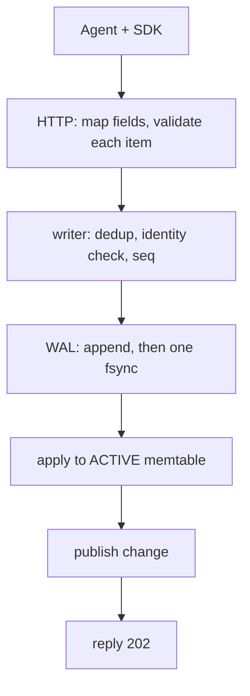
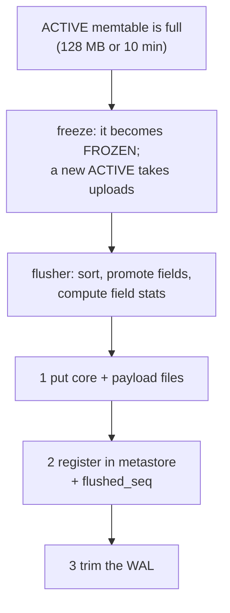
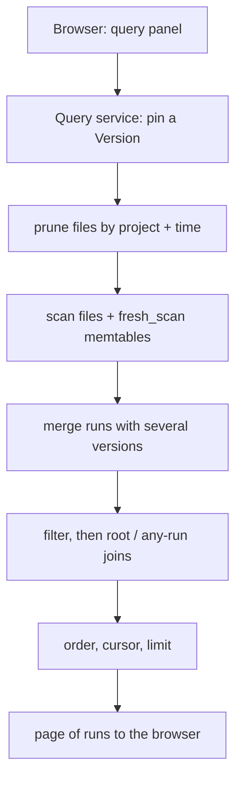
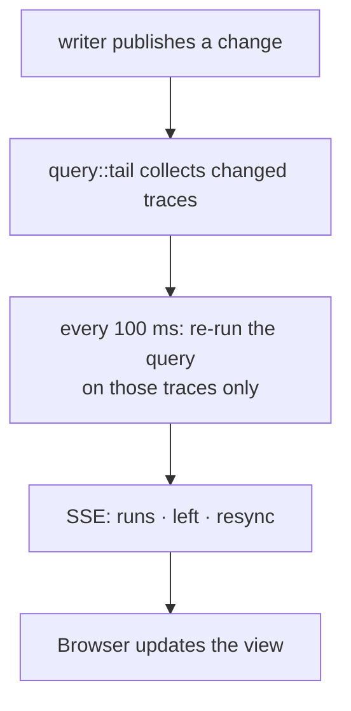
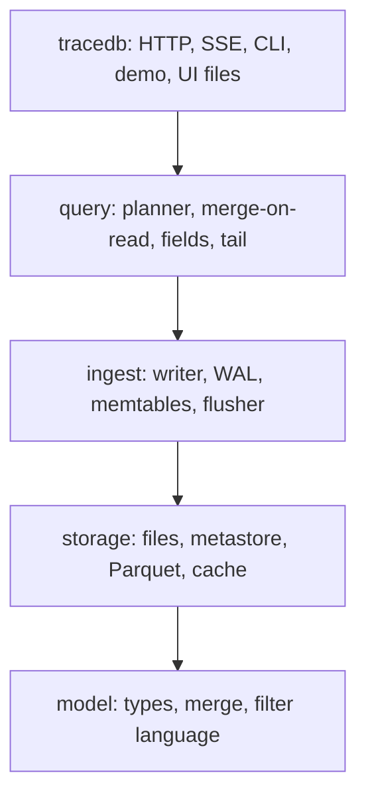
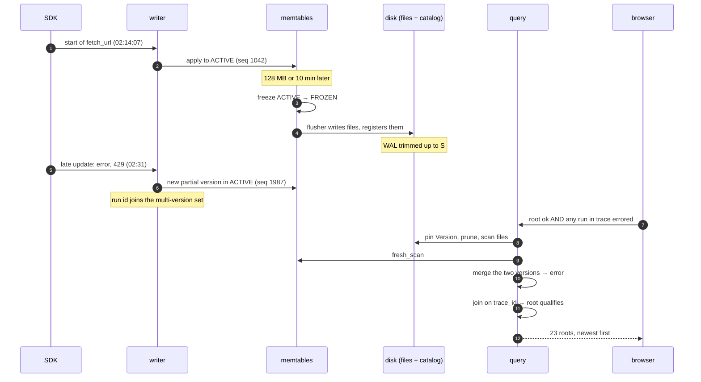
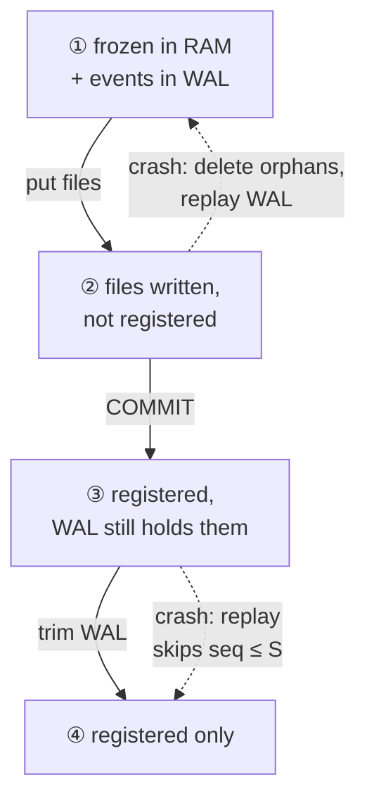
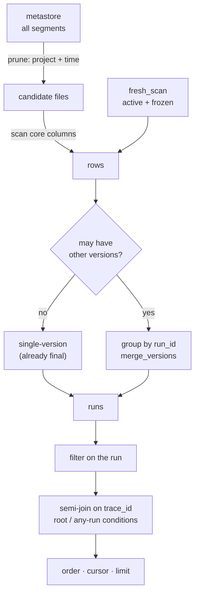
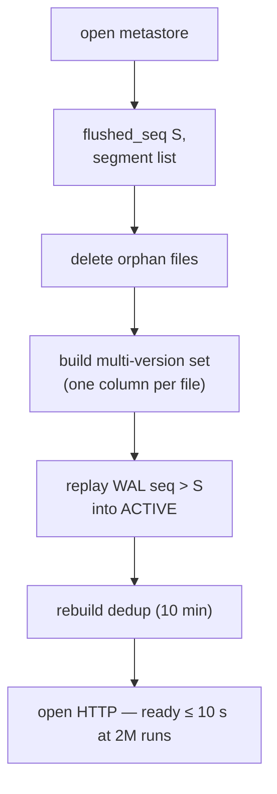

# M2 starter guide (pre-code) — Appendix A of the [plan](plan.md)

How M2 will work end to end, before any code exists: what each goal needs, which part of the system does it, and
pseudo-flows for every path. Names in `code font` are **planned** module and function names (plan.md §Project
Structure); there are no line numbers yet. **The last M2 PR (plan.md, PR 12) rewrites this file** into a guide for
reading the built code, like the [M1 starter guide](../001-m1-see-agent-trace-live/starter-guide.md): real links and
line numbers for every scene below, with the same vertical diagrams.

For *why* it is built this way, see [design.md](design.md). This guide is about *how it flows*.

## 1. Goals → functionality → where it will live

| Goal (spec end state) | Functionality that delivers it | Planned home |
|---|---|---|
| Keep data on disk; no memory ceiling | two memtables, flusher, Parquet core + payload files, catalog, WAL trim | `ingest::flush`, `storage::{segment, metastore, object}` |
| Never lose or duplicate a confirmed event, even mid-flush | write → register → trim order; orphan cleanup; replay from `flushed_seq` | `ingest::flush`, `ingest::recover`, `ingest::wal::trim` |
| One merged run wherever its pieces are | `needs_merge` + multi-version set; `merge_versions` aggregate | `ingest::mvset`, `query::merge` |
| Filter by any field, JSON path and tree condition | filter AST + parser; planner compiles to DataFusion; semi-joins | `model::filter`, `query::plan` |
| Click to build, text to edit, both the same query | panel ⇄ AST ⇄ text; canonical printer | `ui/src/query/*`, `model::filter::print` |
| Fields and values with counts | flush-time `field_stats` + memtable stats | `ingest::flush::stats`, `query::fields` |
| Samples and Table views; links | `columns` in the query; URL ⇄ query | `ui/src/views/*`, `ui/src/route.ts` |
| Any query live | re-query changed traces every 100 ms | `query::tail` |
| Bursts slow down, never fail | `429` when memory or unflushed WAL is over its limit | `ingest::writer` |
| Restart in ≤ 10 s at 2M runs | catalog read + small WAL replay + MV set from one column | `ingest::recover` |
| Same results on cloud storage | `ObjectStore` + `Metastore` traits, S3 + Postgres impls | `storage::{object, metastore}` |
| Scenario numbers, every change | `tracedb demo` + cloud CI job | `tracedb::demo`, `.github/workflows/ci.yml` |
| Honest retries | identity check before WAL append | `ingest::writer` |
| UI work without server rebuilds; Rust build without Node | `--ui-dir`; `build.rs` embeds `ui/dist` if present | `tracedb::routes::ui`, `crates/tracedb/build.rs` |

## 2. The system, one path at a time

Four small charts instead of one wide one. Each reads top to bottom.

### 2a. Write path: an upload, until "202"



Same as M1, except the identity check now runs before the WAL (so a rejected item leaves no trace).

### 2b. Background flush: memory to files



### 2c. Read path: one query



### 2d. Live view: keeping a query open



### Crates, top to bottom



Each crate uses only the ones below it. `query` reaches `ingest` only through two read-only traits (`Fresh`,
`Changes`); only `storage` knows file paths, Parquet and SQL.

## 3. Suggested reading order once it's written

| # | Planned file | Why read it |
|---|---|---|
| 1 | `model/src/filter/{ast,parse,print}.rs` | The query language: everything else consumes the AST |
| 2 | `model/src/merge.rs` (`merge_versions`) | The M1 merge rule, now for two versions |
| 3 | `storage/src/{object,metastore,segment}.rs` | The three storage traits and the files on disk |
| 4 | `ingest/src/flush.rs` | **Critical.** Write → register → trim |
| 5 | `ingest/src/recover.rs` | **Critical.** Restart: orphans, MV set, replay from `flushed_seq` |
| 6 | `ingest/src/writer.rs` | Identity check before WAL; freeze; `429` |
| 7 | `query/src/plan.rs` | **Critical.** Prune → scan → split → merge → filter → join → page |
| 8 | `query/src/merge.rs` | The `merge_versions` aggregate |
| 9 | `query/src/tail.rs` | Live views by re-querying changed traces |
| 10 | `query/src/fields.rs` | Field catalog reads |
| 11 | `ui/src/query/*` | Panel ⇄ AST ⇄ text |

## 4. Walkthrough: one run, from upload to the 23 quiet failures

The `fetch_url` step again: it starts at 02:14:07, gets flushed at 02:20, and its late update (error, `status_code:
429`) arrives at 02:31. At 08:00 the developer looks for quiet failures.



### Scene 1: start arrives (as M1, plus one check)

```text
writer.commit(group):
  for item in group:
    if dedup.contains(item.key):           count accepted; continue
    if let Some(st) = active.get(id).or(frozen.get(id)):
        if check_identity(st, item) is Err(r):  reject(item, r); continue     # NEW: before WAL, no dedup key
    seq += 1; wal.append(event(seq, item))
  wal.sync()
  for ev in appended: change = active.apply(ev); hub.publish(change)
  reply each request
```

What changes from M1: the identity check moved in front of the WAL, so `rejected` events leave no trace, and an
identical retry is checked (and rejected) again.

### Scene 2: the memtable fills, and uploads don't pause

```text
writer.before_group():
  if active.bytes ≥ LIMIT or active.oldest_age ≥ 10 min:
    if frozen.is_some():            reply 429 Retry-After: 1 to this group; return    # R-8
    frozen = Arc(take(active)); active = Memtable::new(); flusher.wake(frozen)          # R-10, O(1) swap
  if wal.unflushed_bytes ≥ 1 GB:    reply 429 Retry-After: 1; return
```

Uploads keep going into the new active memtable while the flusher works. Only if the *next* memtable fills before the
flush finishes do clients hear "busy".

### Scene 3: the flush (the part that must never lose data)

```text
flusher.flush(frozen):                          # background thread
  S = frozen.max_seq
  for (project, runs) in frozen.by_project():
    rows  = runs.sorted_by(trace_id, dotted_order)
    for r in rows:
      r.start_key   = dotted_order.own_start(r)
      r.needs_merge = r.created_by_patch || bloom_hit_in_older_segments(r.run_id)
      r.attrs_*     = promote_scalars(r.metadata, r.inputs, r.outputs)
    stats = field_stats(rows)                   # per path: type, count, top 50 values
    core, payload = SegmentFormat::write(rows)  # Parquet, page index, blooms on trace_id + run_id
    object_store.put(core_path, core); object_store.put(payload_path, payload)     # step 1: write
  metastore.transaction(|tx| {                                                       # step 2: register
    tx.insert_segments(all new segments); tx.insert_field_stats(all stats)
    tx.set_flushed_seq(S)
  })
  versions.publish(Version { segments: old + new, frozen: None })                   # readers see files now
  wal.trim(through = S, keep_younger_than = dedup_window)                           # step 3: trim
on error at any step: keep frozen, retry with backoff (uploads get 429 when active is also full)
```



At every arrow the data is in at least one durable place. That's the whole safety argument.

### Scene 4: the late update meets a run that's already on disk

```text
writer.apply(patch for 7c1e…a4):
  active has no state for it → new state from the patch (no name, no start_time) → created_by_patch = true
  mvset.insert(7c1e…a4)                 # every reader now merges this run's versions
```

The file row (written as single-version) and the memtable row now both belong to a multi-version run. Neither is
rewritten; the merge happens when someone reads it.

### Scene 5: the query

```text
query.run(Q):
  v      = versions.pin()                                         # R-7: this file set until we finish
  files  = v.segments.filter(project == Q.project && overlaps(start_key range, Q.time))
  pushed = Q.filter OR needs_merge OR run_id ∈ mvset              # safe pushdown
  rows   = datafusion.scan(files, core columns, pushed, Q.time on start_key)
           ∪ ingest.fresh_scan(Q.project, Q.time)                  # active + frozen, as Arrow
  single = rows.filter(!needs_merge && run_id ∉ mvset)
  multi  = rows.filter(needs_merge || run_id ∈ mvset).group_by(run_id).agg(merge_versions)
  runs   = (single ∪ derive(multi)).filter(Q.filter)
  if Q.trace_filter: runs = runs.semi_join(roots_matching(Q.trace_filter), on trace_id)
  if Q.tree_filter:  runs = runs.semi_join(trace_ids_with_any(Q.tree_filter), on trace_id)
  if Q.is_root:      runs = runs.filter(is_root)
  return runs.order_by(start_time desc, run_id).after(Q.cursor).limit(Q.limit + 1)
```

`trace_ids_with_any(eq(status, "error"))` runs the same prune → scan → merge → filter over all runs in scope (not
only roots), then keeps distinct `trace_id`s. For the 23 quiet failures, that set contains `0b9f…11` because the
merged `fetch_url` is now `error`.



### Scene 6: opening the trace

```text
query.trace(T):
  files = v.segments.filter(min_trace_id ≤ T ≤ max_trace_id)     # UUIDv7: few files
               .filter(cache.bloom(file, "trace_id").may_contain(T))   # R-9: usually 1
  rows  = scan(files, trace_id = T) ∪ fresh rows of T
  return merge multi-version rows; sort by dotted_order           # same tree as M1
query.run(R, include):   same lookup by run_id; then read payload file at payload_row for inputs/outputs/events
```

### Scene 7: the live view

```text
query.tail(Q) -> Stream<TailMsg>:
  rx = ingest.subscribe(); yield Hello{server_seq}
  changed = {}; sent = Lru(5_000)
  loop select:
    change = rx.recv():  changed.insert(change.trace_id); if quiet ≥ 100 ms: tick now
                         on Lagged or |changed| > 5_000: yield Resync; changed.clear()
    every 100 ms tick, if changed not empty:
      now  = query.run(Q ∧ trace_id ∈ changed)
      yield Runs(now); yield Left(sent ∩ runs_of(changed) − now)
      sent.extend(now); changed.clear()
```

HTTP's `/api/tail` only turns `TailMsg` into SSE events (`hello`, `runs`, `left`, `resync`).

### Scene 8: the field browser

```text
query.fields(project, time):
  segs  = segments in scope
  stats = metastore.sum_field_stats(segs)       # SQL: GROUP BY path, type; merge top_values in Rust
        + ingest.memtable_stats(project, time)  # computed on demand from active + frozen
  return paths sorted by count, complete = no segment hit the 10,000-path cap
query.values(project, time, path, prefix): same, for one path; top 50 values with counts
```

### Scene 9: restart

```text
ingest.recover(cfg):
  S        = metastore.flushed_seq()
  segments = metastore.active_segments()
  object_store.list() − segments' paths → delete (orphans from a crash between put and COMMIT)
  mvset    = ∪ over segments: read column run_id where needs_merge (cached)
  wal.replay_from(S + 1, |ev| active.apply(ev); if ev.created_by_patch: mvset.insert(ev.run_id))
  dedup    = rebuild from WAL records inside the window
  ready
```



### Scene 10: the panel and the text are the same query

```text
ui: chips ──to_ast──▶ AST ──print──▶ "and(has(tags, \"batch=…\"), eq(status, \"ok\"))"
    text  ──parse───▶ AST ──to_chips─▶ chips      (parse errors: {slot, start, end, expected} → underline)
click any value v of field f  →  AST = and(AST, eq(f, v))         (Alt-click: not(eq(f, v)))
URL   ⇄  {project, time, filter, trace, tree, root, order, cols, view, live}
```

## 5. HTTP status codes in M2

| Code | Meaning | Raised by |
|---|---|---|
| 202 | durable and applied (rejections listed in `rejected[]`) | `routes::ingest` |
| 429 + Retry-After: 1 | queue full, memtable full during a flush, or unflushed WAL ≥ 1 GB | `ingest::Ingest::accept`, `ingest::writer` |
| 503 + Retry-After: 5 | WAL write or fsync failed | `ingest::writer` |
| 400 `bad_filter` | parse/type error with position | `routes::api` ← `model::filter::parse` |
| 413 / 415 / 501 | body too big / multipart / feedback (as M1) | `routes` |

`507` is gone.

## 6. Things to try once it exists

```bash
tracedb demo --seed 7                                   # the scenario numbers
tracedb query --root --tree-filter 'eq(status, "error")' 'and(has(tags, "batch=2026-11-05-a"), eq(status, "ok"))'
curl -s localhost:7070/healthz | jq                    # memtable, frozen, segments, last flush
ls .tracedb/data/*/*/                                  # the immutable files
sqlite3 .tracedb/meta.sqlite 'select id, row_count, needs_merge_rows from segments'
cargo test -p tracedb-query --test merge_on_read       # query == naive filter, with random flush points
```

## 7. Where M2 is most likely to be wrong (read these tests first)

1. **Merge-on-read correctness**: the property test with random late updates and random flush points
   (design §9). If any run shows two rows or a stale field, the `needs_merge` / multi-version set rule is broken.
2. **Flush crash windows**: the crash harness kills between put, COMMIT and trim. Duplicates mean replay didn't skip
   `seq ≤ S`; losses mean trim ran too early.
3. **Live tree conditions**: a root appearing in the quiet-failures live view when a child errors after the root
   finished.
4. **Known limit**: identity conflicts for runs that are only on disk are accepted and flagged, not rejected
   (design §8, open question 1).
