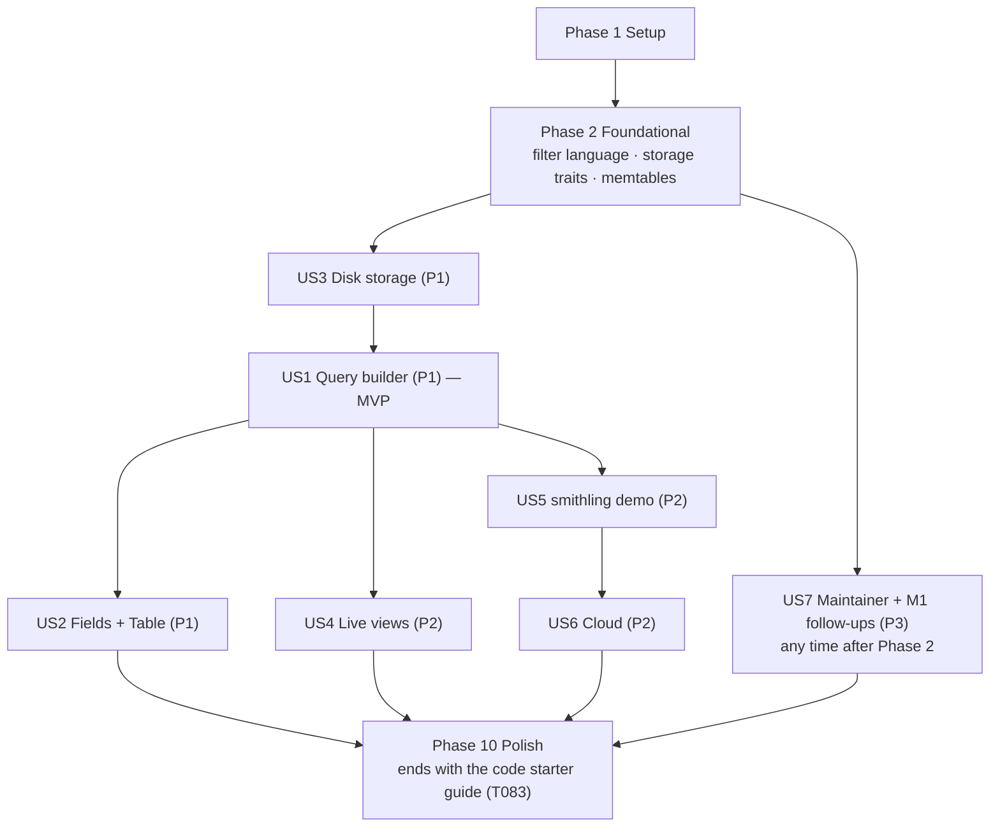

# Tasks: M2 — Durable storage + query builder

**Input**: [spec.md](spec.md), [plan.md](plan.md), [design.md](design.md), [data-model.md](data-model.md),
[contracts/](contracts/), [research.md](research.md), [quickstart.md](quickstart.md), [starter-guide.md](starter-guide.md)

**Tests**: included. The spec requires automated checks (M2-FR-22, SC-01..10) and constitution VI requires the demo,
bench and crash test.

**Assumed answers to design §8** (proposed defaults; change before implementing if you disagree):
1. Identity conflicts for runs only on disk are accepted and flagged (`identity_conflict` warning), not rejected.
2. Dedup window 10 min (configurable); each flush saves its dedup keys in the catalog, flushed WAL files go at once (D-022).
3. `build.rs` stops running npm; it embeds `ui/dist` if present, else a placeholder page.
4. Memtable limit 128 MB; flush age 10 min. (M3: 64 MB measured as heap, 2 min, [D-028](../000-smithling-master-plan/decisions.md#d-028).)
5. No `field:value` short form in M2.

**Status**: all done; M2 closed at `c7595c6`. *Italic notes* say how a task was built where it differs. Paths are as
after the crate split (after M3): `crates/smithling` became `server` (HTTP), `tools` (seed, scenario, demo, query CLI)
and `smithling` (the binary and the tests that start it).

**Organization**: grouped by user story; each story phase ends at a checkpoint that can be shown on its own.

## Format: `[ID] [P?] [Story] Description`
- **[P]**: can run in parallel (different files, no dependency on an unfinished task)
- **[Story]**: US1–US7 from spec.md

## Path conventions
Crates `crates/{model,storage,ingest,query,smithling}`; UI in `ui/`; integration tests in `crates/<crate>/tests/`;
fixtures in `tests/fixtures/`; CI in `.github/workflows/ci.yml` and `ci/cloud.yml`.

---

## Phase 1: Setup (shared infrastructure)

**Purpose**: dependencies and the new crate.

- [X] T001 Add workspace dependencies in root `Cargo.toml`: `datafusion = { version = "55.2", default-features = false, features = ["parquet", "nested_expressions", "datetime_expressions"] }`, `sqlx = { version = "0.9", default-features = false, features = ["runtime-tokio", "sqlite", "postgres", "migrate"] }`, `ulid = "3"`, `moka = { version = "0.12", features = ["sync"] }`; take `arrow`, `parquet` and `object_store` (must resolve to 0.13.x, backlog R-4) through DataFusion's re-exports, not as separate versions; verify with `cargo tree -d` that there is one arrow version
- [X] T002 [P] Create `crates/storage/` (`Cargo.toml`, `src/lib.rs` with empty modules `object`, `metastore`, `segment`, `cache`, `version`) and add it to the workspace members
- [X] T003 [P] *(MinIO + one-shot `bucket` service, Postgres 17; keys from `AWS_ACCESS_KEY_ID` / `AWS_SECRET_ACCESS_KEY` / `PGPASSWORD`, which smithling reads too; parsed, not run here: no Docker)* Add `ci/cloud.yml` (docker compose: MinIO with a `smithling` bucket, Postgres 17 with database `smithling`; credentials from environment variables, never echoed)

**Checkpoint**: `cargo build` succeeds with the new dependencies; `cargo tree -d` shows no duplicate arrow/parquet.

---

## Phase 2: Foundational (blocking prerequisites)

**Purpose**: the filter language, the storage traits, and the memtable split that every story uses.

**⚠️ CRITICAL**: no story can start until this phase is complete.

### Tests for the foundation (write first; they should fail)

- [X] T004 [P] Filter golden tests `crates/model/tests/filter.rs`: every example in `contracts/filter-language.md` (SDK docstring examples, the three scenario queries, the four error rows with exact byte ranges and messages)
- [X] T005 [P] *(built as a `proptest!` block in `crates/model/tests/filter.rs`)* Filter property test `crates/model/tests/filter_roundtrip.rs`: random ASTs → `print` → `parse` gives the same AST; `print` is canonical (printing twice is identical)
- [X] T006 [P] `merge_versions` property test `crates/model/tests/merge_versions.rs`: for random event sequences split at random points into versions, merging the versions by `last_seq` equals applying all events in order with M1 `merge` (incl. `tags: []`/`metadata: {}` set via the `present` bitmask)
- [X] T007 [P] *(local SQLite + local files in `crates/storage/tests/segment.rs`; S3/Postgres runs are T068)* Storage trait tests `crates/storage/tests/traits.rs`, generic over implementations: object put/get/range-read/list/delete; a put to an existing name fails (write-once); metastore migrations, flush transaction atomicity (insert segments + field_stats + `flushed_seq` all or nothing), `active_segments`, `flushed_seq`

### Implementation

- [X] T008 [P] Filter AST in `crates/model/src/filter/ast.rs` per data-model §9: `Expr = And | Or | Not | Cmp{op: eq|neq|gt|gte|lt|lte, path, value} | Has{path, value} | In{path, values}`; `Path` = built-in field or `metadata.<dotted>` / `inputs.<dotted>` / `outputs.<dotted>`; `Value` = string | number | bool | null | time
- [X] T009 Filter parser in `crates/model/src/filter/parse.rs`: hand-written recursive descent for the grammar in `contracts/filter-language.md`; errors are `{start, end, expected}` byte ranges (built: `{start, end, message}`, the message says what was expected); unknown fields suggest the closest built-in (edit distance ≤ 2); `latency` in seconds; relative times `"-12h"`, `"-30m"`, `"-7d"`; `status` values limited to `"running" | "ok" | "error"`; `feedback_key`/`feedback_score` → `unsupported: feedback is supported from M4`; `search(…)` → `unsupported: search() is supported from M3` (M2; removed in M3, where both parse)
- [X] T010 Canonical printer in `crates/model/src/filter/print.rs` (`print(&Expr) -> String`), and `crates/model/src/filter/mod.rs` exporting `parse_filter`, `print`, `Expr`
- [X] T011 [P] `merge_versions(older: &RunVersion, newer: &RunVersion) -> RunVersion` in `crates/model/src/merge.rs`: per field, the newer present value wins (by `last_seq`); identity fields keep the **first** version's value and add `Warning::IdentityConflict` on mismatch (design §8 q1); recompute derived fields with `derive`
- [X] T012 [P] *(done as a `present` bitmask + `to_fields()` on `RunState` in `crates/model/src/run.rs`: a version is a `RunState`, so no separate type)* `RunVersion` type in `crates/model/src/version.rs` with every column of data-model §2, incl. `start_key` ("from the run's own `dotted_order` segment; **never null**"), `present: u32` bitmask, `needs_merge`, `first_seq`/`last_seq`; `start_key` derived via `DottedOrder` (own segment timestamp)
- [X] T013 [P] `ObjectStore` trait + local impl in `crates/storage/src/object.rs` over `object_store::local::LocalFileSystem`; S3 impl over `object_store::aws::AmazonS3` (endpoint, bucket, prefix from `--storage s3://bucket/prefix` + `AWS_*` env); write-once (`PutMode::Create`)
- [X] T014 [P] *(DDL inline in `metastore.rs` with `CREATE … IF NOT EXISTS`, no `migrations/` folder; trace-id bounds are `TEXT`, no foreign keys)* `Metastore` trait in `crates/storage/src/metastore.rs` with SQLite and Postgres impls via `sqlx`; migrations in `crates/storage/migrations/0001_init.sql` creating exactly the `state`, `segments`, `field_stats` tables and the `segments_scope` index of data-model §5 (SQL that runs on both; `BLOB` vs `BYTEA` via `sqlx` type mapping)
- [X] T015 [P] *(replaced by DataFusion's built-in Parquet metadata cache, decision D-013)* `Cache` trait + moka LRU impl in `crates/storage/src/cache.rs` (keys: file footer, bloom filter, row group; weight by bytes; default 256 MB)
- [X] T016 *(in `crates/ingest/src/memtable.rs`, behind the memtable lock: decision D-015; the deletion side lands with M4 compaction, tested by T076)* `Version` + pinning in `crates/storage/src/version.rs`: `Arc<Version{id, segments, frozen}>`; `VersionSet::pin()`, `publish(new)`; a segment's files may be deleted only when no live `Arc<Version>` references it (R-7); test-only `swap(remove, add)`
- [X] T017 Split the M1 run store into memtables in `crates/ingest/src/memtable.rs`: `Active` (M1 `RunStore` with `by_trace`, `roots`, `children`, byte count, oldest-event time) and `Frozen` (`Arc`, immutable); `freeze()` swaps in O(1); at most one frozen
- [X] T018 *(as `Ingest::mem()` + the memtable `Snapshot`; the Arrow `fresh_scan` lands with the planner, T041)* `Fresh` trait in `crates/ingest/src/lib.rs`: `fresh_scan(project: Option<&str>, time: TimeRange) -> RecordBatch` over active + frozen (core columns only, no payloads) and `fresh_trace(trace_id)`, `fresh_run(run_id, include)`; replaces M1's `Snapshot` (keep `Snapshot` as a thin adapter until query moves over in US1)
- [X] T019 [P] *(built in `crates/ingest/src/lib.rs`, `Ingest::multi_version()`; no `mvset.rs`)* Multi-version set in `crates/ingest/src/mvset.rs`: `RwLock<HashSet<RunId>>`; the writer inserts when it creates a state from a patch (`created_by_patch`); exported read-only to query

**Checkpoint**: all Phase 2 tests pass; M1's test suite still passes with memtables (no flush yet).

---

## Phase 3: User Story 3 — Keep all data on disk, restart fast (Priority: P1)

**Goal**: data moves to immutable files in the background, nothing confirmed is lost, restarts are fast.

**Independent test**: load 2M runs, kill during uploads and flushes 10 times, restart, compare against every confirmed
upload (spec Story 3).

### Tests for User Story 3

- [X] T020 [P] [US3] Segment round-trip test `crates/storage/tests/segment.rs`: write run versions → read back equal; sorted by `(trace_id, dotted_order)`; bloom filters answer `may_contain` for every written `trace_id` and `run_id`; promoted paths per data-model §4 ("metadata depth ≤ 4, strings ≤ 256 B"; "inputs/outputs depth ≤ 3, ≤ 64 leaves per field")
- [X] T021 [P] [US3] Flush test `crates/ingest/tests/flush.rs`: after a flush the catalog lists the segment, `flushed_seq = S`, WAL files with last seq ≤ S are gone (D-022), field stats rows exist
- [X] T022 [P] [US3] Recovery test `crates/ingest/tests/recover.rs`: orphan files (written, not registered) are deleted on start; replay skips seq ≤ `flushed_seq`; multi-version set is rebuilt from `needs_merge` rows; an M1 data folder (fixture in `tests/fixtures/m1-folder/`) opens with no manual step (M2-FR-20) — M1 folder is generated in the test (M2 writer, same WAL format) instead of a checked-in `tests/fixtures/m1-folder/`; also covers dedup rebuild, a missing data file → `corrupt_segments`, and refusing to delete files the WAL no longer covers
- [X] T023 [P] [US3] Extend the crash harness `crates/smithling/tests/crash.rs`: kill points during upload, during file put, between put and COMMIT, after COMMIT before trim, during trim (via a `SMITHLING_TEST_CRASH_AT` hook); 10 rounds; assert 0 missing and 0 duplicated (SC-05) — 5 random kills during upload + `during_put`, `after_put`, `after_commit`, `during_trim`, `after_trim`; small WAL files via `SMITHLING_TEST_WAL_ROLL`; also bounds stored versions (reads merge duplicates)
- [X] T024 [P] [US3] *(built as `crates/ingest/tests/slowdown.rs`)* Slowdown test `crates/smithling/tests/slowdown.rs`: with a 4 MB memtable and a slowed flusher, a burst gets `429` + `Retry-After: 1`, the client retries, nothing is lost, memtable bytes stay ≤ 2 × limit (R-8)
- [X] T025 [P] [US3] Restart test `crates/smithling/tests/restart.rs` (`#[ignore]`): 2M runs on disk → ready ≤ 10 s (SC-06)
- [X] T026 [P] [US3] Flush-latency test `crates/smithling/tests/throughput.rs` (`#[ignore]`): ≥ 5,000 events/s while flushes run, p99 upload latency ≤ 1 s (SC-07) — 16 MB memtable so flushes run throughout; a `429` retry counts toward its batch's latency. M3 renamed and raised it: `sustains_20000_events_per_second_while_querying`

### Implementation for User Story 3

- [X] T027 [P] [US3] *(built as `promote` in `crates/model/src/attrs.rs`, run when an event is applied, not at flush; written to one JSON text column `attrs`, [D-012](../000-smithling-master-plan/decisions.md#d-012))* Promotion in `crates/ingest/src/flush/promote.rs`: copy scalar leaves into `attrs_str` / `attrs_num` / `attrs_bool` per data-model §4; a path seen with two types goes into both maps
- [X] T028 [P] [US3] *(built as `StatsBuilder` in `crates/storage/src/segment.rs`)* Field stats in `crates/ingest/src/flush/stats.rs`: per path and type: `count`, top 50 values with counts, `other_count`; cap 10,000 paths per segment and mark it incomplete
- [X] T029 [US3] Parquet writer/reader in `crates/storage/src/segment.rs` (`SegmentFormat` trait): core file with the columns of data-model §2, row groups ~64k, page index on, zstd, bloom filters on `trace_id` and `run_id`; payload file with data-model §3 columns; `payload_row` pointer (payload is `run_id`, `inputs`, `outputs`, `events` only; `metadata`, `extra`, `dropped` are core columns)
- [X] T030 [US3] *(built as `crates/ingest/src/flush.rs`; `needs_merge = created_by_patch() || mvset.contains(id)`, no bloom lookup, [D-016](../000-smithling-master-plan/decisions.md#d-016); M3 adds the writer's flushed-ids filter, `crates/ingest/src/flushed.rs`, [D-025](../000-smithling-master-plan/decisions.md#d-025); a project-less version is filed under its run's project when known, [D-024](../000-smithling-master-plan/decisions.md#d-024))* Flusher in `crates/ingest/src/flush/mod.rs`: background thread; per project in the frozen memtable: sort, set `start_key`, set `needs_merge` (= `created_by_patch` or a bloom hit in an older segment of the same project), promote, stats, write files under `<project>/<yyyy-mm-dd>/seg-<ulid>.{core,payload}.parquet` (`_unknown/` when project is unknown); one metastore transaction (segments + field_stats + `flushed_seq = S`); `VersionSet::publish`; drop frozen; on error keep frozen and retry with backoff
- [X] T031 [US3] WAL changes in `crates/ingest/src/wal.rs`: `replay_from(seq)`, `trim(through_seq, keep_younger_than)` deleting whole files only, `unflushed_bytes()`
- [X] T032 [US3] Writer changes in `crates/ingest/src/writer.rs`: freeze when active ≥ `--memtable` (default 128 MB) or oldest event ≥ `--flush-age` (default 10 min); reply `429` + `Retry-After: 1` to the whole group when active is full and a frozen memtable is still flushing, or when unflushed WAL ≥ 1 GB; remove the M1 budget and `507`; dedup window from `--dedup-window` (default 10 min). Also freezes when unflushed WAL ≥ half its limit; M3 defaults 64 MB / 2 min ([D-028](../000-smithling-master-plan/decisions.md#d-028))
- [X] T033 [US3] Recovery in `crates/ingest/src/recover.rs`: read `flushed_seq` and active segments; delete orphans; build the multi-version set from the `run_id` column where `needs_merge` (cached); replay WAL > `flushed_seq`; rebuild dedup from WAL records inside the window; create a fresh metastore with `flushed_seq = 0` for an M1 folder — extracted from `Ingest::open`; orphans are deleted only when the WAL reaches back to `flushed_seq` (else refuse to start); registered files missing or unreadable (read only for `needs_merge` segments) are left out and reported (M3 reads every file at start, [D-025](../000-smithling-master-plan/decisions.md#d-025))
- [X] T034 [US3] Wire storage into `Ingest::open` and `smithling serve` in `crates/ingest/src/lib.rs` and `crates/smithling/src/main.rs`: flags `--storage`, `--metastore`, `--memtable`, `--flush-age`, `--dedup-window`, `--cache` per `contracts/cli.md` (no `--cache` in M2, [D-013](../000-smithling-master-plan/decisions.md#d-013); M3 adds `--cache 32MB`, [D-028](../000-smithling-master-plan/decisions.md#d-028)); `--max-memory`/`--max-runs` accepted with a "no longer applies" warning
- [X] T035 [US3] `/healthz` in `crates/server/src/lib.rs`: `{ok, wal_ok, flush_ok, memtable_bytes, frozen, unflushed_wal_bytes, segments, last_flush_at, corrupt_segments}` per `contracts/http-api.md` — `Health` in `crates/ingest/src/lib.rs`, served as is; `corrupt_segments` is filled at start only; extra fields kept
- [X] T036 [US3] *(built in `crates/query/src/lib.rs` (`trace`, `run`) over `scan.rs`; no `lookup.rs`)* Keep M1 reads working over memtables ∪ files until US1's planner lands: trace and run lookups in `crates/query/src/lookup.rs` (min/max `trace_id` + bloom pruning, merge multi-version rows, sort by `dotted_order`; payload read via `payload_row`)

**Checkpoint (demo)**: `smithling seed --traces 20000` → `/healthz` shows segments and memtable ≤ 128 MB; `kill -9`,
restart ≤ 10 s; the M1 runs list and trace view still work; crash harness 10/10.

---

## Phase 4: User Story 1 — Find the failures with the query builder (Priority: P1) 🎯 MVP

**Goal**: any filter (fields, JSON paths, conditions on the root and on any run in the trace), by clicking, over
memtables ∪ files.

**Independent test**: on the scenario data, build each query in the panel without typing syntax → exactly 14 and 23,
newest first across pages (spec Story 1).

### Tests for User Story 1

- [X] T037 [P] [US1] Merge-on-read property test `crates/query/tests/merge_on_read.rs`: random runs, random late updates, random flush points → `query(Q)` equals a naive filter over fully merged runs, for random `Q` incl. `trace_filter` and `tree_filter` (SC-09)
- [X] T038 [P] [US1] *(built as `pages_have_no_repeats_or_gaps_while_runs_arrive` in `crates/tools/tests/query_api.rs`)* Cursor property test `crates/query/tests/cursor.rs`: paging with page size 10 while new runs arrive returns no repeats and no gaps among runs that existed at the first page (M2-FR-04); cursor `query_hash` excludes `cursor`, `view`, `live`
- [X] T039 [P] [US1] API tests `crates/tools/tests/query_api.rs`: `POST /api/query` shapes and `400 bad_filter {slot, start, end, expected}` (built: `{code, message, slot, start, end}`) / `bad_cursor` / `unsupported` per `contracts/http-api.md`; `GET /api/roots` still answers M1 clients
- [X] T040 [P] [US1] *(through `<App/>`; also add/edit a chip by field/operator/value, local text errors before sending, cursor paging, project/time/order/limit, empty state, URL round trip)* UI tests `ui/src/query/Panel.test.tsx`: chips ⇄ text round trip; negate/disable/remove a chip updates results; click a tag/status/name adds a chip, Alt-click adds its negation; inline error underline from a `bad_filter` response; M1 `?project=&status=` links translate on load

### Implementation for User Story 1

- [X] T041 [US1] *(superseded by [D-017](../000-smithling-master-plan/decisions.md#d-017): no `TableProvider` or `fresh_scan`; `scan::pin` copies memtable runs with the `Version`, `read_core` scans files with scope ∧ (pushed ∨ `needs_merge`), in `crates/query/src/scan.rs`)* `TableProvider` over a pinned `Version` + `fresh_scan` batch in `crates/query/src/provider.rs`: prune segments by project and `start_key` range from the version's segment list; scan core columns with pushdown `Q.filter OR needs_merge OR run_id ∈ multi-version set` (design §4.3); identity predicates pushed down unconditionally
- [X] T042 [US1] *(superseded by [D-017](../000-smithling-master-plan/decisions.md#d-017): no UDAF; `versions_of` + `merge_group` in `crates/query/src/scan.rs` call `model::merge_versions`)* `merge_versions` aggregate UDAF in `crates/query/src/merge.rs` grouping rows that have `needs_merge` or whose `run_id` is in the multi-version set; uses `model::merge_versions`
- [X] T043 [US1] *(superseded by [D-017](../000-smithling-master-plan/decisions.md#d-017)/[D-012](../000-smithling-master-plan/decisions.md#d-012): no `plan.rs`; `pushdown.rs` compiles a superset pre-filter, `model::filter::eval` decides on merged runs, unpromoted paths report `not_indexed` without reading payloads ([D-011](../000-smithling-master-plan/decisions.md#d-011)); `select` in `crates/query/src/lib.rs`)* Planner in `crates/query/src/plan.rs`: compile `Expr` to DataFusion `Expr` (built-in fields → columns; `metadata.*`/`inputs.*`/`outputs.*` → `attrs_*` map lookups by type; comparisons only on the matching type, with a `mixed_types` warning carrying counts); non-promoted paths → read payload rows of candidates with a `not_indexed` warning; `is_root`; order by `start_time` or `latency` with the keyset cursor `{order_value, run_id, query_hash}`; limit `1..=200`, default 50
- [X] T044 [US1] *(built as `trace_conditions` in `crates/query/src/lib.rs`, per 2,000 candidates, not semi-joins, [D-017](../000-smithling-master-plan/decisions.md#d-017))* Tree filters in `crates/query/src/plan.rs`: `trace_filter` = semi-join with roots matching it on `trace_id`; `tree_filter` = semi-join with distinct `trace_id`s of any run matching it (including the run itself; contract note)
- [X] T045 [US1] `Query` service API in `crates/query/src/lib.rs`: `query(Query) -> Page{runs, next_cursor, warnings, stats{files_scanned, files_pruned, rows_merged, ms}}` (built `stats`: `files_total, files_scanned, rows_read, rows_merged, files_version_lookup, merge_rows, matched, complete, ms`); move M1 `roots`, `trace`, `run` onto it; drop the `Snapshot` adapter from T018
- [X] T046 [US1] Routes in `crates/server/src/routes/api.rs`: `POST /api/query` (request/response per `contracts/http-api.md`), errors with slot and byte range; `GET /api/roots` mapped onto `query` with `is_root: true`
- [X] T047 [P] [US1] *(also `--url`/`SMITHLING_URL`, default `http://localhost:7070`; no default `--time`, so all time; footer `N runs` or `showing N of M runs`; usage errors now exit 1 for every command, not clap's 2)* `smithling query` in `crates/smithling/src/main.rs` + `crates/tools/src/cli_query.rs`: flags per `contracts/cli.md`; table output, `--json` for JSON lines
- [X] T048 [P] [US1] *(golden file grown to 86 cases: byte offsets past non-ASCII, escapes and surrogates, number printing, lex errors, UUID and chrono time forms; the UI test also runs a print/parse round-trip property; UI offsets are UTF-16, converted to bytes for the golden check and for server errors)* UI query model in `ui/src/query/ast.ts`, `ui/src/query/print.ts`, `ui/src/query/parse.ts` mirroring the Rust grammar; a shared golden file `tests/fixtures/filter-golden.json` used by both T004 and the UI tests so the two parsers can't drift
- [X] T049 [US1] *(chip model in `ui/src/query/chips.ts`: top-level `and` arguments are chips, `not(x)` is a negated chip, anything else is one expression chip; *root only* is a toggle chip in "This run"; limit is a select 10–200; disabled chips live in the page, not the URL; page wiring in `ui/src/views/Runs.tsx`)* Query panel in `ui/src/query/Panel.tsx`, `ui/src/query/Chip.tsx`, `ui/src/query/TextEditor.tsx`: project, time range, three where-rows (this run / its root / any run in its trace), order, limit; text ⇄ panel toggle; deep expressions shown as one expression chip; inline errors
- [X] T050 [US1] *(M1 `RunsList` removed; its live tail comes back with T063; paging on scroll plus a `more ▸` button; query warnings shown above the table)* Samples view in `ui/src/views/Samples.tsx` (from M1 `RunsList`, now driven by `POST /api/query`, infinite paging by cursor); click-to-filter on status badges, tags, names
- [X] T051 [US1] *(in `ui/src/query/url.ts`, `route.ts` unchanged; also `limit=`; `order=<by>.<dir>`, default omitted; an M1 link = only `project`/`status` → `root=1` (+ `eq(status, …)`), and since `?project=` alone reads as M1 the writer adds `root=0` in that one case; `cols`/`view`/`live` kept for part B)* URL state in `ui/src/query/url.ts` + `ui/src/route.ts`: `?project=&time=&filter=&trace=&tree=&root=1&order=&cols=&view=&live=1`; translate M1 links on load (M2-FR-11)

**Checkpoint (demo)**: quickstart step 2.1–2.2 and 2.4–2.5: 14 and 23 by clicking; text ⇄ panel; a link reopens the
view. **This is the M2 MVP.**

---

## Phase 5: User Story 2 — Explore fields and filter by clicking values (Priority: P1)

**Goal**: a field browser with types and top values; any value anywhere is clickable; a Table view with chosen columns.

**Independent test**: open the field browser → `prompt_version` with `v6 (928)`, `v7 (912)`; click `v7`, a tag and a
status → three chips; results match (spec Story 2).

### Tests for User Story 2

- [X] T052 [P] [US2] *(plus `crates/query/tests/tree_filters.rs`: 14 failing roots / 23 quiet failures across files and memtable, and trace conditions over >2,000 candidate traces read only those traces)* Field catalog tests `crates/query/tests/fields.rs`: stats summed across segments in scope plus memtable stats; a metadata key first seen today is listed; `complete = false` past 10,000 paths; values endpoint returns ≤ 50 with `approximate` when any segment's top 50 cut it off
- [X] T053 [P] [US2] *(release, 2M runs = 7 files + 222k memtable runs: p50 ≈ 262 ms (max 286 ms) for fields, fields by prefix, values, values by prefix. Measured at `6aabb98` with D-020 already in; T078's ≈ 3 ms is a later run at 37 files, presumably with far fewer runs in the memtable, whose stats are computed per request (inferred, not re-measured). Since `7e02feb` `bench_m2.rs` only wraps `smithling bench`)* Suggestion latency check in `crates/smithling/tests/bench_m2.rs` (`#[ignore]`): p50 ≤ 500 ms for fields and values at 2M runs (SC-03)
- [X] T054 [P] [US2] *(plus `ui/src/views/Live.test.tsx` for T063)* UI tests `ui/src/fields/FieldBrowser.test.tsx` and `ui/src/views/Table.test.tsx`: suggestions with counts as you type; add a column; click a cell value → chip

### Implementation for User Story 2

- [X] T055 [US2] *(summed in memory from the pinned `Version`'s stats, not SQL — D-020; per-field `complete` = all its values known exactly; `other_count` = runs with the path minus listed counts; active memtable read in batches of 4,096 runs per lock hold; approximate by design: a file counts whole if its time range overlaps; multi-version runs count once, merged — D-023)* Field catalog reads in `crates/query/src/fields.rs`: `fields(scope)` and `values(scope, path, prefix)` from `field_stats` rows of segments in scope (one SQL `GROUP BY path, type`; merge `top_values` in Rust) + `ingest.memtable_stats(scope)` computed on demand
- [X] T056 [US2] *(`time` = last span like `12h`; missing `path` → `400 bad_request`)* Routes `GET /api/fields` and `GET /api/fields/values` in `crates/server/src/routes/api.rs` per `contracts/http-api.md`
- [X] T057 [P] [US2] *(a `fields` toggle beside the results; server prefix search, debounced 150 ms; list-typed fields filter with `has`; `+col` adds a Table column)* Field browser in `ui/src/fields/FieldBrowser.tsx` + `ui/src/fields/ValueList.tsx`: paths by count with types, values with counts, prefix search, click → chip in "This run"
- [X] T058 [P] [US2] *(rendered by `Samples.tsx`, which keeps paging and live for both views; status and name always shown; columns limited to what the server fills — status, name, model, latency (s), total_tokens, tags, and metadata/inputs/outputs paths; `columns` sent only in the Table view)* Table view in `ui/src/views/Table.tsx`: user-chosen columns sent as `columns` in the query; cells clickable to filter; columns kept in the URL (`cols=`)

**Checkpoint (demo)**: quickstart step 2.3.

---

## Phase 6: User Story 4 — Live views for any query (Priority: P2)

**Goal**: any query view can stay live, including tree conditions; runs that stop matching are marked.

**Independent test**: a live view for `status = error AND name = fetch_url` shows only matching runs within 1 s
(spec Story 4).

### Tests for User Story 4

- [X] T059 [P] [US4] Live tests `crates/server/tests/e2e_live.rs`: matching runs within 1 s, non-matching ignored; `left` when a run stops matching; quiet-failures live view gets the root when a child errors after the root finished; `resync` past 5,000 changed traces; M1 `?project=`/`?trace=` tails still work (reuse M1 `e2e_tail.rs` assertions) — M1 tails stay in `e2e_tail.rs` (unchanged, passing); also a bad `?q=` → 400; the quiet-failure case covers a root loaded before the view opened

### Implementation for User Story 4

- [X] T060 [US4] `query::tail(Query) -> Stream<TailMsg>` in `crates/query/src/tail.rs` per design §4.5: subscribe first, then `Hello{server_seq}`; collect changed `trace_id`s; first change after a quiet spell at once, then every 100 ms run `query(Q ∧ trace_id ∈ changed)`; emit `Runs`, `Left` (last 5,000 sent ids), `Resync` on lag or > 5,000 changed traces — runs unchanged since `Hello` are not resent unless the query has trace/tree conditions; `Left` = changed runs the tab may have loaded (not new since `Hello`) ∪ sent runs of changed traces, minus matches; changes keep draining while a query runs; a failed query sends `Resync` with backoff; `Sent` bookkeeping is property-tested; live headers carry `child_count = 0` like query pages
- [X] T061 [US4] `Change` gains `trace_id` in `crates/ingest/src/hub.rs` / `crates/ingest/src/memtable.rs` — `Change.header` already carries `trace_id`, `run_id`, `last_seq`; `Change` gains `elsewhere` (set by the writer with the multi-version set) and `is_new()`, so `Left` skips runs new since `Hello` that were never sent
- [X] T062 [US4] Reduce `crates/server/src/routes/tail.rs` to SSE framing of `TailMsg` (`hello`, `runs`, `left`, `resync`; 15 s keep-alive); parse `?q=` (URL-encoded query JSON) and M1 `?project=` / `?trace=` (M2-FR-26) — `?q=` is the `POST /api/query` body as JSON; `?project=` maps to the same `listed_roots()` query as `/api/roots`, `?trace=` to `traces = {id}`; both also narrow `?q=`
- [X] T063 [US4] *(`live=1` in the URL; `left` carries ids only, so shown rows that leave are re-read with `GET /api/runs/{id}`; new runs that sort past a loaded page with more pages are left to paging; M1's "N new" pill when scrolled is not restored)* UI live toggle in `ui/src/live.ts` + `ui/src/views/Samples.tsx`: subscribe with the current query; mark `left` runs "no longer matching"; reload on `resync`

**Checkpoint (demo)**: quickstart step 5.

---

## Phase 7: User Story 5 — Reproduce the scenario numbers with one command (Priority: P2)

**Goal**: `smithling demo` generates the overnight-eval scenario and checks 14, 23 and the `prompt_version` top values.

**Independent test**: on an empty folder, `smithling demo` passes all checks and exits 0 (spec Story 5).

### Tests for User Story 5

- [X] T064 [P] [US5] *(also: exactly the planted root ids; v7 ∧ 429 = 19; late in 30–120 s or 40+ min; a load test asserts ≥ 2 flushes and every failing root starts in a file and ends in the memtable)* Scenario generator test `crates/tools/tests/scenario.rs`: same seed → identical data; planted counts exactly as research M2-R14 (200 roots tagged `batch=2026-11-05-a`; 14 roots error; 23 roots ok with ≥ 1 errored step; `metadata.prompt_version` on 1,840 runs: v6 928, v7 912); background volume forces ≥ 2 flushes

### Implementation for User Story 5

- [X] T065 [US5] *(`load` sends background one trace per upload, pausing while a memtable is frozen, and stops once the starts are flushed after ≥ 2 flushes, so the late updates stay in the memtable; up to 3 memtables of background. Timestamps are relative to now − 6 h, so two demo runs differ only by a time shift; `generate(seed, base, …)` is identical for the same base. `seed`'s uploads now retry on 429; refuses a server that already holds the batch)* Scenario generator in `crates/tools/src/scenario.rs` per research M2-R14, sent through `/runs/batch`; late finishers 30–120 s and a few 40+ min (sent immediately with correct timestamps under `--no-delay` semantics)
- [X] T066 [US5] *(adds `--memtable` (default 4MB; background sized from it, match the server's with `--url`); top values come from `/api/fields/values` and are cross-checked with `/api/query` counts; counts also require exactly the planted run ids; "across" = a counted run with `first_seq ≤ flushed_seq < last_seq`, `flushed_seq` read before the queries; all queries use the last 12 h)* `smithling demo` in `crates/tools/src/demo.rs` + `main.rs`: flags per `contracts/cli.md` (`--seed`, `--url` or `--data`, `serve` storage flags, `--checks m2`; M3 default `m2,m3`, and `--url` reads `memtable_limit_bytes`, `4ec794c`); run its own server on a temp folder when no `--url`; checks: 14 failing roots, 23 quiet failures, `prompt_version` top values, the planted v7 ∧ `status_code = 429` count, and "checks across memtable and files" (at least one counted run has versions in both); print the pass/fail table with timings; exit 1 naming expected vs actual on failure
- [X] T067 [US5] *(YAML parses; not run on a CI runner)* Run `smithling demo` in CI (`.github/workflows/ci.yml`, local job)

**Checkpoint (demo)**: quickstart step 1.

---

## Phase 8: User Story 6 — Same results on cloud storage (Priority: P2)

**Goal**: S3-compatible storage + Postgres by configuration only, same results.

**Independent test**: demo checks and crash test on MinIO + Postgres give the same numbers (spec Story 6).

- [X] T068 [US6] *(object and catalog contract incl. `dedup_keys` with every byte value (BYTEA); fresh S3 prefix / Postgres database per run; skip with a note when unset, fail when `SMITHLING_TEST_REQUIRE_CLOUD` is set; local + SQLite pass, S3/Postgres compiled but unrun)* Run the storage trait tests (T007) against S3 (MinIO) and Postgres when `SMITHLING_TEST_S3_URL` / `SMITHLING_TEST_PG_URL` are set, in `crates/storage/tests/traits.rs`
- [X] T069 [US6] *(job `cloud`; random masked credentials per run; demo rows compared with a local demo run in the same job (header and ms stripped); crash harness gets a per-round prefix and database from the same env; unrun: no remote CI)* Cloud CI job in `.github/workflows/ci.yml`: start `ci/cloud.yml`, run storage trait tests, `smithling demo --storage s3://smithling/ci --metastore postgres://…`, and the crash harness with the same flags; compare the demo table with the local job's
- [X] T070 [US6] *(startup logs `storage_summary` in `lib.rs::serve`: URL passwords and every `AWS_*` value as `***`; the startup error is redacted too; `smithling_storage::redact` now also hides passwords containing `/`; the test runs `serve` against an unresolvable postgres URL with `RUST_LOG=debug`)* Ensure credentials never reach logs: redact `postgres://user:pass@` and `AWS_*` values in `crates/smithling/src/main.rs` startup logging; test in `crates/smithling/tests/redact.rs`

**Checkpoint**: cloud CI job green with the same demo numbers (SC-08).

---

## Phase 9: User Story 7 — Maintainer workflow and M1 follow-ups (Priority: P3)

**Goal**: honest retries, UI work without server rebuilds, Rust builds without Node. Independent of US1–US6; can be
done right after Phase 2 (plan PR 2).

**Independent test**: each acceptance scenario of spec Story 7.

- [X] T071 [P] [US7] Writer test `crates/ingest/tests/writer.rs`: an identity conflict is rejected; the identical retry is rejected again with the same reason; it never gets a seq, WAL record or dedup key (M2-FR-23)
- [X] T072 [US7] Identity check before WAL append in `crates/ingest/src/writer.rs`: check against the active, then frozen state with `model::check_identity`; rejected items are not numbered, logged or added to dedup
- [X] T073 [P] [US7] `--ui-dir PATH` / `SMITHLING_UI_DIR` in `crates/server/src/routes/ui.rs`: serve files from that folder instead of the embedded copy (same index fallback); test in `crates/server/tests/ui_dir.rs` (M2-FR-24)
- [X] T074 [US7] `crates/server/build.rs`: stop running npm; embed `ui/dist` if present, else a one-page placeholder ("UI not built — run `npm run build` in ui/") (M2-FR-25)
- [X] T075 [US7] CI in `.github/workflows/ci.yml`: a `ui` job (npm ci, test, build, upload `ui/dist` artifact); Rust jobs download it; one Rust job runs on an image without Node; the release/clean-container job always embeds the built UI

**Checkpoint**: `cargo build` without Node; `serve --ui-dir ui/dist` serves an edited UI; retry rejection is stable.

---

## Phase 10: Polish and cross-cutting

- [X] T076 [P] *(M2 deletes no files, so `swap` and the deleter rule are test-only stand-ins for M4: a scan paused after pinning returns the same rows across a rewrite swap, a published version that drops a file, and a real flush; the old files go only once its `Arc<Version>` is dropped)* Pinned-version test `crates/query/tests/pinned.rs`: a long scan across a test-only `swap` returns the same rows; swapped-out files are deleted only after the scan drops its `Arc<Version>` (R-7)
- [X] T077 [P] *(release, 37 files, scattered trace ids so bounds prune nothing: files with rows decoded per lookup 36.98 without blooms → 1.20 with (max 3); p50 6.0 → 5.7 ms, as the page index on sorted `trace_id` already skips most of each file. Removed in M3 when `bench_m2.rs` became a wrapper around `smithling bench`, `7e02feb`)* Bloom bench in `crates/smithling/tests/bench_m2.rs` (`#[ignore]`): files opened per trace lookup with and without blooms at 2M runs; report (R-9)
- [X] T078 [P] *(release, 2M runs / 5.13 GB raw JSON, 37 files: SC-03 passes after D-021 (lists by start time stop once the page is full; `eq` on promoted strings pushed down): filtered list p50 errors 136 → 14 ms, metadata + name 2.6 s → 29 ms, quiet failures 6.5 s → 53 ms (max 59 ms); trace p50 6.1 ms, run 30 ms, suggestions ≈ 3 ms; memtable peak 138 MB ≤ limit + one batch. SC-04 disk is the WAL change's (D-022): 6.10 GB = 119% before, 0.98 GB = 19% with it. `7c5b094` ([D-024](../000-smithling-master-plan/decisions.md#d-024)), 2M runs, 300+ overlapping files with late updates without a project: failing roots p50 52 ms, quiet failures 109 ms; queries inside the project holding the updates 4.5 s (reported, not asserted; M3 [D-029](../000-smithling-master-plan/decisions.md#d-029)). Since `7e02feb` `bench_m2.rs` is a wrapper around `smithling bench`)* M2 bench in `crates/smithling/tests/bench_m2.rs` (`#[ignore]`): P50/P99 for filtered list, trace, single run, suggestions at 2M runs; assert SC-03 (filter p50 ≤ 500 ms; trace/run p50 ≤ 200 ms; suggestions p50 ≤ 500 ms); report memory and disk vs raw JSON (SC-04)
- [X] T079 [P] *(256KB memtable so the seeded traces flush, checked via `/healthz` segments; then `smithling demo`; Linux-only (strace), so not run here; the same commands without strace pass on macOS)* No-outbound check `scripts/no-outbound.sh`: add a flush and a `smithling demo` run in local mode (M1 check extended)
- [X] T080 [P] `README.md`: storage flags, `smithling demo`, `smithling query`, the query panel, cloud mode, M2 limits (no compaction, no text search)
- [X] T081 *(see its "Last verified": steps 1, 2 (CLI), 3, 4, 6, 8 pass; browser clicks, live view and cloud not runnable here; wrong steps fixed: `--memtable` for `demo --url`, seeding in batches, `smithling-ingest` slowdown, step 7 env)* Run [quickstart.md](quickstart.md) end to end and record results under "Last verified"
- [X] T082 Update the M2 row and STATE/NEXT in `specs/000-smithling-master-plan/roadmap.md`
- [X] T083 *(committed 6e77f12; colour-coded new / revised / unchanged)* **Code starter guide** (M2-FR-27, plan PR 12): rewrite `specs/002-m2-durable-storage-query-builder/starter-guide.md` from pre-code to a guide for reading the built code, as M1's: reading order of the real files; each scene (write + identity check, freeze, flush write → register → trim, late update, query split/merge/semi-join, trace lookup, live view, field browser, restart, panel ⇄ text) mapped to real functions with links and line numbers; vertical diagrams with short labels; rough edges found while writing it

---

## Dependencies and execution order

- **US1 after US3**: the planner reads files, so it needs the segment format and flusher. The UI part of US1
  (T048–T051) can start right after Phase 2 against a stub `/api/query`.
- **US6 after US5**: the cloud job runs `smithling demo`.
- **Within each story**: tests first (they should fail), then implementation, then the checkpoint.
- **T083 is last**: it reads the merged code; M2 isn't done until it lands.

## Parallel opportunities
- **Phase 1**: T002, T003.
- **Phase 2**: tests T004–T007 together; T008, T011, T012 (model) alongside T013, T014, T015 (storage); T019 alongside T017.
- **US3**: tests T020–T026 together; T027, T028 together before T030.
- **US1**: tests T037–T040 together; UI T048–T051 alongside the Rust planner T041–T046; T047 (CLI) alongside T046.
- **US2**: T057, T058 (UI) alongside T055, T056.
- **US7**: whole phase alongside US3.
- **Polish**: T076–T080 together.

## Implementation strategy
1. **Foundation** (Phases 1–2): the language and storage traits; M1 tests stay green.
2. **US3**: data on disk, crash-safe, fast restart. Demo: 2M runs, `kill -9`, back in ≤ 10 s.
3. **MVP = US1**: the 14 and 23 by clicking. Stop and demo.
4. **US2**: field browser and Table.
5. **US4, US5, US6**: live views, `smithling demo`, cloud CI.
6. **US7** whenever convenient after Phase 2 (small, independent).
7. **Polish**, then the **code starter guide** (T083) closes M2.

PR mapping (plan.md "Delivery order"): PR1 = T004–T006, T008–T012 · PR2 = T071–T075 · PR3 = T001–T003, T007, T013–T016 ·
PR4 = T020, T027–T029 · PR5 = T017–T019, T021, T024, T030–T032, T034, T035 · PR6 = T022, T023, T025, T033, T036 ·
PR7 = T037–T039, T041–T043, T045, T046 · PR8 = T044, T047, T052, T055, T056 · PR9 = T059–T063 ·
PR10 = T040, T048–T051, T054, T057, T058 · PR11 = T026, T053, T064–T070, T076–T082 · PR12 = T083.
