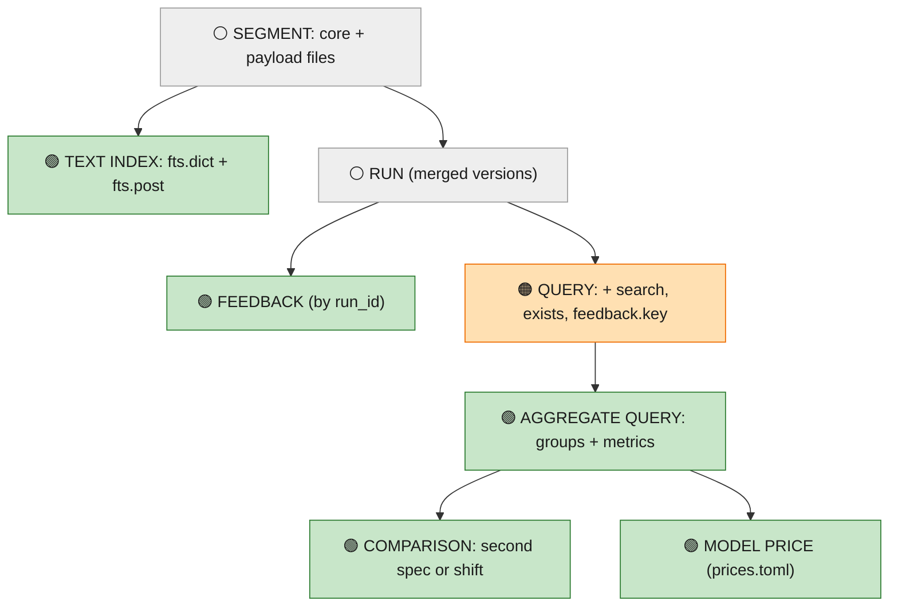
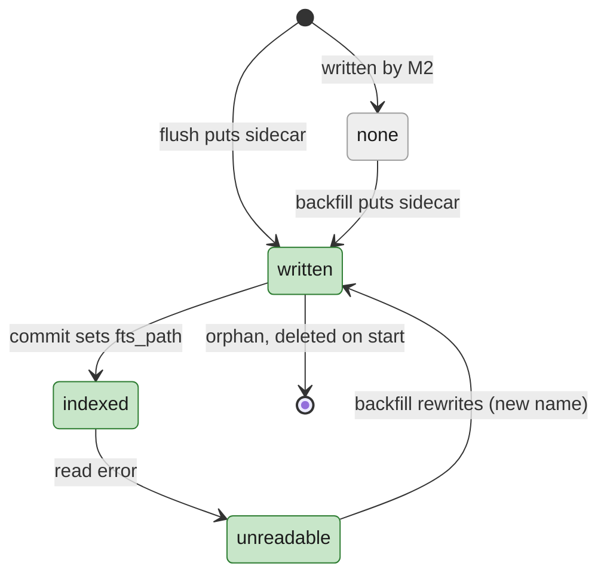

# Data Model: M3 — Search, aggregates and speed

M1's and M2's entities are unchanged unless marked here: [M2 data model](../002-m2-durable-storage-query-builder/data-model.md)
(core and payload files, catalog, query, live views). This file adds what M3 stores and the shapes of its new
requests.

**Delta key** (as in [spec.md](spec.md)):

| Marker | Fill | Meaning |
|---|---|---|
| 🟢 **New** | green | first built in M3 |
| 🟠 **Improved** | orange | exists from M1 or M2; M3 extends or changes it |
| ⚪ **Existing** | grey | built in M1 or M2; M3 uses it as is |

## 1. Entities and how they relate



- A **text index** belongs to one segment; a segment written by M2 may have none (`fts_path` null).
- **Feedback** points at a `run_id`, whether or not that run has arrived; the join happens at read time.
- An **aggregate query** is a query plus group keys and metrics; a **comparison** pairs two of them.
- A **model price** is read by cost metrics at query time.

## 2. 🟢 Text index sidecar (per segment)

### 2.1 Dictionary: `seg-<id>.fts.dict.parquet`

| Column | Type | Notes |
|---|---|---|
| `term` | string | lower-cased word ([research M3-R2](research.md#-m3-r2-words-unicode-word-boundaries-lower-case-json-string-and-scalar-leaves)) |
| `field` | u8 | 0 = `inputs`, 1 = `outputs`, 2 = `error` |
| `df` | u32 | payload rows containing the term in that field |
| `post_off` | u64 | byte offset of the posting list in `fts.post` |
| `post_len` | u32 | byte length |

Sorted by `(term, field)`, ~4 KB data pages, page index on: each page's min/max `term` is a **term zone**, so a
lookup reads the footer (cached) and one page. zstd.

### 2.2 Postings: `seg-<id>.fts.post`

```text
file   = [chunk]…                          # ~64 KB chunks; a list never straddles a chunk unless it's larger
list   = n: varint, then blocks
block  = 128 row numbers: first value varint, deltas bit-packed at the block's max width
```

Row numbers are payload rows (`payload_row` in the core file). No positions (settled, reason (c)).

### 2.3 What is indexed

| Source | Leaves | Example |
|---|---|---|
| `inputs` | every string and scalar leaf (numbers and booleans as text) | `inputs.url` → `https`, `api`, `example`, `com` |
| `outputs` | same | `outputs.body` → `429`, `too`, `many`, `requests` |
| `error` | the whole text | `HTTPError: 429 Too Many Requests` → `httperror`, `429`, `too`, `many`, `requests` |

Keys aren't indexed; a phrase matches within one leaf.

## 3. 🟠 Catalog changes (same SQL on SQLite and Postgres)

```sql
-- schema_version 1 → 2, applied in place on start (as dedup_keys was)
ALTER TABLE segments ADD COLUMN fts_path  TEXT;     -- null: no sidecar yet (M2 file, or backfill pending)
ALTER TABLE segments ADD COLUMN fts_bytes BIGINT;   -- index size, for the disk report

CREATE TABLE IF NOT EXISTS feedback (
  id          TEXT PRIMARY KEY,                     -- SDK's feedback id (uuid)
  run_id      TEXT NOT NULL,                        -- may not exist (yet): orphan until it does
  trace_id    TEXT,
  key         TEXT NOT NULL,
  score       DOUBLE PRECISION,                     -- REAL on SQLite; null when only value is set
  value       TEXT,                                 -- JSON
  comment     TEXT,
  correction  TEXT,                                 -- JSON
  source      TEXT,                                 -- JSON feedback_source {type, metadata}
  created_at  BIGINT NOT NULL,                      -- µs
  modified_at BIGINT NOT NULL,
  raw         TEXT NOT NULL                         -- the full body, unknown fields kept verbatim
);
CREATE INDEX IF NOT EXISTS feedback_run ON feedback (run_id);
CREATE INDEX IF NOT EXISTS feedback_key ON feedback (key);
```

- 🟠 `commit_flush` becomes idempotent: a segment id that already exists means "already committed", and the flush
  returns `Ok` (research M3-R13 b).
- 🟢 Backfill sets `fts_path` and `fts_bytes` for one segment per transaction.
- 🟢 Feedback writes are `INSERT … ON CONFLICT (id) DO UPDATE`, one transaction per request; `PATCH` updates the same
  row.

## 4. 🟠 Core file: one new column

| Column | Type | Notes |
|---|---|---|
| `reported_cost_pico` | i64, null | 🟢 cost the run reported (usage `total_cost`, or `input_cost + output_cost`, or run `total_cost`), in picodollars; derived at apply time like the token counts. Null in M2 files: derived at read from `outputs_usage` / `metadata` |

Every other column is M2's. Computed cost (tokens × price) is never stored, so a price edit applies to old runs.

## 5. 🟢 Price list: `prices.toml`

```toml
# Embedded in the binary; <data>/prices.toml (same shape) replaces entries by name. USD per 1M tokens.
version = 1

[models."gpt-4o-mini"]
input  = 0.15
output = 0.60
aliases = ["gpt-4o-mini-2024-07-18"]

[models."gpt-4o"]
input  = 2.50
output = 10.00
aliases = ["gpt-4o-2024-08-06", "gpt-4o-2024-11-20"]

[models."claude-haiku"]
input  = 0.80
output = 4.00
aliases = ["claude-3-5-haiku-latest"]
```

| Rule | Value |
|---|---|
| Unit in memory | integer picodollars (10⁻¹² USD) per token: `input × 10⁶` |
| Lookup | exact model name, then aliases; no prefix matching |
| No entry | "no price": counted in `no_price_runs`, never 0 |
| Display | half-up to cents (`$4.12`); the API also returns `cost_pico` |
| Source order per run | reported → tokens × price → no price; no rollup to parent runs |

## 6. 🟠 Query AST additions

```text
Expr = … (M2: And | Or | Not | Cmp | Has | In)
     | Search { text: String, words: [String], side: Any | Inputs | Outputs | Error }   # 🟢
     | Exists { path: Path }                                                             # 🟢
Path = … (M2) | feedback.<key>                                                           # 🟢 numeric: mean score of that key on the run
```

| Rule | Detail |
|---|---|
| `Search.words` | `text::tokens(text)`, computed at parse; an empty list is a parse error ("search needs at least one word") |
| Evaluation order | `Search` last within an `and`; it needs payload text |
| Index use | only for a `Search` at the top level of a slot or of a top-level `and` |
| `Exists` | true when the path has a value (same as `neq(path, null)`); printed as written |
| LangSmith feedback form | `and(eq(feedback_key, "k"), gt(feedback_score, x))` → `gt(feedback.k, x)` at parse |

**🟠 Page additions** (`POST /api/query` response):

```text
RunRow  += match?: { path: "outputs.body", excerpt: "…got 429 Too Many Requests from…", start, end }   # chars in excerpt
Stats   += index_files, scan_files (no sidecar), candidates, payload_rows, cache_hits
Warning += skipped_files{ids}, not_indexed{files}   # not_indexed now also names files without a sidecar
```

## 7. 🟢 Aggregate request and response

```text
AggSpec {
  query:   QuerySpec (M2, incl. search),            # limit, cursor, order ignored
  group_by: [GroupKey] (0..=2),                     # name | run_type | model | status | tag | metadata.<k> | feedback_key
  metrics: [Metric] (≥ 1),                          # count | error_rate | p50|p95|p99(latency) | sum(input_tokens|output_tokens|total_tokens) | sum(cost) | avg(feedback.<key>)
  view:    table | series | dist,                   # default table
  top:     1..=50 (default 10),
  bucket:  auto | "1m" | "5m" | "15m" | "1h" | "6h" | "1d",   # series only
  compare: none | { filter: QuerySpec slots } | { shift: "1d" | "7d" | … },
}

AggResult {
  query_id, partial: bool, sampled_pct?: f32,
  totals: Cells,                                    # whole set; separate from groups (tags overlap)
  groups: [Group { key: [Value | "(none)" | "(other)"], cells: Cells, where: filter text | null }],
  cut: bool, overlap: bool,                         # top N applied; tag groups overlap
  series?: { step_ms, offset: bool, buckets: [{ t | offset_ms, per_group: [Cells | null], where }] },
  dist?:   { bins_ms: [lower…], per_group: [[count]], where_per_bin },
  compare?: { side_b: AggResult (same shape, no compare) },
  stats: { files_scanned, clean_rows, dirty_runs, ms }
}

Cells { runs, finished, running, errors, error_rate?, p50?, p95?, p99?, n_latency,
        input_tokens?, output_tokens?, total_tokens?, cost_pico?, no_price_runs, feedback_avg?, feedback_n,
        estimated: bool, approximate: bool }
```

- Missing values are `null`, never 0 (a group absent on one side of a comparison, a percentile over 0 runs).
- `where` is the click-through condition as filter text (design §4.5); `null` for a tag grouping's `(other)`.

**SSE messages** (`GET /api/aggregate/stream`):

```text
AggMsg = Estimate(AggResult with partial = true) | Result(AggResult) | Error{code, message}
```

## 8. 🟢 Feedback (in memory and on the wire)

```text
Feedback { id, run_id, trace_id?, key, score?: f64, value?: JSON, comment?, correction?: JSON,
           feedback_source?: {type, metadata}, session_id?, created_at, modified_at, extra: {unknown fields} }
FeedbackIndex: HashMap<RunId, SmallVec<(key, score)>>     # loaded at start from the catalog; ~40 B per item
```

Orphaned feedback = rows whose `run_id` isn't found by a run lookup in the request's scope. They are listed, never
dropped.

## 9. 🟠 In-memory structures (changes)

| | Structure | Owner | Contents | Size at 2M runs |
|---|---|---|---|---|
| 🟢 | Flushed-ids bloom | writer | every flushed run id; a new start that hits it joins the multi-version set | ≈2.4 MB (1% false positives) |
| 🟢 | Damaged-file map | ingest, read by query and `/healthz` | segment id → reason, found at start or while serving | small |
| 🟢 | `Cache` | storage | footers, page indexes, dictionary pages, postings chunks, payload ranges (LRU by bytes) | 32 MB default (proposed) |
| 🟢 | Feedback index | ingest | `run_id → [(key, score)]` | ~40 B per item |
| 🟢 | Aggregate accumulators | one query | per group: counters, sums, latency values, histogram | ≤ 16 MB latencies per 2M runs; capped at 4M values |
| 🟠 | Memtable limit | writer | proposed: measured as heap, 64 MB (was 128 MB of JSON bytes) | see research M3-R12 |
| 🟠 | Dedup window | writer | proposed: 16 B fingerprints with a cap (was ~300 B per key in memory) | — |

## 10. 🟢 Object layout additions

```
<storage root>/<project>/<yyyy-mm-dd>/seg-<ulid>.fts.dict.parquet
<storage root>/<project>/<yyyy-mm-dd>/seg-<ulid>.fts.post
<data>/prices.toml                       optional user price list
```

Written once next to the segment's core and payload files; same orphan rule on start.

## 11. Lifecycle: a segment's text index



## 12. Worked example: the 31 hits

The `fetch_url` step `7c1e…a4` again. Its start (with `inputs.url`) was flushed into `seg-01JC…`; its late update
(error, `outputs.body`, `status_code: 429`) was flushed into a later file, `seg-01JD…`.

```
seg-01JD… fts.dict    ("429", outputs) df 31 → postings [402, 403, …]   ("too", outputs) df 40 …   ("429", error) df 31 …
query search("429 Too Many Requests")
  lookup per file: ∩ postings of 429, too, many, requests (any side) → seg-01JD… rows {402, …}; seg-01JC… none
  candidates → run ids {7c1e…a4, … 31 runs}; 7c1e…a4 is multi-version → both versions fetched and merged
  verify on merged leaves: outputs.body "… 429 Too Many Requests …" ✓  error "HTTPError: 429 Too Many Requests" ✓
  excerpt { path: "error", excerpt: "HTTPError: 429 Too Many Requests", start: 11, end: 32 }
→ 31 runs, all name = fetch_url
```

If a later update replaced `outputs.body` and cleared `error`, the old file's postings would still name the run, but
the verify step on the merged leaves would reject it.
