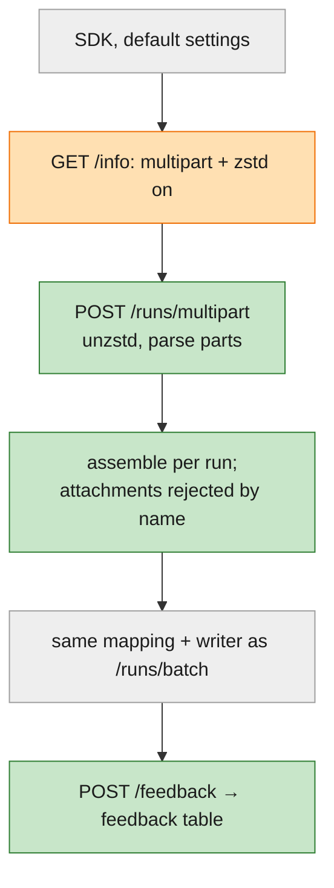
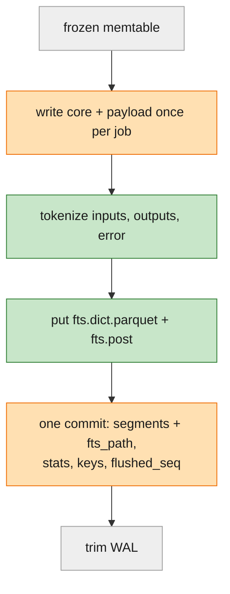
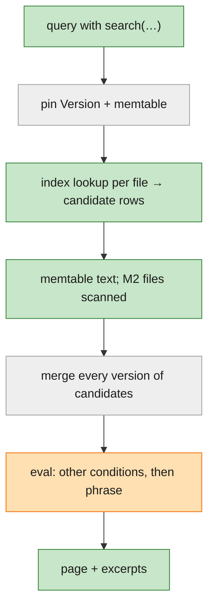
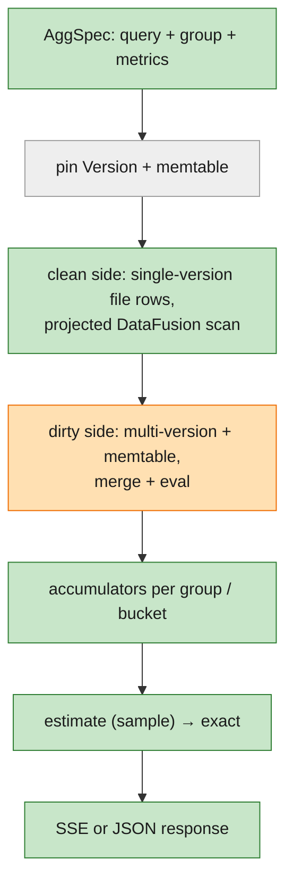
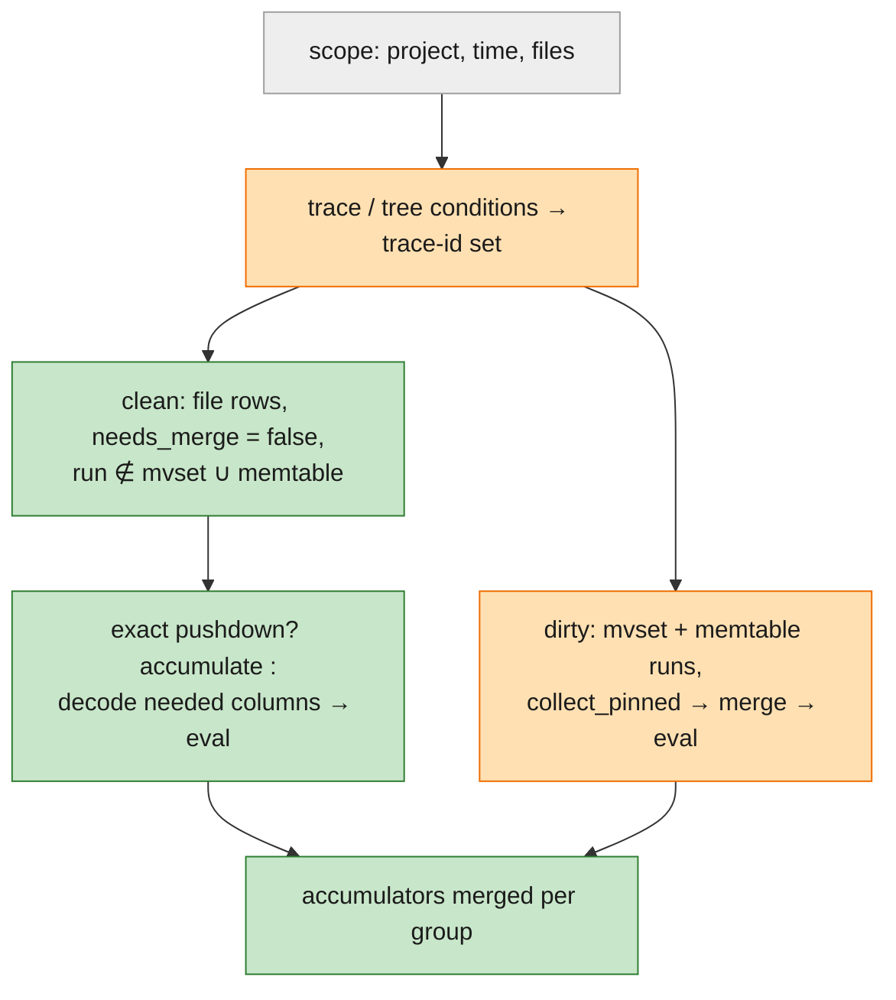
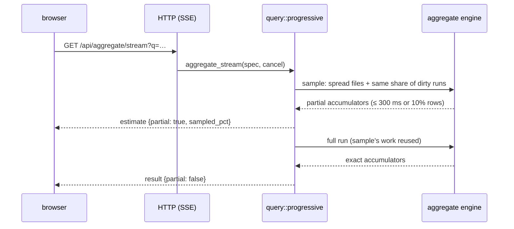
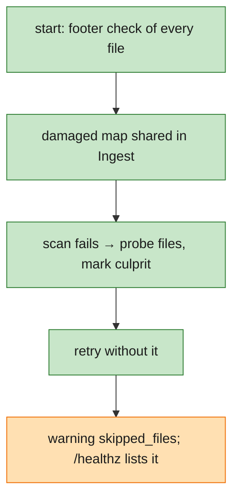

# Design: M3 — Search, aggregates and speed

**Status**: Draft for review (before implementation) · **Spec**: [spec.md](spec.md) · **Plan**: [plan.md](plan.md) ·
**Research**: [research.md](research.md) · **Starter guide (pre-code)**: [starter-guide.md](starter-guide.md) ·
**Builds on**: [M2 design](../002-m2-durable-storage-query-builder/design.md) and the
[M2 code guide](../002-m2-durable-storage-query-builder/starter-guide.md) · **Master design**:
[design-notes.md](../000-tracedb-master-plan/design-notes.md)

**Delta key** (as in [spec.md](spec.md); every diagram node uses the fill colour):

| Marker | Fill | Meaning |
|---|---|---|
| 🟢 **New** | green | first built in M3 |
| 🟠 **Improved** | orange | exists from M1 or M2; M3 extends or changes it |
| ⚪ **Existing** | grey | built in M1 or M2; M3 uses it as is |

Code links point at branch `002-m2-durable-storage-query-builder`, commit `6e77f12`.

## 1. What this design has to achieve

From the [spec](spec.md#end-state), M3 must:
- find words and phrases in inputs, outputs and errors at 2M runs in ≤ 500 ms, with no false matches;
- add up any query (count, error rate, exact percentiles, tokens, cost, feedback), grouped, bucketed, compared, in
  ≤ 1 s, with a first estimate in ≤ 1 s when slower;
- accept the current SDK's default uploads (multipart, zstd, feedback);
- meet the master speed and footprint targets, measured by a command, gated in CI;
- close the M2 rough edges.

It keeps every M1 and M2 promise: confirm after fsync, write → register → trim, one merge rule, one evaluator.

## 2. Big picture

Four short charts, one per path, each top to bottom.

### 2a. Upload



### 2b. Flush



### 2c. Search



### 2d. Aggregate



**The ideas to hold on to:**
1. **The index only rules files and rows out.** Every hit is a candidate; the merged run and `eval` decide.
2. **Every run is on exactly one side of an aggregate.** Single-version file rows are added up straight from a
   projected scan; everything that might have another version goes through the M2 merge first.
3. **Estimates are labelled and replaced.** An estimate is the same engine over a sample; the exact answer always
   follows unless the query changed.
4. **New uploads use the old path.** Multipart is a different envelope around the same items, mapping and writer.
5. **Measured, not asserted.** Every target has a `bench` row, a budget and a CI gate.

## 3. Core components

| | # | Component | M3 responsibility | Interface (shape) | SmithDB counterpart |
|---|---|---|---|---|---|
| 🟠 | 1 | **`model`** | + `Search`, `Exists`, `feedback.<key>` in the AST; stats line; tokenizer; cost | `parse_filter`, `parse_stats`, `text::tokens`, `cost::of(run, prices)` | filter language |
| 🟠 | 2 | **HTTP layer** | + `/runs/multipart`, `/feedback`, `/api/aggregate`, `/api/aggregate/stream`, `/api/feedback`; `/info` flags | [contracts/http-api.md](contracts/http-api.md) | API servers |
| 🟠 | 3 | **Ingest service** | + second start marked multi-version; files once per flush job; sidecar at flush; damaged-file map; backfill; feedback store | `accept`, `feedback.put`, `damaged()` | ingestion service |
| 🟢 | 4 | **`TextIndex`** (storage) | write and read per-file sidecars | `write(rows) -> Sidecar`, `lookup(seg, terms, field) -> RowSet` | inverted index |
| 🟢 | 5 | **`Cache`** (storage) | bounded memory cache for footers, page indexes, index pages, postings, payload ranges | `get_or_load(key, size, f)` | SSD cache |
| 🟠 | 6 | **Query service** | + search; faster run lookup; aggregate engine; progressive estimate; comparison | `query`, `aggregate(AggSpec) -> AggResult`, `aggregate_stream(AggSpec) -> Stream<AggMsg>` | query service, progressive querying |
| 🟠 | 7 | **UI** | + search box/chip, excerpts, Stats tab, Time series, Distribution, Compare, "N new" | consumes the HTTP API | LangSmith UI |
| 🟠 | 8 | **CLI** | + `bench`, `query --group-by`, demo checks for steps 4–9 and 13 | [contracts/cli.md](contracts/cli.md) | — |

Boundary rules are M2's. In addition:
- only `storage` knows the sidecar's file layout;
- `query` reads feedback through a read-only `Feedback` trait exported by `ingest`, as it reads `Fresh`;
- the accumulators are pure code with no I/O, so the property test can run them over naive merged runs.

### 3.1 What each component can and cannot do in M3

- **`model`**:
  - *Can*: parse and print `search`, `exists`, `feedback.<key>`, the stats line; tokenize; match a phrase in a
    value; compute a run's cost from a price list.
  - *Cannot*: stemming, fuzzy matching, relevance ranking (spec assumption).
- **HTTP**:
  - *Can*: everything M2 does; multipart with zstd; feedback create and update; aggregate JSON and SSE.
  - *Cannot*: store attachments (rejected per part); LangSmith read APIs, datasets, `evaluate()`'s own endpoints
    (out of scope).
- **Ingest**:
  - *Can*: everything M2 does; mark a second start as multi-version; index at flush; backfill M2 files; keep a live
    damaged-file map; store feedback before its run exists.
  - *Cannot*: compaction (M4); rewrite or delete files.
- **`TextIndex`**:
  - *Can*: per file, which payload rows may contain all of a set of words in a field.
  - *Cannot*: positions, prefix or wildcard terms.
- **Query**:
  - *Can*: search combined with any condition; aggregates over memtables ∪ files; top N + other + `(none)`; series,
    distribution, comparison; estimate, then exact; cancel.
  - *Cannot*: find-what-stands-out (M4); saved queries; group by more than 2 keys.
- **UI**:
  - *Can*: everything in the spec's end state.
  - *Cannot*: write feedback (M4); threads; export.

## 4. Key flows

### 4.1 🟢 Text index at flush

```text
flush(job):                                         # files and ids made once per job, outside the retry loop (§4.11)
  for (project, rows) in job.by_project():
    w   = segment::write(project, rows)             # as M2: core + payload, sorted (trace_id, dotted_order)
    idx = TextIndex::write(rows in payload-row order):
            for row, field in {inputs, outputs, error}:
              for leaf in string/scalar leaves(field):
                for word in text::tokens(leaf): postings[(word, field)].push(row)   # once per row
            dict = sorted (term, field, df, post_off, post_len)  → Parquet, page index on, ~4 KB pages
            post = concatenated lists: delta + bit-pack blocks of 128, 64 KB chunks
    put core, payload, fts.dict.parquet, fts.post         # kill point: after_fts_put
  commit_flush(segments with fts_path, stats, dedup keys, flushed_seq)
```

- The index is built from the same rows as the payload file, so payload row numbers line up.
- **Cost**: tokenizing is the largest new CPU cost at flush. It runs on the flusher thread, so uploads don't wait;
  the bench load phase checks that 20k events/s holds while flushing and indexing (SC-04).
- **Size**: ~+12% of today's files (M3-R1); `bench` reports index bytes separately in the disk row.
- **Crash safety** is M2's: a sidecar put before the commit is an orphan like any data file and is deleted on start.

### 4.2 🟢 Search

```text
select(Q with search(text, side)):
  words = text::tokens(text)                     # "429 Too Many Requests" → [429, too, many, requests]
  v     = pin(scope)                             # as M2, plus text fields of memtable runs in scope
  for file in v.files_in_scope():
    if file.fts_path:   rows = ∩ over words: TextIndex::lookup(file, word, side)   # dict page + postings chunk, via Cache
                        if any word has df > 50% of file rows: skip this word's list (verify catches it)
    else:               rows = all rows; warn not_indexed{file}                     # M2 files until backfilled
    candidates += run ids of rows (core row ↔ payload_row)
  candidates += memtable runs whose text contains every word
  runs = collect(scope, ids = candidates)        # every version of each candidate, merged (M2)
  runs = runs.filter(eval(Q without search))     # cheaper conditions first
  runs = runs.filter(phrase_in(merged text, words, side))     # exact, on the merged run's leaves
  page + excerpt(first match: path, ±80 chars on char boundaries)
```

- **Superset rule** (as [pushdown.rs:1-9](../../crates/query/src/pushdown.rs#L1)): the lookup may return extra rows,
  never drop a match. A multi-version run is a candidate if *any* of its versions is.
  - The verify step uses the merged text, so a replaced output stops matching (spec edge case).
  - Text added by a late update is found through the memtable or the newer file's index.
- **Which conditions use the index**: a `search` at the top level of `filter` (or inside a top-level `and`). Under
  `not` or `or`, it is checked by `eval` over the D-021 windows with early stop ([D-021](../000-tracedb-master-plan/decisions.md#d-021)).
  `tree_filter: search(…)` uses the index to find candidate *traces*.
- **Ordering**: candidates go through D-021's windows in page order, so the first page stops early as lists do.
- **Excerpts** are computed for the page's runs only (late materialization). The verify step reads the payload
  columns it needs (`inputs`, `outputs`) for candidates by row, through the `Cache`.
- **Backfill** (M2 folders): when no flush has run for a flush age, `backfill` takes one segment without
  `fts_path`, reads its payload, writes a sidecar (new object) and sets `fts_path` in one catalog update. A crash
  leaves an orphan, deleted on start.

### 4.3 🟢 Aggregates: clean and dirty sides



```text
aggregate(spec):
  v      = pin(scope)
  dirty  = mvset ∪ ids(memtable runs in scope)
  traces = trace_conditions(spec) as a trace-id set (if any)        # same code as lists
  (pushed, exact) = pushdown::compile(spec.filter)                  # exact = the pushed Expr IS the filter
  cols   = columns(spec.groups, spec.metrics) ∪ (exact ? ∅ : columns(spec.filter))
  for batch in datafusion.scan(v.files, cols, scope ∧ pushed ∧ needs_merge = false):   # clean side
    for row in batch where row.run_id ∉ dirty and (traces is none or row.trace_id ∈ traces):
      if exact or eval(spec.filter, decode(row, cols)): acc[group_keys(row)].add(row)
  for run in collect_pinned(scope, ids = dirty) merged, eval(spec.filter), trace check:      # dirty side
    acc[group_keys(run)].add(run)
  return finish(acc, top = spec.top)                                # top N + other + (none); tags unnested
```

- **No double counting**: a run is clean only if no other version can exist. Today a second *start* for a run
  already on disk isn't marked ([D-016](../000-tracedb-master-plan/decisions.md#d-016),
  [writer.rs:250](../../crates/ingest/src/writer.rs#L250)). Unit 1 fixes it before this engine exists:
  - the writer keeps a bloom filter of every flushed run id, rebuilt at start from the files' `run_id` columns;
  - a start that creates a new memtable state and hits that filter joins the multi-version set.
- **Accumulator** per group: `runs, finished, errors, running, sum_in, sum_out, sum_total, cost_pico,
  no_price_runs, latencies: Vec<i64>, hist: [u32; BINS], feedback: {key → (sum, n)}`. All mergeable.
- **Group keys**:
  - built-ins read columns;
  - `tag` unnests the `tags` list;
  - `metadata.<k>` reads the `attrs` JSON text: parse per row, or a promoted column if the spike says so (§11 q5);
  - missing → `(none)`.
- **Percentiles**: nearest rank over `latencies` with `select_nth_unstable`. Past 4M values per query, the histogram
  answers instead and the cell is marked `approximate` (M3-R5).
- **Dirty-side cost** grows with late finishers (~200k runs at 2M with 10% late, ~1.5 s at today's 7.8 µs/run).
  The merged states D-023 already keeps for the field browser are reused across queries; the unit 4 spike measures
  both sides first.

### 4.4 🟢 Progressive answers



- **The sample** is files picked evenly across the time range by `SegmentMeta.row_count` until ~10% of rows, plus
  the same share of dirty runs.
  - Counts and sums are scaled by `rows_total / rows_read`; rates and percentiles are not.
  - Each estimated cell says `estimated`.
  - For a plain group-by on a path the catalog has stats for, `field_stats` gives first counts at once.
- **Skipped** when the exact answer is likely within ~300 ms (rows in scope < ~200k): only `result` is sent.
- **Cancel**: the SSE stream owns a cancel token; closing it stops DataFusion streams and the dirty loop at the
  next batch. Every event carries the request's `query_id`, and the UI ignores events for an old id (spec edge case).
- `POST /api/aggregate` always returns the exact answer; CLI and `demo` use it.

### 4.5 🟢 Series, distribution, comparison, click-through

- **Time series**:
  - `bucket` is auto (≈100 buckets on a round step) or given (`"5m"`), on `start_time`;
  - each top-N group is a series, and `other` is one more;
  - empty buckets are `null`.
- **Distribution**: fixed log-latency bins (10 ms → 1 h, 8 per doubling), counts per group.
- **Comparison**: `compare: {filter | shift}`.
  - The engine runs both specs over one pin, concurrently.
  - Table cells pair up by group key; a group missing on one side is `null` there (spec Story 3, scenario 2).
  - Series use an **offset axis**: time since each side's first run (batches) or since the window start (shift),
    so a 12 h and a 10 h batch line up from 0 (edge case).
- **Click-through**: every group, bucket and bin returns `where`, an AST fragment the UI adds as chips:

  | Clicked | Adds |
  |---|---|
  | group `fetch_url` | `eq(name, "fetch_url")` |
  | `(none)` for `metadata.k` | `eq(metadata.k, null)` |
  | `other` | `and(exists(metadata.k), not(in(metadata.k, [top…])))` |
  | tag group | `has(tags, "v")` |
  | bucket | `and(gte(start_time, t0), lt(start_time, t1))` |
  | bin | `and(gte(latency, a), lt(latency, b))` |
  | error-rate cell | also `eq(status, "error")` |

### 4.6 🟢 Cost

```text
cost::of(run, prices) -> Cost:
  if let Some(c) = run.reported_cost_pico: return Reported(c)    # usage_metadata.total_cost, or input+output cost, or total_cost
  if run.run_type == llm and run.model and prices[alias(run.model)]:
     return Computed(in_tokens × in_price + out_tokens × out_price)   # picodollars, integer
  return NoPrice
```

- `reported_cost_pico` is derived at apply time next to the token counts
  ([derive.rs:41](../../crates/model/src/derive.rs#L41)) and stored as a new nullable core column. M2 files derive
  it at read time from `outputs_usage` / `metadata`.
- Only runs with usage count; no rollup to parents. Display rounds half-up to cents; the result carries
  `no_price_runs` ("12 runs had no price").
- `prices.toml` is embedded. `<data>/prices.toml`, if present, replaces entries by model name and is read at start;
  a parse error stops start with a message naming the line.

### 4.7 🟢 Multipart upload

```text
POST /runs/multipart (Content-Type: multipart/form-data; boundary=…; maybe Content-Encoding: zstd):
  body  = zstd? stream_decode(body) : body                     # zstd 0.13.4; cap: 50 MB decoded (as M2's limit)
  for part in parse_parts(body, boundary):                     # httparse headers; Content-Length or scan for boundary
    match name.split('.'):
      [op, id]                   → base[(op,id)] = json(part)            # op ∈ {post, patch}
      [op, id, field]            → fields[(op,id)][field] = json(part)   # inputs|outputs|events|extra|error|serialized
      ["attachment", id, name]   → drain(part); rejected += {part: name, reason: "attachment_not_stored"}
      ["feedback", id]           → feedback.put(json(part))
      _                          → drain(part); rejected += {part: name, reason: "unknown_part"}
  items = for (op,id): base ∪ fields                            # order of parts doesn't matter
  submit(items, Source::LsMultipart, Dialect::LangSmith)        # the same path as /runs/batch
  202 {accepted, rejected}
```

- **`/info`** flips to `use_multipart_endpoint: true`, `instance_flags.zstd_compression_enabled: true`, and keeps
  `version: ""` (settled 2026-11-06). The JSON batch path keeps working: 0.8.18 fixtures and a "multipart off" mode
  are replayed in CI.
- **Status codes** are chosen for the SDK's reactions (M3-R9):
  - malformed → `400`;
  - over the limit → `413`;
  - busy → `429` + `Retry-After`;
  - never `404` (the SDK would fall back to `/runs/batch` and drop feedback);
  - never `415` (the batch would be dropped silently).
- **Streaming**: parts are parsed as the body arrives; attachment bytes are drained, not buffered.

### 4.8 🟢 Feedback

```text
POST /feedback {id, run_id, trace_id?, key, score?, value?, comment?, correction?, feedback_source?, …}:
  validate (id, run_id, key required); keep unknown fields in raw
  metastore: INSERT … ON CONFLICT(id) DO UPDATE (idempotent retries)   # committed before the reply
  index.insert(run_id, (key, score)); reply 200 {stored feedback}
PATCH /feedback/{id}: same row, fields replaced
read: feedback.<key> on a run = mean of its scores for key   (filter + metric avg(feedback.<key>))
orphans = feedback whose run_id isn't found in scope           → GET /api/feedback?orphaned=true; UI count
```

- **Durable on its own**: the catalog commit is the confirmation; no WAL record. A crash before the commit means no
  reply, and the SDK retries.
- **Feedback first, run later**: rows are keyed by `run_id`; the join happens at read time, so it attaches as soon
  as the run is visible (Story 5, scenario 4).
- **Filters**: `feedback.<key>` is a path evaluated from the in-memory index. Pushdown can't use it, so it filters
  after the merge, like `not_indexed` paths. LangSmith's `and(eq(feedback_key, k), gt(feedback_score, x))` is
  rewritten to `gt(feedback.k, x)` at parse time.

### 4.9 🟠 Speed and footprint

| Gap (M3-R12) | Change |
|---|---|
| run + payload p50 43 ms at 0.48M runs | `collect` returns each version's `segment_id`; `scan::payload` reads only those files ([scan.rs:391](../../crates/query/src/scan.rs#L391)); child count from the trace's header rows, not a full `trace()` ([lib.rs:510](../../crates/query/src/lib.rs#L510)) |
| list p99 128 ms on varied queries | `Cache` for footers and page indexes; bench varies values and windows (n ≥ 100) |
| no data cache | `storage::Cache` (moka, 32 MB default, `--cache`), counted in idle memory; DataFusion keeps its metadata cache |
| idle 295–348 MB after restart; 128 MB memtable counts JSON bytes | proposed: memtable limit measured as heap, 64 MB; flush age 2 min; dedup keys as 16 B fingerprints with a cap; jemalloc (§11 q1). Heap-profile spike first (the remaining ~170 MB is unexplained) |
| throughput with queries unmeasured | the bench load phase runs a query loop alongside 8 upload clients |

**Idle** is defined as: no uploads for one flush age, memtable flushed, dedup window drained; median physical
footprint over 30 s.

### 4.10 🟢 `tracedb bench`

```text
tracedb bench [--runs 2M] [--data DIR] [--json FILE] [--check]:
  calibrate: decode the shipped reference Parquet file 20× + a sort → r = runner / reference, clamped [1, 3]
  load: generator from tests/bench_m2.rs → HTTP /runs/batch from 8 clients, a query loop alongside → events/s
  queries (after warmup), n ≥ 100 each, varied values and windows:
    trace (101 random) · run + payload (101 random) · filtered list (100) · text search · grouped · first estimate · suggestions
  report: query | p50 | p99 | target | budget = target × r | PASS/FAIL ; disk (files, index) ; idle memory
  exit 1 if any p50 > budget or p99 > 5 × p50, naming the query and value
```

**CI**:
- a 200k-run smoke on every PR;
- the full 2M run on `main` and nightly, with the table in the job summary (runner time and disk to be checked);
- `tests/bench_m2.rs` becomes a thin wrapper.

### 4.11 🟠 M2 follow-ups



- **Damaged or missing file** (FR-18):
  - start checks every file's footer, not only those with `needs_merge` rows
    ([recover.rs:92](../../crates/ingest/src/recover.rs#L92));
  - `corrupt` becomes a live map ([lib.rs:400](../../crates/ingest/src/lib.rs#L400));
  - a scan error (one `read_parquet` over all URLs today) probes the files, marks the bad one and retries
    without it.
- **Double registration** (FR-19):
  - `segment::write` and the ids run once per job, outside the retry loop
    ([flush.rs:58](../../crates/ingest/src/flush.rs#L58), [segment.rs:190](../../crates/storage/src/segment.rs#L190));
  - `commit_flush` treats an existing segment id as "already committed" and returns `Ok`.
- **UI** (FR-20):
  - `leave()` refetches the shown columns ([Samples.tsx:76](../../ui/src/views/Samples.tsx#L76));
  - arrivals while scrolled are buffered behind an "N new" pill.
- **Seed** (FR-22):
  - base time = now − n·7 s − the longest duration ([seed.rs:84](../../crates/tracedb/src/seed.rs#L84));
  - the base time is mixed into the id stream, so seeding the same seed twice doesn't reuse run ids with new
    `dotted_order`s. That reuse was the `identity_conflict` seen in M2; `demo` stays deterministic.

## 5. Data structures and formats

Details of record: [data-model.md](data-model.md). In short:
- 🟢 **Sidecar** per segment: `seg-<id>.fts.dict.parquet` (`term, field, df, post_off, post_len`) and
  `seg-<id>.fts.post` (postings blob).
- 🟠 **Catalog**: `segments.fts_path` (nullable), `segments.fts_bytes`; new `feedback` table; `schema_version` 2.
- 🟠 **Core file**: new nullable `reported_cost_pico`.
- 🟢 **`prices.toml`**: `[models."gpt-4o-mini"] input = 0.15, output = 0.60, aliases = […]` (USD per 1M tokens).
- 🟢 **AggSpec / AggResult**, **AggMsg** (SSE).

## 6. Query language and the panel

Details of record: [contracts/filter-language.md](contracts/filter-language.md).

- `search("429 Too Many Requests")`, `search(outputs, "rate limit")`: the text is one phrase (one word is a
  phrase of one). The side is `inputs | outputs | error`, or any when omitted.
- `exists(metadata.k)` (same meaning as `neq(metadata.k, null)`; each prints as written).
- `feedback.<key>` as a numeric path.
- Stats line, a separate text slot: `by name | count, error_rate, p95(latency), sum(cost)`.

UI layout (M3 additions marked):

```
┌ Query ───────────────────────────────────────────────────────────────────────────────┐
│ Project [overnight-eval ▾]  Time [last 2d ▾]  🔍 ["429 Too Many Requests"     ] ● live │  ← 🟢 search box
│ This run    [tag = batch=2026-11-05-a ×] [search "429 Too Many…" ×] [+]               │  ← 🟢 search chip
│ Its root    [+]          Any run in trace  [+]                                         │
│ Group by [name ×] [+]   Metrics [count] [error rate] [p95 latency] [cost] [+]          │  ← 🟢
│ Compare [batch=2026-11-06-b ×]                                                         │  ← 🟢
├ Fields ─────────┬ Samples | Table | Stats | Time series | Distribution ───────────────┤  ← 🟠 tabs
│ …               │ name        runs  error rate  p95     cost   │ b: error rate  p95   │
│ feedback.       │ fetch_url    300   14.0%      31 s    —      │     2.0%       9 s   │
│  correctness    │ llm_call   1,112    0.0%       …      $4.12  │     …          …     │
│ (3 orphaned)    │ … top 10 + other (cut)                         n shown next to pNN  │
└─────────────────┴───────────────────────────────────────────────────────────────────────┘
```

URL adds `q` (search), `by`, `m`, `view=samples|table|stats|series|dist`, `top`, `bucket`, `cmp` / `shift`
(`QueryState.view` is `samples | table` today, [url.ts:21](../../ui/src/query/url.ts#L21)).

## 7. Cloud mode

Unchanged from M2: sidecars go to the same `ObjectStore` (write-once, range reads); the `feedback` table and
`fts_path` go through the same `Metastore` migration on SQLite and Postgres. Unit 13 makes the cloud CI job's first
real run, with the M3 demo.

## 8. Failure handling and limits

| | Situation | Behaviour |
|---|---|---|
| 🟢 | Sidecar missing or unreadable | file searched by scan (`not_indexed`), reported in `/healthz`; backfill may rewrite it |
| 🟠 | Data file damaged or missing | skipped with `skipped_files` warning; `/healthz` lists it (§4.11) |
| 🟢 | Very common word | its postings skipped for that file; verify decides |
| 🟢 | Huge text value (1 MB) | indexed whole; excerpt is ±80 chars |
| 🟢 | Group-by with 1 value per run | top 10 + `other`, `cut: true` |
| 🟢 | Percentile over > 4M values | histogram estimate, `approximate: true` |
| 🟢 | Aggregate stream closed | computation cancelled at the next batch |
| 🟢 | Multipart: unknown or attachment part | that part rejected by name; the rest stored |
| 🟢 | Multipart: malformed body | `400`, nothing stored |
| 🟢 | Feedback for an unknown run | stored; listed as orphaned |
| 🟢 | `prices.toml` invalid | start fails naming the line |

## 9. How M3 is proven (tests)

| | What | Test | Gate |
|---|---|---|---|
| 🟢 | Scenario numbers (31, 14% / 31 s, $4.12, a vs b) | `tracedb demo` | CI, local + cloud |
| 🟢 | Search is exact | property: random runs, late updates, flush points; `search` via index == naive phrase check over merged runs; M2 files (no sidecar) give the same rows | CI |
| 🟢 | Tokenizer | Unicode cases (CJK, emoji, accents, punctuation), phrase across leaves doesn't match | CI |
| 🟢 | Aggregates are exact | property: aggregate == naive over merged runs, incl. `(none)`, `other`, tags, compare, buckets; estimate at 100% sample == exact | CI |
| 🟢 | Cancel | closing the stream stops the scan (rows read stop growing) | CI |
| 🟢 | Multipart | fixtures from SDK 0.14.17 (multipart on/zstd off; on/zstd on); round-trip: same items as JSON batch → identical stored runs | CI |
| 🟢 | Feedback | fixtures (`create_feedback` before and after the run); orphan; idempotent retry | CI |
| 🟠 | No double count | second start for a flushed run → multi-version; aggregate counts it once | CI |
| 🟠 | Damaged files, flush retry | start-time and live damage; lost commit reply | CI |
| 🟠 | Speed and footprint | `tracedb bench` with budgets | CI (smoke on PRs, 2M on main/nightly) |
| ⚪ | Crash safety | crash harness + `after_fts_put` kill point | CI |
| 🟠 | UI | search chip ⇄ text, Stats table, charts, click-through conditions, URL round trip, "N new" | CI (vitest) |

## 10. SmithDB mapping and what M3 still leaves out

| | SmithDB | M3 | Why |
|---|---|---|---|
| 🟢 | Inverted index for object storage: term zones, postings chunked apart, range reads | per-file sidecar: Parquet dictionary (page index = zones) + postings blob | no positions: (c), settled; Parquet dictionary: (c) |
| 🟢 | Progressive querying | sampled estimate, then exact, over SSE; lists keep D-021's early stop | (c) sampling instead of newest-first partials for aggregates |
| 🟠 | Late materialization | payloads only for shown rows and search candidates; run lookup reads only holding files | — |
| 🟠 | SSD cache | memory `Cache` (moka, 32 MB) | (a); disk tier behind the trait later |
| ⚪ | Merge-on-read, fresh data, pruning, pinned versions | as M2 | — |
| ⚪ | Compaction | none | M4 |

## 11. Open questions

Each has a proposed default. Settled on 2026-11-06 and no longer open: multipart + zstd advertised; attachment parts
rejected per part; no word positions (c); branch `003-…` from the 002 tip.

1. **Memory defaults to meet 200 MB idle.** Today's 128 MB memtable (counted as JSON bytes) plus the dedup window
   doesn't fit.
   *Proposed*: memtable limit measured as heap, 64 MB; flush age 2 min; dedup keys as 16 B fingerprints with a
   cap; cache 32 MB; jemalloc (`tikv-jemallocator` 0.7.0). All are flags; the M2 defaults remain available.
2. **Decision-log entries.** This plan changes the roadmap's "scan + bloom in v0, custom index backlog", D-013 (no
   `Cache`), D-016 (second start), and design-notes §4 (feedback by multipart by default).
   *Proposed*: log D-024–D-027 when the plan is approved.
3. **Feedback filter meaning.** A run with several scores for one key.
   *Proposed*: `feedback.<key>` = the mean of that run's scores for the key (LangSmith-style
   `feedback_key` / `feedback_score` pairs map onto it).
4. **Batch b figures and timing.** 2.0% / p95 9 s / $4.07; batch a ends now − 30 h, batch b now − 6 h; M2 checks
   select by batch tag instead of "last 12 h".
   *Proposed as is.*
5. **Group by a metadata key.** It parses `attrs` JSON per row; the spike may show it's too slow at 2M rows.
   *Proposed*: the spike decides; the fallback is a promoted `group_keys` column for the 16 most frequent metadata
   keys per file.
6. **Dirty-side cost.** At 10% late finishers the merge side may take ~1.5 s at 2M runs.
   *Proposed*: reuse D-023's merged-state cache. If grouped p50 still misses 1 s, report it in the bench and pull
   M4's compaction trigger forward rather than loosening the target.
7. **Backfill of M2 files.**
   *Proposed*: yes, in the background when idle (unit 6). It can be cut without breaking correctness (scan
   fallback).
8. **Stats line syntax** (tracedb's own, not LangSmith's).
   *Proposed*: `by <key>[, <key>] | <metric>, …`, as in the filter contract.
9. **CI bench capacity.** The 2M run's time and disk on the CI runner aren't known.
   *Proposed*: 200k smoke on PRs, 2M on `main` and nightly. If the runner can't hold 2M, run it on the reference
   laptop before each milestone and post the table.
