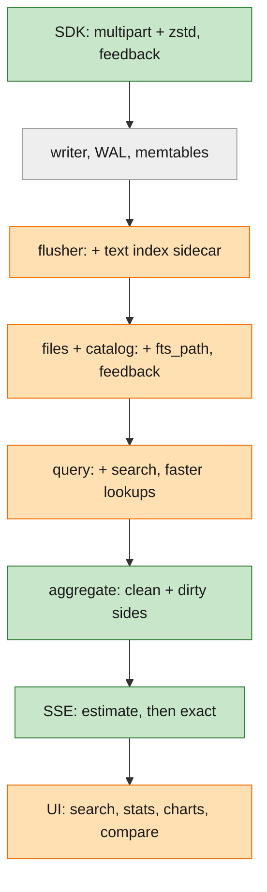
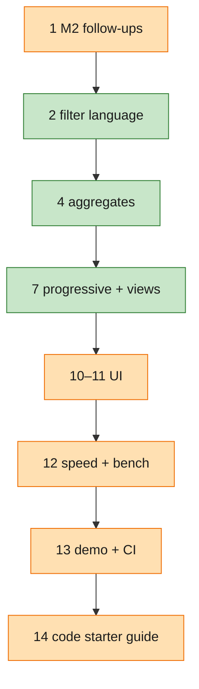

# Implementation Plan: M3 — Search, aggregates and speed

**Branch**: `003-m3-search-aggregates-speed` (cut from the 002 tip) | **Date**: 2026-11-06 | **Spec**: [spec.md](spec.md) | **Design**: [design.md](design.md) | **Appendix A**: [starter guide (pre-code)](starter-guide.md)

**Input**: Feature specification from `specs/003-m3-search-aggregates-speed/spec.md`. Master: [000 plan](../000-tracedb-master-plan/plan.md). Builds on: [M2 plan](../002-m2-durable-storage-query-builder/plan.md) (built, passed locally; browser and cloud checks open).

**Delta key** (as in [spec.md](spec.md); diagrams use the fill colour):

| Marker | Fill | Meaning |
|---|---|---|
| 🟢 **New** | green | first built in M3 |
| 🟠 **Improved** | orange | exists from M1 or M2; M3 extends or changes it |
| ⚪ **Existing** | grey | built in M1 or M2; M3 uses it as is |

## Summary

M3 finishes SmithDB's read path on top of M2's files and makes the speed claims measured.

- 🟢 **Text index at flush.** Each flush writes a small per-file index (a term dictionary as Parquet plus a postings
  blob). A search looks up its words, reads only candidate rows, merges them like any query, and checks the phrase
  on the merged text (research M3-R1–R3).
- 🟢 **Aggregates.** A new engine splits the runs in scope into a *clean* side (single-version file rows, scanned
  by DataFusion with only the needed columns) and a *dirty* side (multi-version and memtable runs, merged as today).
  Both feed mergeable accumulators: exact percentiles, cost from a local price list, feedback averages, groups, time
  buckets, latency bins and comparison (M3-R4–R8).
- 🟢 **Progressive answers.** Slow grouped queries stream a sampled estimate, then the exact figures, over SSE
  (M3-R6).
- 🟢 **Uploads.** The SDK's multipart (zstd) upload and `POST /feedback` are accepted; `/info` advertises them, so
  defaults work unchanged (M3-R9–R10).
- 🟠 **Speed and footprint.** Targeted fixes (run lookup, bounded cache, memory defaults), a `tracedb bench` command
  with a calibrated CI gate, and the demo extended to steps 4–9 and 13 with batch b (M3-R11–R12).
- 🟠 **M2 rough edges** closed (M3-R13).

Design: [design.md](design.md). How it all flows, as pseudo-code: [Appendix A](starter-guide.md).



## End-state map: where you see each requirement

"Where you see it" is the screen, command or check to look at; "What you should see" is the pass condition. Steps
refer to [quickstart.md](quickstart.md).

### Functional (what you can do)

| | Req | As a…, I can… | Where you see it | What you should see | Automated check |
|---|---|---|---|---|---|
| 🟢 | M3-FR-01 | As an agent developer, I can search words and phrases in inputs, outputs and errors, combined with any filter | search box → `"429 Too Many Requests"` (step 2.1); `tracedb query 'search("…")'` | **31** runs, all `fetch_url`; a search chip in the panel | `demo` check; search property test (index == scan) |
| 🟢 | M3-FR-02 | As an agent developer, I see the match highlighted, on each run's latest state | Samples rows under a search | excerpt with the phrase marked; a replaced output no longer matches | excerpt unit tests; late-update search test |
| 🟢 | M3-FR-03 | As an agent developer, I get no false matches, fast | `stats.files_scanned`, `stats.index_hits` on a search | few files read; every hit verified | index-superset property test; M2-folder parity test |
| 🟢 | M3-FR-04 | As an agent developer, I can aggregate any query, grouped by any field | *Stats* tab → by `name`, metrics error rate, p95, cost (step 2.2) | `fetch_url` **14.0%**, p95 **31 s**; batch **$4.12** | `demo` check; aggregate == naive property test |
| 🟠 | M3-FR-05 | As an agent developer, I can switch Samples, Table, Time series, Distribution on one query | view tabs (step 2.3) | same query, four views; stats table and chart together | UI view-switch tests |
| 🟠 | M3-FR-06 | As an agent developer, I can click a cell, bar or point to see its runs | click the 02:30 spike (step 2.3) | Samples with the group's chips added | click-through condition tests (incl. `(none)`, `other`) |
| 🟢 | M3-FR-07 | As an agent developer, I can compare two batches or a shifted window | *Compare* → batch b (step 2.4) | two columns per group; two lines on one chart | `demo` check; offset-alignment tests |
| 🟠 | M3-FR-08 | As an agent developer, I can share any grouped or charted view | copy the URL (step 2.5) | same grouping, metrics, view, comparison | URL round-trip tests |
| 🟢 | M3-FR-09 | As an agent developer, I see honest cost | cost column; "12 runs had no price" | $4.12; reported cost wins over tokens | cost unit tests (source order, aliases, half-up) |
| 🟠 | M3-FR-10 | As an agent developer, every query is interactive at 2M runs | `tracedb bench` (step 4) | every row PASS | bench in CI (calibrated) |
| 🟢 | M3-FR-11 | As an agent developer, slow grouped queries show an estimate first | grouped query over all 2M runs | "estimate · 10% sampled", then exact; changing the query cancels | SSE e2e test; cancel frees the scan |
| 🟠 | M3-FR-12 | As an agent developer, payloads are read only for shown runs; repeats come from a bounded cache | `stats.payload_rows`, `stats.cache_hits` | payload rows = shown rows; second run faster or equal | late-materialization test; cache bound test |
| 🟠 | M3-FR-13 | As an agent developer, uploads stay fast while I query; tracedb stays light | bench load phase; idle footprint; `du` | ≥ 20k ev/s; idle ≤ 200 MB; disk ≤ 50% of raw | bench rows; idle-memory test |
| 🟢 | M3-FR-14 | As an agent developer, the SDK's multipart upload just works | example agent on SDK defaults (step 3) | full trace; nothing unsupported | multipart fixtures (zstd on and off); round-trip property test |
| 🟢 | M3-FR-15 | As an agent developer, SDK feedback is stored, filterable and averaged | `create_feedback` → filter `gt(feedback.correctness, 0.5)` (step 3) | the run matches; `avg` shows in Stats; early feedback attaches later | feedback fixtures; orphan test |
| 🟠 | M3-FR-16 | As a test user, I can replay steps 4–9 and 13 in one command | `tracedb demo` (step 1) | `14 ✓ 23 ✓ 31 ✓ 14% / 31 s ✓ $4.12 ✓ a vs b ✓` | CI, local + cloud |
| 🟠 | M3-FR-17 | As a maintainer, a slipped target fails CI | CI bench job | failing row names query, target and value | CI |
| 🟠 | M3-FR-18 | As a maintainer, a bad file doesn't take every query down | delete a data file while serving (step 5) | queries answer with `skipped_files`; `/healthz` lists it | damaged-file tests (start and while serving) |
| 🟠 | M3-FR-19 | As a maintainer, a retried flush registers once | — | row counts exact after a lost commit reply | flush retry test |
| 🟠 | M3-FR-20 | As an agent developer, live Samples show "N new"; left Table rows show new values | scroll down with *live* on; a run stops matching | pill "N new"; updated cells | UI tests |
| 🟠 | M3-FR-21 | As a new reader, I can follow one run through the M3 code | [starter-guide.md](starter-guide.md) (rewritten last) | every scene linked to lines, colour-coded | review |
| 🟠 | M3-FR-22 | As a test user, generated data never starts in the future | `tracedb seed`, `tracedb demo` | max `start_time` ≤ now | seed and scenario tests |

### Non-functional (how well it does it)

| | Req | As a…, I can… | Where you see it | What you should see | Automated check |
|---|---|---|---|---|---|
| 🟢 | SC-01 | As an agent developer, I find the pattern in payload text | search (step 2.1) | 31, all `fetch_url` | `demo` |
| 🟢 | SC-02 | As an agent developer, I can size it and see the fix | Stats + Compare (steps 2.2, 2.4) | 14% / 31 s / $4.12; a vs b side by side and overlaid | `demo` |
| 🟠 | SC-03 | As an agent developer, every query is interactive at 2M runs | `tracedb bench` | trace, run ≤ 50 ms; list ≤ 100 ms; text ≤ 500 ms; grouped ≤ 1 s; suggestions ≤ 200 ms; p99 ≤ 5× p50 | bench (CI) |
| 🟠 | SC-04 | As an agent developer, uploads aren't slowed by queries | bench load phase | ≥ 20,000 events/s | bench (CI) |
| 🟠 | SC-05 | As an agent developer, tracedb stays light | idle footprint; `du -sh` | ≤ 200 MB idle; ≤ 50% of raw incl. index | bench report; idle test |
| 🟢 | SC-06 | As an agent developer, I get a first answer quickly | SSE `estimate` event | ≤ 1 s at 2M runs | bench row "grouped, first estimate" |
| 🟠 | SC-07 | As a maintainer, both storages give the same numbers | CI cloud job (first real run) | identical demo table | CI |
| 🟠 | SC-08 | As an agent developer, SDK defaults work with only the endpoint changed | example agent, defaults (step 3) | zero items unsupported | SDK fixtures replayed in CI |
| 🟢 | SC-09 | As a new user, I answer "pattern? how bad?" in < 5 min in the UI | step 2, timed | 31 hits and 14% / 31 s found by clicking | manual (by eye) |
| 🟢 | SC-10 | As a maintainer, CI names the slipped target | CI bench job | query, target, value | CI |
| ⚪ | SC-11 | As an M1/M2 user, nothing got worse | M1 + M2 suites, M2 demo checks | all green | CI |

## Technical Context

**Language/Version**: Rust 1.99 (edition 2024). UI in TypeScript (React + Vite), built as its own CI job (as M2).

**Primary Dependencies**: M2's (tokio, axum 0.8.9, datafusion 55.2 → arrow/parquet 59.3.2, object_store 0.13.2,
sqlx 0.9, ulid, …) plus, all already locked or in the offline registry (research M3-R15):

| Crate | Version | Use |
|---|---|---|
| `unicode-segmentation` | 1.13.3 | tokenizer |
| `zstd` | 0.13.4 | multipart bodies |
| `httparse` | 1.10.1 | multipart part headers |
| `moka` | 0.12.16 | bounded `Cache` |
| `tikv-jemallocator` | 0.7.0 | returns freed memory, if approved |

The UI adds no runtime library; charts are hand-drawn SVG (M3-R14).

**Storage**: as M2, plus per-file text-index sidecars (`seg-<id>.fts.dict.parquet`, `seg-<id>.fts.post`) on the
same `ObjectStore`; catalog gains `segments.fts_path` and a `feedback` table; `prices.toml` embedded, optional user
copy under `<data>`.

**Testing**:
- `cargo test` with proptest: aggregate == naive, search index == scan, tokenizer, multipart round trip, print/parse
  with `search`/`exists`/stats line.
- SDK contract fixtures re-recorded for multipart (zstd on and off) and feedback.
- `tracedb demo` checks for steps 4–9 and 13.
- `tracedb bench` (calibrated) in CI.
- Crash harness unchanged, plus a kill point after the sidecar put.
- Cloud CI job (MinIO + Postgres), first real run.
- UI component tests (vitest).

**Target Platform**: macOS and Linux laptops; CI on Linux.

**Project Type**: single binary = web service + embedded SPA + CLI (as M1/M2).

**Performance Goals** (SC-03, SC-04, SC-06), medians at 2M runs (p99 ≤ 5× median):
- trace and run ≤ 50 ms; list ≤ 100 ms; text search ≤ 500 ms; grouped ≤ 1 s; suggestions ≤ 200 ms;
- first estimate ≤ 1 s;
- ≥ 20k events/s while querying.

**Constraints**: zero outbound in local mode (prices local); idle memory ≤ 200 MB; disk incl. index ≤ 50% of raw
JSON; nothing confirmed lost or duplicated; write-once objects.

**Scale/Scope**: 7 user stories (4 P1); no new crate; 14 PR-sized units, most ≤ 400 lines (units 4 and 10 may run
over; noted below).

No NEEDS CLARIFICATION remain. Open design questions with proposed defaults are in [design §11](design.md#11-open-questions).

## Constitution Check

*GATE: Must pass before Phase 0 research. Re-check after Phase 1 design.* Constitution v1.1.0.

| Principle | M3 check | Pre | Post |
|---|---|---|---|
| I. Rust, one binary | still one binary; new crates are Rust (zstd links its C library statically); price list embedded | PASS | PASS |
| II. SmithDB is the reference | adds SmithDB's inverted index (per file, term zones, chunked postings, range reads), progressive querying, late materialization and a cache (design §10). Differences with reasons below, each behind an interface (`TextIndex`, `Cache`, `Metastore`, aggregate `Accumulator`) | PASS | PASS |
| III. Local and private | no outbound; prices from the binary or `<data>/prices.toml`; feedback, sidecars and catalog under `--data` (or the configured cloud store) | PASS | PASS |
| IV. UI first | search box and chip, Stats table, Time series, Distribution, Compare, feedback filter and orphan count ship with the API; `tracedb query --group-by`, `demo`, `bench` are the CLI equivalents. `bench` is a maintainer measurement tool required by VI; its figures also appear per query as `stats.ms` | PASS | PASS |
| V. Cloud-portable storage | sidecars are write-once objects read by range; `fts_path` and `feedback` go through `Metastore` migrations on SQLite and Postgres; the cloud CI job runs the M3 demo | PASS | PASS |
| VI. Done is measured | `demo` asserts 14 / 23 / 31 / 14% / 31 s / $4.12 / a vs b; `bench` reports P50/P99 and fails CI on a slipped target; crash harness keeps running (plus a sidecar kill point) | PASS | PASS |

Architecture constraint "query execution builds on DataFusion and Arrow": DataFusion scans, prunes and projects
both the clean side and the index dictionary. Accumulators, merging and the exact filter stay in our code, as lists
do since [D-017](../000-tracedb-master-plan/decisions.md#d-017) (one evaluator).

**Differences from SmithDB recorded in M3** (constitution II; reason (a) local-first, (b) Rust ecosystem, (c)
deliberately staged):

| | Difference | Reason | Revisit when |
|---|---|---|---|
| 🟢 | Text index stores no word positions; phrases are verified on the text (settled 2026-11-06) | (c) | text-search p99 misses, or candidates > ~50k rows |
| 🟢 | Term dictionary is a Parquet file (page index as term zones), not a custom format | (c) | the dictionary dominates lookup time |
| 🟢 | Progressive answers sample files evenly, then compute exactly, rather than streaming newest-first partials | (c) | users want running partials per file |
| 🟠 | Cache is memory only (32 MB default), not memory + SSD | (a) | cloud mode (disk tier behind `Cache`) |
| ⚪ | No compaction; the dirty side grows with late finishers | (c) | M4 |
| ⚪ | One process for ingest, query and compaction | (a) | cloud split |
| 🟢 | Attachment parts rejected per part, not stored (settled 2026-11-06) | (c) | a user needs attachments (backlog) |

Recorded decisions this plan changes (need decision-log entries when approved): the roadmap's "custom search index
is backlog; scan + bloom in v0" (→ M3-R1), [D-013](../000-tracedb-master-plan/decisions.md#d-013) "no `Cache`
trait" (→ M3-R12), [D-016](../000-tracedb-master-plan/decisions.md#d-016) "second start not marked" (→ unit 1), and
design-notes §4 "feedback as a multipart part by default" (→ M3-R10).

## Project Structure

### Documentation (this feature)

```text
specs/003-m3-search-aggregates-speed/
├── spec.md            # what and why
├── design.md          # how each piece works over the M2 code (review before implementation)
├── plan.md            # this file
├── starter-guide.md   # Appendix A: pre-code walkthrough (rewritten for the built code in unit 14)
├── research.md        # Phase 0 decisions (M3-R1…R15)
├── data-model.md      # sidecar, catalog changes, feedback, prices, AST, aggregate request/response
├── quickstart.md      # how to prove M3 works
├── contracts/         # http-api.md, cli.md, filter-language.md (M3 additions only)
├── checklists/        # requirements.md
└── tasks.md           # /speckit-tasks (next)
```

### Source Code (repository root)

New files are marked 🟢; changed files 🟠.

```text
crates/
├── model/src/
│   ├── filter/{ast,parse,print,eval}.rs   🟠 Search, Exists, feedback.<key>; stats line
│   ├── text.rs                            🟢 tokenize, phrase match, excerpt
│   ├── agg.rs                             🟢 AggSpec, GroupKey, Metric (pure types, parse/print)
│   ├── cost.rs  + prices.toml             🟢 price list, cost source order, picodollars
│   └── derive.rs                          🟠 reported_cost
├── storage/src/
│   ├── fts.rs                             🟢 TextIndex: sidecar writer + reader (dictionary, postings)
│   ├── cache.rs                           🟢 bounded Cache (moka)
│   ├── segment.rs                         🟠 reported_cost_pico column; written once per flush job
│   └── metastore.rs                       🟠 fts_path, feedback table, idempotent commit_flush
├── ingest/src/
│   ├── writer.rs                          🟠 flushed-ids bloom → second start joins the multi-version set
│   ├── flush.rs                           🟠 sidecar at flush; files written once per job
│   ├── recover.rs                         🟠 footer check of every file; bloom rebuild; feedback load
│   ├── feedback.rs                        🟢 feedback store (catalog-backed, in-memory index)
│   ├── backfill.rs                        🟢 sidecars for M2 files when idle
│   └── lib.rs                             🟠 shared damaged-file map; health
├── query/src/
│   ├── search.rs                          🟢 index lookup → candidates; memtable text; fallback
│   ├── aggregate/{mod,accum,clean,dirty,series}.rs   🟢 engine, accumulators, buckets, compare
│   ├── progressive.rs                     🟢 sample plan, estimate, cancel
│   ├── scan.rs                            🟠 skip damaged files; payload only from holding files
│   ├── pushdown.rs                        🟠 exact flag
│   └── lib.rs                             🟠 run lookup without loading the trace; search in select
└── tracedb/src/
    ├── routes/multipart.rs                🟢 streaming parser, zstd, part assembly
    ├── routes/aggregate.rs                🟢 POST /api/aggregate, SSE framing
    ├── routes/ingest.rs                   🟠 /info flags, POST/PATCH /feedback
    ├── routes/api.rs                      🟠 search excerpts, /api/feedback
    ├── bench.rs                           🟢 tracedb bench (from tests/bench_m2.rs)
    ├── scenario.rs, demo.rs               🟠 batch a re-plant, batch b, M3 checks
    ├── seed.rs, cli_query.rs, main.rs     🟠 no future starts; --group-by; bench; allocator
ui/src/
├── query/{ast,parse,print,url}.ts         🟠 search, exists, stats state in the URL
├── query/SearchBox.tsx                    🟢
├── stats/{StatsPanel,StatsTable,TimeSeries,Distribution,Compare}.tsx   🟢
└── views/{Samples,Table,Runs}.tsx         🟠 excerpts, "N new", left-row refresh, view tabs
scripts/record-sdk-fixtures.py             🟠 /info modes, feedback, post+patch
tests/fixtures/{filter-golden.json, sdk-0.14.17-multipart/}   🟠 / 🟢
.github/workflows/ci.yml                   🟠 bench jobs, cloud job
```

**Structure Decision**: no new crate. The text index lives in `storage` behind `TextIndex` (only `storage` knows
files); search and aggregates are query-service code over the same pin; the filter and aggregate *types* are pure
`model` code shared by query, CLI, tests and mirrored in the UI; feedback is an ingest-owned store (it is written),
read by query through a read-only trait, as `Fresh` is.

## Delivery order (PR-sized; each ends in something checkable)

| # | | Unit | As a…, I can… after it merges |
|---|---|---|---|
| 1 | 🟠 | **M2 follow-ups, correctness first**: flushed-ids bloom (second start → multi-version), files written once per flush job + idempotent commit, footer check at start, damaged-file map, skip + `skipped_files` warning, seed timestamps and id stream | As a maintainer, I can delete a data file while serving and still get answers plus a `/healthz` entry; the flush-retry and second-start tests pass |
| 2 | 🟢 | **Filter language**: `search(…)`, `exists(…)`, `feedback.<key>` and the stats line, in Rust and TypeScript; golden fixtures | As a maintainer, I can run the grammar golden tests and print/parse property test with the new forms (search returns `unsupported` until unit 6) |
| 3 | 🟠 | **Scenario + cost**: batch a re-planted, batch b, 503 background text, M2 checks by tag; `model::cost` + `prices.toml` + `reported_cost` | As a test user, I can run `tracedb demo` (M2 checks still pass) and a scenario test that checks the planted 31 / 14.0% / 31 s / $4.12 / batch b figures naively |
| 4 | 🟢 | **Aggregate engine** (first task: 2M-row projected group-by spike): clean/dirty sides, accumulators, groups, top N, `(none)`, `other`, tags; `POST /api/aggregate`; `tracedb query --group-by` | As an agent developer, I can `curl /api/aggregate` and get `fetch_url` 14.0% / p95 31 s and $4.12; aggregate == naive property test green |
| 5 | 🟢 | **Text index at flush**: tokenizer, `TextIndex` sidecar writer/reader, `fts_path` migration, flusher writes it (+ crash kill point) | As a maintainer, I can see `.fts.*` next to every new file and round-trip lookups in storage tests; disk report includes the index |
| 6 | 🟢 | **Search path**: lookup → candidates → merge → verify; memtable text; M2-file fallback; excerpts; backfill when idle | As an agent developer, I can `curl /api/query` with `search("429 Too Many Requests")` and get 31 `fetch_url` runs with excerpts; index == scan property test green |
| 7 | 🟢 | **Progressive + views**: sampled estimate, `GET /api/aggregate/stream` with cancel, time series, distribution, comparison | As an agent developer, I can watch an `estimate` then a `result` event; batch a vs b returns side by side and as offset-aligned series |
| 8 | 🟢 | **Multipart upload**: streaming parser, zstd, part assembly, per-part rejections, `/info` flip; fixtures re-recorded | As an agent developer, I can run the example agent on SDK defaults and see its trace; both fixture sets replay |
| 9 | 🟢 | **Feedback**: `POST`/`PATCH /feedback`, feedback table, in-memory index, orphans, `feedback.<key>` filter, `avg(feedback.<key>)` metric | As an agent developer, I can send `create_feedback` and filter and average by it; early feedback attaches when the run arrives |
| 10 | 🟠 | **UI a**: search box and chip, excerpts; Stats tab (group by, metrics, table) with click-through; "N new" pill; left-row refresh | As an agent developer, I can find the 31 and the 14% / 31 s by clicking |
| 11 | 🟠 | **UI b**: Time series, Distribution, Compare overlay, progressive display, URL state for all of it | As an agent developer, I can see the 02:30 spike, click it, compare a vs b, and share the link |
| 12 | 🟠 | **Speed + footprint** (first task: heap-profile spike): run lookup fix, bounded `Cache`, memory defaults and allocator (if approved), `tracedb bench` + calibration + CI gate | As a maintainer, I can run `tracedb bench` and see every row PASS; CI fails on a slipped target |
| 13 | 🟠 | **Demo + CI**: demo checks for steps 4–9 and 13 with timings; cloud job's first real run; quickstart verified | As a test user, I can run `tracedb demo` and see all M3 checks pass on local and cloud-style storage |
| 14 | 🟠 | **Code starter guide**: rewrite [starter-guide.md](starter-guide.md) from pre-code to a guide for reading the built M3 code, as M2's: reading order, every scene mapped to real functions with links and line numbers, colour-coded new / revised / unchanged, rough edges found while writing it | As a new reader, I can follow one run through the M3 code (text index, search, aggregates, progressive answers, multipart, feedback) with line-level links |

**Dependencies**:
- 1, 2, 3, 5 and 8 can start in parallel.
- 4 needs 1 (no double counting) and 2 (`exists` for `other`); its demo-number check needs 3.
- 6 needs 2 and 5. 7 needs 4. 9 needs 2 (filter) and 4 (metric).
- 10 needs 4 and 6; 11 needs 7 (both can start against stub APIs).
- 12 needs 4–7 (bench measures them). 13 needs everything before it.
- 14 is last: it reads the merged code, so M3 isn't done until it lands.

**Size notes**: units 4 and 10 are the largest; if a split isn't natural, each ships as one PR and says so (4 can
split engine / route; 10 can split search / stats).



The chart is the critical path; units 3, 5–6, 8–9 run beside it.

## Complexity Tracking

No constitution violations. Four choices add moving parts and are justified in research:

| | Choice | Why needed | Simpler alternative rejected because |
|---|---|---|---|
| 🟢 | Custom per-file text index (dictionary + postings) | text search ≤ 500 ms at 2M runs (M3-R1) | scan + bloom: Parquet blooms don't match words; scanning takes 1–3 s |
| 🟢 | Two-sided aggregate engine (clean / dirty) | grouped ≤ 1 s at 2M runs (M3-R4) | merge everything first: ~15 s at 2M runs |
| 🟢 | Own streaming multipart parser | SDK defaults (M3-R9) | `multer` isn't in the offline registry; buffering whole bodies breaks streamed parts |
| 🟢 | Exact percentiles from kept values | demo asserts p95 = 31 s exactly (M3-R5) | t-digest can miss the planted value; it stays as the memory-cap fallback |

## Appendix A: starter guide (pre-code)

The walkthrough lives in [starter-guide.md](starter-guide.md). Today it is pre-code: planned names and
pseudo-flows. The last unit (14) rewrites it in place into the guide for reading the built M3 code, with real
links and line numbers, as M2's. It covers:

1. **Goals → functionality → planned home**, colour-coded.
2. **The system, one path at a time**: upload (multipart), flush (+ index), search, aggregate (+ progressive).
3. **Reading order** once the code exists, with the critical files marked.
4. **One run, from a multipart upload to batch a vs b**: a sequence diagram and scenes for the `fetch_url` step:
   - multipart upload;
   - the flush with its index;
   - search and verify;
   - the clean / dirty split;
   - progressive estimate;
   - time series click-through;
   - feedback;
   - comparison;
   - `demo` and `bench`.
5. **Status codes**, **things to try**, and **where M3 is most likely to be wrong**.
