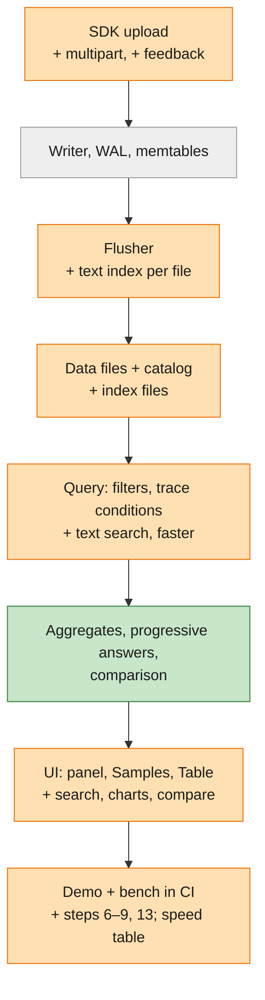

# Feature Specification: M3 — Search, aggregates and speed (the core demo)

**Feature Branch**: `003-m3-search-aggregates-speed`

**Created**: 2026-11-06

**Status**: Built 2026-11-07, passed locally (see the [roadmap](../000-smithling-master-plan/roadmap.md) STATE)

**Input**: User description: "let's do 3rd milestone, outline what needs to be done." Scope from the
[roadmap](../000-smithling-master-plan/roadmap.md) M3 section ("Core demo"), plus the follow-ups and rough edges found
while building and reviewing M2. Written the same way as M2: goal and why, end state as "As a <who>, I can <what>" with
the capability first and a labelled Example, then the work tied to the end state and the lifecycle of one run.

**Master**: [specs/000-smithling-master-plan](../000-smithling-master-plan/spec.md) (requirements of record) ·
[roadmap](../000-smithling-master-plan/roadmap.md) (progress). This folder holds the M3 details of record.

**Builds on**: [M2 — Durable storage + query builder](../002-m2-durable-storage-query-builder/spec.md). Everything M1
and M2 promise stays true.

**Delta key** (used everywhere below, as in the M2 starter guide; diagrams use the fill colour):

| Marker | Fill | Meaning |
|---|---|---|
| 🟢 **New** | green | first built in M3 |
| 🟠 **Improved** | orange | exists from M1 or M2; M3 extends or changes it |
| ⚪ **Existing** | grey | built in M1 or M2; M3 uses it as is |

**Delivers from master**: FR-001 (full: current SDK defaults, including multipart uploads and feedback), FR-008
(feedback score filters), FR-011, FR-014, FR-015, FR-022 (stats view), FR-023 (bench and import of demo data on the
command line), FR-024 (steps 4–9 and 13), FR-029 (group by, metrics, comparison), FR-031 (Time series and
Distribution); QR-004, QR-005, QR-006, QR-008.

---

## Goal and why

Answer "is this a pattern, and how bad is it?" at interactive speed. This is **the v0 headline**.

- **It finishes the morning triage** (master scenario steps 6–9 and 13). M2 finds *what failed*; M3 finds whether the
  same error is hiding in payload text elsewhere (step 7), puts numbers on it (step 9), and shows whether the fix
  worked (step 13).
- **It makes the speed claims real.** M2's targets were sized for its own stage (500 ms lists). The master promises
  100 ms filters, 50 ms traces and 500 ms text search at 2M runs, measured on every change, not asserted.
- **It removes the last setup step.** Before M3, the current LangSmith SDK needed a setting changed to avoid the
  upload format smithling didn't accept. Since M3, `/info` advertises multipart and zstd and both are accepted, so the
  endpoint is the only setting.
- **It completes the SmithDB read path.** Text search with an index, late materialization of payloads, progressive
  answers and a cache are the SmithDB pieces M2 left for later.

## Delta at a glance

What M3 adds to the system that M1 and M2 built, one box per part, top to bottom along the path of one run.

| | Part | Before M3 (M1 / M2) | What M3 changes |
|---|---|---|---|
| 🟢 | Text search | none | words and exact phrases in inputs, outputs and error messages, with an index per data file and highlighting |
| 🟢 | Aggregates | none | count, error rate, p50/p95/p99, tokens, cost, feedback average, grouped by any field |
| 🟢 | Charts | none | Time series and Distribution views; click a bar or point to open its runs |
| 🟢 | Comparison | none | two batches, or the same window shifted back, side by side and overlaid |
| 🟢 | Progressive answers | none | a first estimate for slow grouped queries, then the exact figures |
| 🟢 | Feedback | rejected (`501`) | SDK-sent feedback stored, filterable and averaged |
| 🟢 | Cost | not computed | reported cost, else tokens × a local editable price list |
| 🟠 | SDK uploads | plain JSON batches; smithling tells the SDK not to use multipart | multipart (incl. compressed parts) accepted; defaults work unchanged |
| 🟠 | Speed | M2 targets: list ≤ 500 ms, trace/run ≤ 200 ms | master targets: list ≤ 100 ms, trace/run ≤ 50 ms, text ≤ 500 ms, grouped ≤ 1 s, p99 ≤ 5× median |
| 🟠 | Footprint | disk 19% of raw JSON; memory capped by the memtable | idle memory ≤ 200 MB; disk incl. text index ≤ 50% |
| 🟠 | Query panel and views | where-rows, chips, Samples, Table, live | + search chip, group by, metrics, comparison, charts |
| 🟠 | `smithling demo` | M2 checks (14, 23, prompt_version, 429) | + 31 hits, 14% / 31 s, $4.12, batch a vs b |
| 🟠 | Benchmark | `#[ignore]` test run by hand | `smithling bench` command; CI fails on a slipped target |
| 🟠 | M2 rough edges | bad file breaks every query; double-registered flush; no "N new" | fixed (Story 7) |
| ⚪ | Durable write path, flush, recovery, crash safety | M2 | unchanged; crash harness keeps passing |
| ⚪ | Filter language, trace conditions, cursor, live views, field browser | M2 | unchanged, except the new search condition |
| ⚪ | Local and cloud storage | M2 | unchanged; first real run of the cloud CI job |

## End state

*Capability first; the Example under it is the scenario we use to prove it. Each line carries its delta marker.*

- 🟢 As an **agent developer**, I can search the text of all inputs, outputs and error messages for a word or an exact phrase and combine
  it with any other filter, including conditions on the root or any run in the trace.
  - *Example*: `"429 Too Many Requests"` → exactly **31** runs, all named `fetch_url`, with the match highlighted.
- 🟢 As an agent developer, I can add up any set of runs: count, error rate, latency p50/p95/p99, total tokens, total
  cost and average feedback score, grouped by name, model, run type, tag or any metadata key.
  - *Example*: batch a grouped by name: `fetch_url` shows **14%** errors and p95 **31 s**; the batch cost **$4.12**.
- 🟠 As an agent developer, I can see the same query as Samples, Table, Time series or Distribution without rebuilding
  it, and click any bar, point or row to open the runs behind it.
  - *Example*: error rate over time for batch a shows the spike at 02:30; clicking it lists the failing runs.
- 🟢 As an agent developer, I can compare two sets of runs, side by side in a table or overlaid on the same chart, either
  two batches or the same window shifted back in time.
  - *Example*: batch a vs batch b (after the retry fix): `fetch_url` error rate drops from **14%** to the planted
    batch-b figure, shown as two lines on one chart.
- 🟠 As an agent developer, I can use the current LangSmith SDK with its default settings, changing only the endpoint,
  including runs uploaded in its multipart format and feedback it sends.
  - *Example*: an unmodified agent on the pinned SDK traces in with defaults; a feedback score it sends is filterable.
- 🟠 As an agent developer, I get every one of these answers at interactive speed with millions of runs on a laptop, and a
  first answer to slow questions quickly, refined to the exact one.
  - *Example*: at 2M runs, a filter returns its first page in ≤ 100 ms (median) and a grouped chart in ≤ 1 s.
- 🟠 As a **test user**, I can run one command that replays the whole scenario and shows each check passing (steps 4–9
  and 13), and another that prints the speed table.
  - *Example*: `14 ✓  23 ✓  31 ✓  14% / 31 s ✓  $4.12 ✓  batch a vs b ✓`, then a P50/P99 table per query type.
- 🟠 As a **maintainer**, I can trust the speed claims: automated checks run the demo and the benchmark on every change
  and fail if a target slips.
- 🟠 As a **maintainer**, I can rely on the M2 rough edges being closed: a damaged or missing data file is reported and
  no longer takes every query down with it.
- 🟠 As a **new reader** of the code, I can follow one run through the M3 code (text index, aggregates, progressive
  answers, multipart upload) in a starter guide with line-level links, colour-coded by what is new, revised or
  unchanged.

## Lifecycle of one run in M3

The `fetch_url` step again. Stages that work as in M2 say so; the last column names the M3 work.

| # | | When | What happens | M3 work |
|---|---|---|---|---|
| 1 | 🟠 | 02:14:07 | The SDK, on its default settings, uploads the step's start as part of a multipart batch. It is recorded durably and held in memory. | Multipart upload |
| 2 | ⚪ | 02:14:38 | Its update arrives (error, output text containing `429 Too Many Requests`). Merged in memory as in M2. | (M2) |
| 3 | 🟠 | ~02:20 | The in-memory batch is written to disk (as M2). The words in its inputs and outputs are also indexed, so a later search can skip files that can't contain a phrase. | Text index at flush |
| 4 | 🟠 | 08:00 | The developer finds the 14 failing roots and 23 quiet failures (as M2), now in ≤ 100 ms each. | Speed work: late materialization, cache |
| 5 | 🟢 | 08:03 | They search `"429 Too Many Requests"`. Only files whose index says they may hold the phrase are read; the phrase is then checked exactly. **31** runs come back, all `fetch_url`. | Text search |
| 6 | 🟢 | 08:05 | They group batch a by name. A first estimate appears at once, then the exact figures: `fetch_url` **14%** errors, p95 **31 s**; batch cost **$4.12**. | Aggregates; progressive answers |
| 7 | 🟢 | 08:06 | They switch to Time series and see the error spike; clicking it opens the runs behind it. | Time series and Distribution views |
| 8 | 🟢 | 08:10 | A teammate's evaluator sends a feedback score for the step's root; it can be filtered on and averaged. | Feedback upload |
| 9 | 🟢 | next night | After the retry fix, batch b runs. Comparison overlays batch a and batch b on the same chart. | Comparison |
| 10 | 🟠 | every change | Automated checks run the full demo and the benchmark, and fail if a count or a speed target slips. | Demo steps 4–9, 13; bench in CI |

## User Scenarios & Testing *(mandatory)*

### 🟢 User Story 1 - Search the text inside inputs and outputs (Priority: P1)

The developer searches for a word or phrase across all inputs and outputs and combines it with any filter from M2.

**Why this priority**: step 7, "is this a pattern?" Errors often live only in payload text, not in a status field.

**Independent Test**: on the scenario data, type `"429 Too Many Requests"` in the search box and confirm exactly 31
runs come back, all `fetch_url`, each with the matching text highlighted.

**Acceptance Scenarios**: master User Story 4, scenarios 1–3. In addition:

1. **Given** a search plus a tag filter and a condition on any run in the trace, **When** it runs, **Then** only runs satisfying all three are returned, and the search appears as a chip in the query panel and in the text form.
2. **Given** a phrase that matches inside a run whose late update arrived after its start was written to disk, **When** searched, **Then** the run is found with its merged (latest) text.
3. **Given** a single word rather than a phrase, **When** searched, **Then** runs containing that word anywhere in inputs or outputs match, regardless of letter case.
4. **Given** a search restricted to outputs only (or inputs only, or the error message only), **When** it runs, **Then** matches elsewhere are ignored.

---

### 🟢 User Story 2 - Add it up: aggregates, charts and the stats view (Priority: P1)

The developer groups any filtered set of runs and reads the numbers as a table and as charts.

**Why this priority**: step 9, "how bad is it?" Numbers turn a hunch into a decision.

**Independent Test**: in the query panel, group batch a by name, choose error rate, p95 latency and total cost, and
confirm `fetch_url` shows 14% and 31 s and the batch total is $4.12, in both the table and the charts.

**Acceptance Scenarios**: master User Story 5, scenarios 1, 3, 4 and 5. In addition:

1. **Given** a grouping by a metadata key that some runs lack, **When** aggregated, **Then** those runs form a "(none)" group rather than being dropped.
2. **Given** any aggregate cell, bar or point, **When** clicked, **Then** the Samples view opens with exactly the runs behind it (the group's condition added as chips).
3. **Given** a grouped query, **When** shared as a link, **Then** the link reopens the same grouping, metrics and view.
4. **Given** runs with no cost reported, **When** cost is totalled, **Then** cost is computed from token counts and the model's price where known, and the result says how many runs had no price.

---

### 🟢 User Story 3 - Compare batches (Priority: P1)

The developer puts two sets of runs next to each other to see whether a change helped.

**Why this priority**: step 13, "did my fix work?", closes the morning's story.

**Independent Test**: on the scenario data with batch b loaded, compare batch a and batch b grouped by name and confirm
both batches' figures appear side by side for each tool, and as two series on one time chart.

**Acceptance Scenarios**: master User Story 5, scenarios 2 and 6. In addition:

1. **Given** a comparison against "the same window, one day earlier", **When** shown as a time series, **Then** both series share the same time axis, aligned by offset.
2. **Given** a comparison where one side has no runs for a group, **When** shown, **Then** that side is shown as empty, not zero.

---

### 🟠 User Story 4 - Interactive speed at 2M runs (Priority: P1)

Every question from M2 and M3 answers at the master's interactive targets on a laptop with millions of runs, and slow
questions show a first answer while the exact one is computed.

**Why this priority**: the headline is "interactive"; a correct answer in 5 s doesn't feel like a tool you can explore
with.

**Independent Test**: load 2M runs (about 5 GB of raw JSON), run the benchmark command, and confirm every row of its
table meets the targets in SC-03.

**Acceptance Scenarios**:

1. **Given** 2M runs, **When** the developer opens a trace or a run, filters, searches text or groups, **Then** each meets its median target and its 99th percentile is at most 5× the median.
2. **Given** a grouped query over all 2M runs, **When** it starts, **Then** a first estimate is shown within 1 s, clearly marked as partial, and is replaced by the exact figures when done.
3. **Given** the same query run twice, **When** run the second time, **Then** it is at least as fast and returns the same result.
4. **Given** sustained uploads, **When** the developer queries at the same time, **Then** upload throughput stays at or above 20,000 events/s.

---

### 🟠 User Story 5 - Current SDK defaults work unchanged (Priority: P2)

An agent on the current LangSmith SDK, with default settings, traces into smithling with only the endpoint changed,
including the SDK's multipart upload format and any feedback it sends.

**Why this priority**: it removes the last "change this setting" step from getting started; the core triage works
without it, so it follows the P1 stories.

**Independent Test**: run the pinned SDK example agent with defaults (no upload-format override) against smithling and
confirm the full trace appears and nothing is reported as unsupported; send a feedback score and filter by it.

**Acceptance Scenarios**:

1. **Given** the SDK's multipart upload with inputs and outputs as separate parts, **When** received, **Then** the run is stored exactly as if it had been sent as plain JSON.
2. **Given** a multipart upload whose parts are compressed, **When** received, **Then** it is accepted and stored the same way.
3. **Given** feedback (key, score, optional comment) sent by the SDK for a run, **When** received, **Then** the developer can filter runs by feedback score and see the average score in aggregates.
4. **Given** feedback for a run smithling has not seen yet, **When** the run arrives later, **Then** the feedback is attached to it.

---

### 🟠 User Story 6 - The whole scenario and the speed table in one command each (Priority: P2)

A test user replays the full overnight-eval scenario and sees every check pass, then prints the speed table.

**Why this priority**: it is the demo itself (constitution VI), and the maintainer's guard against regressions.

**Independent Test**: on an empty folder, run the demo command and confirm every check from steps 4–9 and 13 passes
with the expected numbers; run the benchmark command and confirm it prints P50/P99 per query type against the targets.

**Acceptance Scenarios**:

1. **Given** an empty folder, **When** the demo command runs, **Then** it checks 14 failing roots, 23 quiet failures, 31 text hits all on `fetch_url`, 14% / 31 s for `fetch_url`, $4.12 batch cost and the batch a vs b comparison, and exits non-zero naming expected vs actual on any failure.
2. **Given** a change that slows a query past its target, **When** automated checks run, **Then** the check fails and names the query, the target and the measured value.

---

### 🟠 User Story 7 - M2 follow-ups (Priority: P3)

Rough edges found while building and reviewing M2.

**Why this priority**: none blocks the demo, but each is a wrong or misleading answer in a corner case.

**Independent Test**: each item has its own check below.

**Acceptance Scenarios**:

1. **Given** a data file that is damaged or missing (found at start or while serving), **When** a query needs it, **Then** health reports that file and queries still answer from the other files, saying which file was skipped. Today every query over it fails and health says ok.
2. **Given** a flush whose catalog commit landed but whose reply was lost, **When** it is retried, **Then** the same rows are not registered twice, and stored-row counts stay exact.
3. **Given** the Samples view scrolled down while live, **When** new runs arrive, **Then** a "N new" indicator appears instead of shifting the rows under the reader (M1 behaviour, lost in M2).
4. **Given** a run that stops matching a live Table view, **When** it is marked "no longer matching", **Then** its columns show its new values.
5. **Given** `smithling seed`, **When** it generates runs, **Then** no run starts in the future.
6. **Given** the M2 storage and query paths on cloud-style storage, **When** automated checks run, **Then** the demo and crash test pass there too (first real run of the M2 cloud job).

---

### Edge Cases

- 🟢 **Phrase split across payload fields** (part in one JSON string, part in another): it does not match; a phrase matches within one text value.
- 🟢 **Very long text values** (for example a 1 MB page dump): searchable, and highlighting shows a short excerpt around the match, not the whole value.
- 🟢 **Non-English text and emoji**: words are split by Unicode rules; searching for a non-English word finds it.
- 🟢 **Text added by a late update** after the start was written to disk: found, and the earlier text no longer matches if it was replaced.
- 🟢 **Grouping by a field with very many values** (for example one value per run): the top groups by count are shown, plus an "other" row, and the result says it was cut.
- 🟢 **Percentiles on few runs**: shown, with the run count next to them so a p95 of 3 runs isn't read as meaningful.
- 🟢 **Cost for an unknown model**: counted as "no price", never as zero cost.
- 🟢 **Comparison with different time spans** (a 12 h batch vs a 10 h batch): table figures are per batch; time series align by offset from each batch's start.
- 🟢 **Feedback for a run that never arrives**: kept and listed as orphaned feedback; it doesn't fail the upload.
- 🟢 **Multipart upload with an unknown part type**: that part is rejected by name; the rest of the upload is stored.
- 🟢 **Progressive answer interrupted** (the developer changes the query): the old computation stops and its partial figures are never shown for the new query.
- 🟠 **Data folder from M2**: M3 starts on it; files written before the text index existed are still searched correctly (more slowly), and get indexed when practical.

## Requirements *(mandatory)*

Each requirement names the master requirement, decision or backlog item it delivers, and carries its delta marker. The
master text is not repeated.

### Functional Requirements

**Search text**

- 🟢 **M3-FR-01** (→ FR-011): Users MUST be able to search words and exact phrases in inputs, outputs and error messages (or one of them only), combined with every M2 condition, from the query panel, the text form, the API and the command line.
- 🟢 **M3-FR-02**: Search results MUST highlight the match with a short excerpt, and MUST reflect each run's merged (latest) state.
- 🟢 **M3-FR-03** (constitution II): Text search MUST use an index built when data is written to disk to skip data that can't match, then confirm each match exactly; no false matches are returned.

**Aggregate, view and compare**

- 🟢 **M3-FR-04** (→ FR-014): Users MUST be able to aggregate any query's runs (count, error rate, latency p50/p95/p99, total tokens, total cost, average feedback score), grouped by name, model, run type, tag or any metadata key, in the query panel and the text form.
- 🟠 **M3-FR-05** (→ FR-031, FR-022): Every query MUST be viewable as Samples, Table, Time series and Distribution without rebuilding it; the stats view shows tables and charts together.
- 🟠 **M3-FR-06** (→ FR-026): Clicking any aggregate cell, bar or point MUST open the runs behind it as a filtered Samples view.
- 🟢 **M3-FR-07** (→ FR-015, FR-029): Users MUST be able to compare two sets of runs (two batches or conditions, or the same window shifted back), side by side in tables and overlaid on charts.
- 🟠 **M3-FR-08** (→ FR-027): Every grouped, charted or compared view MUST have a shareable link that restores it exactly.
- 🟢 **M3-FR-09**: Total cost MUST use the cost reported with a run when present, and otherwise token counts times a local, editable model price list; runs with no known price MUST be counted and reported, not treated as free.

**Speed**

- 🟠 **M3-FR-10** (→ QR-004, QR-008): Trace, run, filter, text search, grouped queries and suggestions MUST meet the master targets at 2M runs (SC-03).
- 🟢 **M3-FR-11** (constitution II, progressive querying): Slow grouped queries MUST show a first estimate, marked partial, and then the exact result; changing the query MUST cancel the old one.
- 🟠 **M3-FR-12** (constitution II, late materialization; cache): Large payloads MUST be read only for the runs a view actually shows, and repeated reads of the same data MUST be served from a bounded cache.
- 🟠 **M3-FR-13** (→ QR-005, QR-006): Upload throughput MUST stay ≥ 20,000 events/s while queries run; idle memory MUST stay ≤ 200 MB; data on disk MUST stay ≤ half the size of the same data as raw JSON, including the text index.

**SDK compatibility**

- 🟢 **M3-FR-14** (→ FR-001): System MUST accept the pinned LangSmith SDK's multipart upload format (including compressed parts) and store it identically to plain JSON uploads.
- 🟢 **M3-FR-15** (→ FR-001, FR-008): System MUST accept feedback (key, score, optional comment) sent by the SDK, attach it to its run (also when it arrives before the run), and make it filterable and averageable. Writing feedback from the UI stays in M4 (FR-020).

**Checks and maintainer workflow**

- 🟠 **M3-FR-16** (→ FR-024): The demo command MUST generate the scenario including batch b and check steps 4–9 and 13 (14, 23, 31, 14% / 31 s, $4.12, batch a vs b), plus a planted feedback check (one score sent before its run), with timings.
- 🟠 **M3-FR-17** (→ FR-023, constitution VI): A benchmark command MUST load the reference volume, run each query type and print P50/P99 against the targets; automated checks MUST run it and fail when a target slips.
- 🟠 **M3-FR-18** (M2 review): A damaged or missing data file MUST NOT make every query fail: queries answer from the other files and name the skipped file; health MUST report every damaged or missing file, whether found at start or while serving.
- 🟠 **M3-FR-19** (M2 review): A retried flush MUST NOT register the same rows twice.
- 🟠 **M3-FR-20** (M2 review): The live Samples view MUST show a "N new" indicator when scrolled away from the top; rows that stop matching a live Table MUST show their new values.
- 🟠 **M3-FR-21** (2026-11-06 decision): M3 MUST end with a code starter guide that maps each end-state flow to the real functions with links and line numbers, using the colour key from M2's guide (new / revised / unchanged).
- 🟠 **M3-FR-22** (M2 review): Generated demo and seed data MUST NOT contain runs that start in the future.

### Key Entities

- ⚪ **Run, Trace, Project, Data file, Catalog, Field, Live view**: as in M2.
- 🟠 **Query**: as in M2, plus a search condition, group-by fields, metrics and an optional comparison.
- 🟢 **Text index**: per data file, a summary of the words in its inputs and outputs, enough to rule the file out for a word or phrase.
- 🟢 **Search condition**: a word or phrase, optionally limited to inputs or outputs; part of the query like any other condition.
- 🟢 **Aggregate query**: a query plus group-by fields and metrics; its result is a set of groups with figures, each linked to the runs behind it.
- 🟢 **Comparison**: two aggregate queries (or one shifted in time) shown together.
- 🟢 **Feedback**: a key, a score and an optional comment attached to one run.
- 🟢 **Model price**: a model name with input and output token prices, kept locally and editable.

## Success Criteria *(mandatory)*

### Measurable Outcomes

- 🟢 **SC-01**: On the scenario data, searching `"429 Too Many Requests"` returns exactly 31 runs, all `fetch_url` (master step 7).
- 🟢 **SC-02**: Batch a grouped by name shows `fetch_url` at 14% errors and p95 31 s, and the batch total cost is $4.12 (step 9); batch a vs batch b appear side by side and overlaid (step 13).
- 🟠 **SC-03**: At 2M runs (about 5 GB raw JSON) on the reference laptop, medians: trace tree ≤ 50 ms, single run ≤ 50 ms, filtered list ≤ 100 ms, text search ≤ 500 ms, grouped query or chart ≤ 1 s, field and value suggestions ≤ 200 ms; every 99th percentile ≤ 5× its median (master QR-004, QR-008). *As built*: `smithling bench` times text search as three rows (rare phrase, common word, search + filter; 2026-11-07), each held to the 500 ms median; the full 2M run is in the backlog (D3-1).
- 🟠 **SC-04**: Upload throughput ≥ 20,000 events/s sustained while queries run (QR-005).
- 🟠 **SC-05**: Idle memory ≤ 200 MB, and data on disk (including the text index) ≤ half the size of the same data as raw JSON (QR-006). *As built*: the idle part is waived for M3 ([D-028](../000-smithling-master-plan/decisions.md#d-028)) and left to M4 compaction (D3-2); the disk part stays in the bench verdict.
- 🟢 **SC-06**: A grouped query over all 2M runs shows a first estimate within 1 s.
- 🟠 **SC-07**: The demo command passes every check for steps 4–9 and 13 (plus the feedback check) on an empty folder, on local and cloud-style storage, with identical numbers.
- 🟠 **SC-08**: An unmodified agent on the pinned SDK, with default settings and only the endpoint changed, traces in with zero items reported unsupported.
- 🟢 **SC-09**: A developer new to smithling answers "is this a pattern, and how bad is it?" on the scenario data (the 31 hits and the 14% / 31 s figures) in under 5 minutes using only the UI.
- 🟢 **SC-10**: Automated checks fail when any SC-03 target is missed by the benchmark, naming the query and the measured value.
- ⚪ **SC-11**: All M1 and M2 success criteria still pass.

## Assumptions

- **Speed targets are the master's** (QR-004, QR-005, QR-006, QR-008), measured on the reference laptop at ~2M runs / ~5 GB. Automated checks on a shared machine compare against the same targets scaled by a calibration run on that machine, so a slow runner doesn't fail for the wrong reason.
- **Text search** matches words case-insensitively and phrases as consecutive words within one text value (master assumption). No fuzzy matching, stemming or relevance ranking; results keep the query's order (newest first by default).
- **Cost**: the cost reported with a run wins; otherwise tokens × a bundled price list for common models, which the user can edit locally. No price list is fetched from the network (constitution III). The scenario's $4.12 is planted so it holds with the bundled list.
- **Batch b** (after the retry fix) is added to the scenario generator; its exact planted figures are fixed in M3 research alongside the generator, as M2's were.
- **Feedback** in M3 is what the SDK sends (for example from evaluators). Adding or editing feedback in the UI, threads and export are M4.
- **Progressive answers** apply to grouped queries and charts; lists already stop once a page is full (M2, D-021).
- **Compaction** (background reorganization of files) stays in M4. M3's speed targets are measured on M2's file layout plus the text index, with whatever file count the reference load produces.
- **Files written before the text index existed** (M2 folders) are searched by reading them, so they are slower until rewritten; M3 needn't rewrite them.
- **Single user**, localhost only, no login (unchanged).
- **Out of scope for M3**: threads, export, find-what-stands-out, feedback writes from the UI, compaction, delete and retention, Claude Code import, agent tools, LangSmith read-API compatibility (backlog R-5).
