# M3 code starter guide

How to read the M3 code: what each goal needs and where it lives, the critical parts, and one run traced from a
multipart upload to batch a vs b, with line-level links. It describes the code as built on branch
`003-m3-search-aggregates-speed` as of 2026-11-07 (commit `b9b7040`: M3 units 1–13 committed). If a line number
has drifted, search for the function name.

For *why* it is built this way, see [design.md](design.md); for the unit order, [plan.md](plan.md). Where the code
differs from the design, the [decision log](../000-tracedb-master-plan/decisions.md) says why (D-025 to D-029 are
the M3 ones). This guide is about *where* things live. It builds on the
[M2 code guide](../002-m2-durable-storage-query-builder/starter-guide.md); paths M3 leaves alone are linked there,
not repeated.

**Colour key** (diagrams use the fill colour; tables and headings use the marker):

| Marker | Fill | Meaning |
|---|---|---|
| 🟢 **New** | green | first built in M3 |
| 🟠 **Improved** | orange | built in M1/M2, changed in M3 |
| ⚪ **Existing** | grey | built in M1/M2, used as is |

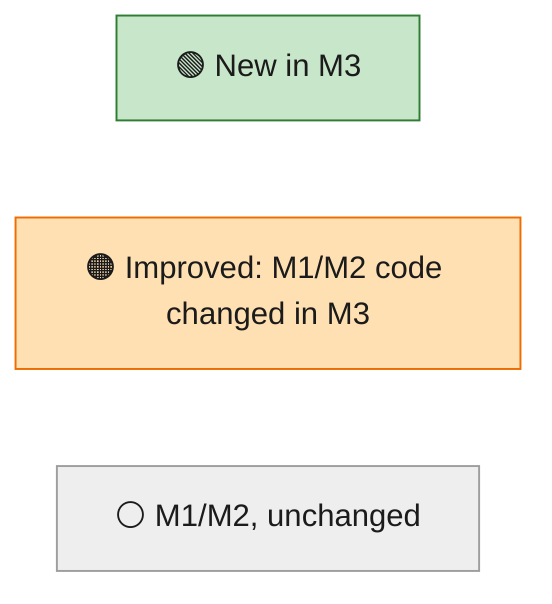

Classified against `git diff 002-m2-durable-storage-query-builder..HEAD`: a file added on this branch is 🟢, a file
M3 edited is 🟠, a file it didn't touch is ⚪.

Four ideas carry M3 (on top of M2's four):

1. **The index only rules things out.** A text-index hit is a candidate. The merged run and the one `eval` decide,
   so a search can't return a false or stale match.
2. **Every run is counted on exactly one side.** Single-version file rows are added up straight from a narrow
   DataFusion scan (clean side); anything that may have another version is merged first (dirty side). This only
   holds because every second version is marked ([D-025](../000-tracedb-master-plan/decisions.md#d-025)).
3. **An estimate is the same engine on a sample**, labelled, and always followed by the exact answer.
4. **Multipart is a new envelope, not a new path.** Its parts become the same items `/runs/batch` sends.

## 1. Goals → functionality → where it lives

| | Goal (spec end state) | What delivers it | Where |
|---|---|---|---|
| 🟢 | Search words and phrases in inputs, outputs, errors | tokenizer; text index sidecar per file at flush; lookup → candidates → merge → verify; excerpts | [model/text.rs](../../crates/model/src/text.rs), [storage/fts.rs](../../crates/storage/src/fts.rs), [query/search.rs](../../crates/query/src/search.rs) |
| 🟢 | Add up any query, grouped | clean / dirty sides, mergeable accumulators, top N + `(other)` + `(none)`, nearest-rank percentiles | [query/aggregate/](../../crates/query/src/aggregate/mod.rs), [model/agg.rs](../../crates/model/src/agg.rs) |
| 🟢 | Honest cost | reported cost → tokens × price list → "no price" | [model/cost.rs](../../crates/model/src/cost.rs), [prices.toml](../../crates/model/src/prices.toml) |
| 🟢 | Time series, distribution, compare; click to drill in | buckets, latency bins, a `where` per group/bucket/bin; side b by filter or shift | [aggregate/series.rs](../../crates/query/src/aggregate/series.rs), [ui/src/stats/](../../ui/src/stats/StatsPanel.tsx) |
| 🟢 | A first answer to slow questions | sampled estimate, then exact, over SSE; dropping the stream cancels | [aggregate/progressive.rs](../../crates/query/src/aggregate/progressive.rs), [routes/aggregate_stream.rs](../../crates/server/src/routes/aggregate_stream.rs) |
| 🟢 | SDK defaults unchanged (multipart, zstd, feedback) | `/info` flags; streaming multipart parser + zstd; `POST`/`PATCH /feedback` | [routes/multipart.rs](../../crates/server/src/routes/multipart.rs), [routes/ingest.rs](../../crates/server/src/routes/ingest.rs), [ingest/feedback.rs](../../crates/ingest/src/feedback.rs) |
| 🟢 | Feedback filterable and averaged | catalog table + in-memory index; `feedback.<key>`; `avg(feedback.<key>)` | [ingest/feedback.rs](../../crates/ingest/src/feedback.rs), [filter/eval.rs](../../crates/model/src/filter/eval.rs) |
| 🟠 | Interactive at 2M runs | kept merged rows in lists; run lookup by file; bounded `Cache`; late text read | [query/lib.rs](../../crates/query/src/lib.rs), [query/scan.rs](../../crates/query/src/scan.rs), [storage/cache.rs](../../crates/storage/src/cache.rs) |
| 🟠 | Light at idle | 64 MB heap memtable, 2 min flush age, 16 B dedup fingerprints, 32 MB cache, jemalloc | [ingest/lib.rs](../../crates/ingest/src/lib.rs), [tracedb/main.rs](../../crates/tracedb/src/main.rs), [.cargo/config.toml](../../.cargo/config.toml) |
| 🟢 | Speed claims measured | `tracedb bench`, calibration, CI gate | [tracedb/bench.rs](../../crates/tools/src/bench.rs), [ci.yml](../../.github/workflows/ci.yml) |
| 🟠 | The whole scenario in one command | batch a and b, feedback, M3 checks | [scenario.rs](../../crates/tools/src/scenario.rs), [demo.rs](../../crates/tools/src/demo.rs) |
| 🟠 | M2 rough edges closed | flushed-ids filter (D-025); files made once per flush job; damaged files skipped; "N new" pill | [ingest/flushed.rs](../../crates/ingest/src/flushed.rs), [flush.rs](../../crates/ingest/src/flush.rs), [query/scan.rs](../../crates/query/src/scan.rs), [views/Samples.tsx](../../ui/src/views/Samples.tsx) |

## 2. The system, one path at a time

Four small charts. Each reads top to bottom.

### 2a. Upload: a multipart batch, until "202"

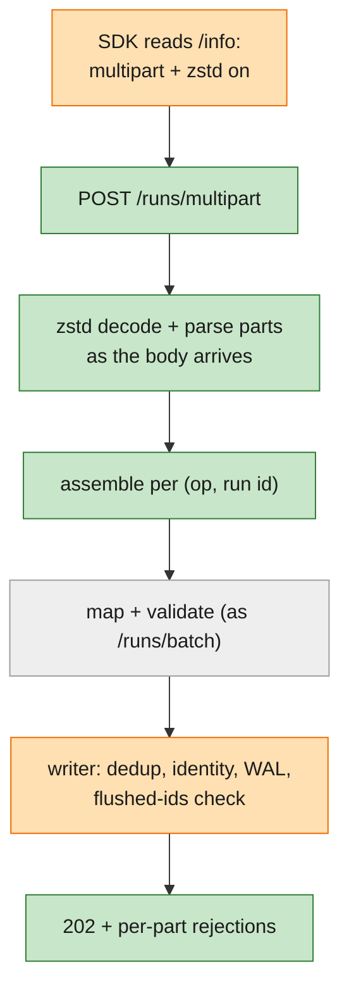

### 2b. Flush: memory to files, plus the index

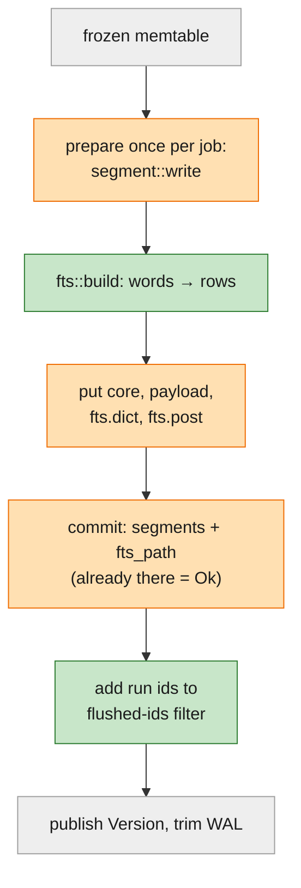

### 2c. Search: one query with `search(…)`

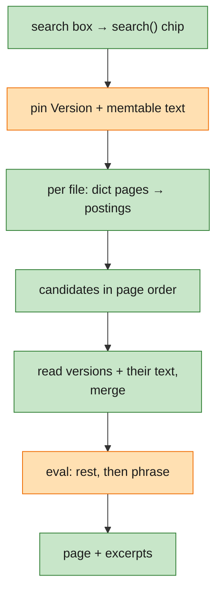

### 2d. Aggregate: group, add up, estimate, then exact

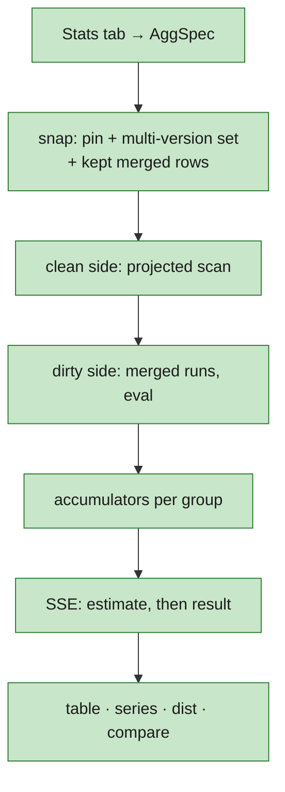

### Crates, top to bottom

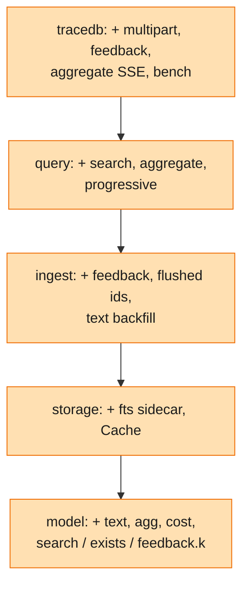

No new crate; each still uses only the ones below it. `query` reads feedback through the read-only
`FeedbackLookup` trait ([feedback.rs:221](../../crates/ingest/src/feedback.rs#L221)), the way it reads memtables
through `Ingest::mem()` ([ingest/lib.rs:685](../../crates/ingest/src/lib.rs#L685)). Only `storage` knows the
sidecar layout ([fts.rs:112](../../crates/storage/src/fts.rs#L112)).

## 3. Suggested reading order (about 3½ hours)

| # | | File | Why read it | Time |
|---|---|---|---|---|
| 1 | 🟢 | [model/src/text.rs](../../crates/model/src/text.rs) | What a word is; phrase match; excerpt. Search is only as good as this (189 lines) | 10 min |
| 2 | 🟠 | [model/src/filter/eval.rs](../../crates/model/src/filter/eval.rs) | `Search`, `Exists`, `feedback.<key>` on a merged run | 10 min |
| 3 | 🟢 | [model/src/agg.rs](../../crates/model/src/agg.rs), [cost.rs](../../crates/model/src/cost.rs) | The aggregate request, the stats line, cost rules (pure) | 20 min |
| 4 | 🟢 | [storage/src/fts.rs](../../crates/storage/src/fts.rs) | **Critical.** Sidecar layout, `build`, `find`, the superset rule | 25 min |
| 5 | 🟠 | [ingest/src/flush.rs](../../crates/ingest/src/flush.rs), [flushed.rs](../../crates/ingest/src/flushed.rs) | Files once per job; sidecar puts; why "clean" can be trusted | 15 min |
| 6 | 🟢 | [query/src/search.rs](../../crates/query/src/search.rs) + `select` in [query/src/lib.rs](../../crates/query/src/lib.rs) | **Critical.** Candidates → merge → verify, a chunk at a time | 30 min |
| 7 | 🟢 | [query/src/aggregate/mod.rs](../../crates/query/src/aggregate/mod.rs), [clean.rs](../../crates/query/src/aggregate/clean.rs), [dirty.rs](../../crates/query/src/aggregate/dirty.rs) | **Critical.** One side per run; no double counting | 35 min |
| 8 | 🟢 | [query/src/aggregate/accum.rs](../../crates/query/src/aggregate/accum.rs) | Nearest-rank percentiles, the value cap, scaling an estimate | 15 min |
| 9 | 🟢 | [query/src/aggregate/progressive.rs](../../crates/query/src/aggregate/progressive.rs) | Sample, scale, cancel | 15 min |
| 10 | 🟢 | [tracedb/src/routes/multipart.rs](../../crates/server/src/routes/multipart.rs) | Part names → items; streaming zstd; per-part rejections | 15 min |
| 11 | 🟢 | [ingest/src/feedback.rs](../../crates/ingest/src/feedback.rs) | Feedback store and index; why it has no WAL record | 10 min |
| 12 | 🟢 | [ui/src/stats/StatsPanel.tsx](../../ui/src/stats/StatsPanel.tsx), [query/SearchBox.tsx](../../ui/src/query/SearchBox.tsx) | Stats tab, charts, click-through | 15 min |

Skip on the first pass: `bench.rs` (1,326 lines, mostly generator and table printing), `clean.rs` column plumbing
(`Cols`, `Light`), `multipart.rs`'s `Parser` state machine, `scenario.rs`.

## 4. Walkthrough: one run, from a multipart upload to batch a vs b

The overnight-eval scenario ([scenario.rs:185](../../crates/tools/src/scenario.rs#L185)) plants 300 `fetch_url`
runs in batch a (`batch=2026-11-05-a`, 42 errors) and 300 in batch b (6 errors). Follow one of batch a's: it
starts, fails with `HTTPError: 429 Too Many Requests`, gets flushed with its index, is found by search, is
counted in the 14.0%, its root gets a `correctness` score, and it is compared with batch b. The SDK sends it as a
zstd multipart upload; `tracedb demo` sends the same items through `/runs/batch` (see §8). Bands: 🟢 new,
🟠 improved, ⚪ as M2.

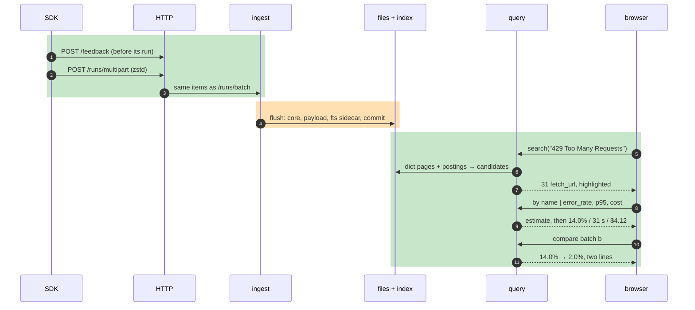

### 🟢 Scene 1: the run arrives in a multipart batch

| Step | Code |
|---|---|
| `/info` turns the SDK's multipart and zstd on, with every `batch_ingest_config` key it reads; `version: ""` keeps feedback on `POST /feedback` ([D-027](../000-tracedb-master-plan/decisions.md#d-027)) | `info` [routes/ingest.rs:20-36](../../crates/server/src/routes/ingest.rs#L20) |
| Route | [tracedb/src/lib.rs:95](../../crates/server/src/lib.rs#L92) → `runs_multipart` [multipart.rs:430](../../crates/server/src/routes/multipart.rs#L430) |
| Boundary from `Content-Type`; `Content-Encoding: zstd` or none, anything else is `400` | `boundary` [multipart.rs:265](../../crates/server/src/routes/multipart.rs#L265), [multipart.rs:329-336](../../crates/server/src/routes/multipart.rs#L329) |
| The body is decoded as it arrives; raw and decoded bytes are each capped at 50 MB (`413`), zstd windows over 16 MB refused | `parse` [multipart.rs:327-364](../../crates/server/src/routes/multipart.rs#L327), `Unzstd` [multipart.rs:288](../../crates/server/src/routes/multipart.rs#L288), [multipart.rs:28](../../crates/server/src/routes/multipart.rs#L28) |
| Part names → kind: `post.<id>`, `post.<id>.<field>`, `attachment.…`, `feedback.<id>`, unknown; attachments and unknown parts are drained, not buffered | `kind` [multipart.rs:39](../../crates/server/src/routes/multipart.rs#L39), `keep` [multipart.rs:56](../../crates/server/src/routes/multipart.rs#L56) |
| Assemble per `(op, id)`: field parts win over the base's same key, whatever the order; posts before patches, as a JSON batch | `assemble` [multipart.rs:372-428](../../crates/server/src/routes/multipart.rs#L372) |
| Feedback parts first (idempotent by id), then the items through the same mapping and writer as `/runs/batch` | [multipart.rs:451-456](../../crates/server/src/routes/multipart.rs#L451) → `accept_items` [routes/ingest.rs:118](../../crates/server/src/routes/ingest.rs#L118) → `Ingest::accept` [ingest/lib.rs:629](../../crates/ingest/src/lib.rs#L629) |
| `202`: writer rejections, then per-part rejections (`attachment_not_stored`, `unknown_part`, `bad_feedback`) | [multipart.rs:457-464](../../crates/server/src/routes/multipart.rs#L457) |

From the writer on it is M2's Scene 1 ([M2 guide](../002-m2-durable-storage-query-builder/starter-guide.md#-scene-1-the-start-arrives-as-m1-plus-one-check)),
plus the flushed-ids check of Scene 13. The update (error, `429`) is M2's path unchanged.

### 🟠 Scene 2: the flush writes the text index sidecar

| Step | Code |
|---|---|
| A job's files are made once, outside the retry loop, and kept across retries | `run` [flush.rs:73-104](../../crates/ingest/src/flush.rs#L73), `prepare` [flush.rs:106-141](../../crates/ingest/src/flush.rs#L106), [flush.rs:145-147](../../crates/ingest/src/flush.rs#L145) |
| One segment per project: core, payload, and the sidecar stem `seg-<id>.fts` | `segment::write` [segment.rs:197](../../crates/storage/src/segment.rs#L197), [segment.rs:206-210](../../crates/storage/src/segment.rs#L206) |
| Words per payload row: every string and scalar leaf of `inputs` and `outputs`, `error` whole; words over 64 bytes indexed by their first 64 | `TextRow::of` [fts.rs:63](../../crates/storage/src/fts.rs#L63), `build_in_groups` [fts.rs:339-367](../../crates/storage/src/fts.rs#L339), `term` [fts.rs:100](../../crates/storage/src/fts.rs#L100) → `tokens` [text.rs:11](../../crates/model/src/text.rs#L11) |
| Postings: payload row numbers in 128-row blocks, a list never straddling a 64 KB chunk unless it's larger | [fts.rs:373-386](../../crates/storage/src/fts.rs#L373), `encode_list` [fts.rs:457](../../crates/storage/src/fts.rs#L457) |
| Dictionary: Parquet `(term, field, df, post_off, post_len)`, sorted, 256-row pages with page stats on `term` only (each page a term zone), zstd | [fts.rs:387-418](../../crates/storage/src/fts.rs#L387) |
| ① put core, payload, `fts.dict.parquet`, `fts.post`; kill point `after_fts_put`; a name already holding the bytes counts as stored | [flush.rs:152-196](../../crates/ingest/src/flush.rs#L152), [flush.rs:164](../../crates/ingest/src/flush.rs#L164) |
| ② one commit with `fts_path`/`fts_bytes`; segment ids already registered = "already committed", `Ok` | [flush.rs:209-210](../../crates/ingest/src/flush.rs#L209) → `commit_flush` [metastore.rs:309-339](../../crates/storage/src/metastore.rs#L309) |
| The flush's run ids go into the flushed-ids filter before the frozen memtable is dropped (Scene 13) | [flush.rs:219-226](../../crates/ingest/src/flush.rs#L219) |
| Start: unregistered sidecars are orphans, always safe to delete | [recover.rs:52-70](../../crates/ingest/src/recover.rs#L52) |

The design is [D-026](../000-tracedb-master-plan/decisions.md#d-026): no word positions, so a phrase's rows are
the intersection of its words' rows, a superset the query then checks. The catalog moved to `schema_version` 2 for
`fts_path` and the `feedback` table ([metastore.rs:48-67](../../crates/storage/src/metastore.rs#L48)).

### 🟢 Scene 3: feedback sent before its run (orphan → attached)

The demo sends one `correctness` score before any run exists ([scenario.rs:203](../../crates/tools/src/scenario.rs#L203),
[scenario.rs:635-637](../../crates/tools/src/scenario.rs#L635)).

| Step | Code |
|---|---|
| `POST /feedback` → validate: `run_id` and `key` required, `score` a number or bool or null, unknown fields kept | [routes/ingest.rs:66-75](../../crates/server/src/routes/ingest.rs#L66) → `from_upload` [feedback.rs:87](../../crates/ingest/src/feedback.rs#L87) |
| One catalog transaction (`ON CONFLICT (id) DO UPDATE`), committed before the reply; no WAL record ([D-027](../000-tracedb-master-plan/decisions.md#d-027)) | `put` [feedback.rs:366](../../crates/ingest/src/feedback.rs#L366) → `commit` [feedback.rs:327](../../crates/ingest/src/feedback.rs#L327) → [metastore.rs:421](../../crates/storage/src/metastore.rs#L421) |
| Then the in-memory index `run_id → (key, score)`; a replaced id moves | `FeedbackIndex::insert` [feedback.rs:195](../../crates/ingest/src/feedback.rs#L195) |
| `PATCH /feedback/{id}` replaces the given fields | [routes/ingest.rs:77](../../crates/server/src/routes/ingest.rs#L77) → `patch` [feedback.rs:381](../../crates/ingest/src/feedback.rs#L381) |
| Orphan = its run is in neither memtable nor the flushed-ids filter; listed by `GET /api/feedback?orphaned=true` and counted in `/healthz` | `feedback_runs_missing` [ingest/lib.rs:760](../../crates/ingest/src/lib.rs#L760), [routes/feedback.rs:71-76](../../crates/server/src/routes/feedback.rs#L71), [ingest/lib.rs:778](../../crates/ingest/src/lib.rs#L778) |
| Attach: nothing moves. The join is at read time, so it matches once the run is visible | `admits` [query/lib.rs:270](../../crates/query/src/lib.rs#L270) → [eval.rs:68](../../crates/model/src/filter/eval.rs#L68) |
| `feedback.<key>` is the mean of the run's scores for that key | `mean` [feedback.rs:235](../../crates/ingest/src/feedback.rs#L235) |
| Index rebuilt at start from the table | `FeedbackStore::load` [feedback.rs:343](../../crates/ingest/src/feedback.rs#L343) ← [ingest/lib.rs:542](../../crates/ingest/src/lib.rs#L542) |

### 🟢 Scene 4: search finds it

`search("429 Too Many Requests")` inside `and(or(batch a, batch b), …)` → 31 runs, all `fetch_url`
([demo.rs:509-525](../../crates/tools/src/demo.rs#L509)).

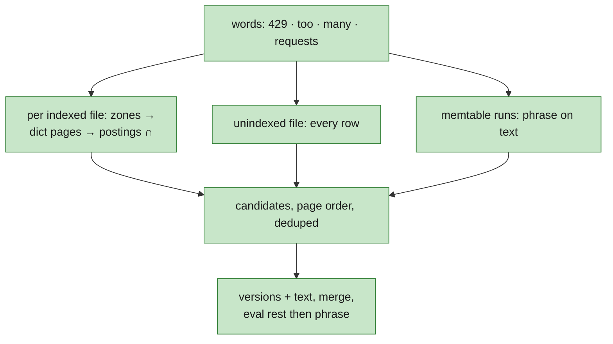

| Step | Code |
|---|---|
| Parse `search("…")` (and `search(outputs, …)` etc.); words made by the same tokenizer as the index | [parse.rs:360](../../crates/model/src/filter/parse.rs#L360), `Expr::Search` [ast.rs:25](../../crates/model/src/filter/ast.rs#L25) |
| Pin with memtable text when the filter searches; kept merged rows brought up to the pin (D-029) | `select` [query/lib.rs:420-426](../../crates/query/src/lib.rs#L420) → `pin_kept` [lib.rs:663](../../crates/query/src/lib.rs#L663) |
| The index answers a search at the top of the filter or inside a top-level `and` | `indexed` [search.rs:33](../../crates/query/src/search.rs#L33), [lib.rs:447-449](../../crates/query/src/lib.rs#L447) |
| Candidates from every file in scope, 16 files at a time; the filter's other conditions pushed down as a superset | `candidates` [search.rs:127-181](../../crates/query/src/search.rs#L127) |
| Per file: each side's field (`error`, `outputs`, `inputs`), words in more than half the rows skipped there | `file_hits` [search.rs:183-237](../../crates/query/src/search.rs#L183), [search.rs:198-202](../../crates/query/src/search.rs#L198) |
| **Index lookup**: footer + page index through the `Cache`; only pages whose term zone may hold a word; then each word's postings range, rarest first, intersected | `lookup_within` [fts.rs:151](../../crates/storage/src/fts.rs#L151) → `find` [fts.rs:165-241](../../crates/storage/src/fts.rs#L165), `zones` [fts.rs:272](../../crates/storage/src/fts.rs#L272), `intersect` [fts.rs:308](../../crates/storage/src/fts.rs#L308) |
| Payload rows → `(start key, run id, trace id)` through the core file's `payload_row`; a row another version may change is kept | `row_keys` [search.rs:245-324](../../crates/query/src/search.rs#L245), [search.rs:315](../../crates/query/src/search.rs#L315) |
| Memtable runs checked against their own text | [search.rs:168-179](../../crates/query/src/search.rs#L168) |
| **Merge**: candidates in page order, `want` first then doubling (late materialization); every version from the files that hold one, plus the others only for multi-version runs | [lib.rs:491-516](../../crates/query/src/lib.rs#L491) → `matching_ids` [lib.rs:335](../../crates/query/src/lib.rs#L335) → `collect_text` [search.rs:330](../../crates/query/src/search.rs#L330), [search.rs:365-384](../../crates/query/src/search.rs#L365) |
| Cheaper conditions first on runs merged without text; then only those runs' text pages, through the `Cache` | [search.rs:412-430](../../crates/query/src/search.rs#L412) → `attach_payload` [search.rs:454](../../crates/query/src/search.rs#L454) → `read_payload_rows` [segment.rs:724](../../crates/storage/src/segment.rs#L724) |
| **Verify**: `eval` checks the phrase on the merged text (consecutive words in one leaf), so a replaced output stops matching | [lib.rs:358](../../crates/query/src/lib.rs#L358) → [eval.rs:60-62](../../crates/model/src/filter/eval.rs#L60) → `phrase_in` [text.rs:60](../../crates/model/src/text.rs#L60) |
| **Excerpt**: first match (error, then outputs, then inputs), ±80 characters, kept only for rows that can be on the page; text dropped after | [lib.rs:556-566](../../crates/query/src/lib.rs#L556) → `excerpt` [text.rs:65](../../crates/model/src/text.rs#L65) |
| Stats `index_files`, `scan_files`, `candidates`, `payload_rows`, `cache_hits` | [lib.rs:641-656](../../crates/query/src/lib.rs#L641) |

**Fallback for files without an index** (written by M2, or an unreadable sidecar): the file gives all its rows as
candidates and is named in a `not_indexed_files` warning ([search.rs:192-195](../../crates/query/src/search.rs#L192),
[search.rs:217-222](../../crates/query/src/search.rs#L217), [lib.rs:617-621](../../crates/query/src/lib.rs#L617)).
Without the index at all (`Query::without_text_index`, [lib.rs:240](../../crates/query/src/lib.rs#L240)) or for a
search under `or`/`not`, `matching` reads the files, checks the other conditions, then the text
([lib.rs:305-330](../../crates/query/src/lib.rs#L305)).

**Backfill**: once no flush has run for a flush age, a background thread gives one unindexed file a sidecar
(new objects, then `fts_path` in one update; a crash between leaves an orphan). Never needed for correct results.
`backfill::run` [backfill.rs:18](../../crates/ingest/src/backfill.rs#L18), `one` [backfill.rs:64](../../crates/ingest/src/backfill.rs#L64)
→ `sidecar_of` [segment.rs:817](../../crates/storage/src/segment.rs#L817), `set_fts` [metastore.rs:405](../../crates/storage/src/metastore.rs#L405),
`Version::with_fts` [memtable.rs:41](../../crates/ingest/src/memtable.rs#L41); spawned at [ingest/lib.rs:592-602](../../crates/ingest/src/lib.rs#L592).
`/healthz` counts `unindexed_segments` ([ingest/lib.rs:793](../../crates/ingest/src/lib.rs#L793)).

### 🟢 Scene 5: group batch a by name

`by name | count, error_rate, p95(latency), sum(cost)` over `has(tags, "batch=2026-11-05-a")`
([demo.rs:493](../../crates/tools/src/demo.rs#L493), [demo.rs:527-541](../../crates/tools/src/demo.rs#L527)).

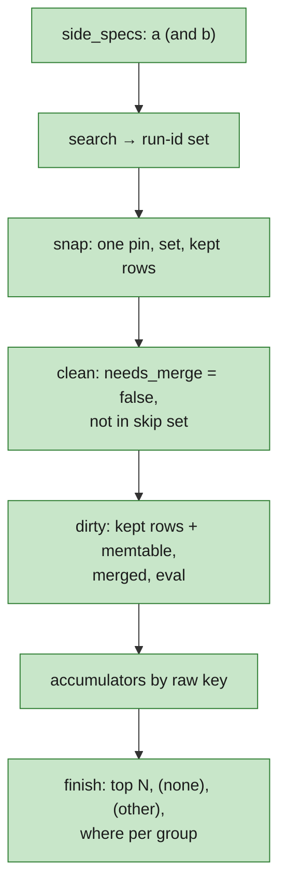

| Step | Code |
|---|---|
| `POST /api/aggregate`: query fields plus `group_by`/`metrics`/`top` or a `stats` line; at most one `avg(feedback.<key>)`; `compare.shift` needs a window start | `aggregate` [routes/api.rs:498](../../crates/server/src/routes/api.rs#L498) → `agg_request` [api.rs:463](../../crates/server/src/routes/api.rs#L463), `AggBody::agg` [api.rs:390](../../crates/server/src/routes/api.rs#L390) → `parse_stats` [agg.rs:203](../../crates/model/src/agg.rs#L203) |
| Exact path | `Query::aggregate` [aggregate/mod.rs:525](../../crates/query/src/aggregate/mod.rs#L525) → `aggregate_with` [mod.rs:536](../../crates/query/src/aggregate/mod.rs#L536) |
| A search in the filter is resolved first to the runs it matches (the clean scan can't read text) | `with_searches` [query/lib.rs:387](../../crates/query/src/lib.rs#L387) → `search_set` [lib.rs:368](../../crates/query/src/lib.rs#L368) |
| **Snap**: one pin of files, memtable runs and the multi-version set, plus their merged file rows kept across requests (D-023) | `snap` [mod.rs:602](../../crates/query/src/aggregate/mod.rs#L602) → `VersionRows::update` [fields.rs:153](../../crates/query/src/fields.rs#L153); `skip` = set ∪ memtable ids [mod.rs:447-456](../../crates/query/src/aggregate/mod.rs#L447) |
| Per side: files in scope (not damaged) by start time, and a `Plan` (keys, filter, prices, which columns) | `sides` [mod.rs:628-676](../../crates/query/src/aggregate/mod.rs#L628) |
| **Clean side**: `needs_merge = false` ∧ scope ∧ pushed filter, only the columns needed, 16 files at a time; an inexact pushdown is decided by `eval` on a light run | `clean::scan` [clean.rs:81-133](../../crates/query/src/aggregate/clean.rs#L81), [clean.rs:97](../../crates/query/src/aggregate/clean.rs#L97), `Rows::batch` [clean.rs:434](../../crates/query/src/aggregate/clean.rs#L434), [clean.rs:447](../../crates/query/src/aggregate/clean.rs#L447) |
| **Dirty side**: each kept merged run, merged again with its memtable versions if any, then memtable-only runs; `eval` on the merged run | `dirty::walk` [dirty.rs:27-96](../../crates/query/src/aggregate/dirty.rs#L27) |
| **Accumulators**: runs, finished, errors, running; token sums; cost; latency values; feedback sums | `Acc::add` [accum.rs:134](../../crates/query/src/aggregate/accum.rs#L134), `Accs::add` [mod.rs:344](../../crates/query/src/aggregate/mod.rs#L344) |
| **Error rate** = errors / finished; running runs apart | `finish` [accum.rs:234-236](../../crates/query/src/aggregate/accum.rs#L234) |
| **p95**: nearest rank, the ⌈0.95·N⌉-th latency of the finished runs; past 4M kept values, from 150 log bins and marked `approximate` | `percentile` [accum.rs:264-292](../../crates/query/src/aggregate/accum.rs#L264), `VALUE_CAP` [accum.rs:12](../../crates/query/src/aggregate/accum.rs#L12) |
| **Cost**: only `llm` runs; reported cost first (usage `total_cost`, or input + output cost, or the run's `total_cost`), else tokens × price, else "no price" | `cost::of` [cost.rs:154](../../crates/model/src/cost.rs#L154), `reported_pico` [cost.rs:174](../../crates/model/src/cost.rs#L174); clean side [clean.rs:470-487](../../crates/query/src/aggregate/clean.rs#L470), dirty side `facts` [mod.rs:277](../../crates/query/src/aggregate/mod.rs#L277) |
| Prices: embedded [prices.toml](../../crates/model/src/prices.toml), then `--prices` or `<data>/prices.toml` replacing entries by name, read once at start | `Prices::embedded` [cost.rs:71](../../crates/model/src/cost.rs#L71), `load_prices` [tracedb/lib.rs:121](../../crates/server/src/lib.rs#L118) |
| **Finish**: totals; top N by runs (ties by key), `(none)`, `(other)`; tag groups unnested and flagged `overlap`; a `where` filter per group | `write_up` [mod.rs:738](../../crates/query/src/aggregate/mod.rs#L738) → `finish` [mod.rs:950-1058](../../crates/query/src/aggregate/mod.rs#L950), `where_group` [mod.rs:1109](../../crates/query/src/aggregate/mod.rs#L1109) |

For `fetch_url`: 300 runs, 42 errors → **14.0%**; p95 rank ⌈0.95 × 300⌉ = 285 lands on the planted 31 s → **31 s**.
Cost over the batch's model calls is **$4.12**, 12 runs "no price" ([scenario.rs:33-37](../../crates/tools/src/scenario.rs#L33)).
A `fetch_url` run with a late update is in the multi-version set, so the clean scan skips its file row and the dirty
side counts it once, merged.

### 🟢 Scene 6: the first estimate, then the exact figures

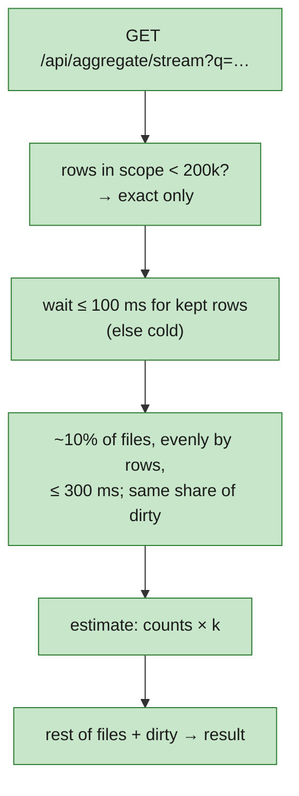

| Step | Code |
|---|---|
| `?q=` is the URL-encoded `POST /api/aggregate` body; a bad one is a single `error` event with `query_id: null` | `stream` [aggregate_stream.rs:60-77](../../crates/server/src/routes/aggregate_stream.rs#L60), `refused` [aggregate_stream.rs:50](../../crates/server/src/routes/aggregate_stream.rs#L50) |
| Defaults: 200k rows, 10% sample, 300 ms budget, 100 ms wait for kept rows | `StreamOpts` [progressive.rs:77-86](../../crates/query/src/aggregate/progressive.rs#L77) |
| The work runs in its own task; the stream owns its `Cancel` | `aggregate_stream` [progressive.rs:172-188](../../crates/query/src/aggregate/progressive.rs#L172) |
| Small scope → only `result` | [progressive.rs:206-218](../../crates/query/src/aggregate/progressive.rs#L206) |
| Kept rows filled in the background; not ready in 100 ms → a cold snap without them | [progressive.rs:219-227](../../crates/query/src/aggregate/progressive.rs#L219), `snap_cold` [mod.rs:612](../../crates/query/src/aggregate/mod.rs#L612) |
| Sample: files spread evenly by rows, no new file after the budget; dirty runs by run-id hash at the share actually read | `pick_files` [progressive.rs:142](../../crates/query/src/aggregate/progressive.rs#L142), [progressive.rs:235-253](../../crates/query/src/aggregate/progressive.rs#L235), `Pick::split` [mod.rs:412](../../crates/query/src/aggregate/mod.rs#L412) |
| Scale counts and sums by k = rows in scope / rows read (cold: plus an estimate of the multi-version runs); rates, percentiles, averages as sampled; `partial: true`, cells `estimated` | [progressive.rs:246-251](../../crates/query/src/aggregate/progressive.rs#L246), `dirty_estimate` [progressive.rs:320](../../crates/query/src/aggregate/progressive.rs#L320), `Cells::scaled` [accum.rs:324](../../crates/query/src/aggregate/accum.rs#L324) |
| Exact: warm reuses the sample's accumulators and reads the rest; cold waits for the kept rows and runs it whole | [progressive.rs:274-313](../../crates/query/src/aggregate/progressive.rs#L274) |
| **Cancel**: closing the connection drops the stream, which sets the token; scans stop at the next batch, the dirty walk every 4,096 runs | `AggStream` drop [progressive.rs:135](../../crates/query/src/aggregate/progressive.rs#L135), [clean.rs:121-123](../../crates/query/src/aggregate/clean.rs#L121), [dirty.rs:42-49](../../crates/query/src/aggregate/dirty.rs#L42) |
| Browser: events for another `query_id` ignored; a new query closes the old stream | `streamAggregate` [ui/src/api.ts:196-224](../../ui/src/api.ts#L196) |

### 🟢 Scene 7: time series, distribution, compare batch b

| Step | Code |
|---|---|
| `view: series`: accumulators per raw key and minute; bucket `auto` picks a round step for about a hundred buckets (≤ 1,000) | `step_min` [series.rs:87](../../crates/query/src/aggregate/series.rs#L87), `series` [series.rs:174](../../crates/query/src/aggregate/series.rs#L174) |
| Each bucket's `where` is `gte`/`lt` on `start_time`, so a point opens its runs | `cond` [series.rs:152](../../crates/query/src/aggregate/series.rs#L152) |
| `view: dist`: finished runs per latency bin (150 log bins, 10 ms to 1 h), a `where` per bin | `bin_counts` [series.rs:226](../../crates/query/src/aggregate/series.rs#L226), `dist` [series.rs:250](../../crates/query/src/aggregate/series.rs#L250), `BIN_LOWER_MS` [accum.rs:17](../../crates/query/src/aggregate/accum.rs#L17) |
| `compare: {filter}` → side b is the same query with b's filter; `{shift: "1d"}` → the same window that much earlier | `side_specs` [mod.rs:907-936](../../crates/query/src/aggregate/mod.rs#L907) |
| Both sides share one snap and run concurrently; side b shows side a's groups in a's order, `null` where b has none | `exact_over` [mod.rs:553-588](../../crates/query/src/aggregate/mod.rs#L553), [mod.rs:749-759](../../crates/query/src/aggregate/mod.rs#L749) |
| Compared series: each side counts from its own first run (filter) or window start (shift); same bucket count | `axes` [series.rs:109](../../crates/query/src/aggregate/series.rs#L109), [mod.rs:765-776](../../crates/query/src/aggregate/mod.rs#L765) |

`fetch_url`: 14.0% → 2.0%, p95 31 s → 9 s; batch b costs $4.07 ([scenario.rs:38-40](../../crates/tools/src/scenario.rs#L38),
checked at [demo.rs:543-583](../../crates/tools/src/demo.rs#L543)).

### 🟢 Scene 8: the UI (search box, Stats tab, charts)

| Step | Code |
|---|---|
| Search box: Enter sets the filter's `search("…")` chip (kept in the URL as `q`), empty removes it | `SearchBox` [SearchBox.tsx:9](../../ui/src/query/SearchBox.tsx#L9) ← [Panel.tsx:62](../../ui/src/query/Panel.tsx#L62); `isBox` [chips.ts:30](../../ui/src/query/chips.ts#L30); `onSearch` [views/Runs.tsx:115](../../ui/src/views/Runs.tsx#L115) |
| Excerpt column with the match marked (code-point offsets) | `Excerpt` [Excerpt.tsx:4](../../ui/src/views/Excerpt.tsx#L4) ← [Samples.tsx:245](../../ui/src/views/Samples.tsx#L245), [Table.tsx:92](../../ui/src/views/Table.tsx#L92) |
| Stats / Time series / Distribution tabs: group-by and metric pickers or the stats line (same parser as Rust, mirrored) | `StatsPanel` [StatsPanel.tsx:86](../../ui/src/stats/StatsPanel.tsx#L86), `parseStats` [query/stats.ts:18](../../ui/src/query/stats.ts#L18) |
| Each change re-opens the stream; an estimate shows marked "≈ estimate · N% sampled" until the result | [StatsPanel.tsx:108-129](../../ui/src/stats/StatsPanel.tsx#L108), [StatsPanel.tsx:199](../../ui/src/stats/StatsPanel.tsx#L199) |
| URL is the stats query: `view`, `by`, `m`, `top`, `bucket`, `cmp`, `shift` | `toUrl` [url.ts:89](../../ui/src/query/url.ts#L89), `aggBody` [url.ts:143](../../ui/src/query/url.ts#L143) |
| Charts (SVG, no chart library) and the compare picker | [TimeSeries.tsx:30](../../ui/src/stats/TimeSeries.tsx#L30), [Distribution.tsx:17](../../ui/src/stats/Distribution.tsx#L17), [Compare.tsx:19](../../ui/src/stats/Compare.tsx#L19), [chart.tsx:61](../../ui/src/stats/chart.tsx#L61) |
| **Click-through**: a cell, point or bar opens Samples with its `where` as chips; side b swaps in b's filter (or drops the shift) | [StatsTable.tsx:67-80](../../ui/src/stats/StatsTable.tsx#L67) → `onOpen` [views/Runs.tsx:124-137](../../ui/src/views/Runs.tsx#L124) |
| Live Samples: new runs wait behind an "N new" pill while scrolled down | [Samples.tsx:18](../../ui/src/views/Samples.tsx#L18), [Samples.tsx:219](../../ui/src/views/Samples.tsx#L219) |

### 🟠 Scene 9: `tracedb demo`, now with M3 rows

| Step | Code |
|---|---|
| `--checks m2,m3` (default both); its own server with a 4 MB memtable unless `--url`, where the background load is sized from the server's `memtable_limit_bytes` in `/healthz` | [demo.rs:38-44](../../crates/tools/src/demo.rs#L38), [demo.rs:126-196](../../crates/tools/src/demo.rs#L126), `memtable_limit` [scenario.rs:706](../../crates/tools/src/scenario.rs#L706) |
| Scenario: batch a re-planted, batch b, feedback (one sent before its run), background | `generate` [scenario.rs:185](../../crates/tools/src/scenario.rs#L185), constants [scenario.rs:19-41](../../crates/tools/src/scenario.rs#L19) |
| Load: early feedback, starts, other feedback, background until the starts are in files after two flushes, then late updates | `load` [scenario.rs:611-688](../../crates/tools/src/scenario.rs#L611) |
| Five M3 checks over the real HTTP API: 31 text hits, 14.0% / 31 s, $4.12 (12 no price), a vs b side by side + overlaid, feedback filter + average | `m3_checks` [demo.rs:495-677](../../crates/tools/src/demo.rs#L495) |
| Pass/fail table, exit 0 / 1 / 2 | `report` [demo.rs:99](../../crates/tools/src/demo.rs#L99) |

### 🟢 Scene 10: `tracedb bench` and calibration

| Step | Code |
|---|---|
| 2M runs (200k with `--smoke`) into its own in-process server through `/runs/batch` from 8 clients, a query loop alongside; one run in ten finishes late | `BenchArgs` [bench.rs:46](../../crates/tools/src/bench.rs#L46), `load` [bench.rs:352](../../crates/tools/src/bench.rs#L352), `start` [bench.rs:930](../../crates/tools/src/bench.rs#L930) |
| Nine rows: trace tree, run + payload, filtered list, three text-search rows, one query shape each (the planted rare phrase; a common word; a common word + `prompt_version`), grouped, first estimate, suggestions; ≥ 100 timed requests each after 10 warm-ups; a wrong answer fails the row | `specs` [bench.rs:584](../../crates/tools/src/bench.rs#L584), `rare_phrase` [bench.rs:495](../../crates/tools/src/bench.rs#L495), `common_word` [bench.rs:500](../../crates/tools/src/bench.rs#L500), `search_filter` [bench.rs:505](../../crates/tools/src/bench.rs#L505), `measure` [bench.rs:753](../../crates/tools/src/bench.rs#L753) |
| **Calibration**: decode the shipped Parquet file 20× and sort its text, best of three, before and after; r = runner / 80 ms, clamped to [1, 3] | `calibrate` [bench.rs:831](../../crates/tools/src/bench.rs#L831), `reference_workload` [bench.rs:809](../../crates/tools/src/bench.rs#L809), `ratio` [bench.rs:804](../../crates/tools/src/bench.rs#L804), [bench.rs:1115](../../crates/tools/src/bench.rs#L1115) |
| Verdict: p50 ≤ target × r and p99 ≤ 5 × p50; load ≥ 20k events/s ÷ r; disk ≤ 50% of raw; idle memory reported, waived until M4 (not in the verdict) | `judge` [bench.rs:792](../../crates/tools/src/bench.rs#L792), `verdict` [bench.rs:742](../../crates/tools/src/bench.rs#L742), [bench.rs:1125-1131](../../crates/tools/src/bench.rs#L1125) |
| CI: `--smoke --check` on PRs, full 2M on `main` and nightly | [ci.yml:154-169](../../.github/workflows/ci.yml#L154), [ci.yml:181-200](../../.github/workflows/ci.yml#L181) |

### 🟠 Scene 11: memory defaults and jemalloc

| Step | Code |
|---|---|
| Memtable 64 MB measured as heap, not JSON; flush age 2 min | [ingest/lib.rs:47-49](../../crates/ingest/src/lib.rs#L47), `RunStore::bytes` [store.rs:173](../../crates/ingest/src/store.rs#L173), [writer.rs:113-117](../../crates/ingest/src/writer.rs#L113) |
| Dedup keys as 16 B fingerprints, at most 1M, pruned while idle | `fingerprint` [dedup.rs:58](../../crates/ingest/src/dedup.rs#L58), `DEFAULT_CAP` [dedup.rs:46](../../crates/ingest/src/dedup.rs#L46), [writer.rs:68-72](../../crates/ingest/src/writer.rs#L68) |
| Bounded `Cache` (32 MB, least recently used out, by bytes; an entry over ⅛ isn't kept) for footers, dictionary pages, postings, payload pages | `Cache::new` [cache.rs:88](../../crates/storage/src/cache.rs#L88), [cache.rs:114](../../crates/storage/src/cache.rs#L114), `footer` [cache.rs:145](../../crates/storage/src/cache.rs#L145), `ranges` [cache.rs:168](../../crates/storage/src/cache.rs#L168) |
| Project map: generations of 458,752 runs | [projects.rs:13](../../crates/ingest/src/projects.rs#L13) |
| Flags `--memtable`, `--flush-age`, `--dedup-keys`, `--cache` (M2 values still settable) | [main.rs:36-50](../../crates/tracedb/src/main.rs#L36) |
| jemalloc as the global allocator; no thread caches, freed pages purged at once, 8 arenas | [main.rs:10-11](../../crates/tracedb/src/main.rs#L10), [.cargo/config.toml:4](../../.cargo/config.toml#L4) |
| Runtime workers turn their cache on while running and hand it back when they park | [main.rs:101-111](../../crates/tracedb/src/main.rs#L105) |
| `/healthz` shows `dedup_keys`, `cache_bytes` | [ingest/lib.rs:801-802](../../crates/ingest/src/lib.rs#L801) |

All of this is [D-028](../000-tracedb-master-plan/decisions.md#d-028). Idle memory is still over its target; see §8.

### 🟠 Scene 12: a damaged file is skipped, not fatal

| Step | Code |
|---|---|
| Start: a missing file, or one whose footers don't read, is left out and listed with a reason | [recover.rs:98-135](../../crates/ingest/src/recover.rs#L98) → `inspect_all` [segment.rs:1096](../../crates/storage/src/segment.rs#L1096) |
| While serving: a failed read probes each file's footers; if none look bad and the error is a decoding one, each file is read alone; bad ones are marked and the read retried without them | `read_core` [scan.rs:391-417](../../crates/query/src/scan.rs#L391), `probe` [scan.rs:362](../../crates/query/src/scan.rs#L362), `damage_of` [scan.rs:318](../../crates/query/src/scan.rs#L318) |
| Single-file readers (search, clean side, payload text) use the same test | `damaged_alone` [scan.rs:349](../../crates/query/src/scan.rs#L349) ← [search.rs:272](../../crates/query/src/search.rs#L272), [clean.rs:150](../../crates/query/src/aggregate/clean.rs#L150), [search.rs:512](../../crates/query/src/search.rs#L512) |
| Marked once: a new `Version` without the file, so later reads don't see it | `mark_damaged` [ingest/lib.rs:713-732](../../crates/ingest/src/lib.rs#L713), `Version::without` [memtable.rs:54](../../crates/ingest/src/memtable.rs#L54) |
| Reported: `skipped_files` warning on lists and aggregates in scope; `/healthz` `ok: false` with `damaged_segments` | [query/lib.rs:613-616](../../crates/query/src/lib.rs#L613), [aggregate/mod.rs:816-824](../../crates/query/src/aggregate/mod.rs#L816), [ingest/lib.rs:782](../../crates/ingest/src/lib.rs#L782) |

This closes the first two M2 rough edges (a corrupt or vanished file gave `500`s while `/healthz` said `ok`).

### 🟠 Scene 13: restart, and a second start for a flushed run (D-025)

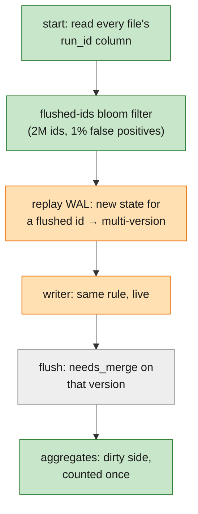

| Step | Code |
|---|---|
| The filter: 7 hashes, 9.6 bits per id; a full stage adds one twice its size; no false negatives | `FlushedIds` [flushed.rs:66-101](../../crates/ingest/src/flushed.rs#L66) |
| Start: sized for twice the rows found; filled from every file's `run_id` column with the footer check | [recover.rs:115-130](../../crates/ingest/src/recover.rs#L115) → `inspect` [segment.rs:1072](../../crates/storage/src/segment.rs#L1072) |
| Replay: a new state started by an update, or for a flushed id, joins the multi-version set | [recover.rs:185-189](../../crates/ingest/src/recover.rs#L185) |
| Live: the writer checks frozen memtable and filter under the memtable lock | [writer.rs:255-274](../../crates/ingest/src/writer.rs#L255) |
| The flusher adds its ids before dropping the frozen memtable, so a run is always in one of them | [flush.rs:219-225](../../crates/ingest/src/flush.rs#L219) |
| That version is flushed `needs_merge` (M2's rule, unchanged), so the clean side never reads it | [flush.rs:116](../../crates/ingest/src/flush.rs#L116), [clean.rs:97](../../crates/query/src/aggregate/clean.rs#L97) |

A false positive only sends a run to the merging side. This closes M2's "second start isn't marked `needs_merge`"
rough edge; the field browser now counts such a run once too
([D-023](../000-tracedb-master-plan/decisions.md#d-023)).

### 🟠 Opening the run (D-029)

`GET /api/runs/{id}` is one `run_id = …` scan for its versions, children counted from the rows naming it as
parent, and each version's payload read by row number from its own file: `run_with_stats`
[query/lib.rs:836-861](../../crates/query/src/lib.rs#L836) → `run_versions` [scan.rs:832](../../crates/query/src/scan.rs#L832),
`payload` [scan.rs:882](../../crates/query/src/scan.rs#L882), `child_count` [scan.rs:977](../../crates/query/src/scan.rs#L977).

## 5. HTTP status codes in M3

| | Code | Meaning | Raised at |
|---|---|---|---|
| 🟠 | 202 | durable and applied; rejections per item, and per part for multipart | [routes/ingest.rs:112](../../crates/server/src/routes/ingest.rs#L112), [multipart.rs:457-464](../../crates/server/src/routes/multipart.rs#L457) |
| 🟢 | 200 | feedback stored (after the catalog commit) | [routes/ingest.rs:72](../../crates/server/src/routes/ingest.rs#L72) |
| 🟢 | 400 `bad_multipart` / `bad_feedback` / `bad_stats` | malformed upload, feedback item or stats line | [multipart.rs:433-436](../../crates/server/src/routes/multipart.rs#L433), [errors.rs:35](../../crates/server/src/routes/errors.rs#L35), [api.rs:404-435](../../crates/server/src/routes/api.rs#L404) |
| 🟢 | 404 `not_found` | `PATCH /feedback/{id}` for an unknown id | [errors.rs:36](../../crates/server/src/routes/errors.rs#L36) |
| ⚪ | 400 `bad_filter` | as M2; `search()` no longer `unsupported` | [routes/api.rs:59](../../crates/server/src/routes/api.rs#L59) |
| ⚪ | 429 + Retry-After: 1 | as M2 | [errors.rs:25](../../crates/server/src/routes/errors.rs#L25) |
| 🟠 | 503 + Retry-After: 5 | as M2; also feedback when the catalog fails | [errors.rs:26-28](../../crates/server/src/routes/errors.rs#L26), [errors.rs:37-39](../../crates/server/src/routes/errors.rs#L37) |
| 🟠 | 413 `too_large` | multipart body over 50 MB, raw or decoded | [multipart.rs:437-443](../../crates/server/src/routes/multipart.rs#L437) |
| 🟠 | 415 / 501 | gone: multipart and feedback are accepted | — |

## 6. Things to try while reading

Commands the README and [quickstart.md](quickstart.md) give and the code supports. **Not run while writing this
guide** (a 2M-run benchmark needed a quiet machine), so the expected values come from the scenario constants and
the demo's checks, not from a run. Port 7070 assumed.

```bash
tracedb demo --seed 7                      # M2 + M3 checks: 31 hits, 14.0% / 31 s, $4.12 (12 no price), a vs b, feedback

tracedb serve --data /tmp/m3 &
tracedb demo --url http://localhost:7070 --seed 7
ls /tmp/m3/data/*/*/ | grep fts            # a .fts.dict.parquet and .fts.post next to each new file
tracedb query --project overnight-eval --search '429 Too Many Requests'
tracedb query --group-by name --metrics 'count,error_rate,p95(latency),sum(cost)' \
  --compare 'has(tags, "batch=2026-11-06-b")' 'has(tags, "batch=2026-11-05-a")'

curl -s localhost:7070/api/aggregate -H 'content-type: application/json' \
  -d '{"filter": "has(tags, \"batch=2026-11-05-a\")", "stats": "by name | count, error_rate, p95(latency), sum(cost)"}' \
  | jq '.groups[] | select(.key[0] == "fetch_url") | .cells | {runs, error_rate, p95}'
q=$(jq -rn '{filter: "has(tags, \"batch=2026-11-05-a\")", group_by: ["name"], metrics: ["count"]} | @uri')
curl -sN "localhost:7070/api/aggregate/stream?q=$q"     # small data: only `result`; ≥ 200k rows: `estimate` first
curl -s 'localhost:7070/api/feedback?orphaned=true' | jq .count
curl -s localhost:7070/healthz | jq '{unindexed_segments, damaged_segments, orphan_feedback, dedup_keys, cache_bytes}'

tracedb bench --smoke --check              # 200k runs, the PR gate
```

The tests are the spec in executable form (also not run here):

```bash
cargo test -p tracedb-query --test search      # index == naive phrase check over merged runs
cargo test -p tracedb-query --test aggregate   # aggregate == naive accumulation, whatever was flushed
cargo test -p tracedb-query --test progressive # estimate over every file == exact; cancel stops reading
cargo test -p tracedb --test multipart         # same runs as the JSON batch, any part order, zstd on/off
cargo test -p tracedb-ingest --test writer     # a second start for a flushed run joins the set
```

## 7. Where M3 is most likely to be wrong (read these tests first)

1. **Double counting in aggregates**:
   [`aggregates_match_naive_accumulation_whatever_was_flushed`](../../crates/query/tests/aggregate.rs#L473) compares
   every group and metric with a naive fold. A run counted twice means a second version reached the clean side:
   check [D-025](../000-tracedb-master-plan/decisions.md#d-025) and
   [`a_second_start_for_a_flushed_run_joins_the_multi_version_set`](../../crates/ingest/tests/writer.rs#L268).
2. **Stale or missed search hits**:
   [`search_matches_a_naive_phrase_check_whatever_was_flushed_or_indexed`](../../crates/query/tests/search.rs#L421)
   and [`replaced_text_stops_matching`](../../crates/query/tests/search.rs#L485).
3. **Tokenizer edge cases** (CJK, emoji, accents, `429,`):
   [`unicode_words_lower_cased`](../../crates/model/tests/text.rs#L11),
   [`a_phrase_split_across_leaves_does_not_match`](../../crates/model/tests/text.rs#L106).
4. **Estimates**: [`a_cold_estimate_skips_multi_version_runs_and_the_result_is_still_exact`](../../crates/query/tests/progressive.rs#L170),
   [`dropping_the_stream_stops_reading`](../../crates/query/tests/progressive.rs#L217).
5. **Multipart part order**: [`part_order_does_not_matter`](../../crates/server/tests/multipart.rs#L153),
   [`a_field_part_wins_over_the_same_key_in_its_base_in_any_order`](../../crates/server/tests/multipart.rs#L168).
6. **Damaged files**: [`a_file_damaged_past_its_footer_is_found_by_reading_files_alone`](../../crates/server/tests/damaged.rs#L155).
7. **Flush retries**: [`a_retried_flush_whose_commit_landed_registers_its_files_once`](../../crates/ingest/tests/flush.rs#L161).

## 8. Rough edges found while writing it

From reading the code and the task list; nothing was run. None were fixed then; the bench's idle and text-search
rows were updated afterwards (below).

- **Idle memory is over target, by decision.** 234–246 MB idle at ~0.5M runs, ≈0.6 GB projected at 2M: merged
  copies of late-updated runs and per-file state, which M4 compaction removes. SC-05 is waived for M3 (roadmap
  2026-11-07, [D-028](../000-tracedb-master-plan/decisions.md#d-028)). `tracedb bench` reports the idle row as
  `WAIVED (M4)` and leaves it out of `--check` ([bench.rs:42](../../crates/tools/src/bench.rs#L42), [bench.rs:1131](../../crates/tools/src/bench.rs#L1131)); the
  `#[ignore]`d [idle-memory test](../../crates/tracedb/tests/idle_memory.rs#L13) still holds a separate `serve` to
  200 MB, so it is red when run.
- **The bench's idle number isn't the server's.** It is the bench process's RSS
  ([bench.rs:899](../../crates/tools/src/bench.rs#L899)), and that process also ran the 8 load clients and the
  timing client ([bench.rs:930](../../crates/tools/src/bench.rs#L930)), so the bench prints it as an upper bound (`idle.process_mb`) and
  leaves `idle_mb` `null` ([bench.rs:1147](../../crates/tools/src/bench.rs#L1147)); the idle-memory test measures a separate `serve` process.
- **The full 2M bench hasn't passed yet.** Earlier runs on a busy machine missed run + payload, filtered list,
  text-search p99 and load (tasks T109); it is being rerun on a quiet machine.
- **Text search is three bench rows (split after this guide was first written).** Rare phrase, common word,
  search + filter, each held to its own median and p99 ([bench.rs:495-512](../../crates/tools/src/bench.rs#L495),
  [bench.rs:620](../../crates/tools/src/bench.rs#L620)); the query loop that runs alongside the load still mixes all three
  (`text_search`, [bench.rs:514](../../crates/tools/src/bench.rs#L514)).
- **CI has never run.** There is no git remote, so the `cloud` job (S3 + Postgres, [ci.yml:79](../../.github/workflows/ci.yml#L79)),
  both bench jobs and the rest exist only as YAML. "Same results on cloud storage" is still unproven.
- **The no-outbound check has never run under strace.** [no-outbound.sh](../../scripts/no-outbound.sh#L7) is Linux
  only and this was built on macOS.
- **The UI hasn't been checked in a real browser.** UI tests run in jsdom; the search box, Stats tab, charts,
  click-through and "N new" pill were never seen rendered. I didn't render this guide's Mermaid charts either.
- **The chart's metric and group aren't in the URL.** They are component state
  ([StatsPanel.tsx:99-101](../../ui/src/stats/StatsPanel.tsx#L99)), so a shared Time series link opens on the
  default metric (the first one that isn't `count`, [StatsPanel.tsx:138](../../ui/src/stats/StatsPanel.tsx#L138)).
- **The first aggregate on a cold server fills the kept rows.** Start only kicks off the fill
  ([tracedb/lib.rs:170](../../crates/server/src/lib.rs#L167) → [mod.rs:619](../../crates/query/src/aggregate/mod.rs#L619));
  `POST /api/aggregate` waits for it ([mod.rs:602-609](../../crates/query/src/aggregate/mod.rs#L602)). Lists that find
  the lock held go the slower M2 way meanwhile ([lib.rs:664-666](../../crates/query/src/lib.rs#L664)); the stream
  gives a cold estimate after 100 ms but its result still waits ([progressive.rs:304](../../crates/query/src/aggregate/progressive.rs#L304)).
  The `Cache` starts empty too.
- **An aggregate over a search runs the whole search first, uncancelled.** `with_searches` resolves it with no
  limit before the snap or any estimate, and doesn't take the cancel token
  ([lib.rs:387-397](../../crates/query/src/lib.rs#L387), [lib.rs:381](../../crates/query/src/lib.rs#L381),
  [progressive.rs:203](../../crates/query/src/aggregate/progressive.rs#L203)). A broad search can delay the first
  estimate past its 1 s target, and closing the stream doesn't stop it.
- **The demo and the bench don't use multipart.** Both upload through `/runs/batch`
  ([scenario.rs:638-640](../../crates/tools/src/scenario.rs#L638), [bench.rs:1](../../crates/tools/src/bench.rs#L1)),
  so the SDK's default path is covered by tests and the no-outbound script only. Multipart items are also recorded
  with `Source::LsBatch` ([multipart.rs:456](../../crates/server/src/routes/multipart.rs#L456)), so the two can't be
  told apart later.
- **A file the backfill fails on isn't retried until restart** (the `failed` set lives in the thread,
  [backfill.rs:28](../../crates/ingest/src/backfill.rs#L28), [backfill.rs:57](../../crates/ingest/src/backfill.rs#L57)).
  It is still searched by reading it.
- **`/healthz` walks every feedback run id on each call** to count orphans
  ([ingest/lib.rs:778](../../crates/ingest/src/lib.rs#L778) → [lib.rs:760-771](../../crates/ingest/src/lib.rs#L760)),
  taking the memtable lock. Fine at demo scale; unmeasured with many feedback items.
- **Stale text.** `tracedb demo --help` still says "run the M2 checks" ([main.rs:78](../../crates/tracedb/src/main.rs#L81)),
  and [quickstart.md](quickstart.md) still ends with "Last verified: not yet (M3 not built)" (task T126 open).
