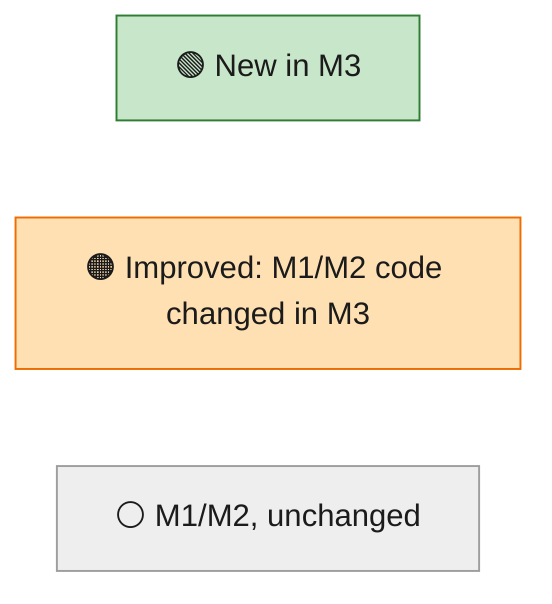
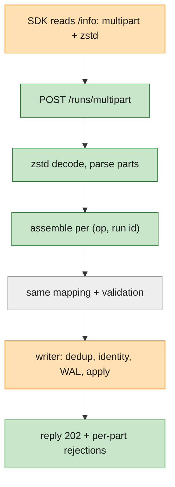
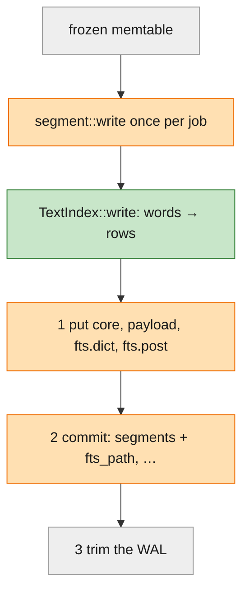
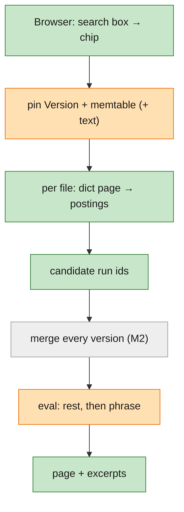
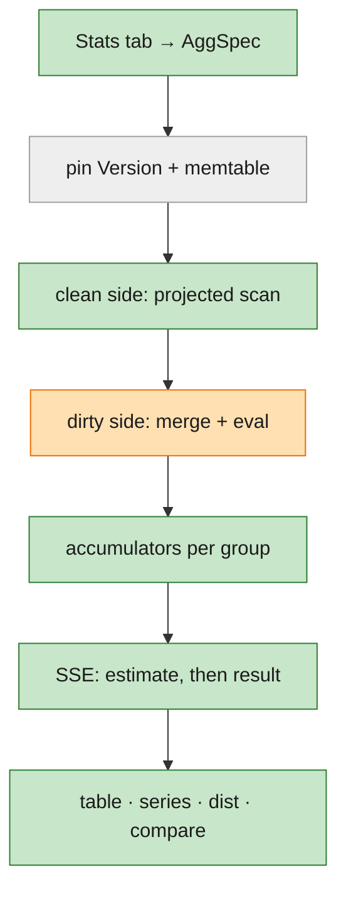
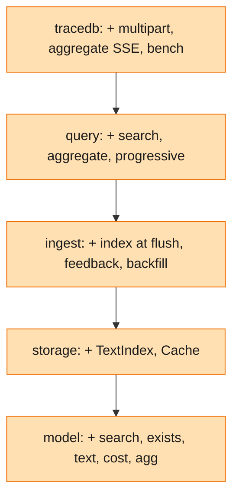
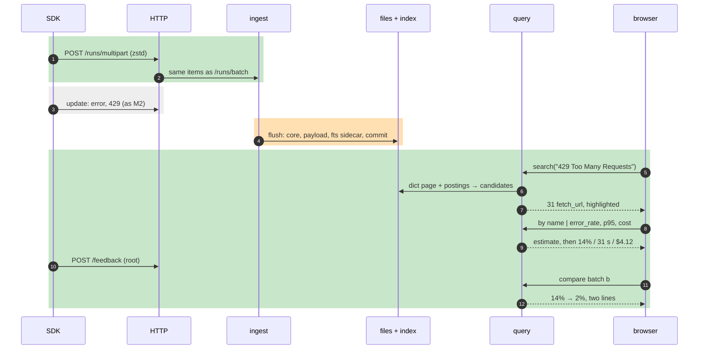
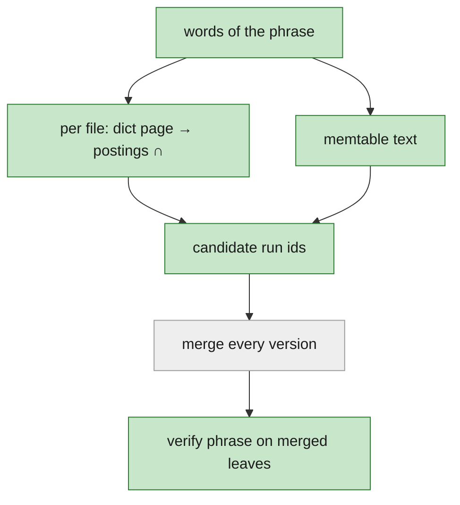

# M3 starter guide (pre-code) — Appendix A of the [plan](plan.md)

How M3 will work end to end, before its code exists: what each goal needs, which part of the system does it, and
pseudo-flows for every path. Names in `code font` are **planned** module and function names (plan.md §Project
Structure); M3 code has no line numbers yet. Links with line numbers point at the **M2 code it builds on** (branch
`002-m2-durable-storage-query-builder`, `6e77f12`). **The last M3 unit (plan.md, unit 14) rewrites this file** into
a guide for reading the built code, like the [M2 code guide](../002-m2-durable-storage-query-builder/starter-guide.md).

For *why* it is built this way, see [design.md](design.md) and [research.md](research.md). This guide is about *how
it flows*.

**Colour key** (diagrams use the fill colour; tables and headings use the marker):

| Marker | Fill | Meaning |
|---|---|---|
| 🟢 **New** | green | first built in M3 |
| 🟠 **Improved** | orange | exists from M1 or M2; M3 extends or changes it |
| ⚪ **Existing** | grey | built in M1 or M2; M3 uses it as is |



Four ideas carry M3 (on top of M2's four):

1. **The index only rules things out.** A text-index hit is a candidate. The merged run and the one `eval` decide,
   so a search can't return a false or stale match.
2. **Every run is counted on exactly one side.** Single-version file rows are added up straight from a narrow
   DataFusion scan; anything that might have another version is merged first, as M2 does.
3. **An estimate is the same engine on a sample**, labelled, and always replaced by the exact answer.
4. **Multipart is a new envelope, not a new path.** Its parts become the same items `/runs/batch` sends.

## 1. Goals → functionality → where it will live

| | Goal (spec end state) | Functionality that delivers it | Planned home |
|---|---|---|---|
| 🟢 | Search words and phrases in inputs, outputs, errors | tokenizer; per-file sidecar at flush; lookup → candidates → merge → verify; excerpts | `model::text`, `storage::fts`, `ingest::flush`, `query::search` |
| 🟢 | Add up any query, grouped | clean/dirty sides, accumulators, top N + other + `(none)`, exact percentiles | `query::aggregate::{clean, dirty, accum}`, `model::agg` |
| 🟢 | Honest cost | reported cost → tokens × `prices.toml` → no price | `model::cost`, `model/prices.toml`, `model::derive` |
| 🟠 | Samples, Table, Time series, Distribution on one query; click to drill in | buckets, bins, `where` per group; view tabs | `query::aggregate::series`, `ui/src/stats/*` |
| 🟢 | Compare two batches or a shifted window | two specs over one pin; offset axis | `query::aggregate`, `ui/src/stats/Compare.tsx` |
| 🟢 | A first answer to slow questions | sampled estimate, then exact, over SSE; cancel | `query::progressive`, `routes::aggregate` |
| 🟠 | SDK defaults unchanged | `/info` flags; multipart parser + zstd; `POST`/`PATCH /feedback` | `routes::multipart`, `routes::ingest`, `ingest::feedback` |
| 🟢 | Feedback filterable and averaged | feedback table + in-memory index; `feedback.<key>`; `avg(...)` | `ingest::feedback`, `model::filter`, `query::aggregate::accum` |
| 🟠 | Interactive at 2M runs; light | run lookup reads only holding files; bounded `Cache`; memory defaults | `query::scan`, `storage::cache`, `ingest::lib` |
| 🟠 | Speed claims measured | `tracedb bench` with calibration; CI gate | `tracedb::bench`, `.github/workflows/ci.yml` |
| 🟠 | The whole scenario in one command | batch a re-planted, batch b, M3 checks | `tracedb::scenario`, `tracedb::demo` |
| 🟠 | M2 rough edges closed | flushed-ids bloom; files once per job; damaged-file map; "N new"; seed times | `ingest::{writer, flush, recover}`, `ui/src/views/Samples.tsx`, `tracedb::seed` |

## 2. The system, one path at a time

Four small charts. Each reads top to bottom.

### 2a. Upload: a multipart batch, until "202"



The writer is 🟠 only for one check: a start for a run already on disk now joins the multi-version set.

### 2b. Flush: memory to files, plus the index



### 2c. Search: one query with `search(…)`



### 2d. Aggregate: group, add up, estimate, then exact



### Crates, top to bottom



No new crate. Each crate still uses only the ones below it. `query` reads feedback through a read-only `Feedback`
trait, like `Ingest::mem()` ([ingest/src/lib.rs:586](../../crates/ingest/src/lib.rs#L586)). Only `storage` knows
the sidecar layout.

## 3. Suggested reading order once it's written

| # | | Planned file | Why read it |
|---|---|---|---|
| 1 | 🟢 | `model/src/text.rs` | What a word is; phrase match; excerpt. Search is only as good as this |
| 2 | 🟠 | `model/src/filter/{ast,eval}.rs` | `Search`, `Exists`, `feedback.<key>`: how they evaluate on a merged run |
| 3 | 🟢 | `model/src/agg.rs`, `cost.rs` | The aggregate request, metrics and cost rules (pure) |
| 4 | 🟢 | `storage/src/fts.rs` | **Critical.** Sidecar layout, lookup, superset rule |
| 5 | 🟠 | `ingest/src/flush.rs` | Files once per job, index at flush, idempotent commit |
| 6 | 🟠 | `ingest/src/writer.rs` | Flushed-ids bloom: why aggregates can trust "clean" |
| 7 | 🟢 | `query/src/search.rs` | **Critical.** Lookup → candidates → merge → verify |
| 8 | 🟢 | `query/src/aggregate/{clean,dirty}.rs` | **Critical.** One side per run; no double counting |
| 9 | 🟢 | `query/src/aggregate/accum.rs` | Exact percentiles, buckets, bins, `where` |
| 10 | 🟢 | `query/src/progressive.rs` | Sample, scale, cancel |
| 11 | 🟢 | `tracedb/src/routes/multipart.rs` | Part names → items; zstd; per-part rejections |
| 12 | 🟢 | `ui/src/stats/*` | Stats panel, charts, click-through |

## 4. Walkthrough: one run, from a multipart upload to batch a vs b

The `fetch_url` step again: it starts at 02:14:07 in a multipart batch, errors at 02:14:38 with
`HTTPError: 429 Too Many Requests`, is flushed with its index at ~02:20, is found by search at 08:03, is counted in
the 14% at 08:05, gets feedback on its root at 08:10, and is compared with batch b the next night. Bands: 🟢 new,
🟠 improved, ⚪ as M2.



### 🟢 Scene 1: the start arrives in a multipart batch (02:14:07)

```text
SDK: GET /info → use_multipart_endpoint: true, zstd_compression_enabled: true, version ""
SDK: POST /runs/multipart, Content-Encoding: zstd
     parts: post.7c1e…a4 {id, trace_id, dotted_order, name: "fetch_url", run_type: "tool", start_time, …}
            post.7c1e…a4.inputs {url: "https://…"}
routes::multipart::upload(headers, body):
  body  = if zstd: zstd::stream::Decoder(body)               # capped at 50 MB decoded
  parts = parse_parts(body, boundary)                         # httparse for part headers
  items = assemble(parts)                                     # (post, 7c1e…a4) = base ∪ {inputs}
  rejected = attachments and unknown parts, by name
  submit(items, Source::LsMultipart, Dialect::LangSmith)       # → M2's path: routes/ingest.rs submit
```

From here it is M2's Scene 1 ([M2 guide](../002-m2-durable-storage-query-builder/starter-guide.md#-scene-1-the-start-arrives-as-m1-plus-one-check)),
plus one check in the writer:

```text
writer.apply(start for 7c1e…a4):
  change = active.apply(ev)
  if change.created and (ev.op == Patch or frozen.contains(id) or flushed_ids.may_contain(id)):   # NEW: flushed_ids
      mvset.insert(id)                       # a second start for a run on disk is now multi-version (D-016 fixed)
```

Today's rule is [writer.rs:250](../../crates/ingest/src/writer.rs#L250); `flushed_ids` is a bloom filter of every
flushed run id, filled at each flush and rebuilt at start.

### ⚪ Scene 2: the update arrives (02:14:38)

As M2: a patch with `error = "HTTPError: 429 Too Many Requests"`, `outputs = {status_code: 429, body: "… 429 Too
Many Requests …"}`, merged into the memtable state.

### 🟠 Scene 3: the flush writes the index (~02:20)

```text
flusher.run(rx):
  for job in rx:
    written = write_all(job)                     # NEW: once per job, outside the retry loop (ids fixed)
    loop until ok: flush(job, &written)          # retries reuse the same files and ids
flush(job, written):
  for w in written:
    put(w.core); put(w.payload); put(w.fts_dict); put(w.fts_post)     # kill point after_fts_put
  metastore.commit_flush(segments incl. fts_path, stats, keys, flushed_seq)
     # NEW: a segment id already present ⇒ already committed ⇒ Ok (no double registration)
  publish Version; flushed_ids.extend(run ids); trim WAL (M2)
TextIndex::write(rows):
  for (row, run) in rows (payload-row order):
    for field in [inputs, outputs, error]:
      for leaf in leaves(run.field): for w in text::tokens(leaf): post[(w, field)].insert(row)
  dict = Parquet(term, field, df, post_off, post_len), sorted, page index on
  post = bit-packed lists in 64 KB chunks
```

For `7c1e…a4`: `("429", outputs)`, `("too", outputs)`, …, `("429", error)`, … each gain its payload row. Today's
retry loop is [flush.rs:55-84](../../crates/ingest/src/flush.rs#L55); ids are minted in
[segment.rs:190](../../crates/storage/src/segment.rs#L190).

### 🟠 Scene 4: the 14 and the 23, now within the M3 targets (08:00)

Lists are M2's ([M2 guide, Scene 6](../002-m2-durable-storage-query-builder/starter-guide.md#-scene-6-the-query)),
with three changes:

```text
query.run(id, include):                           # opening the fetch_url step
  versions = collect(scope = run id)             # NEW: each version carries its segment_id
  header   = merge(versions); children = from trace header rows      # NEW: not a full trace() (lib.rs:510)
  payload  = read only the payload files that hold a version, via Cache    # NEW: not every file (scan.rs:391)
scan(files):
  on a read error: probe each file, damaged.mark(bad), retry without it, warn skipped_files   # NEW (FR-18)
```

### 🟢 Scene 5: search (08:03)

```text
query.select(Q{filter: search("429 Too Many Requests")}):
  words = [429, too, many, requests]
  pin = scan::pin(scope, with_text = true)               # memtable runs incl. inputs/outputs/error text
  for file in pin.files_in_scope():
    if file.fts_path:
      rows = ∩ fts::lookup(file, w, Any) for w in words   # dict page via Cache → postings chunk via Cache
    else:
      rows = all; warn not_indexed{file}
    cand += run_ids(file, rows)
  cand += memtable runs with all words
  runs = collect(scope, ids = cand)                       # every version, merged (M2)
  runs = runs.filter(eval(rest of Q)).filter(phrase_in(merged, words))
  page.runs[i].match = excerpt(first match, ±80 chars)
```



Why only 31: the phrase is planted in `outputs.body` and `error` of the 31 rate-limited `fetch_url` runs; timeouts
say `ReadTimeout`; the background says `503 Service Unavailable`; root errors say `gave up after fetch_url failed`.

### 🟢 Scene 6: group batch a by name (08:05)

```text
query.aggregate(spec{filter: has(tags, "batch=2026-11-05-a"), group_by: [name],
                     metrics: [count, error_rate, p95(latency), sum(cost)]}):
  pin; dirty = mvset ∪ memtable ids
  (pushed, exact) = pushdown::compile(filter)           # has(tags, …) compiles exactly
  clean: for batch in scan(files, cols = [run_id, name, status, latency_ms, model, input_tokens,
                                          output_tokens, reported_cost_pico], pushed ∧ !needs_merge):
           for row not in dirty: acc[row.name].add(row)
  dirty: for run in collect_pinned(scope, dirty) merged where eval(filter): acc[run.name].add(run)
  finish: per group runs, finished, errors/finished, nearest-rank p95 over kept latencies,
          Σ cost::of(run, prices); top 10 + other
```

For `fetch_url`: 300 runs, 42 errors → **14.0%**; latencies sorted, rank ⌈0.95 × 300⌉ = 285 falls among the 22
runs at exactly 31.000 s → **31 s**. Cost over the batch's llm runs: $0.84 + $3.00 + $0.28 (reported) =
**$4.12**, with 12 `local-llama` runs counted as "no price". `7c1e…a4` has two versions, so it is counted once, on
the dirty side.

### 🟢 Scene 7: the first estimate, then the exact figures

```text
query.progressive.stream(spec, cancel):
  if rows_in_scope(spec) < ~200k: yield Result(aggregate(spec)); return
  sample = files spread over the time range until ~10% of rows, + same share of dirty runs
  est = aggregate(spec over sample); scale counts and sums by rows_total / rows_read
  yield Estimate(est{partial: true, sampled_pct})
  yield Result(aggregate(spec, reuse = sample's accumulators))
on cancel (stream closed / new query): stop at the next batch
```

### 🟢 Scene 8: time series and click-through (08:06)

```text
spec.view = series, metric error_rate, bucket auto → step 5m over batch a's range
accumulators keyed by (group, bucket(start_time)); empty bucket = null
each bucket's where = and(eq(name, "fetch_url"), gte(start_time, 02:30), lt(start_time, 02:35))
UI: click the 02:30 point → Samples with those chips → the failing runs
```

### 🟢 Scene 9: feedback for the root (08:10)

```text
POST /feedback {id, run_id: <root of 0b9f…11>, key: "correctness", score: 0}
ingest::feedback.put(fb):  metastore upsert by id (one transaction) → index[run_id].push((key, score)) → 200
filter gt(feedback.correctness, 0.5)  → eval reads index[run_id] (mean per key)
metric avg(feedback.correctness)      → accumulator sums (score, n) per group
feedback sent before its run: stored the same way; it matches as soon as the run is visible
```

Today `/feedback` is `501` ([routes/ingest.rs:74](../../crates/tracedb/src/routes/ingest.rs#L74)), which the SDK
re-raises into agent code.

### 🟢 Scene 10: compare with batch b (next night)

```text
spec.compare = {filter: has(tags, "batch=2026-11-06-b")}
side a, side b = aggregate(spec), aggregate(spec with filter b)    # one pin, concurrently
table: pair groups by key; missing on one side → null
series: offset axis = time since each side's first run
fetch_url: 14.0% → 2.0%, p95 31 s → 9 s; cost $4.12 vs $4.07
```

### 🟠 Scene 11: every change — demo and bench

```text
tracedb demo:  scenario::generate (batch a re-planted, batch b, feedback) → load → M2 checks + M3 checks
               (31 · 14.0% / 31 s · $4.12 · a vs b · feedback) → table, exit 0/1/2
tracedb bench: calibrate r → load 2M via HTTP from 8 clients while querying → n ≥ 100 per query type
               → p50/p99 vs budget = target × r; p99 ≤ 5 × p50 → table / JSON, exit 1 naming the slip
```

M2's demo is [demo.rs:255-343](../../crates/tracedb/src/demo.rs#L255); the bench generator to move is
[tests/bench_m2.rs](../../crates/tracedb/tests/bench_m2.rs).

## 5. HTTP status codes in M3

| | Code | Meaning | Raised by |
|---|---|---|---|
| ⚪ | 202 | durable and applied; rejections listed (per item, and per part for multipart) | `routes::ingest`, `routes::multipart` |
| 🟢 | 200 | feedback stored (after the catalog commit) | `routes::ingest::feedback` |
| 🟢 | 400 `bad_multipart` / `bad_feedback` / `bad_stats` | malformed upload, feedback or stats line | `routes::multipart`, `routes::ingest`, `routes::aggregate` |
| ⚪ | 400 `bad_filter` | as M2; `search()` is no longer `unsupported` | `routes::api` |
| ⚪ | 429 + Retry-After: 1 | as M2 | `ingest::writer` |
| ⚪ | 503 + Retry-After: 5 | as M2; also feedback when the catalog is down | `ingest::writer`, `ingest::feedback` |
| 🟠 | 413 | body (decoded, for zstd) over 50 MB | `routes::multipart` |
| 🟠 | 415 / 501 | **gone** for multipart and feedback | — |

## 6. Things to try once it exists

```bash
tracedb demo --seed 7                                                    # M2 + M3 checks
ls /tmp/m3/data/*/*/ | grep fts                                          # a sidecar next to every new file
tracedb query --search '429 Too Many Requests' --json | jq -s 'length'  # 31
tracedb query --group-by name --metrics 'error_rate,p95(latency),sum(cost)' 'has(tags, "batch=2026-11-05-a")'
curl -sN "localhost:7070/api/aggregate/stream?q=…"                       # estimate, then result (at scale)
sqlite3 /tmp/m3/meta.sqlite 'select count(*), sum(fts_path is null) from segments; select key, count(*) from feedback group by key'
tracedb bench --smoke
```

## 7. Where M3 is most likely to be wrong (read these tests first)

1. **Double counting in aggregates**: the clean/dirty split is only right if every run that might have another
   version is in the multi-version set. Test: aggregate == naive with random second starts, late updates and flush
   points.
2. **Stale or missed search hits**: a late update that replaces text, a phrase across two leaves, an M2 file with
   no sidecar. Test: index == naive phrase check over merged runs.
3. **Tokenizer edge cases**: CJK, emoji, accents, `429,` vs `429`. Test: the Unicode table in `model/tests/text.rs`.
4. **Estimate leaking into a new query**: change the query while an estimate is pending. Test: SSE cancel and
   `query_id` filtering.
5. **Multipart part order and attachments**: parts out of order, a streamed attachment, zstd on/off. Test: the
   round-trip property test and both fixture sets.
6. **Bench noise**: a slow CI runner failing for the wrong reason. Check the calibration factor `r` in the JSON
   first.
