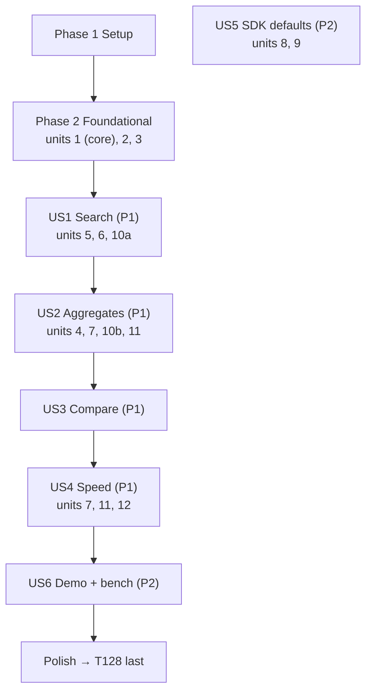

# Tasks: M3 — Search, aggregates and speed

**Input**: [spec.md](spec.md), [plan.md](plan.md), [design.md](design.md), [data-model.md](data-model.md),
[contracts/](contracts/), [research.md](research.md), [quickstart.md](quickstart.md), [starter-guide.md](starter-guide.md)

**Tests**: included. The spec requires automated checks (SC-01..11, M3-FR-16/17) and constitution VI requires the
demo, the benchmark and the crash test.

**Delta key** (as in [spec.md](spec.md)): 🟢 new in M3 · 🟠 improves or changes M1/M2 code · ⚪ existing check
reused and kept green.

**Settled by the user (2026-11-06)**, not to be reopened by a task: multipart + zstd advertised in `/info`;
attachment parts rejected per part (`attachment_not_stored`); text index without word positions (SmithDB
difference (c)); M3 on branch `003-m3-search-aggregates-speed`, cut from the 002 tip.

**Plan open questions, settled by the user (2026-11-06)** ([design §11](design.md#11-open-questions); tasks cite
them as "q<n>"):
1. q1 memory defaults (unit 12, after the heap-profile spike T082): memtable 64 MB measured as heap, flush age 2 min,
   dedup keys as 16 B fingerprints with a cap, cache 32 MB, jemalloc (`tikv-jemallocator`); all still flags. Idle =
   no uploads for one flush age, memtable flushed, dedup window drained; median physical footprint over 30 s
   (T082, T087, T089–T091).
2. q2 the four changed decisions are logged in `specs/000-tracedb-master-plan/decisions.md` at the start of the
   unit that changes each, with the next free D-ids (T003).
3. q3 `feedback.<key>` = the mean of the run's scores for that key (T019, T098, T102).
4. q4 batch b 2.0% / p95 9 s / $4.07; batch a ends now − 30 h, batch b now − 6 h; M2 checks select by batch tag
   (T024, T029, T030).
5. q5/q6 the unit 4 spike (T052) decides metadata group keys and dirty-side reuse; a missed 1 s grouped target is
   reported, never loosened (T109).
6. q7 M2 files are indexed in the background when idle (T047).
7. q8 stats line `by <key>[, <key>] | <metric>, …` (T014, T020).
8. q9 CI bench: 200k-run smoke on every PR against calibrated targets; full 2M on `main` and nightly, failing on a
   slip (T108).
9. The planted feedback check is part of `tracedb demo` (M3-FR-16; T110, T111).

**Organization**: grouped by user story in spec.md's numbering and priority order; each story phase ends at a
checkpoint that can be shown on its own. Units from plan.md "Delivery order" are the commit boundaries; some units
span phases (see the table below).

## Format: `- [ ] [ID] [P?] [Story?] <delta> Description`
- **[P]**: can run in parallel (different files, no dependency on an unfinished task)
- **[Story]**: US1–US7 from spec.md (story phases only)
- **<delta>**: 🟢 / 🟠 / ⚪ as above

## Path conventions
Crates `crates/{model,storage,ingest,query,tracedb}` (packages `tracedb-model`, `tracedb-storage`,
`tracedb-ingest`, `tracedb-query`, `tracedb`); UI in `ui/src/`; integration tests in `crates/<crate>/tests/`;
fixtures in `tests/fixtures/`; scripts in `scripts/`; CI in `.github/workflows/ci.yml` and `ci/cloud.yml`. The
catalog schema is inline SQL in `crates/storage/src/metastore.rs` (no migrations folder).

## Unit → tasks

| Unit | | Plan unit | Tasks | After it merges (check) |
|---|---|---|---|---|
| 1 | 🟠 | M2 follow-ups, correctness first | T005–T010, T113–T118 | delete a data file while serving → answers + a `/healthz` entry; flush-retry and second-start tests pass |
| 2 | 🟢 | Filter language | T011–T022 | grammar golden tests and print/parse property green with the new forms; `search` → `unsupported` until unit 6 |
| 3 | 🟠 | Scenario + cost | T023–T030 | `tracedb demo` (M2 checks) passes; scenario test checks 31 / 14.0% / 31 s / $4.12 / batch b naively |
| 4 | 🟢 | Aggregate engine (spike first) | T052–T062 | `curl /api/aggregate` → `fetch_url` 14.0% / p95 31 s and $4.12; aggregate == naive property green |
| 5 | 🟢 | Text index at flush | T031–T038 | `.fts.*` next to every new file; storage round-trip lookups; disk report includes the index |
| 6 | 🟢 | Search path | T039–T048 | `search("429 Too Many Requests")` on `/api/query` → 31 `fetch_url` with excerpts; index == scan green |
| 7 | 🟢 | Progressive + views | T063–T064, T070–T073, T076–T079 | an `estimate` then a `result` event; a vs b side by side and as offset-aligned series |
| 8 | 🟢 | Multipart upload | T092–T096 | example agent on SDK defaults shows its trace; both fixture sets replay |
| 9 | 🟢 | Feedback | T097–T103 | `create_feedback` → filter and average by it; early feedback attaches when the run arrives |
| 10 | 🟠 | UI a: search, Stats, "N new", left-row refresh | T049–T051, T065–T067, T119–T120 | find the 31 and the 14% / 31 s by clicking |
| 11 | 🟠 | UI b: charts, Compare, progressive, URL | T068–T069, T074–T075, T080–T081 | see the 02:30 spike, click it, compare a vs b, share the link |
| 12 | 🟠 | Speed + footprint (spike first) + bench | T082–T091, T104–T109 | `tracedb bench` every row PASS; CI fails on a slipped target |
| 13 | 🟠 | Demo + CI | T110–T112, T121–T122, T124–T127 | `tracedb demo` all M3 checks pass on local and cloud-style storage; quickstart verified |
| 14 | 🟠 | Code starter guide (last) | T128 | every scene linked to real lines, colour-coded |

Setup T001–T004 land with the first unit that needs them (T001 before unit 1; each dependency in T002 with the
unit that uses it; T003's four entries at the start of units 1, 5, 9 and 12). T123 runs at every checkpoint.

## Per-unit quality bar
Each unit, before its one local commit (no pushes):
1. Tests first: write the unit's tests, run them, see them fail for the right reason; then implement until green.
2. `cargo fmt --all --check`, `cargo clippy --workspace --all-targets -- -D warnings`, full `cargo test --workspace`,
   and `cd ui && npm test` (plus `npm run build` when UI files changed).
3. Fresh-eyes review of the diff (reviewer agent or BuilderAI); fix every P0–P2 before committing.
4. Docs and this file updated in the same commit (tick tasks, add *(as built: …)* notes like M2's).
5. Slow suites at story checkpoints: `cargo test --release -p tracedb --test crash --test restart --test throughput
   -- --ignored`, and `tracedb demo --seed 7`.
6. One local commit per unit, message `…(M3 unit N, Txxx–Tyyy)`; no Co-Authored-By trailer.

---

## Phase 1: Setup (shared infrastructure)

**Purpose**: branch and dependencies.

- [X] T001 ⚪ Cut branch `003-m3-search-aggregates-speed` from the 002 tip once the docs in `specs/003-m3-search-aggregates-speed/` are approved (settled 2026-11-06); confirm `cargo test --workspace` and `cd ui && npm test` are green before any change
- [X] T002 🟠 Add workspace dependencies in root `Cargo.toml`: `unicode-segmentation = "1.13"`, `zstd = "0.13"`, `httparse = "1.10"` (all already in `Cargo.lock`), `moka = { version = "0.12", features = ["sync"] }` (offline registry, M3-R15); each crate adds only what it uses, in its unit; `cargo tree -d` shows one `zstd` and one `arrow`; `tikv-jemallocator = "0.7"` (offline registry) is added by T091 in unit 12 (q1)
- [ ] T003 [P] 🟠 Decision-log entries in `specs/000-tracedb-master-plan/decisions.md` (q2), each written at the start of the unit that changes it, with the next free D-id at that time (D-023 is the last today; an in-flight M2 fix may take D-024): unit 1 second start marked multi-version (revisits D-016); unit 5 per-file text index (replaces the roadmap's "scan + bloom in v0"); unit 9 feedback by `POST /feedback` (corrects design-notes §4); unit 12 bounded `Cache` and memory defaults (revisits D-013) — unit 1: D-025 (2026-11-07, revisits D-016); unit 5: D-026 (2026-11-07, replaces the roadmap's scan + bloom); units 9, 12 still to come
- [x] T004 🟢 TOML parser for `prices.toml`: add `toml` 0.9 (in the offline registry: 0.8.23, 0.9.12, 1.1.5) to root `Cargo.toml` workspace deps and `crates/model/Cargo.toml` — unit 3 (root dep was already in the M3 setup commit; also `tempfile` as a model dev-dependency for the cost tests)

**Checkpoint**: `cargo build --workspace` succeeds; M1 and M2 suites green on the new branch.

---

## Phase 2: Foundational (blocking prerequisites)

**Purpose**: what every story's checks stand on.
- **Unit 1 correctness core** (second start → multi-version; files once per flush job + idempotent commit):
  without it the aggregate clean side (US2, US3, US4) counts runs twice. The rest of unit 1 (damaged files, seed) is
  US7 (Phase 9), shipped in the same unit-1 commit.
- **Unit 2 filter language**: `search` (US1), `exists` for `other` click-through and the stats line (US2, US3),
  `feedback.<key>` (US5).
- **Unit 3 scenario + cost**: the 31, 14.0% / 31 s, $4.12, batch b and feedback figures every story's checks and the
  demo (US6) assert.

**⚠️ CRITICAL**: no story can start until this phase is complete (units 1, 2, 3 can run in parallel).

### Unit 1 correctness core: tests (write first; they should fail)

- [X] T005 [P] 🟠 Writer test `crates/ingest/tests/writer.rs`: a second start (`post`) for a run already flushed creates a memtable state and joins the multi-version set; after a restart the flushed-ids bloom is rebuilt and the same holds (M3-R13 f, D-016 revisited) — `a_second_start_for_a_flushed_run_joins_the_multi_version_set`: live, after restart (saved dedup keys deleted so only the files say what was flushed), and a second start replayed from the WAL
- [X] T006 [P] 🟠 Flush retry test `crates/ingest/tests/flush.rs`: a lost commit reply (test hook) → the retried flush registers the segment once (same ULID), `segments` rows and stored-row counts exact (M3-FR-19) — hook `IngestConfig::test_lost_commit_replies`; the test also checks the catalog's `segments` rows directly (the old retry left 10 rows for 8 published files)
- [X] T007 [P] 🟠 Metastore test `crates/storage/tests/traits.rs`: `commit_flush` with an already-committed segment id returns `Ok` and changes nothing, on SQLite (Postgres when `TRACEDB_TEST_PG_URL` is set) — the existing partial-overlap case (`[s2, s1]`) still errors and rolls back

### Unit 1 correctness core: implementation

- [X] T008 🟠 Flushed-ids bloom in `crates/ingest/src/writer.rs` ("every flushed run id; a new start that hits it joins the multi-version set", "≈2.4 MB (1% false positives)" at 2M), added to at each flush commit and rebuilt in `crates/ingest/src/recover.rs` from every file's `run_id` column — `crates/ingest/src/flushed.rs` (new): staged bloom, 7 hashes, 1%; first stage max(2M, 2 × ids at start), a full stage adds one twice its size; ids added after the commit and before the frozen memtable is dropped; start reads every file's `run_id`/`needs_merge` columns by ranged reads (`segment::inspect`); the replay-time flushed-ids set from saved dedup keys is gone; proptest (no false negatives) + false-positive and size tests
- [X] T009 🟠 Files and ids once per flush job in `crates/ingest/src/flush.rs` and `crates/storage/src/segment.rs`: `segment::write` (ULID minting) moves out of the retry loop; the job's max seq is the commit token — `Prepared` per job in `flush.rs`: files and ids made once, puts skipped once stored, `AlreadyExists` on a retried put counts as stored; `segment.rs` unchanged (`write` already minted the id; the call moved out of the retry loop)
- [X] T010 [P] 🟠 Idempotent `commit_flush` in `crates/storage/src/metastore.rs`: "a segment id that already exists means 'already committed', and the flush returns `Ok`" (M3-R13 b) — all of the flush's segment ids registered and `flushed_seq` ≥ the job's → `Ok`, no change; some but not all → error, rolled back

### Unit 2 filter language: tests

- [X] T011 [P] 🟠 Golden cases in `tests/fixtures/filter-golden.json` (read by `crates/model/tests/filter.rs` and `ui/src/query/parse.test.ts`): ok `search("429 Too Many Requests")`, `search(outputs, "rate limit")`, `exists(metadata.prompt_version)`, `gt(feedback.correctness, 0.5)`; `and(eq(feedback_key, "correctness"), gt(feedback_score, 0.5))` → `gt(feedback.correctness, 0.5)`; the M2 `search("rate limit")` "supported from M3" case becomes ok; stats-line cases (slot `stats`) for the five examples of contracts/filter-language.md *(as built: also edge rows for each new form, the LangSmith pair in place inside a wider `and`, 31 `stats` rows incl. errors; the unknown-function message now lists `exists` and `search`)*
- [X] T012 [P] 🟠 Error rows and property in `crates/model/tests/filter.rs`: the seven contract errors byte-exact (`search()` → `7..7 search needs a string`, `search("")` → `7..9 search needs at least one word`, `search(body, "x")` → `7..11 search side is inputs, outputs or error`, `exists("x")` → `7..10 exists() needs a field path`, `gt(feedback, 1)` → `3..11 feedback needs a key: feedback.<key>`, `by name | p90(latency)` → `10..13 unknown metric "p90"; expected p50, p95 or p99`, `by a, b, c | count` → `9..10 at most 2 group keys`); extend the print/parse proptest with `Search`, `Exists`, `feedback.<key>` *(as built: all seven also asserted via `Display`; `exists(p)` checked equal to `neq(p, null)` in eval tests)*
- [X] T013 [P] 🟢 Tokenizer test `crates/model/tests/text.rs`: Unicode table (CJK, emoji, accents, punctuation: `"429, Too"` = `"429 too"`), lower case, only segments with a letter or digit, numbers and booleans as text *(as built: also `scalar_tokens` for JSON scalars)*
- [X] T014 [P] 🟢 Stats-line test `crates/model/tests/agg.rs`: parse/print of `by name | count, error_rate, p95(latency), sum(cost)` and the other examples (q8); `| top 20`; `AggSpec` JSON matches data-model §7; proptest random `AggSpec` → print → parse identical *(as built: JSON round trip in the same proptest; repeated keys/metrics rejected ("… is listed twice"))*

### Unit 2 filter language: implementation

- [X] T015 [P] 🟢 `text::tokens(&str) -> Vec<String>` in `crates/model/src/text.rs` (+ `unicode-segmentation` in `crates/model/Cargo.toml`): `split_word_bounds`, keep segments with a letter or digit, `to_lowercase`, no NFKC, no stemming (M3-R2)
- [X] T016 🟠 AST in `crates/model/src/filter/ast.rs`: `Search { text: String, words: [String], side: Any | Inputs | Outputs | Error }`, `Exists { path: Path }`, `Path` += `feedback.<key>` ("numeric: mean score of that key on the run", q3) *(as built: `Path::Feedback(key)`, kind number)*
- [X] T017 🟠 Parser in `crates/model/src/filter/parse.rs`: grammar additions of contracts/filter-language.md; `Search.words` = `text::tokens(text)` at parse, empty → the golden error; LangSmith `feedback_key`/`feedback_score` pair rewritten to `feedback.<key>`; error messages exactly as T012 *(as built: the pair is rewritten in its own `and` (several `feedback_score` conditions allowed; an `and` left with one argument collapses to it); anywhere else, or unpaired, it is an error; keys must print back as `feedback.<key>`)*
- [X] T018 🟠 Printer in `crates/model/src/filter/print.rs`: canonical; "`search("…")` keeps the text as written (escaped); `exists(p)` and `neq(p, null)` each print as written"
- [X] T019 🟠 Eval in `crates/model/src/filter/eval.rs`: `Exists` = path has a value; `feedback.<key>` read through a lookup argument (none → missing, q3); `Search` evaluation lands in T043 *(as built: `eval_with(e, row, feedback, now, stats)` takes the lookup; `eval` = no feedback; `Search` matches nothing until T043)*
- [X] T020 [P] 🟢 `crates/model/src/agg.rs`: `AggSpec { query, group_by: [GroupKey] (0..=2), metrics: [Metric] (≥ 1), view: table | series | dist, top: 1..=50 (default 10), bucket: auto | "1m" | "5m" | "15m" | "1h" | "6h" | "1d", compare: none | { filter } | { shift } }`; `GroupKey` = `name | run_type | model | status | tag | metadata.<k> | feedback_key`; `Metric` = `count | error_rate | p50|p95|p99(latency) | sum(input_tokens|output_tokens|total_tokens) | sum(cost) | avg(feedback.<key>)`; `parse_stats` / `print_stats` *(as built: `AggSpec` holds the aggregate fields only (no `query`: `QuerySpec` lives in the query crate, unit 4 pairs them); JSON uses the text forms (`"p95(latency)"`, `{"filter": "<text>"}`); the stats line may omit `by … |` (totals only, contract EBNF updated); `parse_stats` leaves view/bucket/compare at defaults)*
- [X] T021 [P] 🟠 UI mirror in `ui/src/query/ast.ts`, `ui/src/query/parse.ts`, `ui/src/query/print.ts` and new `ui/src/query/stats.ts`: same forms and stats line; `ui/src/query/parse.test.ts` runs the new golden cases (UTF-16 offsets converted to bytes, as M2) *(as built: UI keeps keys/metrics as canonical strings; the empty-search check uses "has a letter or digit", equal to `text::tokens(…)` being empty)*
- [X] T022 🟠 Query layer in `crates/query/src/pushdown.rs` and `crates/query/src/lib.rs`: `Exists` on a built-in column pushes down as `IS NOT NULL`, else no pushdown (superset rule); `Search` and `feedback.*` never pushed; a query with `search` returns `400 unsupported` until T046 *(as built: the 400 is raised in `crates/tracedb/src/routes/api.rs` `filter_slot` (every slot, query and tail) rather than `query/src/lib.rs`, whose only change is a `Path::Feedback` arm in `columns`; `feedback.<key>` is also `400 unsupported` until T102 so it never answers silently without the index; merge-on-read property gained `exists` cases)*

### Unit 3 scenario + cost: tests

- [x] T023 [P] 🟠 Scenario test, batch a, `crates/tracedb/tests/scenario.rs` (naive counts over generated data, M3-R11): `fetch_url` runs 300; errored 42 = 31 × 429 + 11 × `ReadTimeout` → 14.0%; quiet failures 23 = 17 + 6; phrase `429 Too Many Requests` in `outputs.body` and `error` of the 31 only; `status_code = 429` on the 31 (19 v7, 12 v6); latencies "258 ok 0.2–4 s (never late); 11 timeouts 30.000 s; 22 of the 429s 31.000 s (ranks 270–291); 9 at 35–95 s → p95 rank 285 = 31 s"; models gpt-4o-mini 800 runs → $0.84, gpt-4o 200 → $3.00, claude-haiku 100 reporting `total_cost` $0.0028 → $0.28, local-llama 12 → no price; batch cost $4.12, "12 runs had no price"; 2 feedback items `correctness = 0` on two failing roots, one before its run; M2 counts (14, 23, v6 928 / v7 912, v7 ∧ 429 = 19) unchanged — naive checks over the generated items for seeds 7/8/42, plus the same runs through `langsmith_map` + `merge` + `cost::of`
- [x] T024 🟠 Scenario test, batch b and timing, `crates/tracedb/tests/scenario.rs`: `batch=2026-11-06-b` has 200 roots, 300 `fetch_url`, 6 errors all timeouts (2.0%), zero 429s, p95 9 s, cost $4.07, no phrase, no `prompt_version` (q4); batch a ends at now − 30 h, batch b at now − 6 h; background error text `HTTPError: 503 Service Unavailable`; no run starts in the future; same seed → identical data
- [x] T025 [P] 🟢 Cost tests `crates/model/tests/cost.rs`: source order "reported → tokens × price → no price; no rollup to parent runs"; reported = "usage `total_cost`, or `input_cost + output_cost`, or run `total_cost`"; lookup "exact model name, then aliases; no prefix matching"; unknown model → "no price", never 0; "integer picodollars (10⁻¹² USD) per token: `input × 10⁶`"; display "half-up to cents (`$4.12`)"; `<data>/prices.toml` replaces entries by name; a parse error names the line — `cost::of` returns `Option<Cost>`: `None` for every non-llm run, reported cost included (a chain's `usage_metadata` repeats its children's, so counting it would count twice; design §4.6's pseudocode took reported cost from any run); an llm run without usage, or with token counts too large to price, is "no price"

### Unit 3 scenario + cost: implementation

- [x] T026 🟢 `crates/model/src/prices.toml` (embedded; `version = 1`; `[models."gpt-4o-mini"] input = 0.15, output = 0.60, aliases = ["gpt-4o-mini-2024-07-18"]`, `gpt-4o` 2.50 / 10.00, `claude-haiku` 0.80 / 4.00, USD per 1M tokens) and `crates/model/src/cost.rs`: `Prices::embedded()`, `Prices::merge_user(path)`, `cost::of(run, prices) -> Reported(pico) | Computed(pico) | NoPrice`, `cents_half_up` — also `cost::display` (`$4.12`) and `cost::reported_pico`; prices round to integer picodollars per token
- [x] T027 🟠 `reported_cost` in `crates/model/src/derive.rs` next to the token counts, and new core column `reported_cost_pico` ("i64, null … in picodollars; derived at apply time like the token counts. Null in M2 files: derived at read from `outputs_usage` / `metadata`") in `crates/storage/src/segment.rs`; computed cost is never stored — deviation: `Run.reported_cost_pico` derived in `derive.rs`; the stored `segment.rs` column is not added in unit 3 (storage was owned by unit 1 in parallel). Reads from files rebuild runs through `merge` + `derive`, so the value is right for M2 and M3 files alike; add the column when a scan needs it pushed down. Run-level `total_cost` is read from `extra.other.total_cost`, where unknown top-level LangSmith fields land
- [x] T028 🟠 `--prices PATH` on `tracedb serve` in `crates/tracedb/src/main.rs` and `crates/tracedb/src/lib.rs` (`ServeConfig`): reads `<data>/prices.toml` (or `--prices`) at start; invalid → start fails naming the line (design §8) — `ServeConfig.prices`, `AppState.prices`; `--prices` must exist, `<data>/prices.toml` only if present; tests in `crates/tracedb/tests/prices.rs`
- [x] T029 🟠 Re-plant in `crates/tracedb/src/scenario.rs` per M3-R11: fixed `fetch_url` assignment, `ReadTimeout` steps, planted latencies, `ls_model_name` models with token counts, claude-haiku `total_cost`, batch b, end times now − 30 h / now − 6 h, 503 background text; feedback items generated as data (sent in T111) — `generate(seed, now_us, memtable)` now takes "now"; batch b's p95 comes from 14 ok `fetch_url` at exactly 9 s (ranks 281–294); batch b's 6 timeouts sit under ok roots; `Scenario.feedback` (`POST /feedback` bodies, `before_run` on the first)
- [x] T030 🟠 M2 checks select by batch tag instead of "last 12 h" in `crates/tracedb/src/demo.rs`; `crates/tracedb/tests/demo.rs` stays green — no time scope at all (fields/values too); `bench_m2` scenario lists widened from 12 h to 48 h

**Checkpoint**: Phase 2 tests pass; M1 and M2 suites green; `tracedb demo --seed 7 --checks m2` passes on the re-planted scenario.

---

## Phase 3: User Story 1 — Search the text inside inputs and outputs (Priority: P1) 🎯 MVP part 1

**Goal**: words and phrases in inputs, outputs and errors, combined with any M2 condition, with highlighting, from
the panel, text form, API and CLI.

**Independent test**: on the scenario data, `"429 Too Many Requests"` in the search box → exactly 31 runs, all
`fetch_url`, each highlighted (spec Story 1).

### Tests for User Story 1 (unit 5: text index at flush)

- [x] T031 [P] [US1] 🟢 Sidecar test `crates/storage/tests/fts.rs`: write rows → dictionary columns `term` string, `field` u8 ("0 = `inputs`, 1 = `outputs`, 2 = `error`"), `df` u32, `post_off` u64, `post_len` u32, sorted by `(term, field)`; postings "~64 KB chunks; a list never straddles a chunk unless it's larger", "block = 128 row numbers: first value varint, deltas bit-packed at the block's max width"; lookup returns exactly the rows holding every word per side; reads = footer + one dictionary page + one postings range (counting `ObjectStore`); keys not indexed — unit 5 (as listed; reads are footer (one 64 KB suffix read) + one `get_ranges` for the matching dictionary pages (one page per column, ~1.3 KB) + one postings range per word; block = first value varint, then a 1-byte bit width, then gaps (`delta − 1`) packed low bits first; words over 64 bytes indexed by their first 64 (superset); also a property test of the postings codec and a payload-row alignment test through `segment::write`)
- [x] T032 [P] [US1] 🟠 Catalog migration test `crates/storage/tests/traits.rs`: an M2 catalog goes "schema_version 1 → 2, applied in place on start" with `fts_path TEXT`, `fts_bytes BIGINT` and the `feedback` table + `feedback_run` / `feedback_key` indexes; SQLite, and Postgres when set — unit 5 (Postgres half runs when `TRACEDB_TEST_PG_URL` is set (not run here: no local Postgres); a new catalog goes through the same 1 → 2 step; also `set_fts`)
- [x] T033 [P] [US1] 🟠 Flush test `crates/ingest/tests/flush.rs`: every new segment has `seg-<ulid>.fts.dict.parquet` and `seg-<ulid>.fts.post` beside its core and payload files, `fts_path` / `fts_bytes` set in the same commit; a sidecar put without a commit is an orphan deleted on start — unit 5 (plus a lookup on the flushed files that finds exactly the one run with a word)
- [x] T034 [P] [US1] 🟠 Crash harness `crates/tracedb/tests/crash.rs`: new kill point `after_fts_put` via `TRACEDB_TEST_CRASH_AT`; 10/10 rounds, 0 missing, 0 duplicated; orphan sidecars removed on restart — unit 5 (replaces one random-kill round, so 4 random + 6 crash points; the `after_fts_put` round checks on local storage that the crashed flush's four files are gone after restart)

### Implementation for User Story 1 (unit 5)

- [x] T035 [US1] 🟢 `TextIndex` trait and impl in `crates/storage/src/fts.rs`: `write(rows) -> Sidecar`, `lookup(seg, terms, field) -> RowSet`; dictionary Parquet with "~4 KB data pages, page index on: each page's min/max `term` is a term zone", zstd; postings as data-model §2.2; "Row numbers are payload rows (`payload_row` in the core file). No positions (settled, reason (c))"; range reads only — unit 5 (`fts_path` is the stem `…/seg-<id>.fts`; files are `<stem>.dict.parquet` and `<stem>.post`. The sidecar is built inside `segment::write` from its sorted rows, so payload rows line up by construction. Pages are 256 rows in every column (`ZONE_ROWS`, ~2.5–4 KB of terms) so a zone is one page per column; dictionary encoding off; `lookup` with no words is an error)
- [x] T036 [P] [US1] 🟠 Catalog v2 in `crates/storage/src/metastore.rs`: the SQL of data-model §3 verbatim (both `ALTER TABLE segments ADD COLUMN …` and the whole `feedback` table, so unit 9 needs no v3); `SegmentMeta.fts_path`, `fts_bytes`; `set_fts(seg, path, bytes)` one segment per transaction — unit 5 (new and M2 catalogs both take the 1 → 2 step in one transaction; `fts_bytes` is NULL when `fts_path` is)
- [x] T037 [US1] 🟠 Flusher in `crates/ingest/src/flush.rs`: tokenize per data-model §2.3 ("every string and scalar leaf" of `inputs`/`outputs`; `error` "the whole text") in payload-row order; put `fts.dict.parquet` + `fts.post` after core and payload; kill point `after_fts_put`; `fts_path` in the same commit; orphan rule in `crates/ingest/src/recover.rs` covers `.fts.*` — unit 5 (tokenizing is done by `storage::fts::build` (called from `segment::write`), not in the flusher; `.fts.post` and `*.tmp-` names added to the orphan rule; a missing sidecar isn't damage (search falls back to scan, unit 6))
- [x] T038 [P] [US1] 🟠 Disk report in `crates/tracedb/tests/bench_m2.rs`: files and index (`fts_bytes`) reported separately as % of raw JSON (M3-FR-13) — unit 5 (index bytes summed from the `.fts.*` files on disk, which equal `fts_bytes`)

### Tests for User Story 1 (unit 6: search path)

- [ ] T039 [P] [US1] 🟢 Search property test `crates/query/tests/search.rs`: random runs and text, late updates that replace outputs, random flush points, some files without a sidecar → `query(search ∧ Q)` == a naive phrase check over fully merged runs, in `filter`, `trace_filter` and `tree_filter`, and under `not`/`or`; replaced text stops matching; M2 files (no sidecar) give the same rows plus `not_indexed`
- [ ] T040 [P] [US1] 🟠 Phrase and excerpt cases in `crates/model/tests/text.rs`: consecutive words within one leaf; split across leaves → no match; side restriction; excerpt "±80 characters around the first match, cut on character boundaries"; a 1 MB value gives a short excerpt; a non-English word is found
- [ ] T041 [P] [US1] 🟠 API tests `crates/tracedb/tests/query_api.rs`: `search(…)` no longer `400 unsupported`; `match: {path, excerpt, start, end}` only with a search and only on page rows, `start`/`end` "character offsets in `excerpt`"; `stats` adds `index_files, scan_files, candidates, payload_rows, cache_hits`; `not_indexed{files}`; search + tag + any-run-in-trace condition together (Story 1 scenario 1); late-update phrase found with merged text (scenario 2)
- [ ] T042 [P] [US1] 🟢 Backfill test `crates/ingest/tests/backfill.rs`: an M2 folder (no sidecars) gets one sidecar per idle period; search results identical before and after; a crash mid-backfill leaves an orphan deleted on start

### Implementation for User Story 1 (unit 6)

- [ ] T043 [US1] 🟠 `text::phrase_in(leaves, words, side)` and `text::excerpt` in `crates/model/src/text.rs`; `Search` in `crates/model/src/filter/eval.rs` on the merged run's leaves, "`Search` last within an `and`"
- [ ] T044 [US1] 🟠 Memtable text under the pin in `crates/query/src/scan.rs`: `pin` also copies `inputs`/`outputs`/`error` text of memtable runs in scope, only when the query has a search
- [ ] T045 [US1] 🟢 `crates/query/src/search.rs`: per file with `fts_path`, ∩ of `TextIndex::lookup` per word (skip a word with df > 50% of the file's rows); files without one → all rows + `not_indexed`; core row ↔ `payload_row` → run ids; + memtable candidates; `collect` every version, eval the rest then the phrase; D-021 windows in page order; index only for a top-level `search` (or in a top-level `and`); `tree_filter: search` → candidate traces
- [ ] T046 [US1] 🟠 Wire search in `crates/query/src/lib.rs` and `crates/tracedb/src/routes/api.rs`: remove T022's `unsupported`; excerpts for the page's runs only (late materialization); new `stats` fields and warnings; `/healthz` adds `unindexed_segments` in `crates/ingest/src/lib.rs`
- [ ] T047 [US1] 🟢 Backfill in `crates/ingest/src/backfill.rs` (q7, settled: background, when idle): when no flush has run for a flush age, take one segment without `fts_path`, read its payload, write a new sidecar object, `set_fts` in one catalog update
- [ ] T048 [P] [US1] 🟠 `tracedb query --search TEXT` in `crates/tracedb/src/cli_query.rs` (adds `search("TEXT")` to the filter, contracts/cli.md); test in `crates/tracedb/tests/cli_query.rs`

### Tests for User Story 1 (unit 10: UI search)

- [ ] T049 [P] [US1] 🟠 UI tests `ui/src/query/Panel.test.tsx`: typing in the search box adds a `search("…")` chip in "This run"; chip ⇄ text round trip; `q=` survives a URL round trip; Samples rows render the excerpt with `start..end` marked

### Implementation for User Story 1 (unit 10)

- [ ] T050 [US1] 🟢 `ui/src/query/SearchBox.tsx` wired into `ui/src/query/Panel.tsx`, `ui/src/query/chips.ts` and `ui/src/query/url.ts` (`q` "is the search box text; it becomes a `search("…")` chip in the `filter` slot")
- [ ] T051 [US1] 🟠 Excerpts in `ui/src/views/Samples.tsx` and `ui/src/views/Table.tsx`; `match` and new `stats` types in `ui/src/api.ts`

**Checkpoint (demo)**: quickstart step 5 (first `curl`: 31, all `fetch_url`, with `match`), step 6 search and crash
lines, step 2.1 in the browser; crash harness 10/10.

---

## Phase 4: User Story 2 — Add it up: aggregates, charts and the stats view (Priority: P1) 🎯 MVP part 2

**Goal**: group any query, read counts, error rate, percentiles, tokens, cost and feedback as a table and as charts,
and click through to the runs.

**Independent test**: group batch a by name with error rate, p95 and cost → `fetch_url` 14% and 31 s, batch $4.12,
in the table and the charts (spec Story 2).

### Spike (first task of unit 4)

- [ ] T052 [US2] 🟢 2M-row projected group-by spike in throwaway `crates/query/examples/agg_spike.rs` over the M2 bench data: time the clean side (projected DataFusion scan of `run_id`, `needs_merge`, `name`, `status`, latency, tokens) and per-row `attrs` JSON parse for `metadata.<k>` keys, and the dirty side (~10% late finishers, with and without D-023's merged states). **Decision output** in research M3-R4 and design §11 q5/q6 (`specs/003-m3-search-aggregates-speed/research.md`, `design.md`): per-row parse vs a promoted `group_keys` column for the 16 most frequent keys per file; reuse D-023 states or not; measured ms per side

### Tests for User Story 2 (unit 4)

- [ ] T053 [P] [US2] 🟢 Aggregate property test `crates/query/tests/aggregate.rs`: random runs, late updates, second starts, random flush points → `aggregate(spec)` == naive accumulation over fully merged runs for random specs: built-in keys, `tag` (unnested, `overlap: true`, totals separate), `metadata.<k>` with `(none)`, top N + `(other)` with `cut: true`, every metric; no run counted twice; each group's `where` selects exactly its runs through `query`
- [ ] T054 [P] [US2] 🟢 Accumulator tests (`#[cfg(test)]`) in `crates/query/src/aggregate/accum.rs`: nearest rank ⌈p·N⌉ over finished runs; "Past a cap (default 4M values per query), fall back to the Distribution histogram … and mark the figure `approximate`"; `error_rate` = errored / finished with `running` separate; "Missing values are `null`, never 0"; `cost_pico` null when no run had a price; merging accumulators is associative
- [ ] T055 [P] [US2] 🟢 API tests `crates/tracedb/tests/aggregate_api.rs`: `POST /api/aggregate` with `group_by` + `metrics` or a `stats` line; response `query_id, partial, totals, groups[{key, cells, where}], cut, overlap, stats{files_scanned, clean_rows, dirty_runs, ms}`; percentiles in ms; `400 bad_filter` with `slot`; `400 bad_stats` (unknown metric/key, > 2 keys, bad `bucket`/`shift`, `start`/`end`); scenario: `fetch_url` runs 300, `error_rate` 0.14, `p95` 31000, totals `cost_pico` 4120000000000, `no_price_runs` 12; a damaged file → `skipped_files`, not 500

### Implementation for User Story 2 (unit 4)

- [ ] T056 [US2] 🟠 `exact` flag in `crates/query/src/pushdown.rs`: `compile` also says whether the pushed `Expr` IS the filter
- [ ] T057 [US2] 🟢 `crates/query/src/aggregate/accum.rs`: per group "`runs, finished, errors, running, sum_in, sum_out, sum_total, cost_pico, no_price_runs, latencies: Vec<i64>, hist: [u32; BINS], feedback: {key → (sum, n)}`", pure (no I/O); `finish` → `Cells` with `n_latency`, `estimated`, `approximate`
- [ ] T058 [US2] 🟢 Clean side `crates/query/src/aggregate/clean.rs`: projected DataFusion scan of `needs_merge = false` rows with the filter pushed; skip `run_id ∈ mvset ∪ memtable ids`; trace-id set check; exact → accumulate, else decode needed columns + `eval`; keys per T052; cost via `model::cost` from `reported_cost_pico` (derived for M2 files)
- [ ] T059 [US2] 🟢 Dirty side `crates/query/src/aggregate/dirty.rs`: `collect_pinned(scope, ids = dirty)` → merge → `eval` → trace check → accumulate; D-023 merged-state reuse if T052 says so
- [ ] T060 [US2] 🟢 Engine `crates/query/src/aggregate/mod.rs`, exported from `crates/query/src/lib.rs`: `aggregate(AggSpec) -> AggResult` over one pin; trace/tree conditions → trace-id set (list code); `finish(acc, top)` → top N by count + `(other)` + `(none)`, totals separately; `where` per group per design §4.5 (`(none)` → `eq(metadata.k, null)`, `other` → `and(exists(metadata.k), not(in(metadata.k, [top…])))`, tag → `has(tags, "v")`)
- [ ] T061 [US2] 🟢 `POST /api/aggregate` in new `crates/tracedb/src/routes/aggregate.rs`, routed in `crates/tracedb/src/routes/mod.rs`: `AggSpec` JSON or `stats` line, always exact, errors per contracts/http-api.md
- [ ] T062 [P] [US2] 🟠 `tracedb query --group-by KEY[,KEY] --metrics LIST --top N` in `crates/tracedb/src/cli_query.rs`: aggregate table as in contracts/cli.md (`(other)`, `total` row, "12 runs had no price"); test in `crates/tracedb/tests/cli_query.rs`

### Tests for User Story 2 (unit 7: series and distribution)

- [ ] T063 [P] [US2] 🟢 Series test `crates/query/tests/series.rs`: `bucket: auto` ≈ 100 buckets on a round step, given `"5m"`; empty buckets `null`; `(other)` series; distribution "fixed log-latency bins (10 ms → 1 h, 8 per doubling)"; bucket `where` = `and(gte(start_time, t0), lt(start_time, t1))`, bin `where` = `and(gte(latency, a), lt(latency, b))`; scenario error rate spikes in the 02:30 bucket; series == naive bucketing

### Implementation for User Story 2 (unit 7)

- [ ] T064 [US2] 🟢 `crates/query/src/aggregate/series.rs`: `series { step_ms, offset, buckets: [{ t | offset_ms, per_group: [Cells | null], where }] }` and `dist { bins_ms, per_group, where_per_bin }` added for `view: series | dist`

### Tests for User Story 2 (unit 10: Stats tab)

- [ ] T065 [P] [US2] 🟢 UI tests `ui/src/stats/StatsPanel.test.tsx`: group-by (≤ 2) and metric pickers → `AggSpec`; stats-line *Text* view round trip; table shows `n` next to pNN and "12 runs had no price"; clicking a cell opens Samples with the group's `where` chips (error-rate cell also `eq(status, "error")`); view tabs keep the query; `view=`, `by=`, `m=`, `top=` round trip

### Implementation for User Story 2 (unit 10)

- [ ] T066 [US2] 🟢 `ui/src/stats/StatsPanel.tsx` and `ui/src/stats/StatsTable.tsx` (unit 10): pickers, *Text* stats line, table with click-through; aggregate client in `ui/src/api.ts`
- [ ] T067 [US2] 🟠 View tabs and URL in `ui/src/views/Runs.tsx`, `ui/src/query/url.ts` and `ui/src/route.ts` (unit 10): `QueryState.view` widens to `samples | table | stats | series | dist`; `by`, `m`, `top`, `bucket` params (M3-FR-08)

### Tests for User Story 2 (unit 11: charts)

- [ ] T068 [P] [US2] 🟢 UI tests `ui/src/stats/charts.test.tsx`: Time series draws ≤ 10 series + other with `null` gaps; Distribution bars; clicking a point or bar opens Samples with its `where`; `bucket=` round trip

### Implementation for User Story 2 (unit 11)

- [ ] T069 [US2] 🟢 `ui/src/stats/TimeSeries.tsx` and `ui/src/stats/Distribution.tsx` (unit 11): hand-drawn SVG, no chart library (M3-R14), M2 palette, hover tooltip, click-through; Stats view shows table and chart together (M3-FR-05)

**Checkpoint (demo)**: quickstart step 5 (`/api/aggregate`), steps 2.2–2.3 in the browser. **US1 + US2 is the M3 MVP**
("is this a pattern, and how bad is it?").

---

## Phase 5: User Story 3 — Compare batches (Priority: P1)

**Goal**: two sets of runs (two batches or a shifted window) side by side and overlaid.

**Independent test**: with batch b loaded, compare a and b by name → both figures per tool, and two series on one
time chart (spec Story 3).

### Tests for User Story 3 (unit 7)

- [ ] T070 [P] [US3] 🟢 Comparison test `crates/query/tests/compare.rs`: `compare.filter` and `compare.shift: "1d"` over one pin == two naive aggregates; cells pair by group key, "a group missing on one side is `null` there", not 0; offset axis "time since each side's first run (batches) or since the window start (shift)", so a 12 h and a 10 h batch line up from 0; scenario `fetch_url` 14.0% → 2.0%, 31 s → 9 s
- [ ] T071 [P] [US3] 🟠 Compare cases in `crates/tracedb/tests/aggregate_api.rs`: `compare.side_b` has the same shape (no nested compare); `shift` series carry `offset: true`

### Implementation for User Story 3 (unit 7)

- [ ] T072 [US3] 🟢 Comparison in `crates/query/src/aggregate/mod.rs`: both specs concurrently over one pin; `compare: { side_b: AggResult }`; offset-aligned series
- [ ] T073 [P] [US3] 🟠 `tracedb query --compare EXPR | --shift 1d` in `crates/tracedb/src/cli_query.rs` (`│ b:` columns, contracts/cli.md); test in `crates/tracedb/tests/cli_query.rs`

### Tests for User Story 3 (unit 11)

- [ ] T074 [P] [US3] 🟢 UI tests `ui/src/stats/Compare.test.tsx`: compare picker → `cmp=` / `shift=` in the URL and back; b columns per group; an empty side shown empty, not zero; two series on one offset axis

### Implementation for User Story 3 (unit 11)

- [ ] T075 [US3] 🟢 `ui/src/stats/Compare.tsx`, b columns in `ui/src/stats/StatsTable.tsx`, overlay in `ui/src/stats/TimeSeries.tsx`, `cmp` / `shift` in `ui/src/query/url.ts`

**Checkpoint (demo)**: quickstart steps 2.4–2.5 and the `--compare` command of step 5.

---

## Phase 6: User Story 4 — Interactive speed at 2M runs (Priority: P1)

**Goal**: every query at the master's targets, a first estimate for slow grouped queries, light footprint.

**Independent test**: 2M runs, `tracedb bench` → every SC-03 row PASS (spec Story 4). The bench command itself is
US6 (T104–T107); within unit 12 build it right after the spike T082 so the fixes below are measured by it.

### Tests for User Story 4 (unit 7: progressive answers)

- [ ] T076 [P] [US4] 🟢 Progressive test `crates/query/tests/progressive.rs`: an estimate over a 100% sample == exact; counts and sums scaled by `rows_total / rows_read`, rates and percentiles not; every estimated cell `estimated: true`; below ~200k rows in scope only `result`; a cancelled token stops the clean and dirty loops (rows read stop growing)
- [ ] T077 [P] [US4] 🟢 SSE test `crates/tracedb/tests/aggregate_stream.rs`: `GET /api/aggregate/stream?q=` → `estimate` (`partial: true`, `sampled_pct`) then `result`; `error {code, message}` is last; every event carries `query_id`; closing the connection cancels the computation

### Implementation for User Story 4 (unit 7)

- [ ] T078 [US4] 🟢 `crates/query/src/progressive.rs`: files picked evenly across the time range by `SegmentMeta.row_count` until ~10% of rows or 300 ms, plus the same share of dirty runs; `field_stats` first counts for a plain group-by on a path with stats; the full run reuses the sample's work; cancel token checked per batch
- [ ] T079 [US4] 🟢 `GET /api/aggregate/stream` in `crates/tracedb/src/routes/aggregate.rs` (SSE framing as `routes/tail.rs`): `AggMsg = Estimate(AggResult with partial = true) | Result(AggResult) | Error{code, message}`; the stream owns the cancel token

### Tests for User Story 4 (unit 11: progressive display)

- [ ] T080 [P] [US4] 🟠 Progressive cases in `ui/src/stats/StatsPanel.test.tsx`: "estimate · N% sampled" marked partial, replaced by the result; events for an old `query_id` ignored; changing the query closes the old stream

### Implementation for User Story 4 (unit 11)

- [ ] T081 [US4] 🟠 Progressive display in `ui/src/stats/StatsPanel.tsx` and an `EventSource` client in `ui/src/api.ts`

### Spike (first task of unit 12)

- [ ] T082 [US4] 🟢 Heap-profile spike: seed 3,000 traces, restart, go idle (q1 definition), profile the ~170 MB of unexplained live heap (macOS `heap`/`vmmap`, or `dhat` if in the offline registry) in a scratch build. **Decision output** in research M3-R12 (`specs/003-m3-search-aggregates-speed/research.md`): what the heap holds, how T090/T091 should measure the memtable as heap, and the projected idle footprint with the q1 defaults; anything still over 200 MB is reported to the user, not hidden by a looser target

### Tests for User Story 4 (unit 12)

- [ ] T083 [P] [US4] 🟢 Run lookup test `crates/query/tests/run_lookup.rs`: `Query::run` reads payload only from files that hold a version of the run (files opened counted), counts children without loading the whole trace, same results as M2 (M3-FR-12)
- [ ] T084 [P] [US4] 🟢 Cache test `crates/storage/tests/cache.rs`: LRU by bytes stays ≤ capacity; a second read hits; keys cover footers, page indexes, dictionary pages, postings chunks, payload ranges
- [ ] T085 [P] [US4] 🟢 Late-materialization test `crates/query/tests/late_mat.rs`: a list or search page reads payload rows only for its shown runs (`payload_rows` = shown rows); running the same query twice is at least as fast with an identical result (Story 4 scenario 3)
- [ ] T086 [P] [US4] 🟠 Throughput test `crates/tracedb/tests/throughput.rs` (`#[ignore]`): ≥ 20,000 events/s from 8 clients while a query loop runs and flushes index text (SC-04; was 5,000 without queries)
- [ ] T087 [P] [US4] 🟢 Idle-memory test `crates/tracedb/tests/idle_memory.rs` (`#[ignore]`): idle = "no uploads for one flush age, memtable flushed, dedup window drained; median physical footprint over 30 s" ≤ 200 MB (SC-05)

### Implementation for User Story 4 (unit 12)

- [ ] T088 [US4] 🟠 Run lookup: `collect` returns each version's `segment_id` and `scan::payload` reads only those files in `crates/query/src/scan.rs`; `Query::run` counts children from the trace's header rows in `crates/query/src/lib.rs`
- [ ] T089 [US4] 🟢 Bounded `Cache` in new `crates/storage/src/cache.rs` (moka, `get_or_load(key, size, f)`, weighed by bytes, default 32 MB, counted in idle memory), used by `storage::fts` lookups and payload range reads; `--cache` in `crates/tracedb/src/main.rs`; `cache_bytes` in `/healthz`; DataFusion keeps its metadata cache
- [ ] T090 [US4] 🟠 Memory defaults (q1, settled): memtable limit measured as heap, default 64 MB (`--memtable 64MB`); flush age 2 min (`--flush-age 2m`); dedup keys as 16 B fingerprints with a cap, in `crates/ingest/src/writer.rs`, `crates/ingest/src/dedup.rs` and `crates/tracedb/src/main.rs`; every value stays a flag (M2 values still settable); update contracts/cli.md wording "if approved" → defaults
- [ ] T091 [US4] 🟠 jemalloc (q1, settled): `tikv-jemallocator = "0.7"` as `#[global_allocator]` in `crates/tracedb/src/main.rs`, dependency in root `Cargo.toml` and `crates/tracedb/Cargo.toml`, so freed memory returns to the OS

**Checkpoint**: T076–T087 green; at the US6 checkpoint `tracedb bench` shows every SC-03 row PASS (no loosened
targets; if grouped p50 still misses 1 s, it is reported and M4's compaction trigger is proposed earlier, q6).

---

## Phase 7: User Story 5 — Current SDK defaults work unchanged (Priority: P2)

**Goal**: the pinned SDK on defaults (multipart, zstd, feedback) with only the endpoint changed.

**Independent test**: the example agent on defaults → full trace, nothing unsupported; a feedback score is filterable
(spec Story 5).

### Tests for User Story 5 (unit 8: multipart)

- [X] T092 [US5] 🟠 Recorder `scripts/record-sdk-fixtures.py`: `/info` modes `json | multipart | multipart-zstd`; record multipart bodies (base64 + headers) in `requests.jsonl`; the agent also sends `create_feedback` before and after its run is uploaded and one `update_feedback`; record SDK 0.14.17 into `tests/fixtures/sdk-0.14.17-multipart/` (zstd off) and `tests/fixtures/sdk-0.14.17-multipart-zstd/` (zstd on); keep `tests/fixtures/sdk-0.14.17/` (multipart off) and `tests/fixtures/sdk-0.8.18/` (both pins) — *done 2026-11-06: recorded from `/tmp/ls-rec-014` (langsmith 0.14.17 + zstandard); the JSON-mode `sdk-0.14.17/` was not re-recorded, so it has no feedback calls; each fixture dir also gets `expected-feedback.json` for unit 9*
- [X] T093 [US5] 🟠 Contract test `crates/tracedb/tests/contract.rs`: replay every fixture dir (0.8.18 batch, 0.14.17 JSON, multipart zstd off and on); zero items unsupported; merged runs equal `expected-runs.json`; feedback rows stored (SC-08) — *done 2026-11-06 except the feedback check: `/feedback` requests are skipped in replay until T101 (they answer `501` today); all four dirs replay with zero rejections*
- [X] T094 [P] [US5] 🟢 Multipart test `crates/tracedb/tests/multipart.rs`: proptest round trip, random items → JSON batch vs multipart (random part order, zstd on/off) → identical stored runs; `attachment.{id}.{name}` → `rejected [{part, reason: "attachment_not_stored"}]`, rest stored (settled); unknown part → `unknown_part`; `400 bad_multipart`; decoded > 50 MB → `413`; busy → `429` + `Retry-After`; never `404` or `415`; `/info` flags — *done 2026-11-06; also: several zstd frames in 7-byte chunks, Content-Length mismatch, unknown encoding → `400`; `feedback.{id}` → `feedback_not_stored` until T101*

### Implementation for User Story 5 (unit 8)

- [X] T095 [US5] 🟢 Streaming parser `crates/tracedb/src/routes/multipart.rs` (+ `zstd`, `httparse` in `crates/tracedb/Cargo.toml`): zstd stream decode, "cap: 50 MB decoded"; part headers via `httparse`, `Content-Length` or boundary scan; attachments drained, not buffered; assemble per `(op, id)` with fields `inputs, outputs, events, extra, error, serialized`; same `incoming()` mapping and `submit` as `/runs/batch`; `202 {accepted, rejected}`; `feedback.{id}` parts go to the feedback store once T101 lands — *done 2026-11-06; deviation: items use `Source::LsBatch` (a new `LsMultipart` would change the WAL encoding in crates/ingest); `feedback.{id}` parts are drained and rejected `feedback_not_stored` until T101*
- [X] T096 [US5] 🟠 `/info` in `crates/tracedb/src/routes/ingest.rs`: `batch_ingest_config.use_multipart_endpoint: true`, `instance_flags: {zstd_compression_enabled: true}`, `version` stays `""` (settled); route `POST /runs/multipart` in `crates/tracedb/src/routes/mod.rs` — *done 2026-11-06; the route stays in `crates/tracedb/src/lib.rs` (where every route lives), `routes/mod.rs` only declares the module*

### Tests for User Story 5 (unit 9: feedback)

- [ ] T097 [P] [US5] 🟢 Feedback API test `crates/tracedb/tests/feedback.rs`: `POST /feedback` → `200` with `created_at`/`modified_at` after the commit; `400 bad_feedback` (missing `run_id`/`key`, non-number `score`); `id` generated if missing; same `id` retried replaces the row; `PATCH /feedback/{id}` → `200` or `404`; unknown fields kept in `raw`; feedback before its run attaches when it arrives (Story 5 scenario 4); `GET /api/feedback?run_id=`, `?orphaned=true` (`count`), `?keys=true`; restart reloads the index; `/healthz.orphan_feedback`
- [ ] T098 [P] [US5] 🟢 Feedback query test `crates/query/tests/feedback.rs`: `gt(feedback.correctness, 0.5)` uses the mean of the run's scores for the key (q3); the LangSmith pair form gives the same rows; `avg(feedback.<key>)` and `by feedback_key` == naive; `/api/fields` lists `feedback.<key>` as `number` with counts
- [ ] T099 [P] [US5] 🟠 UI test `ui/src/fields/FieldBrowser.test.tsx`: a `feedback.` section with keys, counts and "(N orphaned)"; clicking a key adds an `exists(feedback.<key>)` chip

### Implementation for User Story 5 (unit 9)

- [ ] T100 [US5] 🟢 Feedback store `crates/ingest/src/feedback.rs` + metastore methods in `crates/storage/src/metastore.rs`: `Feedback { id, run_id, trace_id?, key, score?: f64, value?: JSON, comment?, correction?: JSON, feedback_source?: {type, metadata}, session_id?, created_at, modified_at, extra }`; `FeedbackIndex: HashMap<RunId, SmallVec<(key, score)>>` "loaded at start from the catalog; ~40 B per item"; writes `INSERT … ON CONFLICT (id) DO UPDATE`, one transaction per request; read-only `Feedback` trait exported for query
- [ ] T101 [US5] 🟠 Routes: `POST /feedback` (replaces the `501`) and `PATCH /feedback/{id}` in `crates/tracedb/src/routes/ingest.rs`; `GET /api/feedback` in `crates/tracedb/src/routes/api.rs`; multipart `feedback.{id}` parts from T095 go to the same store
- [ ] T102 [US5] 🟠 Query side: `feedback.<key>` evaluated after the merge through the `Feedback` trait in `crates/query/src/lib.rs`; `avg(feedback.<key>)` and `feedback_key` group key in `crates/query/src/aggregate/accum.rs`; `feedback.<key>` paths in `crates/query/src/fields.rs`; orphans in scope
- [ ] T103 [US5] 🟠 UI feedback in `ui/src/fields/FieldBrowser.tsx`: `feedback.` section from `GET /api/feedback?keys=true`, orphan count, click → chip (constitution IV; quickstart 2.6)

**Checkpoint (demo)**: quickstart step 3 (`/info` flags, example agent on defaults, `create_feedback` → filter,
orphan count 1).

---

## Phase 8: User Story 6 — The whole scenario and the speed table in one command each (Priority: P2)

**Goal**: `tracedb demo` checks steps 4–9 and 13; `tracedb bench` prints P50/P99 against the targets and gates CI.

**Independent test**: on an empty folder the demo passes every check; the bench prints P50/P99 per query type
(spec Story 6).

### Tests for User Story 6 (unit 12: bench)

- [ ] T104 [P] [US6] 🟢 Bench gate test `crates/tracedb/tests/bench_cli.rs` (small `--runs`): `TRACEDB_BENCH_SLEEP_MS=200` (test-only hook) with `--check` exits 1 naming the query, the target and the measured value; a p99 over 5× its p50 fails whatever the budget; `--json` writes `{runs, raw_bytes, r, rows: [{query, p50_ms, p99_ms, target_ms, budget_ms, pass}], disk, idle_mb}`; setup error → exit 2; `r` clamped to [1, 3]

### Implementation for User Story 6 (unit 12)

- [ ] T105 [US6] 🟢 `tracedb bench [--runs 2000000] [--data DIR] [--json FILE] [--check] [--smoke]` in new `crates/tracedb/src/bench.rs` + `crates/tracedb/src/main.rs` (moves `bench_m2::run()`): load via `/runs/batch` from 8 clients with a query loop alongside; after warmup, n ≥ 100 each with varied values and windows: trace (101), run + payload (101), filtered list (100), text search, grouped, first estimate, suggestions; rows against SC-03 (trace, run ≤ 50 ms; list ≤ 100 ms; text ≤ 500 ms; grouped ≤ 1 s; first estimate ≤ 1 s; suggestions ≤ 200 ms), load ≥ 20,000 events/s, disk (files + index) ≤ 50% of raw, idle ≤ 200 MB; no target loosened
- [ ] T106 [US6] 🟢 Calibration in `crates/tracedb/src/bench.rs`: "decode the shipped reference Parquet file 20× + a sort → r = runner / reference, clamped [1, 3]", `budget = target × r`; new fixture `tests/fixtures/bench-reference.parquet` with its reference time measured on the reference laptop
- [ ] T107 [US6] 🟠 `crates/tracedb/tests/bench_m2.rs` becomes a thin `#[ignore]` wrapper over `tracedb::bench`
- [ ] T108 [US6] 🟠 CI bench in `.github/workflows/ci.yml` (q9, settled): `tracedb bench --smoke --check` (200k runs, calibrated budgets) on every PR; full `--runs 2000000 --check` on push to `main` and a nightly `schedule`, failing on a slipped target, table in `$GITHUB_STEP_SUMMARY` (`on.push.branches` already `[main]`, fixed in M2 c4630a3)
- [ ] T109 [US6] 🟢 Full run on the reference laptop: `tracedb bench --runs 2000000 --json /tmp/bench.json --check`, every row PASS; record the table in research M3-R12 (`specs/003-m3-search-aggregates-speed/research.md`); a missed row is reported, never loosened (q6)

### Tests for User Story 6 (unit 13: demo)

- [ ] T110 [P] [US6] 🟠 Demo test `crates/tracedb/tests/demo.rs`: `tracedb demo --seed 7` on an empty folder exits 0 with the M2 rows plus `31 text hits, all fetch_url`, `fetch_url error rate / p95 (batch a) 14.0% / 31 s`, `batch a cost $4.12 (12 no price)`, `batch a vs b 14.0% → 2.0%, 31 s → 9 s, side by side + overlaid`, `feedback filter and average 2 runs · avg 0.00 (1 sent before its run)` (planted feedback check, M3-FR-16); a changed planted number → exit 1 naming expected vs actual; `--checks m2` runs only the M2 rows

### Implementation for User Story 6 (unit 13)

- [ ] T111 [US6] 🟠 M3 checks in `crates/tracedb/src/demo.rs` (`--checks m2,m3`, default both) through the real API (`/api/query` search, `/api/aggregate` with the stats line, compare and `view: series`, `/api/feedback`), each with timings; `crates/tracedb/src/scenario.rs` sends the two feedback items via `POST /feedback`, one before its run
- [ ] T112 [US6] ⚪ The local CI job in `.github/workflows/ci.yml` keeps running `tracedb demo --seed 7`, now with the M3 rows

**Checkpoint (demo)**: quickstart steps 1 and 4; CI demo and bench smoke green.

---

## Phase 9: User Story 7 — M2 follow-ups (Priority: P3)

**Goal**: the M2 rough edges closed. T113–T118 are unit 1 and ship in its commit with T005–T010 (before Phase 3);
T119–T120 ship with unit 10; T121–T122 with unit 13.

**Independent test**: each acceptance scenario of spec Story 7.

### Tests for User Story 7 (unit 1)

- [X] T113 [P] [US7] 🟠 Start-time damage test `crates/ingest/tests/recover.rs`: start checks every file's footer, not only those with `needs_merge` rows; a damaged or missing file → `damaged_segments: [{id, reason, since}]`, `corrupt_segments` alias lists the ids — `start_checks_every_files_footer_and_reports_damage`: a truncated core file of a file with no `needs_merge` rows → `unreadable`, a deleted one → `missing`
- [X] T114 [P] [US7] 🟢 Live damage test `crates/tracedb/tests/damaged.rs`: delete a core file while serving → `POST /api/query`, trace, run and fields answer from the other files with a `skipped_files{ids}` warning (not `500 query_failed`); `/healthz` → `ok: false` and the file with `reason: "missing"` (Story 7 scenario 1) — trace, run and field responses name skipped files in a top-level `skipped_files: [ids]` (a run's `warnings` are its own run warnings); `/api/query` uses `warnings: [{kind: skipped_files, ids}]`; a trace/run only in the lost file → 404 with `skipped_files`; second test: a core file damaged past its footer is found by reading files alone
- [X] T115 [P] [US7] 🟠 Seed test `crates/tracedb/tests/seed.rs`: max `start_time` ≤ now; seeding the same seed twice into one folder gives no `identity_conflict`; the demo generator stays deterministic (M3-FR-22) — the demo/scenario generator is unit 3's (`scenario.rs`, unchanged here); seed determinism is for a given seed and time

### Implementation for User Story 7 (unit 1)

- [X] T116 [US7] 🟠 Damaged-file map in `crates/ingest/src/lib.rs` (the fixed `corrupt: Vec<String>` becomes a shared, growing map "segment id → reason, found at start or while serving") with the footer check of every file in `crates/ingest/src/recover.rs`; `/healthz` adds `damaged_segments`, keeps `corrupt_segments` as an alias — `Ingest::{damaged, is_damaged, mark_damaged}`; a file marked while serving also leaves the pinned `Version` (and its field stats); start-time reads are ranged (footer + two columns), not whole files; only "missing" or a decoding error counts as damage, a network error doesn't
- [X] T117 [US7] 🟠 Skip and retry in `crates/query/src/scan.rs` (`read_core`): on a scan error probe the files, mark the culprit in the damaged map, retry without it, add `Warning::SkippedFiles{ids}`; `crates/tracedb/src/routes/api.rs` returns the warning instead of `500` — `read_core`, `read_ids` and payload reads: on an error, footers are probed; if they look fine and the error is a decoding one, each file is read alone; `skipped_files` lists damaged files in the request's scope (`Query::skipped`)
- [X] T118 [P] [US7] 🟠 Seed in `crates/tracedb/src/seed.rs` and `crates/tracedb/src/main.rs`: "base = now − n·7 s − the longest duration"; the base time is mixed into the id stream (M3-R13 d, e) — `seed::generate_before`; shapes come from the seed alone, ids from a second stream mixed with the base time

### Tests for User Story 7 (unit 10)

- [ ] T119 [P] [US7] 🟠 UI tests `ui/src/views/Live.test.tsx` and `ui/src/views/Table.test.tsx`: arrivals while scrolled down with live on are held behind an "N new" pill; a run that stops matching a live Table view shows its new column values (M3-FR-20)

### Implementation for User Story 7 (unit 10)

- [ ] T120 [US7] 🟠 `ui/src/views/Samples.tsx` and `ui/src/live.ts`: buffer arrivals while scrolled behind an "N new" pill; `leave()` refetches the shown columns

### Tests for User Story 7 (unit 13)

- [ ] T121 [P] [US7] 🟠 Cloud storage tests in `crates/storage/tests/traits.rs` and `crates/storage/tests/fts.rs`: sidecar range reads, catalog v2 and the `feedback` table on S3 (MinIO) and Postgres when `TRACEDB_TEST_S3_URL` / `TRACEDB_TEST_PG_URL` are set

### Implementation for User Story 7 (unit 13)

- [ ] T122 [US7] 🟠 Cloud job's first real run in `.github/workflows/ci.yml` (`cloud`): (duplicate `run:` key already fixed in M2 c4630a3; keep the Ruby duplicate-key YAML check in the job); M3 demo on S3 + Postgres diffed against local; crash harness incl. `after_fts_put`; `ci/cloud.yml` reused as is (Story 7 scenario 6, SC-07)

**Checkpoint**: quickstart step 8 (and step 7 in CI): a deleted file is skipped and reported; no future starts;
re-seeding is clean; cloud job green with the local demo table.

---

## Phase 10: Polish and cross-cutting

- [ ] T123 [P] ⚪ Keep green at every checkpoint: M1 and M2 suites, M2 demo rows, crash harness 10/10, `cargo test --release -p tracedb --test crash --test restart --test throughput -- --ignored`, merge-on-read property `crates/query/tests/merge_on_read.rs` (SC-11)
- [ ] T124 [P] 🟠 No-outbound check `scripts/no-outbound.sh`: add a search, an aggregate, a multipart upload and the M3 `tracedb demo` in local mode; prices read locally only (constitution III)
- [ ] T125 [P] 🟠 `README.md`: search, Stats / Time series / Distribution / Compare, feedback, multipart on by default, `tracedb bench`, `--prices` / `--cache`; M3 limits (no compaction, no word positions, attachments rejected, no feedback writes from the UI)
- [ ] T126 🟠 Run [quickstart.md](quickstart.md) end to end (step 2 timed for SC-09) and record results under "Last verified" in `specs/003-m3-search-aggregates-speed/quickstart.md`
- [ ] T127 🟠 Update the M3 row and STATE/NEXT in `specs/000-tracedb-master-plan/roadmap.md`; log decisions changed during the build in `specs/000-tracedb-master-plan/decisions.md`
- [ ] T128 🟠 **Code starter guide, last** (M3-FR-21, unit 14): rewrite `specs/003-m3-search-aggregates-speed/starter-guide.md` from pre-code to a guide for reading the built code, as M2's: reading order of the real files; scenes 1–11 (multipart, flush + index, search + verify, clean/dirty split, estimate, click-through, feedback, compare, demo + bench) mapped to real functions with links and line numbers; colour key 🟢 `#c8e6c9` / 🟠 `#ffe0b2` / ⚪ `#eeeeee` on every node; short vertical diagrams; rough edges found while writing it

---

## Dependencies and execution order

- **Phase 2 → everything**: aggregates need T008–T010 (no double count) and T020 (`exists`, stats line); every
  check needs the T029 scenario.
- **US1**: unit 5 (T031–T038) can start right after Setup in parallel with Phase 2; unit 6 needs units 2 and 5.
- **US2**: unit 4 needs units 1 and 2 (its demo numbers need unit 3); T052 spike first. UI T065–T069 can start
  against a stub `/api/aggregate`.
- **US3** and **US4's progressive part** need unit 4 (unit 7 needs 4).
- **US4 unit 12** needs units 4–7; order inside unit 12: T082 spike → T104–T107 (bench) → T083–T091 → T108–T109.
- **US5**: unit 8 can start after Setup; unit 9 needs unit 2 (filter) and unit 4 (metric); T093 needs T092.
- **US6 demo (unit 13)** needs everything before it. **US7**: T113–T118 with unit 1; T119–T120 with unit 10;
  T121–T122 with unit 13.
- **Within each phase**: tests first (they should fail), then implementation, then the checkpoint.
- **T128 is last**: it reads the merged code; M3 isn't done until it lands.

## Parallel opportunities
- **Setup**: T003 alongside T002/T004.
- **Phase 2**: units 1, 2, 3 side by side; tests T005–T007, T011–T014, T023, T025 together; T015, T020, T021 alongside
  T016–T019; T010 alongside T008/T009.
- **US1**: unit 5 tests T031–T034 together, T036 and T038 alongside T035/T037; unit 6 tests T039–T042 together; T048
  alongside T045/T046; UI T049–T051 alongside the Rust search work.
- **US2**: T053–T055 together; T062 alongside T061; T063 and UI tests T065/T068 alongside the engine.
- **US3**: T070, T071, T074 together; T073 alongside T072.
- **US4**: T076, T077, T080 together; T083–T087 together.
- **US5**: unit 8 runs beside units 4–7; T094, T097–T099 together.
- **US6**: T104 alongside T110 (different units, different files).
- **US7**: T113–T115 together; T118 alongside T116/T117; T119 and T121 any time in their units.
- **Polish**: T123–T125 together.

## Implementation strategy
1. **Foundation** (Phases 1–2): units 1 (core + US7 T113–T118), 2 and 3 in parallel; unit 5 can start too. M1 and
   M2 suites stay green; the M2 demo passes on the re-planted scenario.
2. **MVP = US1 + US2**: the 31 hits and `fetch_url` 14% / 31 s / $4.12, by API and by clicking. Stop and demo
   ("is this a pattern, and how bad is it?").
3. **US3**: batch a vs b; then **US4**: estimate first, then the unit 12 spike, bench and speed fixes.
4. **US5** (units 8–9) any time after Phase 2 (feedback after unit 4).
5. **US6** demo checks and CI gate, with US7's cloud job, then **Polish**; the **code starter guide** (T128) closes
   M3.
