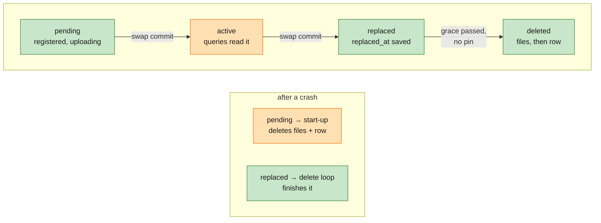
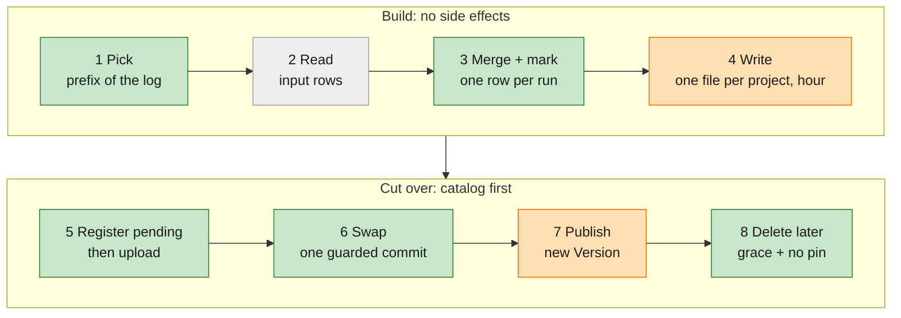

# Implementation Plan: M4 — Compaction (core)

**Branch**: `004-m4-compaction` | **Date**: 2026-11-08 | **Spec**: [spec.md](spec.md) | **Tasks**: [tasks.md](tasks.md)

One file on purpose: the design, the key decisions, the data and API changes, and the work units are all here.

**Delta key** (same as the [spec](spec.md)):

| Marker | Fill | Meaning |
|---|---|---|
| 🟢 **New** | green | first built in M4 |
| 🟠 **Improved** | orange | exists from M1–M3; M4 extends or changes it |
| ⚪ **Existing** | grey | built in M1–M3; M4 uses it as is |

**Status** marks where each part stands: ✅ built (U1–U3, `f9dee0a`), ⏳ next (U4–U6).

## Done when

```sh
cargo test --workspace                      # incl. the compaction property test
smithling demo --seed 7 --compact           # every check passes, same counts as without --compact; files after ≤ 10% of before
SMITHLING_TEST_CRASH_AT=<point> …           # crash harness: 10/10 rounds per compaction point, zero loss
```

Plus the cloud CI job (MinIO + Postgres) running the demo with `--compact`.

## Delta at a glance

| | Part | Before M4 | What M4 changes | Status |
|---|---|---|---|---|
| 🟢 | Compaction job (`ingest/src/compact.rs`) | none | pick, merge, write, swap, publish | ✅ |
| 🟢 | Background timer | none | one thread in `serve`, a job every 60 s, clean shutdown, survives a panicking job | ⏳ T017 |
| 🟢 | Delete loop | files never deleted | grace period + in-process pins | ⏳ T018 |
| 🟠 | Catalog (`segments`) | `active` rows only, added by flush | + `pending`, `replaced`, `replaced_at`; guarded swap | ✅ |
| 🟠 | Start-up (`ingest/src/recover.rs`) | orphan files deleted under the WAL check | + removes `pending` outputs, keeps `replaced` rows for the delete loop | ✅ |
| 🟠 | Writer lock | `<data_dir>/LOCK` | + `<storage>/LOCK` when the store is a local path | ⏳ T017 |
| 🟠 | `Version` (writer's file list) | files only added | files removed by a swap; an era token per swap | ✅ |
| 🟠 | Multi-version set, query kept rows | only grow | shrink after a swap once no query holds the old files | ✅ |
| 🟠 | Crash harness | flush and WAL points | + `compact_after_put`, `compact_after_commit`, `compact_mid_delete` | ⏳ T019 |
| 🟠 | `/healthz`, UI, demo, CI | file counts; demo and cloud job without compaction | + compaction status; `demo --compact`; cloud job runs it | ⏳ T021–T023 |
| ⚪ | WAL, flush, query language, search, aggregates, UI views | M1–M3 | unchanged; same answers | — |

## How compaction works

### A file's life in the catalog

The catalog is the record of which files are live. Every file row moves one way through four states; each arrow is
one catalog write, and the box under it says who cleans up after a crash at that point.



*Green: new in M4. Orange: exists, M4 changes it. Grey: unchanged.* Flush files go straight to `active` (as in
M1–M3); compaction outputs go through `pending`.

### One job



| Step | What | Reuses |
|---|---|---|
| 1. Pick | From the pinned `Version` plus damaged files: tier-0 files in log order (`min_seq`, not the wall clock), grouped by flush. Take whole flushes while every file's newest window has closed (end + settle ≤ now). Stop at a damaged file or the job's size cap; both keep it a prefix | `Version`, `SegmentMeta` |
| 2. Read | Every core + payload row of the inputs | `segment` readers |
| 3. Merge + mark | Group by `run_id`; `merge_versions` in seq order (a prefix keeps seq ranges disjoint). Mark `needs_merge` if the run is in an existing L1 file of the same window, or its first version here is an update | `model::merge_versions`, `segment::run_ids` |
| 4. Write | Group by (merged run's project, window); `segment::write` with `tier = 1`, names `cmp-<ulid>.*`, split at 256 MB | `segment::write` |
| 5. Register, upload | Rows as `pending` first, then `put_new` each file (write-once). Crash point `compact_after_put` | flush's upload loop |
| 6. Swap | One transaction: inputs `active → replaced` (all of them, else roll back), outputs `pending → active`, field stats in. Retried with the same outputs; all outputs already `active` means a lost reply, so done. Crash point `compact_after_commit` | `Metastore` |
| 7. Publish | `with_compaction` on the *current* `Version` (keeps files flushed meanwhile) with a new era token; rebuild the multi-version set; reset query kept rows | `Mem` lock |
| 8. Delete | Delete loop (below). Crash point `compact_mid_delete` | in-process pins (R-7) |

### A query across a swap

A query clones the `Arc<Version>` when it starts and reads only those files. Every `Version` between two swaps
shares one era token (`Arc<()>`); the compactor keeps a copy of the token each swap ended. Count 1 means no query
holds any file set from before that swap.

```mermaid
sequenceDiagram
    participant Q as Query
    participant W as Writer
    participant C as Catalog
    Q->>W: pin Version v7 (era 3)
    W->>C: swap: inputs replaced, outputs active
    W->>W: publish v8 (era 4); keep era 3 token
    Note over Q: still reads v7's files
    W->>W: delete loop: era 3 held, skip
    Q-->>W: query ends, v7 dropped
    W->>W: era 3 free and grace passed: delete files, then rows
```

## Key decisions (ADR)

Short records of the choices that shape the design. Running decisions (scope, defaults, deferrals) are in the
[spec's decision table](spec.md#decisions-so-far) and the master [decision log](../000-smithling-master-plan/decisions.md).

| ADR | Decision | Why | Rejected | Consequence |
|---|---|---|---|---|
| **A1** One level, a prefix of the log | A job takes whole flushes in log order up to the first one with an open window; outputs are L1, never rewritten | Merge order stays simple: inputs' seq ranges never overlap what's left (C8) | per-project picks; multi-tier (K6) | Late updates to compacted runs stay in small files, merged at query time (spec option a) |
| **A2** The catalog is the record | File states `pending → active → replaced → deleted` in `segments`; outputs registered before any byte is stored | Start-up and other processes tell our files from strangers' by the catalog alone | tracking uploads in memory; naming conventions only | An unregistered `cmp-*` file means a wrong `--metastore`: start-up refuses to delete it |
| **A3** One guarded swap | One transaction moves every input to `replaced` and every output to `active`; rolls back if any input isn't `active`; retries are idempotent | A concurrent flush is kept; a changed input can't be lost; correct at Postgres's default isolation | swap without the input check; two commits | The swap is the only moment answers switch files |
| **A4** Inputs from the catalog and files only | The job never reads the writer's memory to decide what to merge (`needs_merge` rows tell it) | Compaction can move to its own process later (M5 B3) | using the multi-version set | The job reads L1 run ids for windows with late rows |
| **A5** Delete after grace and no pin | Delete when `replaced_at + grace ≤ now` *and* the swap's era token is free; files first, then the row | Pins cover this process; the grace period (in the catalog) covers readers elsewhere (M5) | pins only; grace only | Disk holds replaced files for 24 h by default |
| **A6** Restart trusts the catalog | Start-up deletes `pending` outputs and keeps `replaced` rows; a job whose swap gave up is also settled by a restart | Every crash point ends in a state the catalog describes; one cleanup path | settling in the running server (backlog K12) | After a catalog outage compaction may be stuck until restart, shown in `/healthz`; answers stay right |
| **A7** One writer per store | `LOCK` file under the data folder and a local store; a lease in the catalog in M5 (M5-FR-10) | A second writer would compact and clean up under the first | none now (assumption) | Across machines, one writer per store is assumed until M5 |
| **A8** In the writer, one job at a time | A timer thread in `serve`; skipped while writes slow down; job size capped | One binary (constitution I); bounded memory | a separate service now (M5 B3) | Compaction shares the writer's CPU; measured later (SC-07, K11) |

## Failure handling

| Moment | What happens | Status |
|---|---|---|
| Upload fails | Files already put are removed; the job fails; next tick retries | ✅ |
| Swap refused (an input changed) | Outputs and their `pending` rows removed; next tick picks again | ✅ |
| Swap fails 5 times (catalog down) | Job fails with `last_error` in `/healthz`. Outputs stay `pending` (never read); if the commit did land, later jobs are refused. A restart settles both (A6; K12 for doing it without one) | ✅ |
| Crash after upload, before the swap | Start-up deletes the `pending` outputs, files then rows; inputs still active | ✅ |
| Crash after the swap, before publish | Start-up loads the catalog (outputs active, inputs replaced) and rebuilds from files | ✅ |
| Crash mid-delete | `replaced` row still there; the loop deletes again (deletes are idempotent) | ⏳ T018 |
| Shutdown during a job | Stop flag checked between jobs; shutdown waits a bounded time for the running one; dropping it is safe (rows above) | ⏳ T017 |
| A job panics | Caught per job, recorded as `last_error`, the thread keeps ticking; if the thread ever exits, `/healthz` shows compaction `stopped` | ⏳ T017 |
| Second writer on the same store | Refused by `LOCK` (data folder; local store path in T017) | ✅ / ⏳ T017 |

Every step logs at `info` with ids (job picked, swap committed or refused, each delete); start-up
logs the effective compaction settings.

## What changes outside the job

| | Part | Change | Why |
|---|---|---|---|
| 🟠 | Multi-version set (writer memory) | After a swap, once every era up to it is free (in order): merged runs leave the set unless a memtable or a `needs_merge` row still has them | C2: merged copies of late-updated runs go |
| 🟠 | Query kept rows (`VersionRows`, D-023/D-029) | Reset when the `Version` lost files or a kept run left the set; rebuilt on the next request | They assumed files are only added |
| 🟠 | Start-up | `replaced` rows count as registered; `pending` outputs deleted; any other unknown file stays under the WAL-coverage check | Clean restart at every crash point; a wrong `--metastore` can't delete data |
| ⚪ | Flush | Nothing; a test shows every multi-version run has a marked row once flushed (M4-FR-04) | The newer version is always marked |
| ⚪ | Single-run payload lookup (`query/src/scan.rs`) | Nothing now; answers match after compaction (T015). Reading from the source file is deferred (K11) | Speed is measured later (D-033) |

## Data and API changes

- 🟠 Catalog: `segments.replaced_at BIGINT NULL`; `state` gains `'pending'` and `'replaced'`; `tier = 1` for
  compacted files. One `schema_version` step, same SQL on SQLite and Postgres. ✅
- 🟢 `smithling serve … [--compact on|off] [--compact-window 1h] [--settle 15m] [--compact-target 256MB] [--grace 24h]`. ⏳
- 🟢 `POST /api/compact` (`{force: true}` treats every window as closed; tests and demo). ⏳
- 🟠 `/healthz`: `files: {l0, l1, replaced}`, `compaction: {last_run_at, last_error, backlog_files, running}`. UI: a
  small storage line read from `/healthz`, as the feedback orphan count already is (`ui/src/api.ts:250`). ⏳
- 🟠 `smithling demo --compact` forces compaction between steps and prints files before/after. ⏳

## Constitution Check

| Principle | Check | Pre | Post |
|---|---|---|---|
| I. One binary | compaction is a background job in `serve`; no new service | PASS | PASS |
| II. SmithDB | SmithDB compacts (time-tiered); M4 uses one level, recorded as (c) staged, revisit with K6 | PASS | PASS |
| III. Local, private | no outbound; files under the configured storage | PASS | PASS |
| IV. UI first | compaction status in the UI with `/healthz` | PASS | PASS |
| V. Cloud-portable | write-once outputs, catalog migration on both backends, cloud CI job runs it | PASS | PASS |
| VI. Measured | demo with `--compact`, property test, crash points, file count in the demo | PASS | PASS |

## Work units

Each unit: tests first, then code; `fmt`, `clippy -D warnings`, `cargo test --workspace`; one local commit with a
CHANGELOG line. Details in [tasks.md](tasks.md).

| Unit | What | Done when | Status |
|---|---|---|---|
| U1 | Catalog: `replaced_at`, guarded swap, start-up handling of `pending` and `replaced` | metastore tests on SQLite: swap refused if an input changed; restart after a crash before/after the swap is clean | ✅ |
| U2 | Job core: pick, read, merge, mark, write | unit tests for the prefix rule and windows; property test: merged rows equal merging all versions | ✅ |
| U3 | Run a job: upload, swap, publish, multi-version rebuild, kept-rows reset | every query type returns the same before and after a forced compaction, incl. late updates after it | ✅ |
| U4 | Timer, shutdown, store lock, delete loop with pins, crash points | crash harness 10/10 per point; a query across 100 swaps returns the same answer | ⏳ |
| U5 | `/api/compact`, `/healthz`, UI line, `demo --compact` with file counts | done-check commands above pass locally | ⏳ |
| U6 | Cloud CI job with compaction; close M4 docs | CI config updated; docs say what was built | ⏳ |
