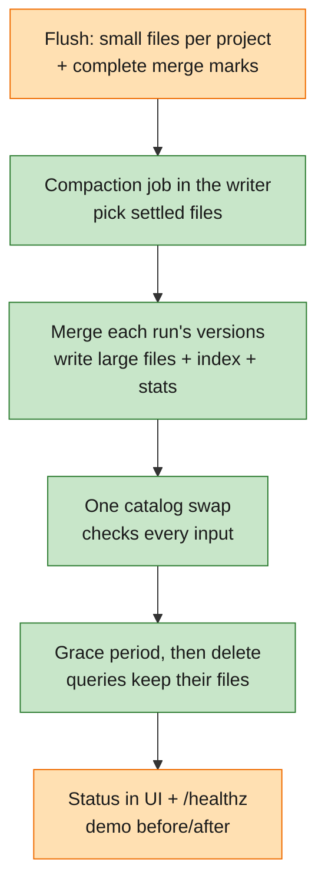

# Feature Specification: M4 — Compaction (core)

**Feature Branch**: `004-m4-compaction`

**Created**: 2026-11-08

**Status**: Draft. Spec only; implementation not started.

**Input**: User description: "now we're coming back to Milestone 4, and let's do the spec. Similar to this milestone
[M5], I would actually like you to identify the core functionality instead of breaking down everything. Let's scope
in what we need to do, and we don't need to put in perfection. If there's something we don't, we can improve later.
Let's put them into the backlog."

**Master**: [specs/000-smithling-master-plan](../000-smithling-master-plan/spec.md) (requirements of record) ·
[roadmap](../000-smithling-master-plan/roadmap.md) (progress). This folder holds the M4 details of record.

**Builds on**: M3 — Search, aggregates and speed (built, passed locally). Everything M1–M3 promise stays true.
**Needed by**: [M5](../005-m5-disaggregated-trace-db/spec.md#requirements-m5-places-on-m4), which sets four
requirements on M4 compaction (M4-REQ-1–4, delivered here as M4-FR-03, -05, -07, -10).

**Delta key**:

| Marker | Fill | Meaning |
|---|---|---|
| 🟢 **New** | green | first built in M4 |
| 🟠 **Improved** | orange | exists from M1–M3; M4 extends or changes it |
| ⚪ **Existing** | grey | built in M1–M3; M4 uses it as is |

**Delivers from master**: the compaction part of the roadmap's M4 ("compaction tiers + atomic swap", "late `end`
correct before and after compaction"); the M3 idle-memory waiver's fix (D3-2, [D-028](../000-smithling-master-plan/decisions.md#d-028)).
The roadmap's other M4 features move to the [backlog](#backlog-with-triggers).

---

## Goal and why

Keep Smithling fast and small as data piles up, by merging the many small files each flush writes into a few large
ones, with every run's versions merged into one row.

- **The file count is the first wall.** Every flush writes one file per project and nothing ever merges them.
  Trace ids are random, so nearly every file's trace-id range covers any trace, and a lookup checks almost every
  file's metadata and filters before skipping it. Single-run reads measured 17.9 ms at 96 files and 26.1 ms at 244
  (M3-R12): about 0.055 ms per file, so a straight line through the two points misses 50 ms at about 680 files
  (around 1.4M runs at ~500 files per million). A rough estimate from two points
  ([M5 research §4](../005-m5-disaggregated-trace-db/research.md#4-upper-bound-of-one-machine-and-shard-keys)).
- **Late updates cost memory and time forever.** A run whose update lands in a later file is merged at every query
  and kept merged in memory (≈2.3 KB each). That's why M3's idle memory was over target and waived until M4 (D-028).
- **Multi-day traces scatter.** A trace updated over days is spread across hundreds of files.
- **M5 depends on it.** Read workers over shared storage need compaction built against the catalog and files only.

## Decisions so far

| Date | Decision | Why |
|---|---|---|
| 2026-11-08 | **M4 is compaction only.** Threads, export, feedback writes from the UI and find-what-stands-out move to the [backlog](#backlog-with-triggers) | Owner's call: core first, improve later. Compaction blocks M5 and fixes the measured walls; the features don't block anything |
| 2026-11-08 | **One level of compaction in M4.** Small files of a project are merged into larger files once they've settled; a multi-tier scheme (design-notes §7's T0 → T1 → T2) is backlog | Smallest scheme that bounds the file count and merges late updates |
| 2026-11-08 | **Compaction runs inside the writer process** as a background job, built so it can later become its own service (M5 backlog B3) | One process stays the default (constitution I); M5's requirements keep the later split cheap |
| 2026-11-08 | **The deferred M3 performance work stays deferred through M4**: the full 2M-run bench (D3-1) and the idle-memory target (D3-2). M4 measures idle memory and reports it (SC-04), it doesn't gate on it | Owner's call: correctness and the end-to-end path first (D-033) |
| 2026-11-08 | **Outputs are cut by time window only**, not also by trace-id range. A trace may still span a few files, but files are bigger and fewer, so it spans far fewer. *Considered*: cutting each window's output into trace-id ranges (non-overlapping, like RocksDB levels), so a trace lookup reaches one file per window by range; rejected for M4 as more complex than needed | Owner's call: keep it simple |
| 2026-11-08 | **Compaction takes a prefix of the log** (the oldest flushes, across all projects), not files chosen per project. Found while planning: merging is in log order and needs a run's versions to cover non-overlapping position ranges; a per-project pick can merge versions on both sides of one it skipped (C8) | Correctness, with no extra machinery: everything left out is newer than everything merged |
| 2026-11-08 | **One level: flushed files (L0) → compacted files (L1); L1 files are not rewritten in M4.** No further levels | Owner's call; bounds the file count with the least machinery |
| 2026-11-08 | **Very late updates to already-compacted runs stay in their own small files and are merged at query time** (option a). *Considered*: (b) rewrite an L1 file once its late rows pass a share; (c) multi-tier compaction (K6). Revisit if late files per window grow (K6, K10) | Owner's call; late updates to compacted runs are rare, so query-time merging stays cheap |
| 2026-11-08 | **A run goes into the window of its own start time** (what file bounds use today, `storage/src/segment.rs:173`). *Considered*: the trace's start (the root's time, the first segment of every version's `dotted_order`), which would keep a multi-day trace in one window; rejected for M4 as the less simple choice | Owner's call: start simple, document the alternative |
| 2026-11-08 | **A job whose swap gives up is settled by a restart**, not in the running server. Until then its outputs stay `pending` (unread) and, if the commit did land, later jobs are refused; `/healthz` shows `last_error`. In-process settling is backlog K12 | Owner's call: rare (the catalog must fail 5 times in a row), answers stay right, and start-up already cleans it up |
| 2026-11-08 | **Good defaults now, tuned later**: window 1 h of run start time, settle age 15 min, target file size 256 MB, grace period 24 h, all configurable. The final values come from benchmarking, tuning and real usage (backlog K10) | Owner's call: don't block on numbers we can't measure yet |

## How compaction works (as decided)

One level, one rule:

1. **L0** files are what flushes write today: small, one per project per flush. Their rows can belong to several
   windows (late updates carry old start times).
2. A **window** is one hour of run start time (default). A window **closes** once its end plus the settle age has passed.
3. A **compaction job** starts from a catalog snapshot and takes **the oldest flushes, in log order, up to the first
   flush that still has a row in an open window**, across all projects (a prefix of the log). It merges each run's
   versions found in those files into one row, groups the rows by project and window, and writes **one L1 file per
   project per window** (split at the target size), sorted by `(trace_id, dotted_order)` as flushes are.
   Taking a prefix keeps the merge rule exact: anything not compacted is newer than everything compacted
   (problem C8).
4. **One catalog commit** replaces the job's L0 inputs with its L1 outputs; files flushed meanwhile are untouched.
5. **L1 files are never rewritten.** A late update to a window that already has an L1 lands in a new L0 file and,
   when that file is compacted, in a small extra L1 file for the old window; the run is merged at query time (marked
   as multi-version) until a later improvement folds it (K6).

Result: per project, about one L1 file per hour of data, plus a few small late files, plus at most a window's worth of
L0 files waiting.

## What breaks today (the north star)

| # | Today | Breaks when | What a user sees | In M4? |
|---|---|---|---|---|
| C1 | Every flush adds files; none are ever merged | ~680 files (~1.4M runs) | Single-run and trace reads miss 50 ms, then get slower without end | **Yes** |
| C2 | Runs with versions in several files are merged at every query and kept merged in memory | Late updates accumulate (≈2.3 KB each) | Idle memory over 200 MB at 0.5M runs, ~0.6 GB projected at 2M (D3-2); slow first grouped query after restart (9 s cold for 203k such runs) | **Yes** |
| C3 | Per-file state in memory, ~0.1 MB per file (M3-R12): the file's catalog entry, its field statistics (D-020), subtract-stats for multi-version runs (D-023), DataFusion's cached file metadata | Thousands of files | Memory grows with the file count | **Yes** (follows from C1) |
| C4 | A trace updated over days spans many files | Multi-day traces | Opening the trace gets slower each day | **Yes** (follows from C1, C2) |
| C5 | Single-run payloads are found by picking files whose sequence range covers the version (`query/src/scan.rs:920`) | A merged file spans a wide sequence range | Lookups open more files after compaction | **Yes**: must not get slower |
| C6 | A file may miss marking a run whose other versions are elsewhere, if it joined while the flush ran (`query/src/fields.rs:92`); the writer covers it from memory | Anything reads files without the writer's memory: compaction, M5 readers | Runs counted twice, or merged wrongly | **Yes** (M5 KD-4) |
| C8 | Versions of a run are merged in log order and must cover non-overlapping position ranges (`model/src/merge.rs:215`) | Compaction merges versions on either side of one it didn't take (e.g. picking files per project, while a project-less update sits in a `""` file, D-024) | An older update overrides a newer one: **wrong values** | **Yes**: compact a prefix of the log |
| C7 | Project-less late updates are filed under `""`, which every project's list reads (D-024) | Many late updates without a project | Slow lists | No: backlog K5 |

## Delta at a glance

| | Part | Before M4 | What M4 changes | Problems |
|---|---|---|---|---|
| 🟢 | Compaction | none | a background job merges a project's settled small files into larger ones, one row per run | C1–C4 |
| 🟠 | Merge marks in files | a file may miss a multi-version run (writer covers from memory) | every multi-version run is marked in the file | C6 |
| 🟢 | Catalog swap | files are only ever added | one commit replaces inputs with outputs, refused if an input changed | C1 |
| 🟢 | Deleting files | never | replaced files deleted after a grace period, never while a query holds them | C1 |
| 🟠 | Single-run payload lookup | picks files by sequence range | stays as fast after compaction | C5 |
| 🟠 | Memory | merged copies of late-updated runs kept forever | released once compaction merges them | C2, C3 |
| 🟠 | Status | file counts in `/healthz` | + compaction backlog, last run, files waiting for deletion; shown in the UI | — |
| ⚪ | Ingest, flush, query language, UI views, search, aggregates | M1–M3 | unchanged; same answers | — |

## End state

*Capability first; the Example under it is the scenario we use to prove it.*

- 🟢 As an **agent developer**, I get the same fast trace and run reads at millions of runs as at thousands, because
  files are merged in the background. (C1, C4)
  - *Example*: at the 2M-run bench load, after compaction settles, the file count is ≤ 10% of the uncompacted count
    and single-run reads are back under 50 ms (median).
- 🟢 As an agent developer, I see runs that finished late exactly as before compaction, whenever their last update
  arrives, before or after compaction has run. (C2, C6)
  - *Example*: `smithling demo` passes every check with identical counts with compaction forced between steps.
- 🟠 As an **operator**, I see Smithling's memory stay flat as late-updated runs accumulate. (C2, C3)
  - *Example*: idle memory measured at 0.5M runs after compaction, against the 200 MB target (D3-2).
- 🟢 As an operator, I can kill Smithling at any moment during compaction and lose nothing, and a long query never
  fails because compaction replaced its files.
- 🟢 As an operator, I can see in the UI and `/healthz` whether compaction is keeping up.
- 🟠 As a **maintainer**, I can trust it: CI runs the demo with compaction forced, the crash points, and compaction
  on cloud-style storage.

## Lifecycle of one run in M4

The `fetch_url` step from the scenario.

| # | | What happens | Problems |
|---|---|---|---|
| 1 | ⚪ | The step's start is flushed into a small file at 02:20 (as M2). | — |
| 2 | 🟠 | Its late update arrives at 02:55 and is flushed into another small file, marked as a version whose run has another version elsewhere. | C6 |
| 3 | 🟢 | At 03:15 the 02:00–03:00 window has closed (its end plus the 15 min settle age). Compaction takes the project's flushed files for that window: the step's two versions become one row with the latest values, in the window's compacted file, with its text index and field stats. | C1, C2 |
| 4 | 🟢 | One catalog commit replaces the inputs with the output. A query that started before keeps reading the old files. | — |
| 5 | 🟢 | After the grace period the old files are deleted. The step's merged copy is no longer kept in memory. | C2 |
| 6 | 🟢 | A day later a very late patch updates the step again: it lands in a new flushed file and shows at once. When that file is compacted, the patch goes into a small extra file for the 02:00 window; the step is merged at query time from then on (Decisions: late updates, option a). | C2 |

## User Scenarios & Testing *(mandatory)*

### 🟢 User Story 1 - Files stay few as data grows (Priority: P1)

**Fixes**: C1, C3, C4.

Compaction merges each project's settled small files into larger ones in the background.

**Why this priority**: the file count is the first measured wall; everything else in M4 follows from it.

**Independent Test**: load the bench data (or a scaled-down version); let compaction settle; the file count drops to
≤ 10% of the uncompacted count, and single-run and trace reads are at least as fast as before compaction.

**Acceptance Scenarios**:

1. **Given** a project with many small settled files, **When** compaction runs, **Then** they're replaced by a few larger files holding the same runs.
2. **Given** files still receiving late updates (younger than the settle age), **When** compaction runs, **Then** they're left alone.
3. **Given** a multi-day trace, **When** compaction has settled, **Then** opening it reads a small, bounded number of files.

---

### 🟢 User Story 2 - Same answers before and after compaction (Priority: P1)

**Fixes**: C2, C5, C6.

Every query returns exactly what it returned before compaction, including runs with late updates and updates that
arrive after their run was compacted.

**Why this priority**: compaction that changes answers is worse than none.

**Independent Test**: a property test applies random event sequences (starts, late updates, retries, out-of-order
patches) with compaction at random points; every query result equals a reference computed without compaction. The
demo passes with identical counts with compaction forced between steps.

**Acceptance Scenarios**:

1. **Given** a run with versions in several files, **When** they're compacted, **Then** the output holds one row with the same merged values the query showed before (latest value per field wins, D-001).
2. **Given** a run already compacted, **When** a later update arrives, **Then** the run shows the update at once, and the next compaction merges it.
3. **Given** a run with some versions in the compacted files and some elsewhere (another file, or still in memory), **When** compacted, **Then** it is still marked as having several versions and merged correctly at query time.
4. **Given** a compacted run, **When** its payload is opened, **Then** it shows the merged inputs and outputs, and the lookup is no slower than before compaction.
5. **Given** text search, field suggestions and aggregates, **When** run after compaction, **Then** counts and matches are unchanged.

---

### 🟢 User Story 3 - Safe at every moment (Priority: P1)

**Fixes**: C1 (safely).

A crash at any point during compaction loses and duplicates nothing; a query never loses a file it is reading.

**Why this priority**: compaction is the first time Smithling deletes data files; constitution VI makes crash safety a gate.

**Independent Test**: the crash harness kills the process at each compaction crash point (mid-upload, after upload
before the swap, after the swap, mid-delete), 10 rounds each; after restart every confirmed event is queryable once.
A long query running across 100 swaps returns the same answer.

**Acceptance Scenarios**:

1. **Given** a crash after outputs were uploaded but before the swap, **When** Smithling restarts, **Then** the outputs are never visible, are cleaned up, and the inputs still serve.
2. **Given** a crash after the swap, **When** Smithling restarts, **Then** the outputs serve and the inputs are deleted after the grace period.
3. **Given** a query that started before a swap, **When** it runs past the swap, **Then** it finishes reading the inputs.
4. **Given** a flush published while a compaction job runs, **When** the job swaps, **Then** the new file is kept; and if an input was already replaced, the swap is refused.

---

### 🟠 User Story 4 - Doesn't slow ingest down (Priority: P2)

**Fixes**: C1 (without new harm).

Compaction runs in the background within limits and yields to ingest.

**Why this priority**: compaction shares the writer machine (M5 backlog B3 splits it out later).

**Independent Test**: under the bench write load, confirmation P99 with compaction running stays within 20% of the
same load without compaction.

**Acceptance Scenarios**:

1. **Given** ingest is under pressure (write slowdown active, R-8), **When** compaction would start, **Then** it waits.
2. **Given** compaction running, **When** memory or disk would pass its limits, **Then** it works in smaller pieces rather than failing.

---

### 🟢 User Story 5 - See whether compaction keeps up (Priority: P3)

Constitution IV: the browser shows file counts, compaction backlog, the last run and files waiting for deletion;
`/healthz` and `smithling status` carry the same.

**Independent Test**: stop compaction (setting) under load; the backlog shown grows; start it; it falls.

---

### 🟢 User Story 6 - Works on cloud-style storage (Priority: P2)

Compaction runs the same on local disk and on S3-compatible storage with a Postgres catalog (constitution V; M5
M4-REQ-4).

**Independent Test**: the cloud CI job (MinIO + Postgres) runs the demo with compaction forced and the swap crash
points; counts match local.

---

### Edge Cases

- A run's versions span two projects' folders (one under `""`, D-024): compacted per project; merged at query time as today (backlog K5 re-homes them).
- A file is damaged (M3 Story 7): compaction skips it, reports it, and leaves it in place.
- A file has no text-index sidecar (M2 folders): the output gets one.
- Compaction is turned off: everything works as M3.
- The settle age is shorter than an SDK's late update: the update lands in a new file and is merged next time.
- A huge run (MB-sized payload): output files may exceed the target size rather than split a run.
- Disk nearly full: compaction doesn't start a job whose outputs wouldn't fit.

## Requirements *(mandatory)*

### Functional Requirements

**Compaction**

- 🟢 **M4-FR-01** (C1): A background job MUST merge the oldest flushed files, in log order, up to the first with a row in an open window, into one compacted file per project per window (split at a target size), and MUST leave the rest alone ([How compaction works](#how-compaction-works-as-decided)).
- 🟢 **M4-FR-02** (C2): Merging MUST combine every run's versions found in the inputs into one row by the M1 merge rule; a run with versions outside the inputs MUST stay marked as multi-version.
- 🟢 **M4-FR-03** (M5 M4-REQ-1): Compaction MUST take its inputs only from the catalog and the files, never from the writer's memory.
- 🟠 **M4-FR-04** (C6): Every flush MUST mark in the file every run that has (or may have) versions elsewhere, so files alone decide which runs need merging.
- 🟢 **M4-FR-05** (M5 M4-REQ-2): Replacing inputs with outputs MUST be one catalog commit that fails if any input is no longer current and keeps files published meanwhile.
- 🟢 **M4-FR-06**: Output files MUST carry everything inputs did: payloads, text index, field statistics, bounds.
- 🟢 **M4-FR-07** (M5 M4-REQ-3): Replaced files MUST be deleted only after a grace period, and never while a query in this process holds them.
- 🟠 **M4-FR-08** (C5): Opening a single run's payload MUST NOT get slower after compaction.
- 🟠 **M4-FR-09** (C2, C3): Memory held for merged copies of multi-version runs and per-file state MUST drop once compaction merges them.

**Safety and limits**

- 🟢 **M4-FR-10** (M5 M4-REQ-4; constitution V, VI): The crash harness MUST cover the compaction crash points, and compaction MUST run in the cloud CI job.
- 🟠 **M4-FR-11**: Compaction MUST wait while ingest is slowed down (R-8) and MUST stay within configurable memory and disk limits.
- 🟢 **M4-FR-12**: Compaction MUST be configurable (on/off, settle age, target size, grace period) and forceable from the command line for tests and demos.

**Visibility**

- 🟢 **M4-FR-13** (constitution IV): The UI, `/healthz` and the command line MUST show the file count, compaction backlog, last run and files waiting for deletion.

### Key Entities

- **Window**: one hour (default) of run start time; closed once its end plus the settle age has passed.
- **L0 file**: a file written by a flush.
- **L1 file**: a compacted file holding one window's rows of one project, never rewritten in M4.
- **Compaction job**: a set of input files from one project, its outputs, and its state (chosen, uploaded, swapped, abandoned).
- **Output file**: a larger data file (with payloads, text index and stats) holding one merged row per run of its inputs.
- **Replaced file**: an input no longer in the active file set, waiting for its grace period to end.
- **Grace period**: how long replaced files stay before deletion.

## Success Criteria *(mandatory)*

### Measurable Outcomes

- 🟢 **SC-01** (C1): After compaction settles on the bench load, the file count is ≤ 10% of the uncompacted count.
- 🟢 **SC-02** (C2, C6): Zero differences between query results with and without compaction, across the property test and `smithling demo` with compaction forced between steps, on local and cloud-style storage.
- 🟠 **SC-03** (C1, C5): Single-run and trace reads at the bench load after compaction: median ≤ 50 ms (master QR-004), and never slower than before compaction.
- 🟠 **SC-04** (C2): Idle memory at 0.5M runs after compaction, measured and reported against the 200 MB target (D3-2); not a gate in M4 (Decisions, K11).
- 🟢 **SC-05**: Zero confirmed events lost or duplicated across 10 kill rounds at each compaction crash point, in CI.
- 🟢 **SC-06**: A query running across 100 swaps returns the same answer; zero missing-file errors.
- 🟠 **SC-07**: Confirmation P99 under the bench write load with compaction running stays within 20% of the same load without it.
- ⚪ **SC-08**: All M1–M3 success criteria still pass.

## Open questions

None. *Settled 2026-11-08*: export stays in the backlog (K2); the deferred M3 performance work and the starting
values moved to [Decisions so far](#decisions-so-far); log-prefix selection (C8) confirmed.

## Backlog with triggers

| # | Item | Trigger to pick it up |
|---|---|---|
| K1 | **Threads view** (master Story 6, FR-016; scenario step 10) | Chat-agent users need conversation views |
| K2 | **Export to JSONL** (Story 7, FR-017; step 11) | Users turn failures into eval datasets (see OQ-1) |
| K3 | **Feedback writes from the UI** (Story 9, FR-020) | Users want to score runs in the browser (SDK feedback already works, M3) |
| K4 | **Find what stands out** (Story 12, FR-032) | Users ask "which field explains this spike?" |
| K5 | **Re-home project-less late updates** (`""` files, D-024) during compaction | Lists slow down from `""` files in real data |
| K6 | **Fold late files into their window's file** (option b) or **multi-tier compaction** (option c; T0 → T1 → T2, design-notes §7) | Small late files per window grow, or one level leaves too many files |
| K7 | **Time-based dedup and project-map windows** (M5 P14, P15) | Write rate near 10× today |
| K8 | **Delete and retention** (master backlog B1: delete vectors, TTL) | Users need data removed |
| K9 | **Compaction as its own service** | M5 backlog B3 |
| K10 | **Tune the defaults** (window, settle age, target size, grace period, job limits) with the bench and real workloads | The full bench can run (D3-1), or real usage shows a default is wrong |
| K11 | **The deferred M3 performance work**: the full 2M-run quiet bench (D3-1) and idle memory ≤ 200 MB as a gate (D3-2) | A quiet machine or the nightly CI bench exists; re-evaluate before M5's plan starts |
| K12 | **Settle a job whose swap gave up without a restart** (re-read its outputs: delete if `pending`, publish if `active`) | Catalog outages make operators restart to unstick compaction |

## Assumptions

- **Settle age** covers most late updates (SDK patches arrive within seconds to tens of minutes; the scenario's 40-minute root may land after its file is compacted, which Story 2 covers).
- **Outputs are per project and window**, matching how files are laid out today (`data/<project>/<date>/`); input selection is a prefix of the log across projects (C8).
- **Grace period deletion** is enough in one process alongside in-process holds (R-7); cross-process leases are M5's.
- **Performance priority** (D-033): correctness first; SC-03, SC-04 and SC-07 are measured and reported, and may be deferred by decision.
- **Out of scope**: everything in the backlog above; vortex files; OTLP.
