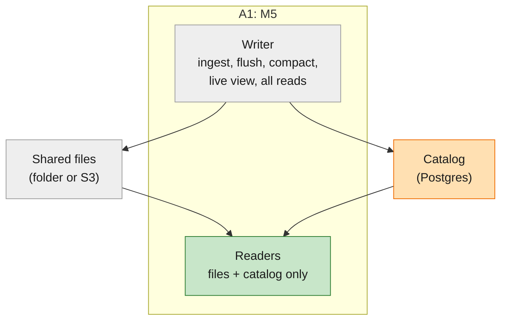

# M5 design: options and key decisions (open for discussion)

**Status**: Proposed, 2026-11-08. Nothing here is decided until its entry in the [decision register](#key-decision-register)
says **Decided**. Spec: [spec.md](spec.md) · Plan: [plan.md](plan.md) · Options from other systems: [research.md](research.md).

## How we use this document

This is the place to discuss the design before building it. It is deliberately not a locked architecture.

1. **Architecture options** ([below](#architecture-options)) describe the whole system at different levels of
   disaggregation. M5 picks one; the others stay written down so later steps start from them.
2. **Components and jobs** list what each part does, with its options.
3. **The decision register** holds every key decision: the question, options, how we judge them, a recommendation,
   and a status. Status moves **Open → Proposed → Decided** (or **Deferred** to the spec backlog). Only the owner moves
   an entry to Decided.
4. **Discussion log**: each entry keeps dated notes under it. A changed decision keeps its old text struck through
   with the reason, as [decisions.md](../000-smithling-master-plan/decisions.md) does for the master plan.
5. **Plan units name the decisions they need** ([plan.md](plan.md#delivery-order)). A unit doesn't start until its
   decisions are Decided.

## Architecture options

Four levels of disaggregation, from least to most. Each later step adds to the one before it.

| Option | What runs where | Fixes | Doesn't fix | Status |
|---|---|---|---|---|
| **A1. Read workers over files** | Writer: ingest, flush, compaction, live view, all reads. Readers: reads from published files and the catalog only | P1 (reads), P2, P7, P9; P10, P12 light | P5, writer is one machine, readers ≤ flush age | **Proposed for M5** (spec Decisions) |
| A2. A1 + fresher readers | A1, plus readers see unflushed data: shorter flush, a narrow live path from the writer, or readers following the log | + P3, P4, P6 | P5 | Backlog B2 |
| A3. Full disaggregation | A2, plus the write log in shared storage before confirming, compaction as its own service, writer handoff | + P5, P8, P10 full, P1 (compaction) | write rate of one writer | Backlog B1, B3, B4 |
| A4. Sharded | A3 with several writers, by trace id | + P11 | — | Backlog B5 |

Colours: 🟢 new in M5 · 🟠 changed · ⚪ as M4.

## Components and jobs

### Writer (⚪ as M4, 🟠 small changes)

| Job | Today | M5 change | Decisions |
|---|---|---|---|
| Ingest (validate, dedup, log, fsync, apply, confirm) | as M1–M3 | none | — |
| Flush and publish | one catalog commit per flush | also bumps the catalog version; checked against the writer lease | KD-2, KD-7 |
| Compaction (M4) | background task in the writer | must meet M4-REQ-1–4; its swaps bump the catalog version | KD-2, KD-4 |
| Delete replaced files | M4 design | after the grace period | KD-6 |
| Lease | none | take at start, renew on a timer, stop if lost | KD-7 |
| Serve reads, live view | as today | none | — |

### Read worker (🟢 new)

| Job | What it does | Decisions |
|---|---|---|
| Start | Open storage and catalog read-only; load the newest catalog version and build its state; serve once ready | KD-1, KD-8 |
| Check for a new version | At the start of each query (and on a timer when idle) | KD-2, OQ-3 |
| Refresh state | New files' stats, multi-version runs, merged copies, feedback; files removed by compaction | KD-3, KD-4, KD-5 |
| Serve reads | Every read API from one catalog version per query, with a time limit | KD-6, KD-9 |
| Report status | Catalog version, age of newest data, current or behind; check in to the catalog | KD-10 |

### Catalog (🟠)

| Part | Today | M5 change | Decisions |
|---|---|---|---|
| Files, field stats, feedback, dedup keys | as M3/M4 | none | — |
| Catalog version | none (the writer's in-memory `Version.id` only) | a stored counter, bumped by every publish | KD-2 |
| Writer lease | none | one row | KD-7 |
| Reader check-ins | none | one row per reader | KD-10 |
| Backend | SQLite or Postgres | split mode across machines needs Postgres | KD-8 |

### Shared storage (⚪)

No change. Write-once files with unique names, read by range, on a folder or S3-compatible storage. Readers want a
larger cache on S3 (KD-11).

## Key decision register

| ID | Question | Recommendation | Status | Blocks |
|---|---|---|---|---|
| [KD-1](#kd-1-how-does-a-reader-exist-without-a-writer) | How does a reader exist without a writer? | Read-only `Ingest` for M5 | Proposed | U2 |
| [KD-2](#kd-2-what-is-a-catalog-version) | What is a catalog version, and how do readers notice a new one? | Stored counter, looked up per query | Proposed | U1, U3 |
| [KD-3](#kd-3-how-do-readers-refresh-their-state) | How do readers refresh their state? | Incremental per new file; background rebuild after compaction | Proposed | U3 |
| [KD-4](#kd-4-how-do-readers-know-which-runs-have-several-versions) | How do readers know which runs have versions in several files? | Files are the truth: readers use the run-id filter, as the writer does at start | **Open (risk)** | U3, M4 |
| [KD-5](#kd-5-how-does-feedback-reach-readers) | How does feedback reach readers? | Feedback writes bump the catalog version | Proposed | U3 |
| [KD-6](#kd-6-grace-period-and-reader-query-time-limit) | Grace period and query time limit | 24 h and 1 h | Proposed (spec OQ-2) | U4 |
| [KD-7](#kd-7-writer-lease) | Writer lease: how it works | Lease row with a number, checked in every publish | Proposed | U1 |
| [KD-8](#kd-8-catalog-backend-in-split-mode) | Catalog backend in split mode | Postgres across machines; SQLite on one machine for tests | Proposed | U2 |
| [KD-9](#kd-9-the-live-view-on-a-reader) | What does a reader do with the live view? | Serve from files, labelled, with a link to the writer | Open | U2 |
| [KD-10](#kd-10-reader-status-and-check-ins) | How readers report status | `/healthz` + a check-in row in the catalog | Proposed | U5 |
| [KD-11](#kd-11-reader-cache-on-object-storage) | Reader cache on object storage | Same cache, larger default on S3 | Open | U6 |
| [KD-12](#kd-12-constitution-ii-record) | Record files-only reads as a staged SmithDB difference? | Yes, Principle II (c), B2 as the revisit | Proposed (spec OQ-1) | plan gate |

### KD-1: How does a reader exist without a writer?

`Query::new` takes a whole `Ingest` (`crates/query/src/lib.rs:218`); queries reach the writer's memtables, the
multi-version set, the project map, feedback and storage through it.

| Option | Change | For | Against |
|---|---|---|---|
| **a. Read-only `Ingest`** | `Ingest::open_reader(cfg)`: no log, no writer thread, empty memtables; `Version` and state from the catalog; `accept` refuses | Smallest change; queries unchanged | Writer-only paths stay reachable and must refuse; the name is misleading |
| b. Extract a read-state type | Move what queries need (`Version`, multi-version set, feedback index, storage) into one type both writer and reader provide | Clean seam; helps B2/B3 later | Touches every query module; bigger PR |
| c. Separate reader crate | A new crate with its own state | Clear ownership | Duplicates loading logic; most work |

**Criteria**: size of change (< ~400 lines per PR), risk to the writer path, how much later steps reuse.
**Recommendation**: (a) now, with (b) as a follow-up refactor once B2 or B3 needs it.

### KD-2: What is a catalog version?

Today the version id lives only in the writer's memory (`Version.id`, `crates/ingest/src/memtable.rs:22`), and the
catalog's `state` row holds `schema_version` and `flushed_seq`. Compaction swaps (M4) won't move `flushed_seq`.

| Option | For | Against |
|---|---|---|
| **a. A `catalog_version` counter in `state`, bumped in every publishing transaction** (flush, compaction swap, sidecar, feedback) | One cheap lookup tells a reader whether anything changed; exact | Every publisher must remember to bump it (test it) |
| b. Derive from data (newest segment id, newest feedback time) | No schema change | Misses removals; several lookups |
| c. Postgres LISTEN/NOTIFY | Readers learn at once | Postgres only; still needs (a) as fallback |

**Criteria**: exact (never miss a change), cheap per query, same on SQLite and Postgres (constitution V).
**Recommendation**: (a), looked up at the start of each query; (c) later if lookups show up in latency (spec OQ-3).

### KD-3: How do readers refresh their state?

State that follows the catalog: the file set and field stats (`Version`), merged copies of multi-version runs
(`VersionRows`, D-023/D-029), the multi-version set, feedback, the run-id filter (D-025). M3 measured a cold rebuild
of 203k multi-version runs at 9 s (M3-R4).

| Option | For | Against |
|---|---|---|
| **a. Incremental per new file**, as the writer does at each flush (`Version::with_flush`, new files' `needs_merge` rows); a full rebuild only when compaction removes files, done in the background while the reader keeps serving the previous version | Cheap per flush; reuses existing code | Two paths to test (incremental, rebuild) |
| b. Full rebuild on every new version | One path | Seconds per flush at 2M runs; a reader could fall permanently behind |
| c. Writer publishes a ready-made state snapshot file | Readers just load it | New file format; couples readers to writer internals |

**Criteria**: answers equal the writer's (SC-04), refresh time well under the flush age, code reuse.
**Recommendation**: (a). Answers are always from one whole version, so a slow rebuild only delays freshness.

### KD-4: How do readers know which runs have several versions?

**Risk found while planning.** The writer tracks multi-version runs in memory (`multi_version`, used by
`query/src/scan.rs:234`, `fields.rs:254`, `search.rs:276`) and marks file rows `needs_merge`. A run that joins the set
while its memtable is being flushed may not be marked in that file (`query/src/fields.rs:92`). The writer covers this
from memory; a reader can't. If a reader misses it, the run is counted twice in field counts and aggregates.

| Option | For | Against |
|---|---|---|
| **a. Readers rebuild the set from files**, as the writer does at start: the run-id filter over every file's `run_id` column (D-025), plus `needs_merge` rows; a new file's runs that hit the filter join the set | Same rule as the writer's restart path, already tested | Reader memory for the filter (~2.4 MB at 2M runs); a false positive only sends a run down the slower merging path |
| b. Make the flush mark every multi-version run in the file (close the race in the writer) | Files fully describe themselves; also needed for B3 (M4-REQ-1) | Touches the flush path; must not slow it |
| c. Writer publishes the set to the catalog | Exact | Grows with runs; another publish step |

**Criteria**: no double counting (SC-04), files are the source of truth (M4-REQ-1).
**Recommendation**: (a) and (b) together: (b) makes files correct, (a) lets readers rely on files alone. Needs a
property test: reader answers equal the writer's across random late updates and flush timing.
**Status**: Open, because it touches M4's flush and compaction rules.

### KD-5: How does feedback reach readers?

Feedback is written straight to the catalog (D-027), not the write log; an in-memory index is loaded at start.

| Option | For | Against |
|---|---|---|
| **a. Feedback writes bump the catalog version (KD-2)**; readers reload changed feedback rows | One change signal for everything | Needs a way to read only changed rows (an `updated_seq` column) |
| b. Readers reload all feedback on a timer | No schema change | Stale between reloads; full reload grows with feedback |
| c. Readers read feedback from the catalog per query | Always current | A catalog query per read; slower aggregates |

**Recommendation**: (a).

### KD-6: Grace period and reader query time limit

Spec OQ-2. Iceberg defaults to 3 days for orphan cleanup; Delta keeps 7 days and warns shorter can break readers
(research §3).

| Option | Grace | Query limit | For | Against |
|---|---|---|---|---|
| **a** | 24 h | 1 h | Ample margin; small storage cost | Replaced files linger a day |
| b | 1 h | 5 min | Less storage | Long agent queries and exports may fail |
| c | 7 days (Delta) | 1 h | Very safe | Storage for a week of replaced files |

**Recommendation**: (a), both configurable. The writer deletes; readers enforce the limit on their own queries.

### KD-7: Writer lease

| Option | For | Against |
|---|---|---|
| **a. A `writer_lease` row: owner, number, expiry; taking it raises the number; every publish checks the number in the same transaction** | Works on SQLite and Postgres; a paused writer can't publish after losing it | Renewal traffic (tiny for one writer) |
| b. Postgres advisory lock | Simple | No number to check; lost on disconnect; Postgres only |
| c. A lock file in shared storage | No catalog change | No fencing on S3 without compare-and-swap; weaker |

**Recommendation**: (a), also in one-process mode (one code path). Expiry 30 s, renewal every 10 s (configurable).

### KD-8: Catalog backend in split mode

| Option | For | Against |
|---|---|---|
| **a. Postgres for readers on other machines; SQLite allowed when every process shares one machine's folder** (tests, demos) | Both already supported (`storage/src/metastore.rs:1`) | SQLite readers must open read-only; SQLite on a network filesystem is unsafe, so refuse it |
| b. Postgres always in split mode | One rule | Local split demos need Postgres installed (constitution I: optional services only) |

**Recommendation**: (a).

### KD-9: The live view on a reader

| Option | For | Against |
|---|---|---|
| a. Refuse, pointing to the writer | Honest; simple | A UI pointed at a reader has no live page |
| **b. Serve from files, labelled "data up to <time>", with a link to the writer's live view** | UI works everywhere | Users may not notice the label |
| c. Proxy to the writer | Live everywhere | A reader-to-writer link, against the M5 rule |

**Recommendation**: (b). **Status**: Open; it's a UI choice for the owner.

### KD-10: Reader status and check-ins

| Option | For | Against |
|---|---|---|
| **a. Each reader writes a check-in row (id, address, catalog version, newest data time, at) every 10 s; `/healthz` on each reader shows its own; the writer's UI panel lists check-ins from the last minute** | The writer sees readers without contacting them | Readers write to the catalog (small, separate table) |
| b. Status only on each reader's `/healthz` | No writes from readers | No single place to see all readers (P12) |

**Recommendation**: (a).

### KD-11: Reader cache on object storage

The cache is 32 MB by default (D-028). On S3 every miss is a request of tens of ms.

| Option | For | Against |
|---|---|---|
| a. Same default everywhere | Simple | Slow reads on S3 |
| b. Larger default when storage is S3 (e.g. 512 MB) | Better S3 latency | Readers use more memory |
| c. Memory + local SSD tier (SmithDB, design-notes §2) | Best latency | New code; backlog |

**Recommendation**: (b), measured in U6; (c) stays backlog. **Status**: Open until measured.

### KD-12: Constitution II record

SmithDB queries the ingestion node for fresh data; M5 readers read files only. **Recommendation**: record as
Principle II (c), deliberately staged (simpler first), revisit with backlog B2. Listed in [plan.md](plan.md#constitution-check).

## Risks

| Risk | Where | Mitigation |
|---|---|---|
| Readers count a multi-version run twice | KD-4 | Files are the truth; property test against the writer |
| A publisher forgets to bump the catalog version | KD-2 | One helper used by every publish; a test that each publish path bumps it |
| Reader refresh can't keep up at 2M runs | KD-3 | Incremental refresh; measure refresh time per flush in the bench |
| M4 compaction relies on writer memory | M4-REQ-1 | Review M4's spec against M4-REQ-1–4 before it's planned |
| SQLite opened by several processes | KD-8 | Readers open read-only; refuse network filesystems |

## Discussion log

- 2026-11-08: Register created. KD-4 raised as a correctness risk found in `query/src/fields.rs:92`.
