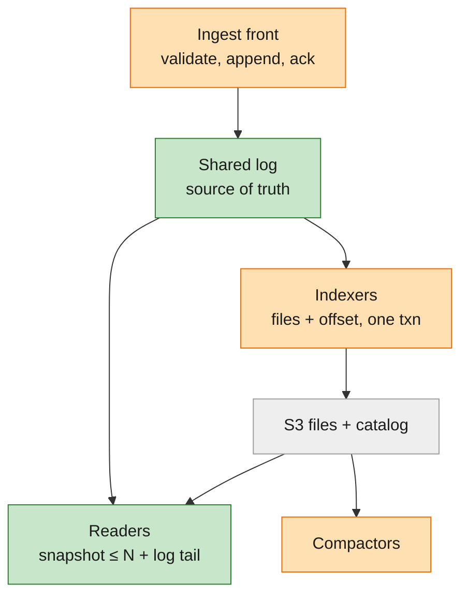

# M5 research: how other systems solve each problem

## Phase 0 summary (plan, 2026-11-08)

The plan's open choices are not resolved here; they are entries in the [design register](design.md#key-decision-register),
each with options, criteria and a recommendation, so they can be discussed before being decided. This file keeps the
evidence they draw on:

| Plan question | Design entry | Evidence |
|---|---|---|
| How readers see new data | KD-2, KD-3 | §5 (catalog checked at query time, Quickwit / Husky) |
| Multi-version runs on readers | KD-4 | §4 shard-key notes; code: `query/src/fields.rs:92`, D-025 |
| Grace period, query time limit | KD-6 | §3 (Iceberg 3 days, Delta 7 days) |
| Writer lease and fencing | KD-7 | §3 (lease row with a number checked in the commit) |
| Catalog backend | KD-8 | §3 limits; `storage/src/metastore.rs:1` |
| Live view on readers | KD-9 | §5 (live paths in file-only systems) |
| Reader cache on S3 | KD-11 | §1 (request latency), design-notes §2 (SmithDB memory + SSD) |
| Constitution II record | KD-12 | §2 (SmithDB reads the ingestion node) |
| Durable log off the writer (backlog B1) | spec B1 | §1; SmithDB's post doesn't say when it confirms a write or what survives losing an ingestion node (re-read 2026-11-08) |
| Snapshot, `min_seq`, group commit (added 2026-11-09) | KD-13, KD-14, KD-15 | §7 (Neon's wait-for-LSN); code: `flush.rs`, `writer.rs` |
| Shared WAL tail, end state (backlog B2, B11) | KD-16, KD-17 | §7 |
| Landscape of disaggregated designs (B11) | spec B11 | §8 |
| External log as the source of truth: the owner's preferred research direction (B11) | spec B11, KD-14 | §9 |

Input to the [spec](spec.md)'s open questions and the plan. Gathered 2026-11-08 by read-only research (web sources and
this repo's measurements). **[V]** = source page fetched and checked; **[U]** = from general knowledge, not checked.
Problem numbers (P1–P15) are the spec's north-star table.

## 1. Durable log and what a confirmed write survives

Problems P3, P4, P5. **Decided**: option 2, plus option 5 as an opt-in fast-confirm mode (spec Decisions).

| Option | Confirmed write lost when | Confirm P50 / P99 | Readers can follow it | Fencing | Ops | One binary? |
|---|---|---|---|---|---|---|
| 1. Local log only (today) | That disk or machine dies | fsync ~1–10 ms | Same process only | Not needed | Lowest | Yes |
| 2a. Log batch in S3 Standard before confirming | Only a region-level S3 event | ~150–300 / 300–500+ ms incl. a 50–250 ms batch window [U] | Poll the next batch number (~100–300 ms) | Ownership number in the catalog; batches created only if absent (`If-None-Match`) | Low | Yes (folder backend) |
| 2b. Same on S3 Express One Zone | Loss of that one zone | WarpStream measured 105 / 169 ms with a 50 ms window [V] | ~10–50 ms | Same | Low; one zone | Yes |
| 3. Our own replicated log (Raft, Neon safekeeper style) | A majority of replicas | ~2–10 ms P50 [U] | Pushed from the leader | Raft/Paxos term | **High** | Yes, but we'd own a consensus system |
| 4. External log (Kafka, Redpanda, BookKeeper, S2, Kinesis) | Its replication is lost | ~2–20 ms (Kafka acks=all) to ~100 ms (Kinesis) [U] | Push / long-poll | Producer epochs, ledger fencing | High self-hosted; vendor if managed | **No**, optional config only |
| 5. Local fsync, background upload | Everything not yet uploaded when the machine dies | Same as 1 | Upload interval (~0.2–1 s) | Needs 2's fence for the uploaded part | Low | Yes |

- **How 2 works**: batches named `log/<position:020>` per shard, written with "create only if absent", so a stale writer
  can't overwrite. SlateDB bumps a writer epoch in its manifest by compare-and-swap, then claims the next log number with
  an empty object; anyone with a lower epoch stops [V]. S3 has `If-None-Match` since Aug 2024 and `If-Match` since Nov 2024 [V].
- **Following the log**: readers fetch `position+1` until it isn't there, avoiding LIST requests. SlateDB readers wait at
  a gap rather than skip it [V].
- **Cost on S3 Standard**: $0.005 per 1,000 PUTs, so 10 batches/s ≈ $130/month and 100 batches/s ≈ $1,300/month per
  shard; readers' GETs add ~8% [V]. Throughput should come from bigger batches, not more requests.
- **Others**: turbopuffer confirms only once its log is in object storage, P50 165 ms for 500 kB [V]; SlateDB returns
  after the in-memory write by default, with `await_durable()` for the object-store confirm [V].
- **Limits**: ~3,500 PUT/s per S3 prefix [U]; confirm latency in the hundreds of ms.

Sources: [WarpStream on S3 Express](https://www.warpstream.com/blog/warpstream-s3-express-one-zone-benchmark-and-total-cost-of-ownership) ·
[SlateDB manifest RFC](https://github.com/slatedb/slatedb/blob/main/rfcs/0001-manifest.md) ·
[SlateDB FAQ](https://slatedb.io/docs/get-started/faq/) · [turbopuffer architecture](https://turbopuffer.com/docs/architecture) ·
[S3 If-None-Match](https://aws.amazon.com/about-aws/whats-new/2024/08/amazon-s3-conditional-writes/) ·
[S3 If-Match](https://aws.amazon.com/about-aws/whats-new/2024/11/amazon-s3-functionality-conditional-writes/) ·
[Neon safekeeper protocol](https://github.com/neondatabase/neon/blob/main/docs/safekeeper-protocol.md) ·
[Kinesis limits](https://docs.aws.amazon.com/streams/latest/dev/service-sizes-and-limits.html).
Not verified: Express pricing, S2 latency, Kafka/Raft/Kinesis latency figures, Neon's S3 offload, the 3,500 PUT/s figure.

## 2. Fresh-data read path

Problem P2. Spec OQ-1. Patterns: **A** readers ask the writer for unflushed data; **B** readers follow the log
themselves; **C** flush often, readers read files only.

| System | Pattern | How the flush boundary stays exact | Freshness | Limits read scaling |
|---|---|---|---|---|
| SmithDB [V] | A | Each file records the node that produced it; the planner reads that node's SSD and memory while it's up | 630 ms / 1.47 s ingest-to-queryable | Ingest nodes serve the newest reads |
| InfluxDB 3 / IOx [V] | A | Querier asks ingesters for unpersisted data, dedups overlapping files at query time | sub-second [U] | Ingester CPU |
| Druid [V] | A + handoff | Realtime task serves until a Historical loads the segment; one version per time chunk | sub-second | Fixed set of realtime tasks |
| Pinot [V] | A + completion protocol | Replicas reach the same offset; exactly one commits; broker routes one consuming segment per partition | sub-second | Consuming servers |
| Loki (classic) [V] | A | Queries every ingester, then dedups replicas | seconds | Ingester fan-out |
| Tempo live-store [V] | B | Live-stores consume Kafka on their own; newer than 15 min → live-store only, older → files only; a 30 s cutoff hides incomplete data; can fail on high lag | seconds | Live-store memory |
| Neon [V/U] | B | Pages read "at LSN"; pageserver replays WAL up to it | ms | Pageserver replay |
| ClickHouse Cloud SharedMergeTree [U] | C | Each insert writes a part to S3 and commits to Keeper | ~1 s with async inserts | Keeper commits, too many parts |
| Quickwit [V] | C | Only published splits are searchable; `commit_timeout_secs` default 60 | 5–60 s | Split count, metastore |
| Snowpipe Streaming [V] | C/D | Offset tokens per channel | "as low as 5 s" | — |

- **Limits per pattern**: A, the writer serves every fresh-data query, fine at 1× but caps reads at 10×. B, log traffic
  grows with readers × write rate, plus each reader's memory; lag becomes a new failure mode. C, many small files and
  catalog commits; 2 s P99 is marginal at a 1 s flush.
- **Migration path**: keep one `fresh_scan(filter, after_position)` interface, served first by the writer (A), later by
  log-following readers (B).

Sources: [SmithDB](https://www.langchain.com/blog/introducing-smithdb) ·
[InfluxDB 3](https://www.influxdata.com/blog/influxdb-3-0-system-architecture/) ·
[Druid storage](https://druid.apache.org/docs/latest/design/storage) ·
[Pinot realtime](https://cwiki.apache.org/confluence/display/PINOT/Consuming+and+Indexing+rows+in+Realtime) ·
[Loki architecture](https://grafana.com/docs/loki/latest/get-started/architecture/) ·
[Tempo live-store](https://grafana.com/docs/tempo/latest/reference-tempo-architecture/components/live-store/) ·
[Tempo config](https://grafana.com/docs/tempo/latest/configuration/) ·
[Neon architecture](https://neon.com/docs/introduction/architecture-overview) ·
[Quickwit index config](https://quickwit.io/docs/configuration/index-config) ·
[Snowpipe Streaming](https://docs.snowflake.com/en/user-guide/snowpipe-streaming/data-load-snowpipe-streaming-overview).
ClickHouse docs were unreachable.

## 3. Catalog, cleanup and fencing

Problems P6, P7, P8, P10. Recommendation: Postgres stays the only coordination service.

| Problem | Options | Recommended |
|---|---|---|
| Coverage (P6) | A. a guarded row per shard: `UPDATE … SET covered=$hi WHERE epoch=$e AND covered=$lo-1`, in the flush's transaction · B. derive from file ranges (gaps unnoticed) · C. compare-and-swap a manifest object (SlateDB [V]) | **A**: closest to today's code; the database enforces no gaps |
| Holding files for queries (P7) | A. grace period, like Iceberg and Delta (Delta defaults to 7 days and warns shorter can break concurrent readers [V]) · B. hold rows with expiry (SlateDB checkpoints [U]) · C. Postgres advisory locks (lost silently on disconnect [V]) | **A** with a hard query time limit below it (e.g. 1 h vs 24 h); B only for long exports; in-process references stay as a fast path |
| Compaction swap | A. check each input (Iceberg: fail only if a source file was removed by someone else [V]) · B. one version number per shard (every flush fails compaction; starvation risk [V]) · C. Druid time-range locks [V] | **A**: new flushes only add files, so they don't conflict |
| Delayed delete | A. mark replaced with a time; delete files, then rows · B. Neon deletion queue, check ownership before deleting [V] · C. VACUUM by listing the bucket | **A**, deleting only from a process holding the current ownership number |
| Cleanup of abandoned uploads (P8) | A. minimum age (Iceberg default 3 days, warns about in-progress files [V]) · B. "upload pending" rows written before each upload · C. ownership number in the file name (Neon [V]) | **B + C**, with A as a backstop |
| Fencing (P10) | A. lease row `(owner, epoch, expires_at)`; taking it raises the epoch; every commit checks it · B. session advisory lock (no token; breaks under PgBouncer [U]) · C. etcd / ZooKeeper (new service) | **A**: expiry alone isn't safe after a pause; the check in the commit is the guarantee [U, Kleppmann] |

- **Limits [U]**: one row per file is fine into the tens of millions with an index. One Postgres runs roughly 1–10k
  short guarded commits/s; 1,000 shards flushing every 10 s is ~100/s. Lock contention on one shard's row is the real
  limit. Lease renewals: 1,000 shards every 5 s ≈ 200 updates/s, fewer if renewed per process. SQLite works for one node only.

Sources: [SlateDB manifest](https://slatedb.io/rfcs/0001-manifest/) · [Delta utilities](https://docs.delta.io/latest/delta-utility.html) ·
[Postgres locking](https://www.postgresql.org/docs/current/explicit-locking.html) ·
[Iceberg reliability](https://iceberg.apache.org/docs/latest/reliability/) · [Iceberg maintenance](https://iceberg.apache.org/docs/latest/maintenance/) ·
[Druid storage](https://druid.apache.org/docs/latest/design/storage/) · [Hudi concurrency](https://hudi.apache.org/docs/concurrency_control/) ·
[Neon generation numbers](https://github.com/neondatabase/neon/blob/main/docs/rfcs/025-generation-numbers.md) ·
[Kleppmann on locking](https://martin.kleppmann.com/2016/02/08/how-to-do-distributed-locking.html).

## 4. Upper bound of one machine, and shard keys

Problems P1, P11, P13, P14, P15. From this repo's measurements; the rest estimated for 16 cores / 64 GB / NVMe.

**Measured**

| Figure | Value | Source |
|---|---|---|
| Write rate | 38,616 events/s, P99 114 ms (M2, system malloc); 29.6k (M3, jemalloc) | 002 quickstart step 4; 003 research M3-R12 |
| Single run + payload | P50 17.9 ms at 96 files, 26.1 ms at 244 files (0.48M runs) | M3-R12, D-029 |
| Trace tree / filtered list / suggestions | 6.1 / 61 (P99 128) / ≈3 ms | M3-R12 |
| Grouped query at 2M runs | 440 ms by name, 640 ms by a metadata key; first call cold 9–14 s | M3-R4 |
| Idle memory | 234–246 MB at 0.48M runs (~0.6 GB projected at 2M) | M3-R12, D-028 |
| Merged late-update copies | ≈2.3 KB per late-updated run | M3-R12 |
| Dedup cap | 1M keys, ≈50 MB, ~1 min at 20k events/s | `ingest/src/dedup.rs:45` |
| Project map | ≤ 20 MB, at most ~917k runs | D-028 |
| Files | 400 at 1.95M runs (M2); ~1,000 projected at 2M (M3 defaults) | 002 quickstart; M3-R12 |
| Disk | 19% of raw JSON, ~31–35% with the text index | M3-R1 |

The full 2M bench hasn't run (D3-1).

**Estimated ceilings**: files first (~0.055 ms per file on single-run reads, so 50 ms at ~680 files); writes ~30–40k
events/s (one writer thread); memory ~0.3 GB per million runs plus ~0.25 GB fixed (~100–200M runs); ~30–40 grouped
queries/s; disk isn't the limit by count. **At 10×**: writes refused first; dedup and project-map windows shrink to
~5 s; ~10,000 files (single run ~0.5 s); ~4.6 GB of merged copies; grouped queries run out of CPU.

**Shard keys** (for later; spec OQ-6)

| Key | One writer sees every version of a run? | Trade-offs |
|---|---|---|
| Project hash | Yes, but project-less late updates still depend on the project map | Simple; a project's reads stay on one shard; a big project is capped at one writer |
| Consistent hashing | Yes between moves | Little data moves; moved state (filters, merged copies) must be rebuilt |
| Project + time range | Only if routed by the root's start time | Splits hot projects; late updates must find an old range's writer |
| **Trace-id hash** | **Yes**: every update carries `trace_id` and `dotted_order` (`model/src/validate.rs:55–56`) | Even load, no per-project cap; lists and group-bys fan out to every shard and merge (M3-R4's accumulators already merge); P99 follows the slowest shard |

## 5. Readers that read published files only

Spec OQ-1 (option A, the owner's lean) and OQ-2. Systems that serve reads only from published files get about
**1–60 s** freshness: they flush every 0.25–60 s, and readers see a new file at query time through a strongly
consistent catalog lookup, not a timed poll. None pairs a 2-minute flush with a 2-minute reader poll. Every trace
product with a "live" view either queries the ingest tier or keeps a separate live window.

| System | Flush / commit | Freshness | How readers find new files | Small-file cost |
|---|---|---|---|---|
| Datadog Husky [V] | Writers buffer briefly, upload, commit to the metadata store (interval not published) | not published | Strongly consistent metadata store; "we never communicate with the Writer nodes at query time" | Compactors merge small files; median latency a few hundred ms worse than before, accepted for better P99 |
| Quickwit [V] | `commit_timeout_secs` default 60 | ≤ ~60 s | Metastore asked on every request; no poll delay | Shorter timeout → smaller splits, more merging; 30 s ≈ < 200k PUTs per index per month |
| WarpStream [V] | `batchTimeout` 250 ms (down to 25 ms) | P50 500 ms, P99 900 ms end to end | Control-plane metadata, journaled before confirming | One file per partition every 100 ms ≈ $130/partition/month; fix: share files across partitions, then compact |
| turbopuffer [V] | One log commit per second per namespace | strongly consistent by default; eventual mode up to ~1 h stale | One object-store round trip per query to check the log | Unindexed log data searched by scanning |
| Snowpipe Streaming [V] | `MAX_CLIENT_LAG` default 1 s (30 s for Iceberg) | "as low as 5 s" | Snowflake metadata | 1 s flushes make many small partitions that slow queries until compacted; advice: set the lag as high as you can tolerate |
| Iceberg + Flink [V] | A commit per checkpoint (docs example 5 min) | = checkpoint interval | Reader reloads the table snapshot | Needs `rewriteDataFiles` after |
| Delta + Spark [U] | A commit per micro-batch | seconds to minutes | Delta log | Needs OPTIMIZE |
| ClickHouse Cloud [U] | A part per insert | ~1 s | Keeper | Merges |
| BigQuery Storage Write [V/U] | Rows "available immediately" | immediate | Reads a write-optimized buffer, not files only [U] | — |
| Honeycomb [V] | Not files only: recent data on server NVMe, S3 via Lambda fan-out | — | — | — |
| Tempo (hybrid) [V] | Live-store blocks ≤ 30 s | Readers poll the backend block list every 5 min; the last 15 min come from the live-store | — | — |

**Live views in file-only systems** [V]: a separate stream path that skips storage. Datadog Live Tail streams logs as
they arrive, sampled at high volume. Datadog APM Live Search covers a rolling 15 min of all spans, but can't feed
dashboards or monitors. They give up retention, full aggregation and export, sometimes completeness, and need a second
code path that must agree with storage.

**What users expect**: watching a live run, seconds (SmithDB 630 ms / 1.47 s, "traces in seconds instead of minutes"
[V]; no LangSmith UI latency doc found [U]). Search and aggregation, tens of seconds to a minute is normal (Quickwit 60 s).

**Flush interval trade-off** (one writer, readers read files only):

| Flush every | Files / catalog commits per day | Files per hour of recent data | PUT cost |
|---|---|---|---|
| 2 min | 720 | 30 | trivial |
| 30 s | 2,880 | 120 | trivial |
| 10 s | 8,640 | 360 | trivial |
| 5 s | 17,280 | 720 | ≈ $2.60/month |

Multiply by the files each flush writes (today one per project). Request cost and catalog load are trivial for one
tenant; **the real cost is queries over many small files** (a catalog row, a footer read of tens of ms on S3, and merge
work per file) and ~24× more frequent level-0 compaction. Tiered compaction (recent files merged quickly into
2-minute, then 1-hour files) keeps the count bounded.

**Freshness ≈ flush interval + reader refresh interval.** A 2-minute flush with a 2-minute poll is up to ~4 min.
Checking the catalog at query time (one cheap lookup of the newest commit, or Postgres LISTEN/NOTIFY) removes the
second term without any reader-to-writer link.

**Options**

- **A. Files only, 2 min flush, 2 min poll**: simplest; up to ~4 min stale; breaks watching an agent live unless the
  live view is dropped or served another way.
- **A′. Files only, 2 min flush, catalog checked at query time**: still no reader-to-writer link; up to ~2 min stale.
- **B. Files only, 5–10 s time-based flush (64 MB cap stays), catalog checked at query time**: ~5–10 s; what Husky,
  Quickwit and Snowpipe do; costs aggressive level-0 compaction. The research agent's default pick.
- **C. Files with a 30 s–2 min flush, plus a narrow live path from the writer** (open runs and steps for one trace,
  or the newest runs of a list): keeps ~1 s for the live view and large files; costs a second code path and a
  reader-to-writer link limited to the live view (Tempo, Datadog Live Search). Suggested as an add-on to B if needed.

Not verified: Husky's interval and freshness, ClickHouse visibility, Axiom, Honeycomb freshness, LangSmith UI latency, Delta OPTIMIZE.

Sources: [Datadog Husky](https://www.datadoghq.com/blog/engineering/introducing-husky/) ·
[Quickwit index config](https://quickwit.io/docs/configuration/index-config) · [Quickwit architecture](https://quickwit.io/docs/overview/architecture) ·
[Quickwit 0.8](https://quickwit.io/blog/quickwit-0.8) · [WarpStream architecture](https://docs.warpstream.com/warpstream/overview/architecture) ·
[WarpStream low latency](https://docs.warpstream.com/warpstream/byoc/advanced-agent-deployment-options/low-latency-clusters) ·
[turbopuffer](https://turbopuffer.com/docs/architecture) ·
[Snowpipe Streaming](https://docs.snowflake.com/en/user-guide/snowpipe-streaming/data-load-snowpipe-streaming-overview) ·
[Snowpipe recommendations](https://docs.snowflake.com/en/user-guide/snowpipe-streaming/snowpipe-streaming-classic-recommendation) ·
[Iceberg Flink writes](https://iceberg.apache.org/docs/latest/flink-writes/) · [BigQuery Write API](https://docs.cloud.google.com/bigquery/docs/write-api) ·
[Honeycomb storage](https://www.honeycomb.io/blog/secondary-storage-to-just-storage) · [Tempo config](https://grafana.com/docs/tempo/latest/configuration/) ·
[Datadog Live Tail](https://docs.datadoghq.com/logs/explorer/live_tail/) · [Datadog Trace Explorer](https://docs.datadoghq.com/tracing/trace_explorer/) ·
[SmithDB](https://www.langchain.com/blog/introducing-smithdb).

## 6. Tenants and cross-project queries

Spec OQ-3 and OQ-4. Every product puts a hard boundary (org, workspace, team, tenant) above projects; auth and limits
live there. Queries across projects inside it are normal; across tenants is opt-in and limited.

| Product | Hierarchy | Isolation | Across projects / tenants |
|---|---|---|---|
| LangSmith [V] | org → workspace → tracing project | Workspace is the trust boundary; API keys per workspace (org keys pick one with `X-Tenant-Id`); trace caps per workspace, project, user; 14 d / 180 d retention | `list_runs(project_name=[…])` takes several projects; "All agents" view; nothing across workspaces. Multi-project dashboards [U] |
| Langfuse [V] | org → project | Project API keys; ClickHouse ordering key starts `projectId, date` | Nothing across projects documented |
| Phoenix [V] | projects (Arize AX adds workspaces) | little documented | Compare projects side by side |
| Honeycomb [V] | team → environment → dataset | One key per environment; environments partition data | "All datasets in environment" queries; across environments [U, believed no] |
| Datadog [V] | parent org → child orgs | Orgs can't see each other's data | Opt-in cross-org visibility for dashboards; one org per query, combined by formulas |
| Tempo [V] | tenant (`X-Scope-OrgID`) | Per-tenant overrides: retention, ingest rate and burst, max traces, bytes per trace; reloaded live | `a\|b` on by default; each trace evaluated within one tenant |
| Loki [V] | tenant | Missing header → 401 | `a\|b` off by default; adds a `__tenant_id__` label |
| Mimir [V] | tenant | Per-tenant ingest rate, retention, query parallelism, queriers per tenant, query length | Federation off by default, with `max_tenants` |
| W&B Weave [V/U] | team → project | team scoping | [U] |

- **What users need across projects**: rollups (error rate, cost, tokens across all agents: Honeycomb, LangSmith "All
  agents", Datadog formulas); comparing two projects (Phoenix; LangSmith via a project list). Full-text search across
  every project isn't documented anywhere [U].
- **Storage**: to keep one-project queries fast while projects are stored together, sort and prune by
  `(project, time)` (Langfuse warns that changing that key means a days-long rewrite [V]). Smithling already prunes
  by project and time and lays files out as `data/<project>/<date>/`. Keeping project as a directory makes many small
  files for small projects; keeping it as a sort-key column makes cross-project queries cheap.
- **After trace-id sharding**: trace lookups hit one shard; any project or cross-project query hits every shard, each
  pruning by project, so P99 follows the slowest shard and single- and cross-project queries cost about the same.
  Tempo works this way.
- **Conflict**: [design-notes §2](../000-smithling-master-plan/design-notes.md) says the cloud path will "hash
  `project_id` into slices", which disagrees with the trace-id preference (spec Decisions).
- **Per-tenant limits to leave room for**: ingest rate and burst; bytes per run and runs per trace (LangSmith caps
  25,000 runs per trace [V]); retention (Smithling's planned `projects.ttl_days` plus a tenant default); query
  concurrency, time range and rows scanned; monthly trace caps. Tempo and Mimir keep these in one overrides file;
  Tempo's pitfall is that a field left out becomes 0, not the default [V].

**Options for Smithling**

- **A. Implicit tenant column**: `tenant_id` (always `default`) in the catalog and file keys; sort key
  `(tenant, project, time)`; API accepts a project list or "all". No auth change. Smallest.
- **B. First-class tenant, Tempo-style**: tenant from a header or key; layout `data/<tenant>/…`; one limits file;
  cross-tenant queries left out on purpose.
- **C. Tenant as the storage unit, project as a column** (Honeycomb environment style): files per tenant and time,
  sorted by project. Cross-project queries come free and small projects make fewer small files; one-project queries rely
  on sort-key pruning instead of folders.

Sources: [LangSmith admin](https://docs.langchain.com/langsmith/administration-overview) ·
[LangSmith list_runs](https://reference.langchain.com/python/langsmith/client/Client/list_runs) ·
[Langfuse RBAC](https://langfuse.com/docs/administration/rbac) ·
[Langfuse ClickHouse](https://langfuse.com/self-hosting/deployment/infrastructure/clickhouse) ·
[Langfuse v3](https://langfuse.com/blog/2024-12-langfuse-v3-infrastructure-evolution) ·
[Phoenix projects](https://arize.com/docs/phoenix/tracing/llm-traces/projects) ·
[Honeycomb queries](https://docs.honeycomb.io/investigate/query/build/) · [Honeycomb environments](https://docs.honeycomb.io/configure/environments/) ·
[Datadog multi-org](https://docs.datadoghq.com/account_management/multi_organization/) ·
[Datadog cross-org](https://docs.datadoghq.com/account_management/org_settings/cross_org_visibility/) ·
[Tempo multitenancy](https://grafana.com/docs/tempo/latest/operations/manage-advanced-systems/multitenancy/) ·
[Tempo cross-tenant](https://grafana.com/docs/tempo/latest/operations/manage-advanced-systems/cross_tenant_query/) ·
[Loki multi-tenancy](https://grafana.com/docs/loki/latest/operations/multi-tenancy/) ·
[Mimir config](https://grafana.com/docs/mimir/latest/references/configuration-parameters/) ·
[Weave quickstart](https://docs.coreweave.com/weave/quickstart).

## 7. The Neon boundary and a shared WAL tail

Added 2026-11-09 for the baseline in the spec's [Write and read paths](spec.md#write-and-read-paths), backlog B2 and
B11. Neon facts checked 2026-11-09 against [Neon's architecture overview](https://neon.com/docs/introduction/architecture-overview),
[GetPage@LSN](https://neon.com/blog/get-page-at-lsn) and `wait_lsn` in the pageserver source.

**What Neon separates [V].** Postgres compute streams WAL to a quorum of *safekeepers*; a commit is acknowledged once
a majority has it. *Pageservers* consume the WAL from safekeepers, build page versions, and upload layer files to
object storage. Compute asks a pageserver for "page P as of LSN L", and the pageserver **waits until it has applied
WAL through L** (with a timeout) before answering. Read replicas do the same at their own replay LSN.

So Neon has two separate questions:

| Question | Neon | Smithling today | Smithling later |
|---|---|---|---|
| What survives losing the writer's disk? | WAL on a safekeeper quorum before acknowledgment | Nothing between the WAL sync and publication (P5) | B1: replicated WAL |
| How does a reader catch up to a write? | The pageserver waits for LSN L | Readers see published snapshots only | M5: `min_seq` waits for a snapshot; B2: a WAL tail |

The M5 `min_seq` contract has the same shape as wait-for-LSN, with `published_through_seq` as the reader's applied
LSN. The difference is granularity: Neon's pageserver applies WAL continuously, while a Smithling reader moves forward
one published flush at a time.

**A shared WAL tail (B2), sketched.** For a query on a reader:

1. Pin snapshot N (`published_through_seq = N`), as in M5.
2. Fix an upper watermark U at query start: the highest *committed* `seq` the tail source has (acknowledged on the
   writer, or durable in the shared log if B1 exists).
3. Read the tail records in (N, U] for the query's projects and time range.
4. Merge span updates per run: snapshot rows + tail updates in `seq` order, the same `merge_versions` rule as
   D-023/D-029. Only then filter, group and count, so a late update that changes `status` moves the run between
   matches exactly once (spec Case C).
5. Answer, reporting both N and U.

| Design question | Options | Note |
|---|---|---|
| Where the tail comes from | a. the writer serves (N, U] over a narrow API; b. a shared log in S3 or a log service (needs B1); c. readers subscribe to the writer's change feed | (a) brings back a reader-to-writer link (against the M5 rule); (b) pairs with B1; (c) has P3's dropped-changes problem |
| What U means | acknowledged on the writer vs durable off the writer | If the tail is the writer's memory, U can include writes that a lost disk takes away (P5); readers would show then un-show them |
| Cost per query | tail size × queries | Bounded by the flush age: at 20k events/s and 2 min, up to ~2.4M records; needs per-project or per-trace indexing in the tail |
| Field stats, counts | merged on the fly, or approximate for the tail | Field suggestions may exclude the tail; aggregates must not |
| Interaction with compaction | none: compaction works on published files only, below N | Snapshot pin rules unchanged |

**Why separate decisions.** A WAL tail (B2) makes readers fresher; it doesn't make acknowledged writes safer. A
replicated WAL (B1) makes them safer; it doesn't make readers fresher by itself, though it gives B2 a tail source (b)
that doesn't need a link to the writer. Decide B1 on durability needs and B2 on measured publication lag.

**Research questions for the end state (B11).**

1. Ownership: which service owns each step: sequencing, WAL durability, publication, compaction, deletion? Which
   need the writer lease's ownership number?
2. With compaction as its own pool (B3), who removes orphans (P8), and how do pending-upload rows replace "delete
   anything not in the catalog" at start?
3. Is the tail source a separate service (like safekeepers) or part of the writer with replication?
4. Cost model on S3: requests per published flush, per reader query (footers, pages), per tail read; at what reader
   count does a shared SSD cache tier (KD-11 c) pay off?
5. Failure matrix: writer, log node, compactor, reader, catalog, S3 each lost; what each reader is then promised.
6. Is there a version of this that stays one binary with roles (constitution I)?

## 8. The landscape of disaggregated designs

Added 2026-11-09 for B11. Five families, split by **when a write counts as durable** and **how readers see data not
yet in files**. Family-4 and Neon facts were checked 2026-11-09 (§7, §9); the rest of the table is [U].

| Family | Examples | Ack point | Reader freshness | Stateful services | Complexity |
|---|---|---|---|---|---|
| 1. The log is the database | Neon, Aurora, Azure SQL Hyperscale, AlloyDB | a log quorum | ~instant (wait for LSN) | log quorum, page servers, object store | very high |
| 2. Immutable files + consistent catalog | Snowflake, Datadog Husky, Quickwit, WarpStream, turbopuffer, Iceberg/Delta | catalog commit (or a local WAL) | commit interval (0.25–60 s, §5) | catalog, object store | low |
| 3. Ingesters + object store | Tempo, Loki, Mimir, Cortex, Druid/Pinot real-time | replicated ingester WAL | ~1 s, readers also ask ingesters | ingesters on a hash ring, object store | medium-high |
| 4. External log as the source of truth | Rockset, Materialize, Pinot on Kafka, FoundationDB internally, Delos | the log | tail lag | log, consumers (indexers), object store, catalog | high, but each piece is simple |
| 5. Shared cache tier over object storage | ClickHouse Cloud, StarRocks/Doris shared-data, BigQuery, Firebolt | catalog commit | commit interval | catalog, object store, caches | medium |

Shared-nothing systems (CockroachDB, TiDB, Spanner, Elasticsearch) replicate data on the compute nodes; they scale
but are not disaggregated.

**Levers every family trades**: ack point · freshness mechanism · one sequencer or one per shard · metadata store
(Postgres, FoundationDB, embedded Raft) · where compaction runs · file size vs freshness (the small-files cost) ·
cache strategy · garbage collection of files (grace period or reference tracking) · merge late updates on read or on
write.

**Where Smithling sits**: M5 is family 2 with one writer. B1 and B2 each borrow one piece from family 1, 3 or 4.

## 9. An external log as the source of truth

Added 2026-11-09. **The owner's preferred research direction for B11** (spec Decisions). Research only, not M5
scope. Facts about other systems checked 2026-11-09; sources at the end of this section.

### Smithling is already this shape, inside one process

| Family 4 part | Smithling today | Where |
|---|---|---|
| The log | the WAL: numbered, fsynced batches | `ingest/src/wal.rs` |
| A consumer that builds files | the flusher: frozen memtable → Parquet → one catalog transaction | `ingest/src/flush.rs` |
| The consumer's committed offset | `flushed_seq`, in the same transaction as the files | `flush.rs` |
| Log truncation after consumption | WAL trimmed up to `flushed_seq` | `flush.rs` |
| A live consumer | the hub feeding the live view | `ingest/src/hub.rs` |

So the move is to **take the log out of the writer** and make it shared and durable, so several consumers can read
it. The flush transaction's rule stays the same: *files for offsets (N, M] and the new offset M commit together*.

Colours: 🟢 new service · 🟠 a role that exists today, split out · ⚪ as M5.

### What gets simpler

| | Today / M5 | With a shared log |
|---|---|---|
| Ack | the WAL on the writer's disk (P5: lost with that disk) | a durable append to the log; **B1 comes with it** if the log is replicated |
| Writer | full node: dedup, WAL, memtable, flush, compaction, live view | a thin front that validates and appends; replaceable (B4 becomes fencing on the log) |
| Publishing | the writer's flusher | any indexer: idempotent, restartable from its last committed offset |
| Fresh reads (B2) | not possible without a link to the writer | readers tail the log from N: **the shared WAL tail comes with it** |
| New consumers | each needs code in the writer | add a consumer: live view, exports, M6 agent feeds, rolled-up aggregates |
| Rebuild | from files only | replay the log within its retention |

### What needs a new correctness answer

| # | Question | Today | With a log: options | Lean |
|---|---|---|---|---|
| L1 | **Exactly-once publish** | the offset commits with the files | keep the offset in the catalog transaction, not in the log's consumer group; Kafka's exactly-once covers Kafka outputs only, and an external sink must store "its offset in the same place as its output" [V] | keep today's rule |
| L2 | **Order and the meaning of `seq`** | one global `seq` | one partition: total order, but one partition's throughput cap; many partitions: per-partition offsets, so `published_through_seq` becomes one watermark per partition | partition by trace id (§4), so a run's late updates stay in order in one partition |
| L3 | **Dedup** | writer memory, before numbering | a. at the front, before appending (the front holds state again); b. at the consumer, deterministic from the log, so replays agree | b |
| L4 | **Validation and the project map** | in the writer | at the front (reject early, needs the identity rules) or at consume (accept, then drop) | front, stateless checks only |
| L5 | **Retention** | the WAL is kept until flushed | retention must exceed the worst-case publish lag plus a reader rebuild; a consumer past retention loses data | alert, and push back on the front, well before that |
| L6 | **Fencing** | writer lease (KD-7) | two indexers on one partition: the catalog transaction checks a per-partition ownership number | same rule as KD-7, per partition |
| L7 | **Read-your-writes** | `seq` in the confirmation (KD-14) | the ack returns (partition, offset); `min_seq` waits on that partition's watermark | make the API token opaque now (KD-14) |
| L8 | **Merge before filter on the tail** | Case C on files | tail updates merge onto snapshot rows before filtering; the tail needs per-trace lookup | required for B2 in any form |
| L9 | **Feedback** | straight to the catalog, no `seq` (D-027) | through the log too, so it gets an offset (closes OQ-8), at the cost of revisiting D-027 | open |
| L10 | **Availability** | writes need the writer | writes need the log; the log becomes the most critical service | pick a log with replication and a known failure story |

### Which log

| Option | For | Against |
|---|---|---|
| a. Kafka (with tiered storage, KIP-405: early access in 3.6, production-ready since 3.9) [V] | mature; large ecosystem; exactly-once tools | heavy to run (JVM, brokers); an external service |
| b. Redpanda [V] | Kafka API; Raft group per partition; no JVM or ZooKeeper; tiered storage to S3/GCS | still an external service |
| c. A Kafka-compatible log on object storage (WarpStream-style) [V] | no broker disks; acks after the object write *and* the metadata commit; 250 ms default batch timeout | ~0.5–1 s end to end (§5); vendor or self-built |
| d. **Smithling's own log in S3**: WAL batches as objects created only if absent, with the head in the catalog (§1, option 2) | stays one binary; same storage as the files; is B1 | ack waits for an S3 PUT (tens to hundreds of ms); we build retention and tailing |
| e. Postgres as the log (a batches table) | nothing new to run | low throughput; grows the catalog |

**A `Log` interface** (append → offset, read from an offset, fence) lets one-process mode keep the local WAL while
split mode plugs in (a), (b) or (d). That's how Delos swaps log implementations ("Loglets") under one VirtualLog API, which let Meta change its consensus protocol in production without downtime [V]. It keeps
constitution I (one binary; external services optional) and still lets us reuse an existing system.

### What M5 already keeps so this stays cheap

No M5 scope change is needed. These M5 and M4 rules are what a later move to a shared log relies on:

- `published_through_seq` commits with the files in one transaction (FR-13): it becomes the indexer's offset.
- Flush jobs reuse file names and segment ids on retry: indexers stay idempotent.
- Readers find files only through the catalog (FR-14), and compaction takes its inputs from the catalog only
  (M4-REQ-1): neither cares who wrote the files.
- Merge before filter (FR-17) is the rule a log tail needs too.

One cheap addition for M5: if U8 ships, make the confirmation's `seq` an **opaque write token**, so a later move to
per-partition offsets doesn't break the API (KD-14).

### Research questions for B11

1. One partition or many? At what write rate does one partition (or one writer's log) cap out (§4: ~30–40k events/s
   today)?
2. Dedup at the consumer (L3): how large a key window, kept where, and how it rebuilds on replay.
3. Log choice (a)–(e): ack latency budget, cost at 20k and 200k events/s, and what one-process mode keeps.
4. Retention sizing (L5) against the worst publish lag and a reader rebuild.
5. Tail reads (L8): per-trace indexing of the tail, and how much of the tail a query may read.
6. Feedback through the log (L9): worth reopening D-027?
7. Failure matrix: front, log, indexer, compactor, reader, catalog and S3, each lost; what each reader is then
   promised.
8. Rockset's tailer/leaf/aggregator split: its blog post now redirects to OpenAI's acquisition page; find another
   primary source or drop it as an example.

### How others answer L1, L2 and L6 [V]

| System | Exactly-once publish (L1) | Order (L2) | Fencing (L6) |
|---|---|---|---|
| Materialize persist | shard state in a consensus store (Postgres, or CockroachDB in their cloud) updated by compare-and-set; data in blob storage | versioned by timestamps, with `since` and `upper` frontiers per shard | compare-and-set on the shard state |
| Pinot real-time | the controller has replicas agree on the end offset, one replica commits the segment (COMMIT_START → upload to deep store → COMMIT_END_METADATA) | per Kafka partition | the controller picks the single committer |
| FoundationDB | TLogs fsync before a commit is acknowledged; storage servers pull from them asynchronously | one global version | — |
| Kafka transactions | offsets written to Kafka in the same transaction as the outputs | per partition | producer epochs |

Read-your-writes differs: Neon's pageserver **waits** for the requested LSN (§7); FoundationDB's storage server
returns `future_version` and **the client retries**. KD-14's `min_seq` wait with a deadline sits between the two.

**Sources (§9)**: [Kafka design](https://kafka.apache.org/39/design/design/) ·
[KIP-405](https://cwiki.apache.org/confluence/display/KAFKA/KIP-405%3A+Kafka+Tiered+Storage) ·
[Redpanda architecture](https://docs.redpanda.com/current/get-started/architecture/) ·
[WarpStream architecture](https://docs.warpstream.com/warpstream/overview/architecture) ·
[Delos, OSDI '20](https://www.usenix.org/conference/osdi20/presentation/balakrishnan) ·
[Materialize persist design](https://github.com/MaterializeInc/materialize/blob/main/doc/developer/design/20220330_persist.md) ·
[Pinot real-time consumption](https://cwiki.apache.org/confluence/display/PINOT/Consuming+and+Indexing+rows+in+Realtime) ·
[FoundationDB read/write path](https://apple.github.io/foundationdb/read-write-path.html) ·
[RocksDB-Cloud](https://github.com/rockset/rocksdb-cloud).
