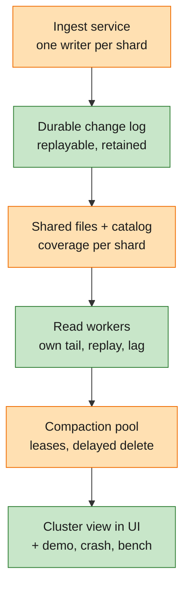

# Feature Specification: M5 — Disaggregated trace database

**Feature Branch**: `005-m5-disaggregated-trace-db`

**Created**: 2026-11-08

**Status**: Draft (spec only; plan next, implementation not started)

**Input**: User description: "how to move this into a disaggregated database … a new milestone after the compaction
and before the debugging agent … review the following plan, spec this out … spec and plan, not implementation." The
input was the 2026-11-08 system-design note (proposed architecture, write path, read path, snapshot correctness,
compaction publication, sharding, reliability, open questions). The note's claims about today's code are checked in
[review.md](review.md); this spec builds on what the code actually does.

**Master**: [specs/000-tracedb-master-plan](../000-tracedb-master-plan/spec.md) (requirements of record) ·
[roadmap](../000-tracedb-master-plan/roadmap.md) (progress; this milestone is inserted as M5, the agents milestone
becomes M6, [D-036](../000-tracedb-master-plan/decisions.md#d-036)). This folder holds the M5 details of record.

**Builds on**: M4 — Follow-through (compaction with an atomic catalog swap, threads, export). Spec folder `004-m4-…`
is reserved for it; M5 starts after M4's compaction exit check passes. Everything M1–M4 promise stays true in the
default one-process mode.

**Delta key**:

| Marker | Fill | Meaning |
|---|---|---|
| 🟢 **New** | green | first built in M5 |
| 🟠 **Improved** | orange | exists from M1–M4; M5 extends or changes it |
| ⚪ **Existing** | grey | built in M1–M4; M5 uses it as is |

**Delivers from master**: the "cloud split" that master Scope lists as out of scope for v0 (it moves into scope with
this milestone, D-036); constitution Architecture Constraints ("each role MUST be splittable into its own service
without changing its contract"); design-notes §2 "Cloud path" column; backlog R-6.

---

## Goal and why

Run tracedb as a **disaggregated trace database**: ingestion, read serving and compaction as separate services that
scale on their own, over shared durable storage whose capacity doesn't depend on any one machine.

- **Long-running agents produce multi-day traces.** One process holding the live tail, the queries and the background
  merges caps all three at one machine. Read load (many people and agents investigating) grows separately from write
  load (more agents) and from data volume (longer retention).
- **The storage layout is already the cloud layout** (constitution V): write-once data files on local disk or object
  storage, and a catalog on SQLite or Postgres. What's missing is everything *between* processes: a change stream
  readers can replay, a catalog protocol several processes can share safely, and ownership of a shard by one writer.
- **It is the step before agents debugging agents (M6).** Agent investigation multiplies read traffic; read workers
  must scale without touching ingestion first.
- **It finishes the SmithDB service split** (constitution II): SmithDB runs ingestion, query and compaction as separate
  services over object storage and a small metastore.

Until M5 ships, the precise description is "designed for compute–storage disaggregation". After M5's exit check,
"disaggregated trace database" is accurate.

## Delta at a glance

| | Part | Before M5 (M1–M4) | What M5 changes |
|---|---|---|---|
| 🟢 | Deployment shape | one process runs every role | the same binary runs one role or all; roles find each other through the catalog |
| 🟢 | Change stream | in-process, drops changes when a subscriber falls behind | durable, ordered per shard, replayable from any retained position |
| 🟢 | Read workers | query reads the writer's memory directly | each reader follows the change stream itself, keeps its own recent data, reports its position and lag |
| 🟢 | Shard ownership | implicit (one writer) | one writer per shard with a fencing epoch; a stale writer can't append or publish |
| 🟠 | Write acknowledgment | after fsync to the local disk | after the write is durable per the stated contract ([NEEDS CLARIFICATION: Q1]) |
| 🟠 | Catalog coverage | one `flushed_seq` for the whole store | contiguous covered position per shard; readers pin a snapshot |
| 🟠 | Compaction | M4: background task in the same process, swap + in-process pins | separate worker pool; cross-process query leases; delayed delete; orphan sweep that is safe with other writers |
| 🟠 | Log retention | WAL trimmed right after flush | retained until files cover it *and* the retention window has passed |
| 🟢 | Cluster view | none | browser page: roles, shards, positions, lag, backlogs, leases |
| ⚪ | Data files, text index, merge rule, query language, UI views | M1–M4 | unchanged; same answers in both deployment shapes |

## End state

*Capability first; the Example under it is the scenario we use to prove it.*

- 🟢 As an **operator**, I can run ingestion, read serving and compaction as separate services from the one tracedb
  binary, pointed at the same storage and catalog, and get the same answers as the one-process mode.
  - *Example*: 1 writer, 2 readers, 1 compactor on one machine (shared folder + Postgres) and on cloud-style storage:
    `tracedb demo` passes every M2–M4 check with identical counts.
- 🟢 As an operator, I can add or remove read workers without touching ingestion, and a new reader serves complete
  answers after replaying only what isn't in files yet.
  - *Example*: start a third reader during the demo load; it reports caught up and answers the 14 / 23 / 31 checks.
- 🟢 As an **agent developer**, I see my agent's steps on any reader shortly after they're acknowledged, including
  steps of a trace that has been running for days, and never see a run twice or lose one while files are being
  flushed or compacted.
  - *Example*: a 3-day trace updated across 50+ flushes and 5+ compactions shows one tree, latest values, on every reader.
- 🟠 As an agent developer, I lose nothing tracedb acknowledged, for the failures it promises to survive.
  - *Example*: kill any service at any of the named crash points (10 rounds each); zero acknowledged events missing.
- 🟢 As an operator, I can hand a shard to a new writer (planned or after a crash) and the old one can no longer write
  or publish, even if it comes back.
- 🟢 As an operator, I can see in the browser which services are running, each reader's position and lag per shard,
  flush and compaction backlogs, and pinned snapshots, and spot a lagging reader at a glance.
- 🟠 As a **maintainer**, I can trust all of this stays true: CI runs the split-deployment demo, the crash points and the
  scaling bench, and fails on lost data or a wrong count.

## Lifecycle of one run in M5

The `fetch_url` step from the scenario, in a split deployment.

| # | | What happens | M5 work |
|---|---|---|---|
| 1 | 🟠 | The SDK uploads the step. The request reaches the writer that owns its shard. | Routing to the shard owner |
| 2 | 🟢 | The writer gives it the next position in the shard's log and makes it durable per the contract; only then confirms. The confirmation carries the position. | Durable log, ack contract |
| 3 | 🟢 | Both readers read the new log entry on their own and apply it to their recent data; each reports its applied position. | Change stream, readers |
| 4 | ⚪ | The step's late update arrives and is merged by the same latest-value-wins rule, on the writer and on every reader. | (M1 rule) |
| 5 | 🟠 | The writer flushes, uploads the files, and in one catalog commit publishes them and moves the shard's covered position. | Per-shard coverage |
| 6 | 🟢 | A query on reader 2 pins the newest catalog snapshot (covered through N) and its own recent data after N. Nothing is missed or counted twice. | Snapshot + tail merge |
| 7 | 🟠 | A compactor merges that file with older ones and swaps them in the catalog. The query from step 6 still holds the old snapshot, so its files stay until it finishes. | Leases, delayed delete |
| 8 | 🟢 | The log entries for step 2 are retired once files cover them and the retention window has passed. | Log retention |

## User Scenarios & Testing *(mandatory)*

### 🟢 User Story 1 - Split deployment gives the same answers (Priority: P1)

An operator starts ingest, read and compaction services separately, pointed at the same storage and catalog, and uses
tracedb exactly as before.

**Why this priority**: the definition of the milestone. Nothing else matters if the split shape returns different answers.

**Independent Test**: start 1 writer, 2 readers and 1 compactor; run `tracedb demo` against a reader; every check passes
with the same numbers as the one-process mode, on local shared storage and on cloud-style storage.

**Acceptance Scenarios**:

1. **Given** a split deployment on an empty store, **When** the demo replays the scenario and waits until the reader has applied the last acknowledged position, **Then** every M2–M4 check passes with identical counts.
2. **Given** the same load, **When** any read query (list, trace, run, search, aggregate, live view) is sent to either reader, **Then** both return the same result once both have applied the same position.
3. **Given** `tracedb serve` with no role options, **When** it starts, **Then** it runs every role in one process as today, makes no outbound connections, and passes every M1–M4 check unchanged.
4. **Given** a reader asked to write, or a writer asked a read query, **When** the request arrives, **Then** it is refused with a message naming the service that handles it.

---

### 🟠 User Story 2 - Acknowledged writes survive the promised failures (Priority: P1)

Every write tracedb confirms survives the failures stated in the durability contract, through every step from log to
files to compaction.

**Why this priority**: a trace store that loses acknowledged steps can't be trusted for debugging; the constitution
makes it a CI gate (Principle VI).

**Independent Test**: the crash harness kills each service at each named crash point (after durable log write, before
ack; after ack; mid-upload; after upload before catalog commit; after catalog commit; mid compaction swap; during
handoff; mid reader replay), 10 rounds each, then checks that every acknowledged event is queryable exactly once.

**Acceptance Scenarios**:

1. **Given** a write that was acknowledged, **When** the failure covered by the contract happens ([NEEDS CLARIFICATION: Q1 — writer process only, or also loss of the writer's disk or machine?]), **Then** after recovery the write is queryable with its exact content.
2. **Given** a write that was not acknowledged, **When** the writer crashes, **Then** the client's retry is accepted and the run appears once, not twice.
3. **Given** a crash after files were uploaded but before the catalog commit, **When** the writer recovers, **Then** the uploaded files are never visible to queries and are removed by the orphan sweep, and their data is restored from the log.

---

### 🟢 User Story 3 - Readers stay fresh and exact (Priority: P1)

Each read worker follows the shard's change stream on its own, keeps the data not yet in files, and combines it with
the published files without gaps or double counting.

**Why this priority**: this is where disaggregation usually breaks correctness: the moment a flush or a compaction is
published while queries run.

**Independent Test**: under continuous load with flushes every few seconds and compactions running, compare every
reader's answers against a reference computed from the full log; they match at every applied position.

**Acceptance Scenarios**:

1. **Given** a reader that has applied position P on a shard, **When** a query starts, **Then** it uses one catalog snapshot covering a contiguous prefix through N ≤ P plus the reader's recent data from N+1 to P, and the result equals the merged state of positions 1..P.
2. **Given** a flush is published while a query runs, **When** the query finishes, **Then** no run is missing and none counted twice; the reader keeps the recent data the query needs until it finishes.
3. **Given** the newest snapshot covers more than the reader has applied (N > P), **When** a query starts, **Then** the reader uses the newest snapshot it can combine exactly (one covering ≤ P) or waits briefly for its own position to reach N; it never mixes them inexactly.
4. **Given** the same event delivered twice, or a late update that arrives before the reader has the run's start, **When** applied, **Then** the merged run is the same as on the writer and in files (deterministic: position order, latest value wins).
5. **Given** a client holds the position returned by its write, **When** it asks a reader to answer at or after that position, **Then** the reader answers once it has applied it, or reports that it is still behind after a timeout.

---

### 🟢 User Story 4 - Scale and replace readers independently (Priority: P2)

An operator adds a reader for more read capacity, or a reader is down for a while, and it catches up on its own.

**Why this priority**: independent read scaling is the main reason for the split, and the next milestone (agents) is read-heavy.

**Independent Test**: start a new reader against a loaded store; it reports "caught up" without copying data files and
answers the demo checks. Stop a reader for 30 minutes under load and restart it; it catches up without loss.

**Acceptance Scenarios**:

1. **Given** a loaded store, **When** a new reader starts, **Then** it loads the newest catalog snapshot, replays the retained log after its covered position, and serves only after it is caught up (or, if configured, serves with a visible "behind" marker).
2. **Given** a reader that has been down longer than the log retention, **When** it restarts, **Then** it starts again from the newest snapshot instead of failing, and says so.
3. **Given** two readers and then four, **When** the same read load runs, **Then** read throughput grows with the reader count while write throughput and freshness on the writer are unchanged.

---

### 🟠 User Story 5 - Compaction as its own pool, safe for every query (Priority: P2)

Compaction runs in its own services, never slows ingestion down, and never removes a file a running query needs.

**Why this priority**: M4 makes compaction safe within one process; across processes the in-memory pins don't exist.

**Independent Test**: run queries that last minutes across 100 compaction swaps; each returns the same answer as
without compaction; no file is deleted while a snapshot that names it is pinned or within its lease.

**Acceptance Scenarios**:

1. **Given** a compaction job selected inputs from snapshot S, **When** a flush publishes new files before the swap, **Then** the swap replaces only its inputs and keeps the new files.
2. **Given** another compactor already replaced one of the inputs, **When** this job tries to swap, **Then** the swap is refused and the job's outputs become orphans for the sweep.
3. **Given** replaced files, **When** every lease on snapshots naming them has ended or expired, **Then** they are deleted; not before.
4. **Given** a compactor that crashed mid-upload, **When** the orphan sweep runs, **Then** files not named by any catalog entry and older than the upload grace period are removed, and files still being uploaded by a live service are not.

---

### 🟢 User Story 6 - Shard ownership and writer handoff (Priority: P2)

Each shard has exactly one active writer. Ownership can move to another writer, and a stale writer is fenced out.

**Why this priority**: two writers on one shard would break ordering and corrupt coverage.

**Independent Test**: move a shard to a second writer while load runs, then wake the old writer (paused, not killed);
it can't append to the log or publish files; no acknowledged event is lost or duplicated.

**Acceptance Scenarios**:

1. **Given** writer A owns shard S at epoch e, **When** writer B takes S at epoch e+1, **Then** every log append and catalog publish by A is rejected from then on.
2. **Given** a handoff, **When** B starts accepting writes, **Then** it continues the shard's positions after the last durable one, and clients retrying to A are redirected to B.
3. **Given** shards keyed by [NEEDS CLARIFICATION: Q3 — one shard in M5, or several shards keyed by project?], **When** a request arrives, **Then** it reaches the owning writer and a read covering several shards combines them in one answer.

---

### 🟢 User Story 7 - See the cluster in the browser (Priority: P3)

An operator opens a cluster page and sees the services, shards, positions, lag, backlogs and leases.

**Why this priority**: constitution IV (UI first): every capability ships its browser view.

**Independent Test**: stop one reader under load; within a minute the page shows it as down and the other's lag stays low;
restart it and watch its lag fall to normal.

**Acceptance Scenarios**:

1. **Given** a split deployment, **When** the cluster page opens, **Then** it lists each service with role, version, uptime and health; each shard with its owner, epoch, last durable position and covered position; each reader's applied position and lag per shard; flush and compaction backlogs; and pinned snapshots with their age.
2. **Given** one-process mode, **When** the page opens, **Then** it shows the single process holding every role, with the same fields.

---

### 🟠 User Story 8 - Bounded under pressure, measured (Priority: P3)

Every queue and buffer is bounded and pushes back instead of growing; scaling and recovery are measured, not asserted.

**Why this priority**: separate services fail separately; unbounded lag or backlog turns a slow reader into an outage.

**Independent Test**: `tracedb bench` in split mode reports write throughput per shard, read throughput for 1/2/4
readers, freshness P50/P99, bootstrap time and catch-up time, separating data-volume growth from read and write load.

**Acceptance Scenarios**:

1. **Given** the writer's memtables, flush queue or durable-log backlog pass their limits, **When** more writes arrive, **Then** clients get "busy, retry after" as today, and nothing acknowledged is dropped.
2. **Given** a reader whose recent data passes its memory limit, **When** it falls behind, **Then** it stops serving as caught up and reports it, rather than growing without bound.
3. **Given** a compaction backlog over its limit, **When** queries run, **Then** the backlog is visible and ingestion is unaffected.

---

### Edge Cases

- A trace spans days, shards' flushes and many compactions, with its root finishing last: every reader shows one tree with the root's final status.
- An update arrives for a run whose start is already compacted into a large old file: merged correctly; the update is not lost or applied twice at the next compaction.
- Positions have a gap (a lost or not-yet-durable batch): coverage stops before the gap; the maximum position seen is never treated as coverage.
- The catalog is briefly unreachable: writers keep accepting up to their limits and publish later; readers keep serving from their last snapshot and report staleness.
- Object storage is slow or failing: flushes retry; the log keeps acknowledged data; nothing is published half-uploaded.
- Writer clock skew: ordering comes from log positions, never from clocks.
- A reader receives log entries out of order or twice: applied in position order, once.
- Two compactors pick overlapping inputs: only one swap succeeds.
- A query's lease expires while it is still running (very long query): it fails with a clear "snapshot expired, retry" rather than reading a deleted file.
- Feedback (written straight to the catalog, D-027) and field statistics loaded at start: readers see new feedback and new files' stats without a restart.
- Services run different versions during an upgrade: a service refuses to join a store whose format it doesn't understand, with a message.
- A hot project produces most of the writes: the shard is visible as hot on the cluster page; splitting one project across shards is out of scope.

## Requirements *(mandatory)*

### Functional Requirements

**Deployment shape**

- 🟢 **M5-FR-01** (constitution I, Arch. Constraints): The one tracedb binary MUST be able to run any one role (ingest, read, compaction) or all of them; running all in one process MUST stay the default and behave exactly as M4.
- 🟢 **M5-FR-02** (constitution III, V): Moving between one-process and split mode MUST be a configuration change only; in one-process local mode tracedb MUST still make zero outbound connections.
- 🟢 **M5-FR-03**: Services MUST discover the store's shards, owners and positions through the shared catalog; no service needs another's address configured except for request routing.

**Durable log and acknowledgment**

- 🟠 **M5-FR-04**: Each shard MUST have one ordered log; every accepted event MUST get the next position in it, and positions MUST be unique and increasing per shard.
- 🟠 **M5-FR-05**: A write MUST be acknowledged only once it is durable to the failure scope the contract states ([NEEDS CLARIFICATION: Q1]); the acknowledgment MUST carry the shard and position.
- 🟢 **M5-FR-06**: The log MUST be readable by any number of readers independently from any retained position, without affecting the writer or each other.
- 🟠 **M5-FR-07**: Log entries MUST be retired only when published files cover them and the configured retention window has passed. A reader that needs a retired entry starts again from the newest snapshot.
- 🟠 **M5-FR-08**: A client retrying a request MUST not create a second copy of a run, across writer restarts and handoff (dedup, as M2, extended to the handoff).

**Catalog and coverage**

- 🟠 **M5-FR-09**: Publishing flushed files MUST move the shard's covered position in the same catalog commit; coverage MUST mean "every position from the start through N is in published files or was superseded by compaction", with no gaps.
- 🟢 **M5-FR-10**: Readers and compactors MUST work from a pinned catalog snapshot; a snapshot's files MUST stay readable until every lease on it ends or expires.
- 🟠 **M5-FR-11**: Feedback, field statistics and other state that queries load from the catalog MUST reach every reader without a restart.

**Read workers**

- 🟢 **M5-FR-12**: Each reader MUST apply the shard's log in position order, exactly once per position, using the same merge rule as the writer, files and compaction (latest value per field wins, by position).
- 🟢 **M5-FR-13**: A query MUST combine one snapshot covering through N with the reader's recent data after N up to its applied position, and MUST NOT miss or double-count any position.
- 🟢 **M5-FR-14**: A reader MUST report its applied position and lag per shard, and MUST be able to answer "at or after position X" or report that it is behind.
- 🟢 **M5-FR-15**: A new or restarted reader MUST start from a snapshot plus log replay, without copying data files, and MUST say when it is caught up.
- 🟢 **M5-FR-16** (constitution II): The fresh-data path MUST be [NEEDS CLARIFICATION: Q2 — readers consume the durable log themselves (the note's preferred direction, differs from SmithDB), or readers fetch the unflushed tail from the writer as SmithDB does?]; the chosen difference from SmithDB, if any, MUST be recorded with its reason.

**Compaction**

- 🟠 **M5-FR-17**: Compaction MUST run in services separate from ingestion, select inputs from a pinned snapshot, and swap them in one catalog commit that fails if any input is no longer current and keeps files published meanwhile.
- 🟠 **M5-FR-18**: Replaced files MUST be deleted only after no lease names them; uploads not in the catalog MUST be swept only after a grace period longer than any live upload, so a sweep never deletes another service's in-flight upload.

**Shards and ownership**

- 🟢 **M5-FR-19**: Each shard MUST have at most one active writer, holding an ownership epoch; every log append and catalog publish MUST be checked against the current epoch, and a stale writer's MUST fail.
- 🟢 **M5-FR-20**: Ownership MUST be transferable, planned or after a writer is declared dead, without losing or duplicating acknowledged events.
- 🟢 **M5-FR-21**: Requests MUST be routed to the shard's owning writer; reads that cover several shards MUST return one combined answer.

**Bounds, visibility, verification**

- 🟠 **M5-FR-22**: Memtables, flush queue, log backlog, reader recent data, query concurrency and compaction backlog MUST each have a limit; past it the service pushes back or reports itself behind, never grows without bound.
- 🟢 **M5-FR-23** (constitution IV): A cluster page in the browser MUST show services, shards, owners, epochs, positions, reader lag, backlogs and pinned snapshots; the same data MUST be available from the API and the command line.
- 🟠 **M5-FR-24** (constitution VI): The crash harness MUST cover every crash point in User Story 2 and run in CI; the demo MUST run against a split deployment in CI; the bench MUST report the User Story 8 rows as P50/P99.

### Key Entities

- **Shard**: a slice of the data with one ordered log and one active writer; key per Q3.
- **Log position**: a shard's sequence number for one accepted event; increasing, unique, never reused.
- **Ownership epoch**: a shard's current writer and a number that rises on each handoff; used to fence stale writers.
- **Log batch**: a durable, ordered group of log entries for one shard, readable by position.
- **Published file set**: data files (with their text index) listed in the catalog, each with its shard, position range, time and trace bounds.
- **Coverage**: per shard, the largest N such that positions 1..N are all in published files.
- **Snapshot**: a consistent view of the published file set and coverage at one catalog version.
- **Lease**: a time-limited hold by a query or compaction job on a snapshot; files it names aren't deleted while it lasts.
- **Reader state**: per reader and shard, the applied position, recent data after its snapshot, lag.
- **Compaction job**: inputs (from a snapshot), outputs, state (selected, uploaded, swapped, abandoned).
- **Orphan**: an uploaded file no catalog entry names; removed after the grace period.

## Success Criteria *(mandatory)*

### Measurable Outcomes

- 🟢 **SC-01**: In a split deployment (1 writer, 2 readers, 1 compactor), `tracedb demo` passes every M2–M4 check with counts identical to one-process mode, on local shared storage and on cloud-style storage.
- 🟠 **SC-02**: Zero acknowledged events lost or duplicated across 10 kill rounds at each crash point of User Story 2, in CI.
- 🟢 **SC-03**: From acknowledgment to visible on every caught-up reader: P50 ≤ 1 s, P99 ≤ 2 s at the reference write load (SmithDB's ingestion-to-queryable is 630 ms / 1.47 s).
- 🟢 **SC-04**: With 2 readers, sustained read throughput is ≥ 1.7× one reader's, and with 4 readers ≥ 3×, with write throughput within 10% of one-reader mode.
- 🟢 **SC-05**: A new reader on a store of 2M runs is caught up and serving within 60 s, without copying data files.
- 🟢 **SC-06**: A reader stopped for 30 minutes under load catches up within 5 minutes of restart, with no missing or doubled runs.
- 🟢 **SC-07**: After a writer handoff, the new writer accepts writes within 30 s; 100% of the old writer's later append and publish attempts are rejected.
- 🟠 **SC-08**: Queries running across 100 compaction swaps return the same answers as without compaction; no file is deleted while leased; orphans are gone within one sweep after the grace period.
- 🟢 **SC-09**: An operator identifies a stopped or lagging reader on the cluster page within 1 minute of it falling behind.
- ⚪ **SC-10**: All M1–M4 success criteria still pass in one-process mode.

## Assumptions

- **Order**: M4 (compaction with an atomic swap, in one process) is built first; M5 then splits it out. The agents milestone (Claude Code import, agent tools) becomes M6.
- **One binary, roles by configuration** (constitution I). Split mode needs a shared catalog database (Postgres) and shared storage (a folder all processes see, or object storage); SQLite stays for one-process mode.
- **Freshness is eventual** across readers; strong consistency is not required. Read-your-writes is available on request by waiting for a position (M5-FR-14), not by default.
- **Trust boundary**: services talk over a private network or localhost; service-to-service authentication and TLS are out of scope for M5 and listed in the backlog. Defaults still bind to localhost.
- **Same version everywhere**: rolling upgrades and schema evolution across mixed versions are out of scope; mismatched services refuse to join (edge case).
- **Log retention default**: 24 h after coverage, configurable. Long enough for a reader outage; replay beyond it starts from a snapshot.
- **Shard key, if several shards** (Q3): by project, because ingest's per-project state (project map, flushed-run filter, multi-version set; D-024, D-025) then stays within one shard. Splitting one hot project across shards is out of scope.
- **Performance priority** ([D-033](../000-tracedb-master-plan/decisions.md#d-033)): correctness and the split working end to end come first; SC-03–SC-06 are measured and reported, and may be deferred by decision as M3's speed rows were.
- **Delete and retention of trace data** stay in backlog B1; M5 defines no delete semantics beyond compaction replacing files.
- **Agent debugging** (recorded-trace investigation vs live stepping) is M6's question, not this milestone's.
- **Out of scope for M5**: autoscaling, multi-region, a managed log service operated by tracedb, cross-shard transactions, splitting one trace across shards, the hosted product.
