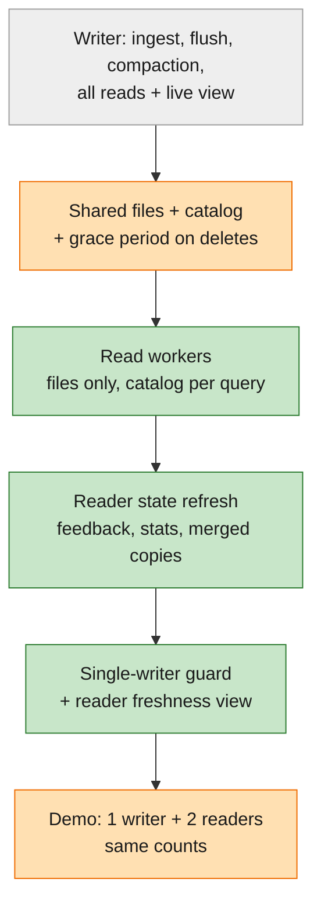

# Feature Specification: M5 — Disaggregated trace database, step 1: read workers over shared storage

**Feature Branch**: `005-m5-disaggregated-trace-db`

**Created**: 2026-11-08 · **Revised**: 2026-11-08 (problems first; then cut to the P0 problems, the rest to the backlog);
2026-11-09 (write and read paths, three freshness points, optional `min_seq` reads, boundary acceptance cases; shared
WAL tail and full disaggregation as researched backlog)

**Status**: Draft. Spec only; implementation not started.

**Input**: User description: "how to move this into a disaggregated database … a new milestone after the compaction
and before the debugging agent … spec and plan, not implementation." Then, after the design discussion: "be a little
bit greedy, push things to the backlog if they're not essential, and only pick up the part that's critical."
The 2026-11-08 design note's claims about today's code are checked in [review.md](review.md); the options other
systems use are in [research.md](research.md). This spec says **what breaks and what must be true**; the plan will
say how.

**Master**: [specs/000-smithling-master-plan](../000-smithling-master-plan/spec.md) (requirements of record) ·
[roadmap](../000-smithling-master-plan/roadmap.md) (progress; this milestone was inserted as M5 and the agents milestone
became M6, [D-036](../000-smithling-master-plan/decisions.md#d-036)). This folder holds the M5 details of record.

**Builds on**: M4 — Follow-through (compaction, threads, export). Spec folder `004-m4-…` is reserved for it. M5
starts after M4's compaction exit check passes, and puts [requirements on M4](#requirements-m5-places-on-m4).
Everything M1–M4 promise stays true in the default one-process mode.

**Delta key**:

| Marker | Fill | Meaning |
|---|---|---|
| 🟢 **New** | green | first built in M5 |
| 🟠 **Improved** | orange | exists from M1–M4; M5 extends or changes it |
| ⚪ **Existing** | grey | built in M1–M4; M5 uses it as is |

**Delivers from master**: the first step of the "cloud split" (D-036): read serving as its own service over shared
storage; constitution Architecture Constraints ("each role MUST be splittable into its own service without changing
its contract").

---

## Goal and why

Let **reads scale on their own**: separate read workers serve queries from the shared files and catalog, while the
writer keeps ingesting as today.

- **M6 is read-heavy.** Agents investigating traces multiply read traffic. Today every query runs on the one process
  that also ingests, so a read burst slows ingestion.
- **The storage side is already shared.** Data files are write-once on local disk or object storage, and the catalog
  is SQLite or Postgres (constitution V). Readers that only read files and the catalog need no new storage or service.
- **Small first.** A full disaggregated trace database (durable log off the writer's machine, a compaction pool,
  writer handoff, sharding) is many changes at once. M5 builds only what the read side needs; the rest is in the
  [backlog](#backlog-with-triggers), each with the condition that brings it back.

### What M5 can and can't be called

| Part | After M5 | Disaggregated? |
|---|---|---|
| Storage | Shared files on object storage, catalog in Postgres | ✅ capacity independent of any machine |
| Read compute | Readers hold no data; add or remove them freely | ✅ scales on its own |
| Write compute | One writer with memtables, a local log and compaction on the same machine | ❌ tied to one machine and its disk |

So M5 is **step 1 of a disaggregated trace database: read workers over shared storage**. More steps follow: the
[backlog](#backlog-with-triggers) items are known and unblocked by M5, but not yet fully specified. The full name
"disaggregated trace database" is earned once B1 (durable log off the writer's machine) and B3 (compaction pool) ship.

## Decisions so far

| Date | Decision | Why |
|---|---|---|
| 2026-11-08 | **Problems drive the design.** Every M5 requirement traces to a problem in [What breaks as we scale](#what-breaks-as-we-scale-the-north-star) | So each design choice has a reason the reader can check |
| 2026-11-08 | **M5 builds only the P0 problems** (P1, P2, P7, P9, plus light versions of P10 and P12); the rest goes to the backlog with triggers | Owner's call: avoid building the whole stack in one shot; take only what's critical for the goal |
| 2026-11-08 | **Readers read published files only**, checking the catalog on every query; they never talk to the writer. Freshness on readers ≤ the writer's flush age (2 min default, configurable) | No reader-to-writer link, and readers can't miss or double-count a run around a flush, because they only ever read whole catalog versions ([research §5](research.md#5-readers-that-read-published-files-only), option A′) |
| 2026-11-08 | **The writer stays a full node**: it ingests, flushes, runs M4 compaction and serves every read, including the live view (~1 s, as today) | Watching a run live keeps M1's freshness; heavy reads move to readers |
| 2026-11-08 | **Single tenant, no sharding.** If sharding comes later, the preferred key is the trace id | Keeps M5 to the split itself; every event already carries its trace id ([research §4](research.md#4-upper-bound-of-one-machine-and-shard-keys)) |
| 2026-11-08 | *Changed the same day*: "a confirmed write survives loss of the writer's machine" (log batch in shared storage before confirming) moves to **backlog B1**. M5 keeps today's guarantee: a confirmed write survives a crash of any process, on the writer's disk | Durability, not read scaling; it's the first follow-up after M5 |
| 2026-11-09 | **Baseline**: one ingest writer, independently scalable readers. The writer confirms after the WAL sync and serves the live view; in the background it uploads immutable files to S3, then publishes the whole set in one Postgres transaction that advances `published_through_seq`. Each reader pins one catalog snapshot per query and reads its files from S3 directly | Matches the M5 decisions above; it names the boundary ([Write and read paths](#write-and-read-paths)) |
| 2026-11-09 | **Freshness is three separate points**: acknowledged, published, observed by a reader. Measure each lag before choosing a target ([OQ-5](#oq-5-freshness-target-for-readers)) | Don't promise a number the code hasn't shown |
| 2026-11-09 | **Fresher readers and machine-loss durability are separate decisions.** A shared WAL tail (B2) is evaluated only if measured publication lag is too slow for readers; replicated WAL (B1) only if acknowledged writes must survive loss of the writer's disk before publication | Neon's boundary: durable WAL and the read path catching up are different problems ([research §7](research.md#7-the-neon-boundary-and-a-shared-wal-tail)) |
| 2026-11-09 | **Full disaggregation is research, not M5**: reads apart from writes (M5), compaction apart from the writer (B3), storage apart from compute (B11) | Heavy; kept as a researched backlog item with triggers |
| 2026-11-09 | **Preferred research direction for B11: an external log as the source of truth** (Rockset, Materialize, Pinot-on-Kafka style). M5 scope unchanged | Owner's preference: decouples writers from publishing and readers, and can reuse an existing log system. Smithling's WAL → flusher → catalog is already this shape inside one process; correctness questions and trade-offs in [research §9](research.md#9-an-external-log-as-the-source-of-truth) |

## What breaks as we scale (the north star)

**Today**: one process on a laptop, about 2M runs, a target of ≥ 20k events/s of writes, one person querying.

**Where we're going**: **10×** today, and **beyond one machine**:

- about 20M runs held;
- about 200k events/s of writes at peak, spread across many projects of one tenant;
- 10× the read traffic, mostly agents investigating traces (M6);
- 30 days of data kept;
- traces that run for several days.

### Upper bound of one machine

Estimated for a 16-core, 64 GB, NVMe machine from M2/M3 measurements ([research §4](research.md#4-upper-bound-of-one-machine-and-shard-keys)).
"Measured" values come from the M2 quickstart and M3 research; the rest are estimates.

| Resource | Ceiling | What hits it |
|---|---|---|
| Number of files | ~680 files (~1.4M runs) before single-run reads miss 50 ms | One file per project per flush; no compaction until M4 |
| Writes | ~30–40k events/s (measured 29.6k–38.6k) | One writer thread does dedup, log, fsync and apply in order |
| Memory | ~100–200M runs held | ~0.3 GB per million runs: merged copies of late-updated runs, per-file state |
| Grouped-query traffic | ~30–40 grouped queries/s | ~0.4–0.6 s of CPU per grouped query at 2M runs |
| Disk | not the limit by count | 0.5–0.9 KB per run on disk |

At 10× on one machine, in order: writes get "busy, retry" all the time; the dedup and project-map windows shrink to
seconds; ~10,000 files push single-run reads to ~0.5 s; merged late-update copies need ~4.6 GB; grouped queries run
out of CPU. M4 compaction handles the files and merged copies; **M5 handles read traffic**; the backlog holds the rest.

### The problems

| # | Today | Breaks when | What a user sees | Where |
|---|---|---|---|---|
| P1 | Writes, queries and compaction share one machine | A read burst competes with ingest | Slower confirmations and slow queries at the same time | **M5 (P0)**, reads only; compaction stays on the writer (B3) |
| P2 | Queries read the writer's memory directly | A second machine serves reads | It can't see anything | **M5 (P0)**: readers read published files only |
| P3 | The live change feed drops changes when a subscriber falls behind | Readers follow the feed | Missing runs, no way to catch up | Not needed in M5 (readers don't follow the feed); B2 |
| P4 | The write log is deleted right after each flush | Anything other than the writer needs the log | Nothing to replay from | Not needed in M5; B1, B2 |
| P5 | A write is confirmed once it's on the writer's local disk | That disk or machine is lost | Up to one flush of confirmed steps lost | **Backlog B1** (first follow-up) |
| P6 | One "covered through N" number (`flushed_seq`), used only in-process | Readers combine files with unflushed data, or a caller needs a particular write | Runs missing or counted twice around a flush; no way to wait for a write | **M5 (light)**: stored per snapshot as `published_through_seq` and reported by readers; optional `min_seq` reads. Combining with unflushed data is B2 |
| P7 | A query holds its files with in-memory references | Compaction (on the writer) replaces files a reader is using | A reader's query fails mid-way | **M5 (P0)**: grace period + query time limit |
| P8 | Startup deletes any file not in the catalog | Several services upload to the same storage | One service deletes another's upload | Not needed in M5 (only the writer uploads); B3 |
| P9 | Feedback, field stats and merged copies are loaded once at startup | Readers run for days | Stale or wrong answers until a restart | **M5 (P0)** |
| P10 | Ownership is implicit: there's only one writer | A second writer is started on the same store | Two writers, the catalog and files get corrupted | **M5 (light)**: a second writer refuses to start. Handoff is B4 |
| P11 | One writer takes all writes (~30–40k events/s) | Total writes pass one writer's limit | "Busy" for every project | **Backlog B5** |
| P12 | Health exists only inside one process | A reader falls behind or fails | Nobody notices | **M5 (light)**: reader freshness in `/healthz` and a UI panel. Full cluster page is B6 |
| P13 | A long trace is spread across many flushed files | Traces run for days with constant updates | Opening a trace gets slower each day | **M4** compaction |
| P14 | The dedup window is a count (1M keys ≈ 1 min at 20k events/s) | Write rate grows | An SDK retry is stored twice | **Backlog B7** (write-rate problem on one writer) |
| P15 | The run → project map is a count (~917k runs ≈ 50 s at 20k events/s) | Write rate grows, or updates come late | Late updates lose their project; slow lists (D-024) | **Backlog B7** |

## Delta at a glance

| | Part | Before M5 (M1–M4) | What M5 changes | Problems |
|---|---|---|---|---|
| 🟢 | Deployment shape | one process runs every role | `smithling serve --role reader` runs a read worker; the default still runs everything | P1, P2 |
| 🟢 | Read workers | none | serve every read API from published files, checking the catalog on each query | P2 |
| 🟢 | Reader state | loaded once at startup, updated in-process at each flush | rebuilt or updated when the catalog version changes | P9 |
| 🟠 | File deletion | in-process references keep files a query uses | replaced files also kept for a grace period; reader queries have a time limit | P7 |
| 🟢 | Writer guard | implicit | a second writer on the same store refuses to start | P10 |
| 🟢 | Freshness view | none | each reader reports its catalog version and how far behind it is | P12 |
| 🟠 | `published_through_seq` | `flushed_seq`, in the catalog `state` row, read only by the writer | part of each catalog snapshot; every reader answer says which one it used | P6 |
| 🟢 | `min_seq` reads (optional) | none; confirmations don't return a seq | confirmations return `seq`; read APIs take `min_seq` + a deadline and may answer "still publishing" | P6 |
| ⚪ | Writer, write log, flush, compaction, live view, data files, query language, UI views | M1–M4 | unchanged | — |

## Write and read paths

### Write path (one writer)

| # | Step | Today | M5 |
|---|---|---|---|
| W1 | Validate, dedup, number each event with a rising `seq` | ⚪ `writer.rs` | — |
| W2 | Append to the WAL; one fsync per group of waiting requests (group commit, no fixed wait) | ⚪ `wal.rs`, `writer.rs` | — |
| W3 | Apply to the memtable and the live hub; **confirm** | ⚪ | 🟢 the confirmation returns the batch's highest `seq` (for `min_seq`) |
| W4 | In the background, at the flush age (2 min) or when the memtable is full: write immutable Parquet files and sidecars to storage (S3 or a folder) | ⚪ `flush.rs` | — |
| W5 | **Publish**: one catalog transaction registers the whole set and advances `published_through_seq` to the frozen memtable's highest `seq` | ⚪ as `flushed_seq` (one flusher, in `seq` order, so contiguous) | 🟠 also bumps `catalog_version` and checks the writer lease (KD-2, KD-7) |
| W6 | Trim the WAL up to `published_through_seq` | ⚪ | — |
| W7 | Compaction swaps files in one guarded transaction; replaced files deleted after the grace period | ⚪ M4 `compact.rs` | 🟠 the swap bumps `catalog_version`; `published_through_seq` doesn't move |

### Read path (each read worker, each query)

| # | Step | Today | M5 |
|---|---|---|---|
| R1 | Look up the newest snapshot: `catalog_version`, `published_through_seq`, the active file set | — (the writer reads its own memory) | 🟢 one lookup per query (KD-2) |
| R2 | **Pin** that snapshot for the whole query; refresh reader state to it if it's new (field stats, multi-version runs, merged copies, feedback) | — | 🟢 KD-3, KD-4, KD-5 |
| R3 | Read only the pinned files, straight from S3 (cached footers and pages); never list storage | ⚪ the writer reads files the same way | 🟢 files are found only through the catalog |
| R4 | Merge each run's versions to its latest values, *then* filter, group and count | ⚪ the writer's rule (D-023, D-029) | 🟢 the same rule on readers, from files alone (KD-4) |
| R5 | Answer, saying which `published_through_seq` it used; stop at the query time limit | — | 🟢 FR-15; time limit (KD-6) |

### Freshness: three points, measured separately

For one event with sequence number `s`:

| Point | True when | Tracked where | Lag to measure |
|---|---|---|---|
| **Acknowledged** | its WAL group is fsynced and the confirmation sent; the writer's live view and queries see it | writer memory (last `seq`) | request → confirmation (group commit) |
| **Published** | `published_through_seq ≥ s` in the catalog | catalog `state` (today's `flushed_seq`) | confirmation → publish: up to the flush age plus flush time |
| **Observed** by reader *r* | *r* pins a snapshot with `published_through_seq ≥ s` | reader memory and its check-in row (KD-10) | publish → first query on *r* that pins it, including state refresh |

What each reader is promised:

| Reader | Sees a confirmed write | Guarantee |
|---|---|---|
| ⚪ Writer live view | within ~1 s, from memory | Sees its own writes; a subscriber that falls behind may miss changes (P3) |
| ⚪ Writer queries | at confirmation | Read-your-writes on the writer |
| 🟢 Read worker | once published and observed | One whole snapshot per query (never partial); staleness ≤ flush age + one catalog check + refresh (FR-08); says which `published_through_seq` it answered from |
| 🟢 Read worker with `min_seq = s` (optional) | only from a snapshot with `published_through_seq ≥ s` | Waits up to the caller's deadline, then answers **"still publishing"** with the `seq` it has reached. Never an answer that is silently stale |
| 🟢 Feedback on a read worker | at the next `catalog_version` | Feedback isn't numbered with `seq` (D-027), so `min_seq` doesn't cover it ([OQ-8](#oq-8-feedback-and-min_seq)) |

The proposal's "one-second WAL group-commit interval" is treated as a **ceiling on acknowledgment lag**, not a wait:
today's writer already fsyncs as soon as the previous fsync ends ([OQ-7](#oq-7-group-commit-interval)).

### What already exists and what M5 adds

| Piece | Status | Where |
|---|---|---|
| WAL with group commit; confirm after fsync | ⚪ exists | `crates/ingest/src/wal.rs`, `writer.rs` |
| Live view from the writer's memory | ⚪ exists | `crates/ingest/src/hub.rs`, `crates/server/src/routes/tail.rs` |
| Files uploaded before one catalog transaction; idempotent retry; orphans deleted at start | ⚪ exists | `crates/ingest/src/flush.rs` |
| Contiguous "published through" number | ⚪ exists as `flushed_seq` | `flush.rs`, `memtable.rs` |
| S3 + Postgres storage and catalog, tested in CI | ⚪ exists | `crates/storage`, `.github/workflows/ci.yml` (MinIO + Postgres) |
| Guarded compaction swap, grace-period deletes | ⚪ exists (M4) | `crates/ingest/src/compact.rs` |
| Merge before filter, on the writer | ⚪ exists | D-023, D-029; `query/src/scan.rs`, `fields.rs` |
| `catalog_version`; `published_through_seq` per snapshot | 🟢 M5 | KD-2, KD-13 |
| Read workers that pin a snapshot and read S3 directly | 🟢 M5 | KD-1, KD-3 |
| Multi-version runs known from files alone | 🟢 M5 | KD-4 |
| Cross-process pin: grace period + reader query time limit | 🟢 M5 | KD-6 |
| Writer lease checked at publish | 🟢 M5 | KD-7 |
| The three freshness lags measured and reported | 🟢 M5 | SC-02, FR-15 |
| `seq` in confirmations; `min_seq` reads; "still publishing" | 🟢 M5, optional (may be deferred) | KD-14 |
| Shared WAL tail for readers | Backlog B2 (research) | KD-16 |
| Replicated WAL (survives loss of the writer's disk) | Backlog B1 | KD-17 |
| Compaction pool; storage and compute fully apart | Backlog B3, B11 (research) | research §7 |

## End state

*Capability first; the Example under it is the scenario we use to prove it.*

- 🟢 As an **operator**, I can start read workers from the one `smithling` binary, pointed at the writer's storage and
  catalog, and get the same answers as the writer once the data is in files. (P1, P2)
  - *Example*: 1 writer + 2 readers on one machine (shared folder + Postgres) and on cloud-style storage:
    `smithling demo` against a reader passes every M2–M4 check with identical counts.
- 🟢 As an operator, I can add, stop or restart read workers at any time without touching the writer. (P1)
  - *Example*: start a third reader during the demo load; it serves the 14 / 23 / 31 checks.
- 🟢 As an **agent** or **agent developer**, I can send heavy queries to readers and see data at most one flush age
  old (2 min by default), with feedback and field statistics as current as the files. (P2, P9)
- ⚪ As an agent developer, I can still watch a running trace live on the writer, within ~1 s as today.
- 🟢 *(Optional)* As an agent, I can ask a reader for an answer that includes my own write (`min_seq` from the
  confirmation) and get either that answer or an explicit "still publishing" by my deadline. (P6)
- 🟠 As an agent developer, my long queries on a reader finish correctly even while compaction replaces files. (P7)
- 🟢 As an operator, I can't accidentally start a second writer on the same store. (P10)
- 🟢 As an operator, I can see in the browser and in `/healthz` how far behind each reader is. (P12)
- 🟠 As a **maintainer**, I can trust this stays true: CI runs the 1 writer + 2 readers demo and the problem demos.

## Lifecycle of one run in M5

The `fetch_url` step from the scenario, with 1 writer and 2 readers.

| # | | What happens | Problems |
|---|---|---|---|
| 1 | ⚪ | The SDK uploads the step to the writer; it is logged, confirmed and visible on the writer's live view within ~1 s. | — |
| 2 | ⚪ | Within the flush age, the writer flushes it to files and publishes them in one catalog commit. | — |
| 3 | 🟢 | An agent queries reader 2. The reader sees the catalog has a newer version, picks up the new files, and refreshes its state (feedback, field stats, merged copies of late-updated runs). The step is in the answer. | P2, P9 |
| 4 | 🟠 | The writer's compaction merges that file with older ones. A long query on reader 1 still reads the old files; they stay for the grace period. | P7 |
| 5 | 🟢 | The operator checks the readers' freshness panel: both are on the newest catalog version. | P12 |

## User Scenarios & Testing *(mandatory)*

### 🟢 User Story 1 - Readers give the same answers as the writer (Priority: P1)

**Fixes**: P1, P2.

An operator starts read workers pointed at the writer's storage and catalog, and queries them exactly as before.

**Why this priority**: the definition of the milestone.

**Independent Test**: start 1 writer and 2 readers; load the scenario; wait until the writer has flushed and both
readers are on the newest catalog version; run `smithling demo` against each reader. Every check passes with the same
numbers as the writer and as one-process mode, on local shared storage and on cloud-style storage.

**Acceptance Scenarios**:

1. **Given** the scenario is loaded and flushed, **When** any read query (list, trace, run, search, aggregate, field suggestions) is sent to a reader, **Then** it returns the same result as the writer.
2. **Given** a step confirmed but not yet flushed, **When** a reader is queried, **Then** the step is absent (not partly present), and it appears once the flush is published.
3. **Given** `smithling serve` with no role option, **When** it starts, **Then** it runs every role in one process as today, makes no outbound connections, and passes every M1–M4 check unchanged.
4. **Given** a write request sent to a reader, **When** it arrives, **Then** it is refused with a message naming the writer's role.
5. **Given** a reader's catalog is SQLite on another machine's disk, **When** it starts, **Then** it refuses with a message that split mode needs a shared catalog (Postgres), or a SQLite file on a shared local folder for one-machine tests.

---

### 🟢 User Story 2 - Readers stay current without restarts (Priority: P1)

**Fixes**: P2, P9.

A reader running for days keeps up with new files, feedback and statistics.

**Why this priority**: a reader that needs restarts to see new data isn't a usable read worker. Merged copies of
late-updated runs (D-023, D-029) must follow new files, or answers go wrong, not just stale.

**Independent Test**: run a reader for the length of the demo load with late updates arriving; after every flush,
compare its answers with the writer's for the same catalog version; they match. Send feedback; it shows on the reader.

**Acceptance Scenarios**:

1. **Given** the writer publishes a new catalog version, **When** the next query reaches a reader, **Then** the reader answers from that version (or the one before it, if it's still loading the new one, and says which).
2. **Given** a late update flushed into a new file for a run whose start is in an older file, **When** a reader is queried, **Then** the run shows its merged latest values, same as the writer.
3. **Given** new feedback stored in the catalog, **When** a reader is queried after its next catalog check, **Then** the feedback is filterable and averaged there.
4. **Given** compaction replaced files, **When** a reader picks up the new version, **Then** its field counts and merged copies equal the writer's, with nothing counted twice.

---

### 🟠 User Story 3 - Long reader queries survive compaction (Priority: P2)

**Fixes**: P7.

A reader's query keeps reading the files of the catalog version it started on, even if compaction on the writer
replaces them.

**Why this priority**: M4 protects queries with in-process references; readers in other processes don't have them.

**Independent Test**: run reader queries that last minutes across 100 compaction swaps on the writer; each returns
the same answer as without compaction; no file is deleted before its grace period ends.

**Acceptance Scenarios**:

1. **Given** a reader query started on catalog version V, **When** compaction replaces V's files, **Then** the query finishes with V's answer.
2. **Given** replaced files, **When** the grace period has passed, **Then** the writer deletes them; not before.
3. **Given** a reader query that runs past its time limit, **When** the limit is hit, **Then** it fails with "query took too long, retry" and never reads a deleted file.

---

### 🟢 User Story 4 - Only one writer per store (Priority: P2)

**Fixes**: P10 (light).

A second writer started by mistake on the same storage and catalog refuses to start.

**Why this priority**: with readers and a writer configured separately, pointing two writers at one store becomes an
easy mistake that corrupts the catalog.

**Independent Test**: start writer A; start writer B on the same store; B exits with a message naming A. Kill A; B can
start once A's lease has expired; then wake a paused A: its next catalog publish is rejected.

**Acceptance Scenarios**:

1. **Given** a running writer, **When** a second writer starts on the same store, **Then** it refuses with a message naming the running one.
2. **Given** the writer was killed, **When** its lease expires, **Then** a new writer can start and recovers from the log as today.
3. **Given** a writer that was paused past its lease and a new writer took over, **When** the old one tries to publish, **Then** the publish is rejected and the old writer stops.

---

### 🟢 User Story 5 - See how current each reader is (Priority: P3)

**Fixes**: P12 (light).

An operator sees each reader's catalog version and how far behind the writer it is, in the browser and in `/healthz`.

**Why this priority**: constitution IV (UI first); a reader that silently falls behind gives old answers.

**Independent Test**: stop the writer's flushes (or block a reader's catalog access); within one catalog check the
reader shows itself behind, with the age of its newest data.

**Acceptance Scenarios**:

1. **Given** a reader, **When** `/healthz` or the UI's status panel is opened on it, **Then** it shows its role, the catalog version it serves, the age of its newest data, and whether it's current.
2. **Given** the writer's UI, **When** the status panel opens, **Then** it lists the readers that have checked in recently with the same fields.

---

### 🟢 User Story 6 - Wait for a particular write on a reader (Priority: P3, optional)

**Fixes**: P6 (light).

An agent that just wrote a step asks a reader for an answer that includes it, and is told plainly if the reader
isn't there yet.

**Why this priority**: useful for agents that write then investigate, but readers already say which
`published_through_seq` they used. It can be deferred by decision without changing anything else in M5.

**Independent Test**: confirm a batch and keep its `seq`; query a reader with `min_seq = seq` and a 5 s deadline
before the flush (answer: "still publishing"), then with a deadline past the next flush (answer includes the step).

**Acceptance Scenarios**:

1. **Given** a confirmation, **When** it returns, **Then** it carries `seq`, the highest sequence number given to the batch; a batch that was all duplicates carries the writer's current confirmed `seq` (a safe upper bound).
2. **Given** a read with `min_seq = s` on a reader whose snapshot has `published_through_seq ≥ s`, **When** it runs, **Then** it answers at once from that snapshot.
3. **Given** a reader behind `s`, **When** the read's deadline passes before a snapshot reaches `s`, **Then** it returns "still publishing" with the `published_through_seq` it reached and no rows.
4. **Given** the same read sent to the writer, **When** it runs, **Then** it answers at once (every confirmed `seq` is in its memory).
5. **Given** a read without `min_seq`, **When** it runs, **Then** it behaves exactly as US1.

---

### Acceptance cases at the write/read boundary

The three cases the baseline must survive. Each runs as a multi-process test on MinIO + Postgres in CI (SC-11).

**Case A: the upload succeeds, the catalog publish doesn't.** (US1, US4; FR-05, FR-10, FR-13, FR-14)

1. **Given** the writer has uploaded flush F's files for `seq` (N, M] and the catalog still says `published_through_seq = N`, **When** the writer is killed before the publish transaction, **Then** every reader keeps answering from snapshots ≤ N, never reads F's files, and a `min_seq = M` read returns "still publishing".
2. **Given** that state, **When** the writer restarts, **Then** it replays the WAL past N, publishes (N, M] in one transaction, deletes F's orphan files, and readers' next queries give counts equal to one-process mode; nothing counted twice.
3. **Given** the publish landed but its reply was lost, **When** the writer retries, **Then** the retry is "already committed" and nothing is registered twice.
4. **Given** the writer lost its lease between upload and publish, **When** it tries to publish, **Then** the transaction is rejected, the writer stops, and its files stay invisible until the new writer removes them.

- *Exists*: files before the transaction, idempotent retries, orphan removal at start (`flush.rs`). *M5 adds*: readers that find files only through the catalog, the lease check, `published_through_seq` per snapshot, the cross-process test.

**Case B: a reader pinned across compaction.** (US3; FR-05, FR-09)

1. **Given** a reader query pinned to snapshot V and reading from S3, **When** the writer's compaction swaps V's files and later flushes publish V+1, V+2, **Then** the query reads only V's files and finishes with V's answer.
2. **Given** the swapped-out files, **When** less than the grace period (24 h) has passed since the swap, **Then** they are still in storage; the reader query time limit (1 h) is shorter than the grace period.
3. **Given** the next query on that reader, **When** it pins the newest snapshot, **Then** it reads the compacted files and gets the same counts as before compaction for the same `published_through_seq`.
4. **Given** a query running past the time limit, **When** the limit is hit, **Then** it fails with "query took too long, retry"; it never reads a deleted object.

- *Exists*: guarded swap, `replaced_at`, 24 h grace and in-process holds (`compact.rs`). *M5 adds*: the pin across processes (grace + time limit only, since in-process holds don't reach readers), reader state rebuild after removals (KD-3).

**Case C: a late span update changes whether a query matches.** (US2; FR-06, FR-17)

Run R started in published file F1 as `status = running`. A late update setting `status = error` and its end time is confirmed as `seq = s`.

1. **Given** a snapshot with `published_through_seq < s`, **When** `status = running` and `status = error` are queried, **Then** R matches the first only.
2. **Given** a snapshot with `published_through_seq ≥ s` (the update in a new file F2, or merged into a compacted file), **When** the same queries run, **Then** R matches `status = error` only: never both, never neither, and it is counted once in aggregates and field counts.
3. **Given** the writer, **When** the same queries run right after the confirmation, **Then** R already matches `status = error`.
4. **Given** a reader with `min_seq = s`, **When** it answers, **Then** R matches `status = error`.

- *Exists*: merge-before-filter on the writer (D-023, D-029), `needs_merge` rows, compaction merges. *M5 adds*: readers that know multi-version runs from files alone (KD-4); a property test over random late updates and flush timing. A future WAL tail (B2) must keep the same rule: merge tail updates onto snapshot rows before filtering.

---

### Edge Cases

- A trace whose root finishes last, after days: readers show it as running until the flush that carries the root's end, then finished.
- A reader starts on a store of 2M runs: it serves only after loading the newest catalog version and its state, and says so meanwhile.
- The catalog is briefly unreachable: readers keep serving their last version and report themselves behind.
- Shared storage is slow: reader queries slow down; nothing incorrect is returned.
- The writer is down: readers keep serving the last published version; writes fail until a writer is back.
- A reader is asked for the live view: it serves its last version and points to the writer for live data.
- Services run different versions: a reader refuses to serve a store whose format it doesn't understand, with a message.

## Requirements *(mandatory)*

Each requirement names the problem it fixes.

### Functional Requirements

**Deployment shape**

- 🟢 **M5-FR-01** (P1; constitution I, Arch. Constraints): The one `smithling` binary MUST be able to run as a read worker; running every role in one process MUST stay the default and behave exactly as M4.
- 🟢 **M5-FR-02** (constitution III, V): Adding read workers MUST be a configuration change only; in one-process local mode Smithling MUST still make zero outbound connections.
- 🟢 **M5-FR-03** (P2): Read workers MUST find everything they serve through the shared catalog and storage; they MUST NOT contact the writer.
- 🟢 **M5-FR-04**: Read workers MUST refuse write requests, and the writer's role MUST be named in the refusal.

**Reading**

- 🟢 **M5-FR-05** (P2): Read workers MUST serve every read API from one published catalog version per query, checking for a newer version at the start of each query.
- 🟢 **M5-FR-06** (P2): A reader's answer MUST equal the writer's answer for the same catalog version, over files only (data not yet flushed is absent, never partial).
- 🟠 **M5-FR-07** (P9): Feedback, field statistics, merged copies of late-updated runs and other state loaded from the catalog or files MUST follow each new catalog version, including compaction swaps, without a restart.
- 🟢 **M5-FR-08** (P2): Freshness on readers MUST be at most the writer's flush age plus one catalog check, and the flush age MUST stay configurable (2 min default).
- 🟠 **M5-FR-13** (P6): Each catalog snapshot MUST carry `catalog_version` and `published_through_seq`, both advanced in the transaction that registers files; every event with `seq ≤ published_through_seq` MUST be in the snapshot's files.
- 🟢 **M5-FR-14** (P2, P8): Read workers MUST find files only through the pinned snapshot, never by listing storage, so files uploaded but not published are never read.
- 🟢 **M5-FR-15** (P6, P12): Every reader answer MUST say the `published_through_seq` it used; the writer MUST report its confirmed `seq` and `published_through_seq`, so the three lags (acknowledged, published, observed) can be measured.
- 🟠 **M5-FR-17** (P2): Readers MUST apply each run's merged latest values before filtering, grouping or counting, as the writer does.

**Waiting for a write (optional; may be deferred by decision)**

- 🟢 **M5-FR-16** (P6): Confirmations MUST return `seq`; read APIs MUST accept `min_seq` and a deadline, and MUST answer only from a snapshot with `published_through_seq ≥ min_seq` or return "still publishing" with the reached `seq`.

**Deletion safety**

- 🟠 **M5-FR-09** (P7): Files replaced by compaction MUST stay readable for a grace period, and reader queries MUST have a time limit shorter than it.

**Writer guard**

- 🟢 **M5-FR-10** (P10): The writer MUST hold a lease in the catalog; a second writer MUST refuse to start while it is valid, and every catalog publish MUST be checked against the current lease so a writer that lost it stops.

**Visibility and verification**

- 🟢 **M5-FR-11** (P12; constitution IV): Each reader MUST report its role, catalog version, age of its newest data and whether it's current, in `/healthz`, the API, the command line and a UI status panel; the writer's panel MUST list recently seen readers.
- 🟠 **M5-FR-12** (constitution VI): CI MUST run the 1 writer + 2 readers demo and the problem demos for P2, P7, P9 and P10; the crash harness MUST keep passing for the writer; readers MUST be killable at any moment without effect on the writer or on stored data.

### Requirements M5 places on M4

So that compaction can later become its own service (backlog B3) without rework:

- **M4-REQ-1**: Compaction MUST take its inputs from the catalog and the files only, not from the writer's memory (for example, which runs need merging comes from the files' `needs_merge` rows).
- **M4-REQ-2**: A compaction swap MUST be one catalog commit that fails if any input is no longer current and keeps files published meanwhile ([research §3](research.md#3-catalog-cleanup-and-fencing)).
- **M4-REQ-3**: Replaced files MUST be deleted after a grace period, not only when in-process references drop.
- **M4-REQ-4**: Compaction MUST run against cloud-style storage (MinIO + Postgres) in CI.

### Key Entities

- **Writer**: the one process that ingests, flushes, compacts and publishes. Holds the lease.
- **Read worker**: a process that serves reads from published files and the catalog only.
- **Catalog version**: a consistent published file set, with feedback and statistics, at one point in time. Each query uses one.
- **Writer lease**: a catalog row naming the current writer, with an expiry and a number that rises on each new writer.
- **Grace period**: how long replaced files stay readable; longer than the reader query time limit.
- **Reader status**: per reader, its catalog version, the age of its newest data, whether it's current, when it last checked in.
- **`published_through_seq`**: the highest `seq` N such that every event with `seq ≤ N` is in published files. Today's `flushed_seq`.
- **Snapshot**: what a query pins: `catalog_version`, `published_through_seq` and the active file set.
- **Freshness points**: acknowledged (WAL synced, confirmed), published (in the catalog), observed (pinned by a reader).

## Success Criteria *(mandatory)*

### Measurable Outcomes

- 🟢 **SC-01** (P1, P2): With 1 writer and 2 readers, `smithling demo` against each reader passes every M2–M4 check with counts identical to one-process mode, on local shared storage and on cloud-style storage.
- 🟢 **SC-02** (P2, P6): At the bench write load, the three lags (request → acknowledged, acknowledged → published, published → observed on a reader) are measured and reported as P50/P99. The reader freshness target is chosen after that ([OQ-5](#oq-5-freshness-target-for-readers)); FR-08's bound holds meanwhile.
- 🟢 **SC-03** (P1): With 2 readers taking the read load, the writer's confirmation P99 under the bench write load stays within 10% of its value with no reads; read throughput with 2 readers is ≥ 1.7× one reader's.
- 🟢 **SC-04** (P9): Across a full demo load with late updates and compaction, readers' answers equal the writer's at every catalog version checked (zero mismatches).
- 🟠 **SC-05** (P7): Reader queries across 100 compaction swaps return the same answers as without compaction; zero queries fail from a missing file.
- 🟢 **SC-06** (P10): 100% of attempts to start a second writer on a store with a valid lease are refused; a writer that lost its lease publishes nothing more.
- 🟢 **SC-07**: A new reader on a store of 2M runs serves within 60 s.
- 🟢 **SC-08** (P12): A reader that falls behind shows as behind within one catalog check.
- ⚪ **SC-09**: All M1–M4 success criteria still pass in one-process mode.
- 🟢 **SC-10** (P6, optional with FR-16): 100% of `min_seq` reads either answer from a snapshot with `published_through_seq ≥ min_seq` or return "still publishing" within the deadline + 1 s; zero stale answers.
- 🟢 **SC-11**: Boundary cases A, B and C pass as multi-process tests on MinIO + Postgres in CI.

### Problem demos

One demo per P0 problem: show it breaking, then show M5 fix it. The plan wires these into `smithling demo` and CI.

| # | Show it breaking (M4) | Show it fixed (M5) | Pass check |
|---|---|---|---|
| P1 | Heavy grouped queries while ingesting at full rate, one process | Same queries on readers | Writer confirmation P99 within 10% of no-read baseline |
| P2 | A second `serve` on the same storage either can't start or serves stale, unmerged data | `--role reader` | Same counts as the writer after flush |
| P7 | A long query in a second process while the writer's compaction replaces its files | Grace period | Same answer; zero missing-file errors |
| P9 | Send feedback and a late update; a second process started earlier doesn't show them | Reader refresh | Shown after the next flush |
| P10 | Start two writers on one store; both write | Lease | Second refused; old writer's publish rejected |
| P12 | Block a reader's catalog access; nothing shows it | Freshness panel | Shown as behind within one check |

## Open questions

Kept here until decided. Decisions move to [Decisions so far](#decisions-so-far) and the roadmap.

### OQ-1: Constitution II — record the files-only read path as a staged difference?

SmithDB queries the ingestion node for fresh data ([research §2](research.md#2-fresh-data-read-path)); M5 readers
read files only. Proposed: record it as Principle II (c), "deliberately staged: simpler first", with backlog B2
(readers see unflushed data) as the SmithDB-equivalent and its trigger. Confirm at the plan's Constitution Check.

### OQ-2: Grace period and reader query time limit

Starting values from Iceberg and Delta practice ([research §3](research.md#3-catalog-cleanup-and-fencing)): grace
period 24 h, reader query time limit 1 h; exports longer than that need another way (backlog). Confirm or change.

### OQ-3: Catalog check per query: lookup or notification?

Each query checks the catalog for a newer version. Options: one indexed lookup per query (Quickwit style), or
Postgres LISTEN/NOTIFY with a lookup fallback. Plan-level; the spec only requires FR-05 and FR-08.

### OQ-4: Reader state refresh cost

Rebuilding merged copies of late-updated runs and per-file statistics on every new catalog version may be slow at
2M runs (M3-R4 measured 9 s uncached for 203k multi-version runs). Options: update incrementally per new file (as the
writer does today at each flush), or rebuild in the background while serving the previous version. Plan-level, but
it decides whether SC-02 and SC-04 hold together.

### OQ-5: Freshness target for readers

Measure first (SC-02): with a 2 min flush age, publication lag is up to ~2 min; observation adds one catalog check
and the state refresh (OQ-4). Then pick the target: keep the flush age, shorten it (research §5 option B, more small
files and compaction), or open B2. Decide after U6.

### OQ-6: Shape of the `min_seq` contract

Proposed (KD-14): `?min_seq=&wait_ms=` on every read API, `wait_ms` capped (30 s); "still publishing" as HTTP 503
with `Retry-After` and a body naming the reached `seq`. Open: the cap; whether exports and live streams accept it;
whether to ship FR-16 in M5 or defer it.

### OQ-7: Group commit interval

The proposal names a one-second group-commit interval. Today's writer has no fixed wait: requests that queue during
one fsync go into the next (`writer.rs`), so confirmations usually take one fsync. Proposed (KD-15): keep that, and
treat 1 s as the ceiling for acknowledgment P99 in SC-02 rather than a wait added to every write.

### OQ-8: Feedback and `min_seq`

Feedback is written straight to the catalog without a `seq` (D-027), so `min_seq` can't wait for it. Options: return
`catalog_version` from feedback writes and accept `min_version` too; or leave feedback out of the contract. Proposed:
leave it out in M5, note it in the API contract.

## Backlog with triggers

Everything below was in the full M5 design and is deferred on purpose. Each item says what brings it back. The
reasoning and options stay in [research.md](research.md).

| # | Item | Problems | Trigger to pick it up | Starting design (research) |
|---|---|---|---|---|
| B1 | **Replicated WAL: durable log off the writer's machine**: log batch in shared storage (or a quorum of log nodes) before confirming; optional fast-confirm mode | P5 | Acknowledged writes must survive loss of the writer's disk before publication. A separate decision from B2: fresher readers don't need it and it doesn't make readers fresher | Log batches created only if absent, ownership number in the catalog (§1, option 2); Neon safekeepers (§7) |
| B2 | **Readers see unflushed data through a shared WAL tail** | P3, P4, P6 | Measured publication lag (SC-02) is slower than readers need, e.g. `min_seq` reads often answer "still publishing", or agents investigate runs still in progress | A query reads snapshot N plus committed WAL records in (N, U], U fixed at query start, and merges span updates onto snapshot rows before filtering or aggregating (§7). Where the tail comes from (the writer, or a shared log from B1) is the main open question. Earlier options: shorter flush, narrow live path, ask the writer (§2, §5) |
| B3 | **Compaction as its own service pool** | P1 (compaction part), P8 | Compaction measurably slows ingest on the writer, or needs more than one machine | Inputs from the catalog only, guarded swap, grace-period delete, pending-upload rows and ownership number in file names (§3); needs M4-REQ-1–4 |
| B4 | **Writer handoff and full fencing** (planned move, automatic takeover) | P10 | The writer must be replaced without an operator, or with < 1 min of write downtime | Lease row with ownership number checked in every commit (§3) |
| B5 | **Sharding** (several writers) | P11 | Sustained writes near one writer's ~30–40k events/s | Trace-id hash; small projects on a few shards (§4) |
| B6 | **Full cluster page** (backlogs, positions, pending deletions) and the scaling bench rows | P12 | More than one writer or a compaction pool exists | — |
| B7 | **Time-based dedup and project-map windows** | P14, P15 | Write rate near 10× today, or late updates older than the map's window seen in the scenario. Could land in M4 | Time windows instead of count caps (review item 8) |
| B8 | **Tenants**: what a tenant is, isolation, limits; tenant id on data | — | A second tenant, or per-tenant limits needed | Options A–C (§6) |
| B9 | **Queries across projects** (rollups, comparisons, search everywhere) | — | Users ask for "all my agents" views | §6; with trace-id sharding these cost the same as one-project queries |
| B10 | **Long exports past the query time limit** | P7 | Exports need more than the reader time limit | Explicit hold rows with expiry (§3) |
| B11 | **Research: the fully disaggregated end state.** Reads apart from writes (M5), compaction apart from the writer (B3), storage apart from compute. **Preferred direction: an external log as the source of truth**, which would deliver B1 (durable ack) and B2 (log tail) together, with indexers, compactors and readers as consumers | P1, P5, P8, P11 | After M5's measurements, and before planning any of B1–B4. Research only: produces a design note and a revised order, not code | Landscape (§8); external log, correctness questions L1–L10 and log options (§9); Neon comparison (§7) |

## Assumptions

- **Order**: M4 (compaction in the writer process, meeting M4-REQ-1–4) is built first. The agents milestone (Claude Code import, agent tools) is M6.
- **One binary, roles by configuration** (constitution I). Split mode needs a shared catalog database (Postgres) and shared storage (a folder all processes see, or object storage). SQLite works only when all processes share one machine's folder, for tests.
- **Freshness on readers is bounded by the flush age** (2 min default) until measured (OQ-5). Agents investigating recorded traces can work with that; watching a run live stays on the writer; `min_seq` makes the wait explicit.
- **Readers keep a cache** of file footers and pages, as the writer does (32 MB default, configurable); on object storage they'll likely want more, since every footer read is a request.
- **Durability is unchanged from M4**: a confirmed write survives any process crash, on the writer's disk (B1 for machine loss).
- **Trust boundary**: services run on a private network or localhost; no service-to-service authentication in M5. Defaults still bind to localhost.
- **Same version everywhere**: mixed versions are out of scope; a mismatched reader refuses to serve.
- **Performance priority** ([D-033](../000-smithling-master-plan/decisions.md#d-033)): correctness first; SC-02, SC-03 and SC-07 are measured and reported, and may be deferred by decision.
- **Agent debugging** (recorded-trace investigation vs live stepping) is M6's question.
- **Out of scope for M5**: everything in the backlog above, plus autoscaling, multi-region and the hosted product.
